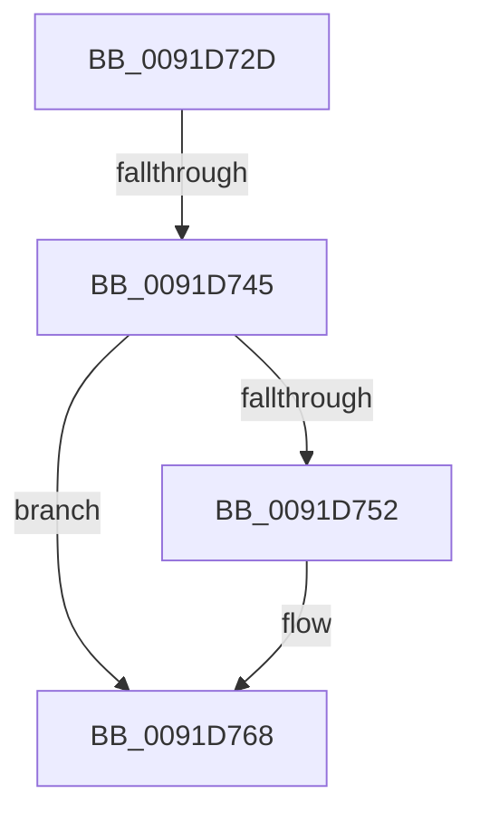

# sub_0091D72D

- RVA: `0x0091D72D`–`0x0091D772` (길이 `69` bytes)
- VA: `0x000000014091D72D`
- 실행 섹션: `PAGE`
- PDB 이름 있음: `아니요`; PDB Function 태그: `아니요`
- unwind 정보 RVA: `0x0008B288`
- 디코드: `18`개 명령, `69/69` bytes 표시
- 미해석 바이트: `0` (있으면 어셈블리에 `.byte`로 보존)

> 이 문서는 커널 이미지의 기계어와 PDB 기호를 분석해 생성했습니다. 4번과 5번은 함수 원형과 자료형을 바이너리 사용 방식에서 추정한 C 해석이며 원본 소스 복구 결과는 아닙니다.

## 1. Dependencies

- 직접 호출 지점: **2**; 고유 호출 대상: **2**
- 직접 호출자로 확인된 함수: **0**
- RIP 상대 이미지 참조: **0**

### Outgoing calls
- `0x0091D738` → [ExAllocatePool2](../../poolcode/B8/ExAllocatePool2_function_00B820F0.md) (function, `0x00B820F0`)
- `0x0091D763` → [memcpy](../../text/6C/memcpy_function_006C6840.md) (function, `0x006C6840`)

### Direct callers
- 이 함수 시작 RVA로 연결되는 직접 call은 확인되지 않았습니다. 간접 호출은 완전히 역산할 수 없습니다.

### Static image references
- 디코드된 RIP-relative 메모리 참조가 없습니다.

## 2. Other-region calls and transfers

- 다른 실행 섹션으로 향하는 call: **2**
  - `0x0091D738` → [ExAllocatePool2](../../poolcode/B8/ExAllocatePool2_function_00B820F0.md) (`PAGE` → `POOLCODE`)
  - `0x0091D763` → [memcpy](../../text/6C/memcpy_function_006C6840.md) (`PAGE` → `.text`)
- call이 아닌 외부 분기/꼬리 이동: **1**
  - `0x0091D743` → [sub_0091D77E](Unknown_function_0091D77E.md) (`tail-transfer`)

## 3. Assembly (complete function range)

```asm
0091D72D  48 89 5C 24 30                  mov qword ptr [rsp + 0x30], rbx
0091D732  41 B8 50 73 49 6E               mov r8d, 0x6e497350
0091D738  E8 B3 49 26 00                  call 0x140b820f0
0091D73D  48 8B D8                        mov rbx, rax
0091D740  48 85 C0                        test rax, rax
0091D743  74 39                           je 0x14091d77e
0091D745  0F 10 07                        movups xmm0, xmmword ptr [rdi]
0091D748  0F 11 00                        movups xmmword ptr [rax], xmm0
0091D74B  48 83 78 08 00                  cmp qword ptr [rax + 8], 0
0091D750  74 16                           je 0x14091d768
0091D752  48 8D 48 10                     lea rcx, [rax + 0x10]
0091D756  48 89 48 08                     mov qword ptr [rax + 8], rcx
0091D75A  44 0F B7 47 02                  movzx r8d, word ptr [rdi + 2]
0091D75F  48 8B 57 08                     mov rdx, qword ptr [rdi + 8]
0091D763  E8 D8 90 DA FF                  call 0x1406c6840
0091D768  48 89 1E                        mov qword ptr [rsi], rbx
0091D76B  33 C0                           xor eax, eax
0091D76D  48 8B 5C 24 30                  mov rbx, qword ptr [rsp + 0x30]
```

## 4. C-style interpretation (structured pseudocode)

```c
__int64 __fastcall sub_0091D72D(__int64 a1, __int64 a2, __int64 a3, __int64 a4, __int64 a5, __int64 a6)
{
    __int64 result;
    unsigned __int64 v_stack_p30;

    v_stack_p30 = v_rbx;
    result = ExAllocatePool2(a1, a2, (unsigned int)(0x6E497350ULL), a4);
    *(unsigned __int64 *)(result) = v_xmm0;
    if ((*(unsigned __int64 *)(result + 8)) != 0) {
        a1 = result + 16;
        *(unsigned __int64 *)(result + 8) = a1;
        a3 = *(unsigned __int16 *)(v_rdi + 2);
        a2 = *(unsigned __int64 *)(v_rdi + 8);
        result = memcpy(a1, a2, a3, a4);
    }
    *(unsigned __int64 *)(v_rsi) = result;
    result = 0;
    return result;
}
```

## 5. (Beta) C Style

```c
int64_t sub_0091D72D(int64_t Arg1, int64_t Arg2, int64_t Arg3, int64_t Arg4, uint64_t Arg5, int64_t Arg6)
{
    int64_t result;
    uint64_t v_stack_p30;

    v_stack_p30 = local_rbx;
    result = ExAllocatePool2(Arg1, Arg2, (uint32_t)(0x6E497350ULL), Arg4);
    *(uint64_t *)(result) = v_xmm0;
    if ((*(uint64_t *)(result + 0x8)) != 0) {
        Arg1 = result + 16;
        *(uint64_t *)(result + 0x8) = Arg1;
        Arg3 = *(uint16_t *)(local_rdi + 0x2);
        Arg2 = *(uint64_t *)(local_rdi + 0x8);
        result = memcpy(Arg1, Arg2, Arg3, Arg4);
    }
    *(uint64_t *)(local_rsi) = result;
    result = 0;
    return result;
}
```

## 6. Execution-region graph

[열기: 2D/3D 그래프와 함수 탐색 컨트롤 패널](../../../control-panel.html?section=page&rva=0x0091D72D&view=graph)

- 2D 그래프는 위에서 아래로 흐르고, 3D 그래프는 빈 공간을 드래그해 회전합니다. Shift+드래그는 이동, 휠은 확대·축소, 함수 노드 선택은 대상 보고서 이동입니다.

### Static fallback


