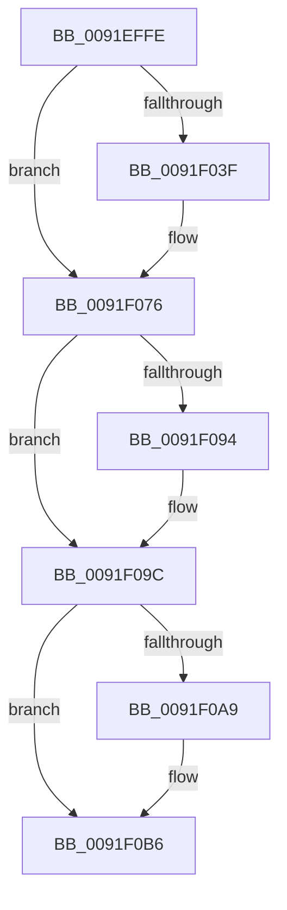

# sub_0091EFFE

- RVA: `0x0091EFFE`–`0x0091F1C8` (길이 `458` bytes)
- VA: `0x000000014091EFFE`
- 실행 섹션: `PAGE`
- PDB 이름 있음: `아니요`; PDB Function 태그: `아니요`
- unwind 정보 RVA: `0x0008B4E8`
- 디코드: `93`개 명령, `458/458` bytes 표시
- 미해석 바이트: `0` (있으면 어셈블리에 `.byte`로 보존)

> 이 문서는 커널 이미지의 기계어와 PDB 기호를 분석해 생성했습니다. 4번과 5번은 함수 원형과 자료형을 바이너리 사용 방식에서 추정한 C 해석이며 원본 소스 복구 결과는 아닙니다.

## 1. Dependencies

- 직접 호출 지점: **8**; 고유 호출 대상: **8**
- 직접 호출자로 확인된 함수: **0**
- RIP 상대 이미지 참조: **1**

### Outgoing calls
- `0x0091F036` → [ZwDuplicateObject](../../text/6A/ZwDuplicateObject_function_006AD850.md) (function, `0x006AD850`)
- `0x0091F069` → [ObReferenceObjectByHandle](../86/ObReferenceObjectByHandle_function_00868DB0.md) (function, `0x00868DB0`)
- `0x0091F086` → [SepAdtClassifyObjectIntoSubCategory](SepAdtClassifyObjectIntoSubCategory_function_0091FA60.md) (function, `0x0091FA60`)
- `0x0091F097` → [ObfDereferenceObject](../../text/2F/ObfDereferenceObject_function_002F9350.md) (function, `0x002F9350`)
- `0x0091F0A9` → [ZwClose](../../text/6A/ZwClose_function_006AD2B0.md) (function, `0x006AD2B0`)
- `0x0091F0B6` → [PsGetCurrentProcessId](../../text/43/PsGetCurrentProcessId_function_00433560.md) (function, `0x00433560`)
- `0x0091F149` → [SepAdtOpenObjectAuditAlarm](SepAdtOpenObjectAuditAlarm_function_0091F23C.md) (function, `0x0091F23C`)
- `0x0091F198` → [SepAdtStagingEvent](SepAdtStagingEvent_function_0091F948.md) (function, `0x0091F948`)

### Direct callers
- 이 함수 시작 RVA로 연결되는 직접 call은 확인되지 않았습니다. 간접 호출은 완전히 역산할 수 없습니다.

### Static image references
- `0x0091F0F7` → RVA `0x000013A8` (`.rdata`; read)

## 2. Other-region calls and transfers

- 다른 실행 섹션으로 향하는 call: **4**
  - `0x0091F036` → [ZwDuplicateObject](../../text/6A/ZwDuplicateObject_function_006AD850.md) (`PAGE` → `.text`)
  - `0x0091F097` → [ObfDereferenceObject](../../text/2F/ObfDereferenceObject_function_002F9350.md) (`PAGE` → `.text`)
  - `0x0091F0A9` → [ZwClose](../../text/6A/ZwClose_function_006AD2B0.md) (`PAGE` → `.text`)
  - `0x0091F0B6` → [PsGetCurrentProcessId](../../text/43/PsGetCurrentProcessId_function_00433560.md) (`PAGE` → `.text`)
- 별도 외부 분기/꼬리 이동을 확인하지 못했습니다.

## 3. Assembly (complete function range)

```asm
0091EFFE  48 89 AC 24 F8 00 00 00         mov qword ptr [rsp + 0xf8], rbp
0091F006  C7 44 24 30 02 00 00 00         mov dword ptr [rsp + 0x30], 2
0091F00E  4C 8D 8C 24 E0 00 00 00         lea r9, [rsp + 0xe0]
0091F016  4C 8B C1                        mov r8, rcx
0091F019  4C 89 A4 24 A8 00 00 00         mov qword ptr [rsp + 0xa8], r12
0091F021  C7 44 24 28 00 02 00 00         mov dword ptr [rsp + 0x28], 0x200
0091F029  4C 89 BC 24 A0 00 00 00         mov qword ptr [rsp + 0xa0], r15
0091F031  44 89 6C 24 20                  mov dword ptr [rsp + 0x20], r13d
0091F036  E8 15 E8 D8 FF                  call 0x1406ad850
0091F03B  85 C0                           test eax, eax
0091F03D  78 37                           js 0x14091f076
0091F03F  48 8B 8C 24 E0 00 00 00         mov rcx, qword ptr [rsp + 0xe0]
0091F047  48 8D 84 24 F0 00 00 00         lea rax, [rsp + 0xf0]
0091F04F  4C 89 6C 24 28                  mov qword ptr [rsp + 0x28], r13
0091F054  45 33 C9                        xor r9d, r9d
0091F057  45 33 C0                        xor r8d, r8d
0091F05A  48 89 44 24 20                  mov qword ptr [rsp + 0x20], rax
0091F05F  33 D2                           xor edx, edx
0091F061  4C 89 AC 24 F0 00 00 00         mov qword ptr [rsp + 0xf0], r13
0091F069  E8 42 9D F4 FF                  call 0x140868db0
0091F06E  48 8B B4 24 F0 00 00 00         mov rsi, qword ptr [rsp + 0xf0]
0091F076  45 33 C9                        xor r9d, r9d
0091F079  48 8D 93 90 00 00 00            lea rdx, [rbx + 0x90]
0091F080  41 B0 01                        mov r8b, 1
0091F083  48 8B CE                        mov rcx, rsi
0091F086  E8 D5 09 00 00                  call 0x14091fa60
0091F08B  44 0F B7 E0                     movzx r12d, ax
0091F08F  48 85 F6                        test rsi, rsi
0091F092  74 08                           je 0x14091f09c
0091F094  48 8B CE                        mov rcx, rsi
0091F097  E8 B4 A2 9D FF                  call 0x1402f9350
0091F09C  48 8B 8C 24 E0 00 00 00         mov rcx, qword ptr [rsp + 0xe0]
0091F0A4  48 85 C9                        test rcx, rcx
0091F0A7  74 0D                           je 0x14091f0b6
0091F0A9  E8 02 E2 D8 FF                  call 0x1406ad2b0
0091F0AE  4C 89 AC 24 E0 00 00 00         mov qword ptr [rsp + 0xe0], r13
0091F0B6  E8 A5 44 B1 FF                  call 0x140433560
0091F0BB  48 89 9C 24 90 00 00 00         mov qword ptr [rsp + 0x90], rbx
0091F0C3  49 8D 4E 20                     lea rcx, [r14 + 0x20]
0091F0C7  48 89 8C 24 88 00 00 00         mov qword ptr [rsp + 0x88], rcx
0091F0CF  48 8D AB 80 00 00 00            lea rbp, [rbx + 0x80]
0091F0D6  4C 89 AC 24 80 00 00 00         mov qword ptr [rsp + 0x80], r13
0091F0DE  4C 8D 8B 90 00 00 00            lea r9, [rbx + 0x90]
0091F0E5  44 89 6C 24 78                  mov dword ptr [rsp + 0x78], r13d
0091F0EA  4C 8D 84 24 E8 00 00 00         lea r8, [rsp + 0xe8]
0091F0F2  4C 89 6C 24 70                  mov qword ptr [rsp + 0x70], r13
0091F0F7  48 8D 15 AA 22 6E FF            lea rdx, [rip - 0x91dd56]
0091F0FE  C7 44 24 68 02 00 00 00         mov dword ptr [rsp + 0x68], 2
0091F106  48 8B F0                        mov rsi, rax
0091F109  48 89 44 24 60                  mov qword ptr [rsp + 0x60], rax
0091F10E  41 0F B7 CC                     movzx ecx, r12w
0091F112  49 8B 06                        mov rax, qword ptr [r14]
0091F115  C6 44 24 58 01                  mov byte ptr [rsp + 0x58], 1
0091F11A  48 89 44 24 50                  mov qword ptr [rsp + 0x50], rax
0091F11F  8B 43 14                        mov eax, dword ptr [rbx + 0x14]
0091F122  89 44 24 48                     mov dword ptr [rsp + 0x48], eax
0091F126  8B 43 18                        mov eax, dword ptr [rbx + 0x18]
0091F129  89 44 24 40                     mov dword ptr [rsp + 0x40], eax
0091F12D  48 8B 43 30                     mov rax, qword ptr [rbx + 0x30]
0091F131  48 89 44 24 38                  mov qword ptr [rsp + 0x38], rax
0091F136  48 8B 43 20                     mov rax, qword ptr [rbx + 0x20]
0091F13A  48 89 44 24 30                  mov qword ptr [rsp + 0x30], rax
0091F13F  48 89 7C 24 28                  mov qword ptr [rsp + 0x28], rdi
0091F144  48 89 6C 24 20                  mov qword ptr [rsp + 0x20], rbp
0091F149  E8 EE 00 00 00                  call 0x14091f23c
0091F14E  8B 4B 14                        mov ecx, dword ptr [rbx + 0x14]
0091F151  4C 8D 8B 90 00 00 00            lea r9, [rbx + 0x90]
0091F158  48 89 5C 24 58                  mov qword ptr [rsp + 0x58], rbx
0091F15D  4C 8D 84 24 E8 00 00 00         lea r8, [rsp + 0xe8]
0091F165  48 89 74 24 50                  mov qword ptr [rsp + 0x50], rsi
0091F16A  0F B6 F8                        movzx edi, al
0091F16D  C6 44 24 48 01                  mov byte ptr [rsp + 0x48], 1
0091F172  89 4C 24 40                     mov dword ptr [rsp + 0x40], ecx
0091F176  8B 4B 18                        mov ecx, dword ptr [rbx + 0x18]
0091F179  89 4C 24 38                     mov dword ptr [rsp + 0x38], ecx
0091F17D  48 8B 4B 30                     mov rcx, qword ptr [rbx + 0x30]
0091F181  48 89 4C 24 30                  mov qword ptr [rsp + 0x30], rcx
0091F186  48 8B 4B 20                     mov rcx, qword ptr [rbx + 0x20]
0091F18A  48 89 4C 24 28                  mov qword ptr [rsp + 0x28], rcx
0091F18F  41 0F B7 CC                     movzx ecx, r12w
0091F193  48 89 6C 24 20                  mov qword ptr [rsp + 0x20], rbp
0091F198  E8 AB 07 00 00                  call 0x14091f948
0091F19D  4C 8B BC 24 A0 00 00 00         mov r15, qword ptr [rsp + 0xa0]
0091F1A5  4C 8B A4 24 A8 00 00 00         mov r12, qword ptr [rsp + 0xa8]
0091F1AD  48 8B AC 24 F8 00 00 00         mov rbp, qword ptr [rsp + 0xf8]
0091F1B5  40 88 7B 0A                     mov byte ptr [rbx + 0xa], dil
0091F1B9  48 81 C4 B0 00 00 00            add rsp, 0xb0
0091F1C0  41 5E                           pop r14
0091F1C2  41 5D                           pop r13
0091F1C4  5F                              pop rdi
0091F1C5  5E                              pop rsi
0091F1C6  5B                              pop rbx
0091F1C7  C3                              ret
```

## 4. C-style interpretation (structured pseudocode)

```c
__int64 __fastcall sub_0091EFFE(__int64 a1, int a2, __int64 a3, __int64 a4, __int64 a5, __int64 a6, __int64 a7, __int64 a8, __int64 a9, __int64 a10, __int64 a11, __int64 a12, __int64 a13, __int64 a14, __int64 a15, __int64 a16, __int64 a17, __int64 a18, __int64 a19, __int64 a20, __int64 a21, __int64 a22, __int64 a23, __int64 a24, __int64 a25, __int64 a26, __int64 a27, __int64 a28, __int64 a29, __int64 a30, __int64 a31)
{
    __int64 result;
    __int64 v_rsi;
    __int64 v_rsp;
    unsigned int v_stack_p20;
    unsigned int v_stack_p28;
    unsigned int v_stack_p30;
    unsigned __int64 v_stack_p38;
    unsigned int v_stack_p40;
    unsigned int v_stack_p48;
    unsigned __int64 v_stack_p50;
    unsigned __int8 v_stack_p58;
    unsigned __int64 v_stack_p60;
    unsigned int v_stack_p68;
    unsigned __int64 v_stack_p70;
    unsigned int v_stack_p78;
    unsigned __int64 v_stack_p80;
    unsigned __int64 v_stack_p88;
    unsigned __int64 v_stack_p90;
    unsigned __int64 v_stack_pA0;
    unsigned __int64 v_stack_pA8;
    unsigned __int64 v_stack_pE0;
    unsigned __int64 v_stack_pF0;
    unsigned __int64 v_stack_pF8;

    v_stack_pF8 = v_rbp;
    v_stack_p30 = 2;
    v_stack_pA8 = v_r12;
    v_stack_p28 = 512;
    v_stack_pA0 = v_r15;
    v_stack_p20 = (unsigned int)(v_r13);
    result = ZwDuplicateObject(a1, a2, a1, a28);
    if (!(sign_flag)) {
        a1 = a28;
        result = a30;
        v_stack_p28 = v_r13;
        a4 = 0;
        a3 = 0;
        v_stack_p20 = result;
        a2 = 0;
        v_stack_pF0 = v_r13;
        result = ObReferenceObjectByHandle(a1, a2, a3, a4);
        v_rsi = a30;
    }
    a4 = 0;
    result = SepAdtClassifyObjectIntoSubCategory(v_rsi, v_rbx + 144, 1, a4);
    if (v_rsi != 0) {
        a1 = v_rsi;
        result = ObfDereferenceObject(a1, v_rbx + 144, 1, a4);
    }
    if (a28 != 0) {
        result = ZwClose(a28, v_rbx + 144, 1, a4);
        v_stack_pE0 = v_r13;
    }
    result = PsGetCurrentProcessId(a28, v_rbx + 144, 1, a4);
    v_stack_p90 = v_rbx;
    v_stack_p88 = v_r14 + 32;
    v_stack_p80 = v_r13;
    v_stack_p78 = (unsigned int)(v_r13);
    v_stack_p70 = v_r13;
    v_stack_p68 = 2;
    v_stack_p60 = result;
    v_stack_p58 = 1;
    v_stack_p50 = *(unsigned __int64 *)(v_r14);
    v_stack_p48 = (unsigned int)((unsigned int)(*(unsigned int *)(v_rbx + 20)));
    v_stack_p40 = (unsigned int)((unsigned int)(*(unsigned int *)(v_rbx + 24)));
    v_stack_p38 = *(unsigned __int64 *)(v_rbx + 48);
    v_stack_p30 = *(unsigned __int64 *)(v_rbx + 32);
    v_stack_p28 = v_rdi;
    v_stack_p20 = v_rbx + 128;
    result = SepAdtOpenObjectAuditAlarm((unsigned __int16)((unsigned __int16)(result)), v_rip - 9559382, a29, v_rbx + 144);
    v_stack_p58 = v_rbx;
    v_stack_p50 = result;
    v_stack_p48 = 1;
    v_stack_p40 = (unsigned int)((unsigned int)(*(unsigned int *)(v_rbx + 20)));
    v_stack_p38 = (unsigned int)((unsigned int)(*(unsigned int *)(v_rbx + 24)));
    v_stack_p30 = *(unsigned __int64 *)(v_rbx + 48);
    v_stack_p28 = *(unsigned __int64 *)(v_rbx + 32);
    v_stack_p20 = v_rbx + 128;
    result = SepAdtStagingEvent((unsigned __int16)((unsigned __int16)(result)), v_rip - 9559382, a29, v_rbx + 144);
    *(unsigned __int8 *)(v_rbx + 10) = (unsigned __int8)((unsigned __int8)(result));
    v_rsp = (v_rsp) + (176);
    return result;
}
```

## 5. (Beta) C Style

```c
int64_t sub_0091EFFE(int64_t Arg1, int32_t Arg2, int64_t Arg3, int64_t Arg4, uint64_t Arg5, uint64_t Arg6, uint64_t Arg7, uint64_t Arg8, uint64_t Arg9, uint64_t Arg10, uint64_t Arg11, uint64_t Arg12, uint64_t Arg13, uint64_t Arg14, uint64_t Arg15, uint64_t Arg16, uint64_t Arg17, uint64_t Arg18, uint64_t Arg19, int64_t Arg20, int64_t Arg21, uint64_t Arg22, uint64_t Arg23, uint64_t Arg24, uint64_t Arg25, uint64_t Arg26, uint64_t Arg27, int64_t Arg28, int64_t Arg29, int64_t Arg30, int64_t Arg31)
{
    int64_t result;
    int64_t local_rsi;
    int64_t local_rsp;
    uint32_t v_stack_p20;
    uint32_t v_stack_p28;
    uint32_t v_stack_p30;
    uint64_t v_stack_p38;
    uint32_t v_stack_p40;
    uint32_t v_stack_p48;
    uint64_t v_stack_p50;
    uint8_t v_stack_p58;
    uint64_t v_stack_p60;
    uint32_t v_stack_p68;
    uint64_t v_stack_p70;
    uint32_t v_stack_p78;
    uint64_t v_stack_p80;
    uint64_t v_stack_p88;
    uint64_t v_stack_p90;
    uint64_t v_stack_pA0;
    uint64_t v_stack_pA8;
    uint64_t v_stack_pE0;
    uint64_t v_stack_pF0;
    uint64_t v_stack_pF8;

    v_stack_pF8 = local_rbp;
    v_stack_p30 = 2;
    v_stack_pA8 = local_r12;
    v_stack_p28 = 512;
    v_stack_pA0 = local_r15;
    v_stack_p20 = (uint32_t)(local_r13);
    result = ZwDuplicateObject(Arg1, Arg2, Arg1, Arg28);
    if (!(sign_flag)) {
        Arg1 = Arg28;
        result = Arg30;
        v_stack_p28 = local_r13;
        Arg4 = 0;
        Arg3 = 0;
        v_stack_p20 = result;
        Arg2 = 0;
        v_stack_pF0 = local_r13;
        result = ObReferenceObjectByHandle(Arg1, Arg2, Arg3, Arg4);
        local_rsi = Arg30;
    }
    Arg4 = 0;
    result = SepAdtClassifyObjectIntoSubCategory(local_rsi, local_rbx + 144, 1, Arg4);
    if (local_rsi != 0) {
        Arg1 = local_rsi;
        result = ObfDereferenceObject(Arg1, local_rbx + 144, 1, Arg4);
    }
    if (Arg28 != 0) {
        result = ZwClose(Arg28, local_rbx + 144, 1, Arg4);
        v_stack_pE0 = local_r13;
    }
    result = PsGetCurrentProcessId(Arg28, local_rbx + 144, 1, Arg4);
    v_stack_p90 = local_rbx;
    v_stack_p88 = local_r14 + 32;
    v_stack_p80 = local_r13;
    v_stack_p78 = (uint32_t)(local_r13);
    v_stack_p70 = local_r13;
    v_stack_p68 = 2;
    v_stack_p60 = result;
    v_stack_p58 = 1;
    v_stack_p50 = *(uint64_t *)(local_r14);
    v_stack_p48 = (uint32_t)((uint32_t)(*(uint32_t *)(local_rbx + 0x14)));
    v_stack_p40 = (uint32_t)((uint32_t)(*(uint32_t *)(local_rbx + 0x18)));
    v_stack_p38 = *(uint64_t *)(local_rbx + 0x30);
    v_stack_p30 = *(uint64_t *)(local_rbx + 0x20);
    v_stack_p28 = local_rdi;
    v_stack_p20 = local_rbx + 128;
    result = SepAdtOpenObjectAuditAlarm((uint16_t)((uint16_t)(result)), v_rip - 9559382, Arg29, local_rbx + 144);
    v_stack_p58 = local_rbx;
    v_stack_p50 = result;
    v_stack_p48 = 1;
    v_stack_p40 = (uint32_t)((uint32_t)(*(uint32_t *)(local_rbx + 0x14)));
    v_stack_p38 = (uint32_t)((uint32_t)(*(uint32_t *)(local_rbx + 0x18)));
    v_stack_p30 = *(uint64_t *)(local_rbx + 0x30);
    v_stack_p28 = *(uint64_t *)(local_rbx + 0x20);
    v_stack_p20 = local_rbx + 128;
    result = SepAdtStagingEvent((uint16_t)((uint16_t)(result)), v_rip - 9559382, Arg29, local_rbx + 144);
    *(uint8_t *)(local_rbx + 0xA) = (uint8_t)((uint8_t)(result));
    local_rsp = (local_rsp) + (176);
    return result;
}
```

## 6. Execution-region graph

[열기: 2D/3D 그래프와 함수 탐색 컨트롤 패널](../../../control-panel.html?section=page&rva=0x0091EFFE&view=graph)

- 2D 그래프는 위에서 아래로 흐르고, 3D 그래프는 빈 공간을 드래그해 회전합니다. Shift+드래그는 이동, 휠은 확대·축소, 함수 노드 선택은 대상 보고서 이동입니다.

### Static fallback


