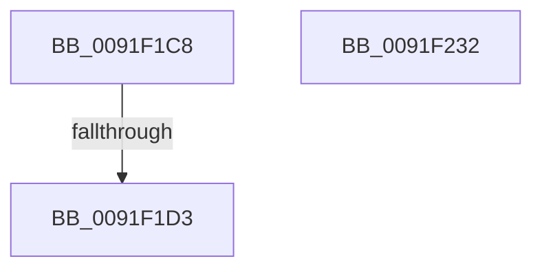

# sub_0091F1C8

- RVA: `0x0091F1C8`–`0x0091F233` (길이 `107` bytes)
- VA: `0x000000014091F1C8`
- 실행 섹션: `PAGE`
- PDB 이름 있음: `아니요`; PDB Function 태그: `아니요`
- unwind 정보 RVA: `0x0008B508`
- 디코드: `28`개 명령, `107/107` bytes 표시
- 미해석 바이트: `0` (있으면 어셈블리에 `.byte`로 보존)

> 이 문서는 커널 이미지의 기계어와 PDB 기호를 분석해 생성했습니다. 4번과 5번은 함수 원형과 자료형을 바이너리 사용 방식에서 추정한 C 해석이며 원본 소스 복구 결과는 아닙니다.

## 1. Dependencies

- 직접 호출 지점: **1**; 고유 호출 대상: **1**
- 직접 호출자로 확인된 함수: **0**
- RIP 상대 이미지 참조: **1**

### Outgoing calls
- `0x0091F21A` → [SepAdtPrivilegeObjectAuditAlarm](../86/SepAdtPrivilegeObjectAuditAlarm_function_0086E3F0.md) (function, `0x0086E3F0`)

### Direct callers
- 이 함수 시작 RVA로 연결되는 직접 call은 확인되지 않았습니다. 간접 호출은 완전히 역산할 수 없습니다.

### Static image references
- `0x0091F20E` → RVA `0x000013A8` (`.rdata`; read)

## 2. Other-region calls and transfers

- 다른 실행 섹션으로 향하는 call: **0**
- call이 아닌 외부 분기/꼬리 이동: **1**
  - `0x0091F1CD` → [SeAuditHandleCreation + 0x67](SeAuditHandleCreation_function_0091EF90.md) (`tail-transfer`)

## 3. Assembly (complete function range)

```asm
0091F1C8  CC                              int3
0091F1C9  40 38 71 7C                     cmp byte ptr [rcx + 0x7c], sil
0091F1CD  0F 84 24 FE FF FF               je 0x14091eff7
0091F1D3  49 8B 06                        mov rax, qword ptr [r14]
0091F1D6  4C 8D 81 80 00 00 00            lea r8, [rcx + 0x80]
0091F1DD  C6 44 24 48 01                  mov byte ptr [rsp + 0x48], 1
0091F1E2  48 8D 91 90 00 00 00            lea rdx, [rcx + 0x90]
0091F1E9  48 89 44 24 40                  mov qword ptr [rsp + 0x40], rax
0091F1EE  4D 8B CA                        mov r9, r10
0091F1F1  8B 41 14                        mov eax, dword ptr [rcx + 0x14]
0091F1F4  89 44 24 38                     mov dword ptr [rsp + 0x38], eax
0091F1F8  48 8B 41 38                     mov rax, qword ptr [rcx + 0x38]
0091F1FC  48 89 44 24 30                  mov qword ptr [rsp + 0x30], rax
0091F201  48 8B 41 30                     mov rax, qword ptr [rcx + 0x30]
0091F205  48 89 44 24 28                  mov qword ptr [rsp + 0x28], rax
0091F20A  48 8B 41 20                     mov rax, qword ptr [rcx + 0x20]
0091F20E  48 8D 0D 93 21 6E FF            lea rcx, [rip - 0x91de6d]
0091F215  48 89 44 24 20                  mov qword ptr [rsp + 0x20], rax
0091F21A  E8 D1 F1 F4 FF                  call 0x14086e3f0
0091F21F  40 88 73 0A                     mov byte ptr [rbx + 0xa], sil
0091F223  48 81 C4 B0 00 00 00            add rsp, 0xb0
0091F22A  41 5E                           pop r14
0091F22C  41 5D                           pop r13
0091F22E  5F                              pop rdi
0091F22F  5E                              pop rsi
0091F230  5B                              pop rbx
0091F231  C3                              ret
0091F232  CC                              int3
```

## 4. C-style interpretation (structured pseudocode)

```c
__int64 __fastcall sub_0091F1C8(__int64 a1)
{
    __int64 result;
    __int64 v_rsp;
    unsigned __int64 v_stack_p20;
    unsigned __int64 v_stack_p28;
    unsigned __int64 v_stack_p30;
    unsigned int v_stack_p38;
    unsigned __int64 v_stack_p40;
    unsigned __int8 v_stack_p48;

    v_stack_p48 = 1;
    v_stack_p40 = *(unsigned __int64 *)(v_r14);
    v_stack_p38 = (unsigned int)((unsigned int)(*(unsigned int *)(a1 + 20)));
    v_stack_p30 = *(unsigned __int64 *)(a1 + 56);
    v_stack_p28 = *(unsigned __int64 *)(a1 + 48);
    v_stack_p20 = *(unsigned __int64 *)(a1 + 32);
    result = SepAdtPrivilegeObjectAuditAlarm(v_rip - 9559661, a1 + 144, a1 + 128, v_r10);
    *(unsigned __int8 *)(v_rbx + 10) = (unsigned __int8)(v_rsi);
    v_rsp = (v_rsp) + (176);
    return result;
}
```

## 5. (Beta) C Style

```c
int64_t sub_0091F1C8(void *Arg1)
{
    uint8_t *arg1 = (uint8_t *)Arg1;

    int64_t result;
    int64_t local_rsp;
    uint64_t v_stack_p20;
    uint64_t v_stack_p28;
    uint64_t v_stack_p30;
    uint32_t v_stack_p38;
    uint64_t v_stack_p40;
    uint8_t v_stack_p48;

    v_stack_p48 = 1;
    v_stack_p40 = *(uint64_t *)(local_r14);
    v_stack_p38 = (uint32_t)((uint32_t)(*(uint32_t *)(arg1 + 0x14)));
    v_stack_p30 = *(uint64_t *)(arg1 + 0x38);
    v_stack_p28 = *(uint64_t *)(arg1 + 0x30);
    v_stack_p20 = *(uint64_t *)(arg1 + 0x20);
    result = SepAdtPrivilegeObjectAuditAlarm(v_rip - 9559661, Arg1 + 144, Arg1 + 128, local_r10);
    *(uint8_t *)(local_rbx + 0xA) = (uint8_t)(local_rsi);
    local_rsp = (local_rsp) + (176);
    return result;
}
```

### 관측된 메모리 오프셋

구조체 형식이 확인되지 않은 접근은 인자 기준의 오프셋으로만 기록했습니다.

| 기준 인자 | 오프셋 표현 | 폭 (bit) | 접근 |
|---|---:|---:|---|
| `Arg1` | `+ 0x14` | `32` | `R` |
| `Arg1` | `+ 0x20` | `64` | `R` |
| `Arg1` | `+ 0x30` | `64` | `R` |
| `Arg1` | `+ 0x38` | `64` | `R` |
| `Arg1` | `+ 0x7C` | `8` | `R` |
| `Arg1` | `+ 0x80` | `64` | `R` |
| `Arg1` | `+ 0x90` | `64` | `R` |

## 6. Execution-region graph

[열기: 2D/3D 그래프와 함수 탐색 컨트롤 패널](../../../control-panel.html?section=page&rva=0x0091F1C8&view=graph)

- 2D 그래프는 위에서 아래로 흐르고, 3D 그래프는 빈 공간을 드래그해 회전합니다. Shift+드래그는 이동, 휠은 확대·축소, 함수 노드 선택은 대상 보고서 이동입니다.

### Static fallback


