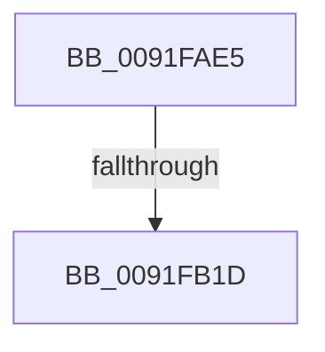

# sub_0091FAE5

- RVA: `0x0091FAE5`–`0x0091FB36` (길이 `81` bytes)
- VA: `0x000000014091FAE5`
- 실행 섹션: `PAGE`
- PDB 이름 있음: `아니요`; PDB Function 태그: `아니요`
- unwind 정보 RVA: `0x0008B5AC`
- 디코드: `20`개 명령, `81/81` bytes 표시
- 미해석 바이트: `0` (있으면 어셈블리에 `.byte`로 보존)

> 이 문서는 커널 이미지의 기계어와 PDB 기호를 분석해 생성했습니다. 4번과 5번은 함수 원형과 자료형을 바이너리 사용 방식에서 추정한 C 해석이며 원본 소스 복구 결과는 아닙니다.

## 1. Dependencies

- 직접 호출 지점: **2**; 고유 호출 대상: **2**
- 직접 호출자로 확인된 함수: **0**
- RIP 상대 이미지 참조: **0**

### Outgoing calls
- `0x0091FAF1` → [PsGetCurrentServerSiloGlobals](../../text/2F/PsGetCurrentServerSiloGlobals_function_002FE1F0.md) (function, `0x002FE1F0`)
- `0x0091FB0C` → [RtlCompareMemory](../../text/6B/RtlCompareMemory_function_006BA670.md) (function, `0x006BA670`)

### Direct callers
- 이 함수 시작 RVA로 연결되는 직접 call은 확인되지 않았습니다. 간접 호출은 완전히 역산할 수 없습니다.

### Static image references
- 디코드된 RIP-relative 메모리 참조가 없습니다.

## 2. Other-region calls and transfers

- 다른 실행 섹션으로 향하는 call: **2**
  - `0x0091FAF1` → [PsGetCurrentServerSiloGlobals](../../text/2F/PsGetCurrentServerSiloGlobals_function_002FE1F0.md) (`PAGE` → `.text`)
  - `0x0091FB0C` → [RtlCompareMemory](../../text/6B/RtlCompareMemory_function_006BA670.md) (`PAGE` → `.text`)
- call이 아닌 외부 분기/꼬리 이동: **2**
  - `0x0091FB17` → [sub_0091FBA6](Unknown_function_0091FBA6.md) (`tail-transfer`)
  - `0x0091FB30` → [sub_0091FBAE + 0x1F](Unknown_function_0091FBAE.md) (`tail-transfer`)

## 3. Assembly (complete function range)

```asm
0091FAE5  4C 89 74 24 30                  mov qword ptr [rsp + 0x30], r14
0091FAEA  4C 8B 72 08                     mov r14, qword ptr [rdx + 8]
0091FAEE  48 D1 EE                        shr rsi, 1
0091FAF1  E8 FA E6 9D FF                  call 0x1402fe1f0
0091FAF6  BB 04 00 00 00                  mov ebx, 4
0091FAFB  48 8B D5                        mov rdx, rbp
0091FAFE  48 3B F3                        cmp rsi, rbx
0091FB01  49 8B CE                        mov rcx, r14
0091FB04  48 0F 46 DE                     cmovbe rbx, rsi
0091FB08  4C 8D 04 1B                     lea r8, [rbx + rbx]
0091FB0C  E8 5F AB D9 FF                  call 0x1406ba670
0091FB11  48 D1 E8                        shr rax, 1
0091FB14  48 3B C3                        cmp rax, rbx
0091FB17  0F 83 89 00 00 00               jae 0x14091fba6
0091FB1D  41 0F B7 0C 46                  movzx ecx, word ptr [r14 + rax*2]
0091FB22  0F B7 44 45 00                  movzx eax, word ptr [rbp + rax*2]
0091FB27  2B C8                           sub ecx, eax
0091FB29  4C 8B 74 24 30                  mov r14, qword ptr [rsp + 0x30]
0091FB2E  85 C9                           test ecx, ecx
0091FB30  0F 84 97 00 00 00               je 0x14091fbcd
```

## 4. C-style interpretation (structured pseudocode)

```c
__int64 __fastcall sub_0091FAE5(__int64 a1, __int64 a2, __int64 a3, __int64 a4, __int64 a5, __int64 a6)
{
    __int64 result;
    __int64 v_rbx;
    __int64 v_rsi;
    unsigned __int64 v_stack_p30;

    v_stack_p30 = v_r14;
    v_rsi = (v_rsi) >> (1);
    result = PsGetCurrentServerSiloGlobals(a1, a2, a3, a4);
    v_rbx = 4;
    if (v_rsi <= 4) { v_rbx = v_rsi; }
    result = RtlCompareMemory(*(unsigned __int64 *)(a2 + 8), v_rbp, v_rbx + v_rbx * 1, a4);
    result = (result) >> (1);
    a1 = (unsigned int)((*(unsigned __int16 *)(*(unsigned __int64 *)(a2 + 8) + result * 2)) - ((unsigned int)(*(unsigned __int16 *)(v_rbp + result * 2))));
}
```

## 5. (Beta) C Style

```c
int64_t sub_0091FAE5(int64_t Arg1, void *Arg2, int64_t Arg3, int64_t Arg4, uint64_t Arg5, int64_t Arg6)
{
    uint8_t *arg2 = (uint8_t *)Arg2;

    int64_t result;
    int64_t local_rbx;
    int64_t local_rsi;
    uint64_t v_stack_p30;

    v_stack_p30 = local_r14;
    local_rsi = (local_rsi) >> (1);
    result = PsGetCurrentServerSiloGlobals(Arg1, Arg2, Arg3, Arg4);
    local_rbx = 4;
    if (local_rsi <= 4) { local_rbx = local_rsi; }
    result = RtlCompareMemory(*(uint64_t *)(arg2 + 0x8), local_rbp, local_rbx + local_rbx * 1, Arg4);
    result = (result) >> (1);
    Arg1 = (uint32_t)((*(uint16_t *)(*(uint64_t *)(arg2 + 0x8) + result * 2)) - ((uint32_t)(*(uint16_t *)(local_rbp + result * 2))));
}
```

### 관측된 메모리 오프셋

구조체 형식이 확인되지 않은 접근은 인자 기준의 오프셋으로만 기록했습니다.

| 기준 인자 | 오프셋 표현 | 폭 (bit) | 접근 |
|---|---:|---:|---|
| `Arg2` | `+ 0x8` | `64` | `R` |

## 6. Execution-region graph

[열기: 2D/3D 그래프와 함수 탐색 컨트롤 패널](../../../control-panel.html?section=page&rva=0x0091FAE5&view=graph)

- 2D 그래프는 위에서 아래로 흐르고, 3D 그래프는 빈 공간을 드래그해 회전합니다. Shift+드래그는 이동, 휠은 확대·축소, 함수 노드 선택은 대상 보고서 이동입니다.

### Static fallback


