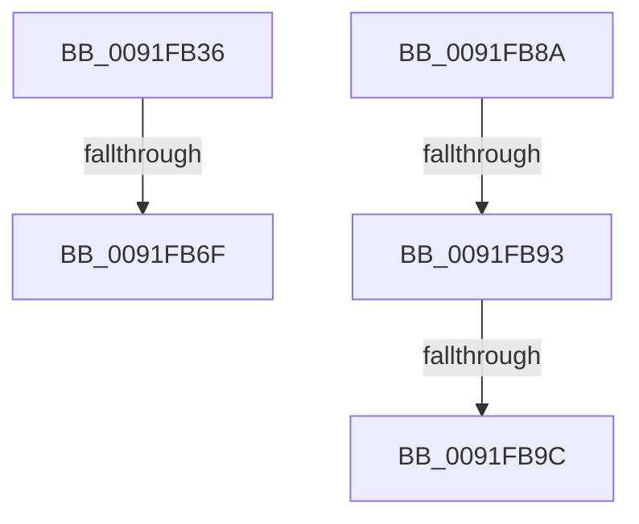

# sub_0091FB36

- RVA: `0x0091FB36`–`0x0091FBA6` (길이 `112` bytes)
- VA: `0x000000014091FB36`
- 실행 섹션: `PAGE`
- PDB 이름 있음: `아니요`; PDB Function 태그: `아니요`
- unwind 정보 RVA: `0x0008B5C0`
- 디코드: `29`개 명령, `112/112` bytes 표시
- 미해석 바이트: `0` (있으면 어셈블리에 `.byte`로 보존)

> 이 문서는 커널 이미지의 기계어와 PDB 기호를 분석해 생성했습니다. 4번과 5번은 함수 원형과 자료형을 바이너리 사용 방식에서 추정한 C 해석이며 원본 소스 복구 결과는 아닙니다.

## 1. Dependencies

- 직접 호출 지점: **2**; 고유 호출 대상: **2**
- 직접 호출자로 확인된 함수: **0**
- RIP 상대 이미지 참조: **3**

### Outgoing calls
- `0x0091FB47` → [PsGetCurrentServerSiloGlobals](../../text/2F/PsGetCurrentServerSiloGlobals_function_002FE1F0.md) (function, `0x002FE1F0`)
- `0x0091FB62` → [RtlCompareMemory](../../text/6B/RtlCompareMemory_function_006BA670.md) (function, `0x006BA670`)

### Direct callers
- 이 함수 시작 RVA로 연결되는 직접 call은 확인되지 않았습니다. 간접 호출은 완전히 역산할 수 없습니다.

### Static image references
- `0x0091FB39` → RVA `0x00002040` (`.rdata`; read)
- `0x0091FB8A` → RVA `0x00FC6AE0` (`ALMOSTRO`; read)
- `0x0091FB93` → RVA `0x00FC6EE0` (`ALMOSTRO`; read)

## 2. Other-region calls and transfers

- 다른 실행 섹션으로 향하는 call: **2**
  - `0x0091FB47` → [PsGetCurrentServerSiloGlobals](../../text/2F/PsGetCurrentServerSiloGlobals_function_002FE1F0.md) (`PAGE` → `.text`)
  - `0x0091FB62` → [RtlCompareMemory](../../text/6B/RtlCompareMemory_function_006BA670.md) (`PAGE` → `.text`)
- call이 아닌 외부 분기/꼬리 이동: **5**
  - `0x0091FB6D` → [sub_0091FBAE](Unknown_function_0091FBAE.md) (`tail-transfer`)
  - `0x0091FB85` → [SepAdtClassifyObjectIntoSubCategory + 0x5C](SepAdtClassifyObjectIntoSubCategory_function_0091FA60.md) (`tail-transfer`)
  - `0x0091FB91` → [sub_0091FBAE + 0x5](Unknown_function_0091FBAE.md) (`tail-transfer`)
  - `0x0091FB9A` → [sub_0091FBAE + 0x29](Unknown_function_0091FBAE.md) (`tail-transfer`)
  - `0x0091FBA1` → [SepAdtClassifyObjectIntoSubCategory + 0x5C](SepAdtClassifyObjectIntoSubCategory_function_0091FA60.md) (`tail-transfer`)

## 3. Assembly (complete function range)

```asm
0091FB36  0F B7 37                        movzx esi, word ptr [rdi]
0091FB39  48 8B 2D 00 25 6E FF            mov rbp, qword ptr [rip - 0x91db00]
0091FB40  48 8B 7F 08                     mov rdi, qword ptr [rdi + 8]
0091FB44  48 D1 EE                        shr rsi, 1
0091FB47  E8 A4 E6 9D FF                  call 0x1402fe1f0
0091FB4C  BB 03 00 00 00                  mov ebx, 3
0091FB51  48 8B D5                        mov rdx, rbp
0091FB54  48 3B F3                        cmp rsi, rbx
0091FB57  48 8B CF                        mov rcx, rdi
0091FB5A  48 0F 46 DE                     cmovbe rbx, rsi
0091FB5E  4C 8D 04 1B                     lea r8, [rbx + rbx]
0091FB62  E8 09 AB D9 FF                  call 0x1406ba670
0091FB67  48 D1 E8                        shr rax, 1
0091FB6A  48 3B C3                        cmp rax, rbx
0091FB6D  73 3F                           jae 0x14091fbae
0091FB6F  0F B7 0C 47                     movzx ecx, word ptr [rdi + rax*2]
0091FB73  0F B7 44 45 00                  movzx eax, word ptr [rbp + rax*2]
0091FB78  2B C8                           sub ecx, eax
0091FB7A  33 C0                           xor eax, eax
0091FB7C  85 C9                           test ecx, ecx
0091FB7E  0F 95 C0                        setne al
0091FB81  66 83 C0 76                     add ax, 0x76
0091FB85  E9 32 FF FF FF                  jmp 0x14091fabc
0091FB8A  48 3B 05 4F 6F 6A 00            cmp rax, qword ptr [rip + 0x6a6f4f]
0091FB91  74 20                           je 0x14091fbb3
0091FB93  48 3B 05 46 73 6A 00            cmp rax, qword ptr [rip + 0x6a7346]
0091FB9A  74 3B                           je 0x14091fbd7
0091FB9C  B8 77 00 00 00                  mov eax, 0x77
0091FBA1  E9 16 FF FF FF                  jmp 0x14091fabc
```

## 4. C-style interpretation (structured pseudocode)

```c
__int64 __fastcall sub_0091FB36(void)
{
    __int64 result;
    __int64 v_rbx;
    __int64 v_rsi;

    v_rsi = (*(unsigned __int16 *)(v_rdi)) >> (1);
    result = PsGetCurrentServerSiloGlobals(a1, a2, a3, a4);
    v_rbx = 3;
    if (v_rsi <= 3) { v_rbx = v_rsi; }
    result = RtlCompareMemory(*(unsigned __int64 *)(v_rdi + 8), *(unsigned __int64 *)(v_rip - 9558784), v_rbx + v_rbx * 1, a4);
    result = (result) >> (1);
    a1 = (unsigned int)((*(unsigned __int16 *)(*(unsigned __int64 *)(v_rdi + 8) + result * 2)) - ((unsigned int)(*(unsigned __int16 *)(*(unsigned __int64 *)(v_rip - 9558784) + result * 2))));
    result = 0;
    result = ((unsigned int)(a1) != 0) ? 1 : 0;
    result = (unsigned __int16)((result) + (118));
}
```

## 5. (Beta) C Style

```c
void sub_0091FB36(void)
{
    int64_t result;
    int64_t local_rbx;
    int64_t local_rsi;

    local_rsi = (*(uint16_t *)(local_rdi)) >> (1);
    result = PsGetCurrentServerSiloGlobals(a1, a2, a3, a4);
    local_rbx = 3;
    if (local_rsi <= 3) { local_rbx = local_rsi; }
    result = RtlCompareMemory(*(uint64_t *)(local_rdi + 0x8), *(uint64_t *)(v_rip - 0x91DB00), local_rbx + local_rbx * 1, a4);
    result = (result) >> (1);
    a1 = (uint32_t)((*(uint16_t *)(*(uint64_t *)(local_rdi + 0x8) + result * 2)) - ((uint32_t)(*(uint16_t *)(*(uint64_t *)(v_rip - 0x91DB00) + result * 2))));
    result = 0;
    result = ((uint32_t)(a1) != 0) ? 1 : 0;
    result = (uint16_t)((result) + (118));
}
```

## 6. Execution-region graph

[열기: 2D/3D 그래프와 함수 탐색 컨트롤 패널](../../../control-panel.html?section=page&rva=0x0091FB36&view=graph)

- 2D 그래프는 위에서 아래로 흐르고, 3D 그래프는 빈 공간을 드래그해 회전합니다. Shift+드래그는 이동, 휠은 확대·축소, 함수 노드 선택은 대상 보고서 이동입니다.

### Static fallback


