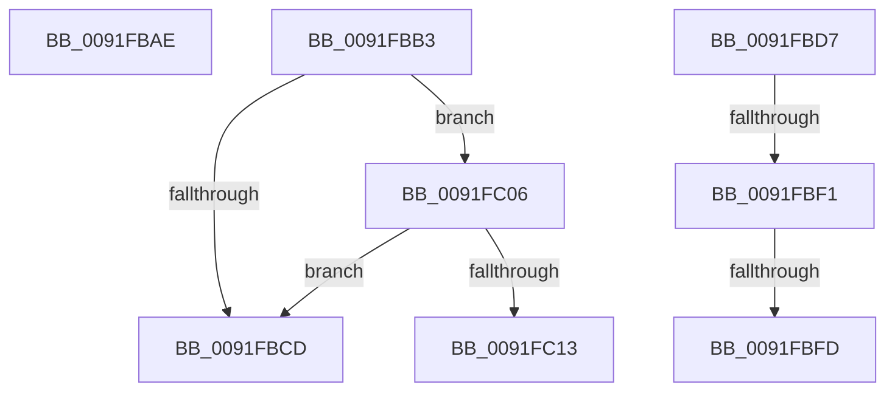

# sub_0091FBAE

- RVA: `0x0091FBAE`–`0x0091FC1C` (길이 `110` bytes)
- VA: `0x000000014091FBAE`
- 실행 섹션: `PAGE`
- PDB 이름 있음: `아니요`; PDB Function 태그: `아니요`
- unwind 정보 RVA: `0x0008B5E4`
- 디코드: `30`개 명령, `110/110` bytes 표시
- 미해석 바이트: `0` (있으면 어셈블리에 `.byte`로 보존)

> 이 문서는 커널 이미지의 기계어와 PDB 기호를 분석해 생성했습니다. 4번과 5번은 함수 원형과 자료형을 바이너리 사용 방식에서 추정한 C 해석이며 원본 소스 복구 결과는 아닙니다.

## 1. Dependencies

- 직접 호출 지점: **4**; 고유 호출 대상: **2**
- 직접 호출자로 확인된 함수: **0**
- RIP 상대 이미지 참조: **0**

### Outgoing calls
- `0x0091FBC4` → [SepAuditingEnabledForSubcategory](../../text/41/SepAuditingEnabledForSubcategory_function_0041C6B0.md) (function, `0x0041C6B0`)
- `0x0091FBE8` → [SepAuditingEnabledForSubcategory](../../text/41/SepAuditingEnabledForSubcategory_function_0041C6B0.md) (function, `0x0041C6B0`)
- `0x0091FBF4` → [SepIsRemovableStorageDevice](SepIsRemovableStorageDevice_function_0091FC24.md) (function, `0x0091FC24`)
- `0x0091FC0A` → [SepIsRemovableStorageDevice](SepIsRemovableStorageDevice_function_0091FC24.md) (function, `0x0091FC24`)

### Direct callers
- 이 함수 시작 RVA로 연결되는 직접 call은 확인되지 않았습니다. 간접 호출은 완전히 역산할 수 없습니다.

### Static image references
- 디코드된 RIP-relative 메모리 참조가 없습니다.

## 2. Other-region calls and transfers

- 다른 실행 섹션으로 향하는 call: **2**
  - `0x0091FBC4` → [SepAuditingEnabledForSubcategory](../../text/41/SepAuditingEnabledForSubcategory_function_0041C6B0.md) (`PAGE` → `.text`)
  - `0x0091FBE8` → [SepAuditingEnabledForSubcategory](../../text/41/SepAuditingEnabledForSubcategory_function_0041C6B0.md) (`PAGE` → `.text`)
- call이 아닌 외부 분기/꼬리 이동: **6**
  - `0x0091FBB1` → [sub_0091FB36 + 0x44](Unknown_function_0091FB36.md) (`tail-transfer`)
  - `0x0091FBD2` → [SepAdtClassifyObjectIntoSubCategory + 0x5C](SepAdtClassifyObjectIntoSubCategory_function_0091FA60.md) (`tail-transfer`)
  - `0x0091FBEF` → [sub_0091FB36 + 0x66](Unknown_function_0091FB36.md) (`tail-transfer`)
  - `0x0091FBFB` → [sub_0091FB36 + 0x66](Unknown_function_0091FB36.md) (`tail-transfer`)
  - `0x0091FC01` → [SepAdtClassifyObjectIntoSubCategory + 0x5C](SepAdtClassifyObjectIntoSubCategory_function_0091FA60.md) (`tail-transfer`)
  - `0x0091FC17` → [SepAdtClassifyObjectIntoSubCategory + 0x5C](SepAdtClassifyObjectIntoSubCategory_function_0091FA60.md) (`tail-transfer`)

## 3. Assembly (complete function range)

```asm
0091FBAE  8D 4E FD                        lea ecx, [rsi - 3]
0091FBB1  EB C7                           jmp 0x14091fb7a
0091FBB3  45 0F B6 C1                     movzx r8d, r9b
0091FBB7  41 0F B6 D3                     movzx edx, r11b
0091FBBB  41 B9 81 00 00 00               mov r9d, 0x81
0091FBC1  41 8B C9                        mov ecx, r9d
0091FBC4  E8 E7 CA AF FF                  call 0x14041c6b0
0091FBC9  3C 01                           cmp al, 1
0091FBCB  74 39                           je 0x14091fc06
0091FBCD  B8 75 00 00 00                  mov eax, 0x75
0091FBD2  E9 E5 FE FF FF                  jmp 0x14091fabc
0091FBD7  45 0F B6 C1                     movzx r8d, r9b
0091FBDB  41 0F B6 D3                     movzx edx, r11b
0091FBDF  41 B9 81 00 00 00               mov r9d, 0x81
0091FBE5  41 8B C9                        mov ecx, r9d
0091FBE8  E8 C3 CA AF FF                  call 0x14041c6b0
0091FBED  3C 01                           cmp al, 1
0091FBEF  75 AB                           jne 0x14091fb9c
0091FBF1  49 8B CA                        mov rcx, r10
0091FBF4  E8 2B 00 00 00                  call 0x14091fc24
0091FBF9  3C 01                           cmp al, 1
0091FBFB  75 9F                           jne 0x14091fb9c
0091FBFD  41 0F B7 C1                     movzx eax, r9w
0091FC01  E9 B6 FE FF FF                  jmp 0x14091fabc
0091FC06  49 8B 4A 08                     mov rcx, qword ptr [r10 + 8]
0091FC0A  E8 15 00 00 00                  call 0x14091fc24
0091FC0F  3C 01                           cmp al, 1
0091FC11  75 BA                           jne 0x14091fbcd
0091FC13  41 0F B7 C1                     movzx eax, r9w
0091FC17  E9 A0 FE FF FF                  jmp 0x14091fabc
```

## 4. C-style interpretation (structured pseudocode)

```c
__int64 __fastcall sub_0091FBAE(__int64 a1, __int64 a2, __int64 a3, unsigned __int8 a4)
{
}
```

## 5. (Beta) C Style

```c
int64_t sub_0091FBAE(int64_t Arg1, int64_t Arg2, int64_t Arg3, uint8_t Arg4)
{
}
```

## 6. Execution-region graph

[열기: 2D/3D 그래프와 함수 탐색 컨트롤 패널](../../../control-panel.html?section=page&rva=0x0091FBAE&view=graph)

- 2D 그래프는 위에서 아래로 흐르고, 3D 그래프는 빈 공간을 드래그해 회전합니다. Shift+드래그는 이동, 휠은 확대·축소, 함수 노드 선택은 대상 보고서 이동입니다.

### Static fallback


