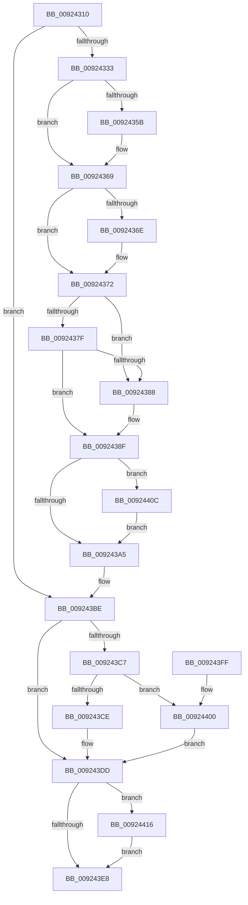

# AlpcConnectionDestroyProcedure

- RVA: `0x00924310`–`0x00924422` (길이 `274` bytes)
- VA: `0x0000000140924310`
- 실행 섹션: `PAGE`
- PDB 이름 있음: `예`; PDB Function 태그: `아니요`
- unwind 정보 RVA: `0x0007BF90`
- 디코드: `77`개 명령, `274/274` bytes 표시
- 미해석 바이트: `0` (있으면 어셈블리에 `.byte`로 보존)

> 이 문서는 커널 이미지의 기계어와 PDB 기호를 분석해 생성했습니다. 4번과 5번은 함수 원형과 자료형을 바이너리 사용 방식에서 추정한 C 해석이며 원본 소스 복구 결과는 아닙니다.

## 1. Dependencies

- 직접 호출 지점: **10**; 고유 호출 대상: **10**
- 직접 호출자로 확인된 함수: **0**
- RIP 상대 이미지 참조: **1**

### Outgoing calls
- `0x00924337` → [AlpcpLockBlobExclusive](AlpcpLockBlobExclusive_function_009253A4.md) (function, `0x009253A4`)
- `0x0092434B` → [KeAbPreAcquire](../../text/21/KeAbPreAcquire_function_00210230.md) (function, `0x00210230`)
- `0x00924364` → [ExfAcquirePushLockExclusiveEx](../../text/20/ExfAcquirePushLockExclusiveEx_function_0020FC90.md) (function, `0x0020FC90`)
- `0x009243A8` → [KeAbPostRelease](../../text/2E/KeAbPostRelease_function_002E1600.md) (function, `0x002E1600`)
- `0x009243B1` → [AlpcpUnlockBlobUncachedExclusive](AlpcpUnlockBlobUncachedExclusive_function_0092536C.md) (function, `0x0092536C`)
- `0x009243B9` → [ObfDereferenceObject](../../text/2F/ObfDereferenceObject_function_002F9350.md) (function, `0x002F9350`)
- `0x009243D8` → [ExFreeToPagedLookasideList](../../text/38/ExFreeToPagedLookasideList_function_00387D30.md) (function, `0x00387D30`)
- `0x00924405` → [ExFreePoolWithTag](../../poolcode/B8/ExFreePoolWithTag_function_00B82870.md) (function, `0x00B82870`)
- `0x0092440F` → [ExfTryToWakePushLock](../../text/26/ExfTryToWakePushLock_function_00265DD0.md) (function, `0x00265DD0`)
- `0x0092441B` → [AlpcpDereferenceBlobEx](../88/AlpcpDereferenceBlobEx_function_0088AF00.md) (function, `0x0088AF00`)

### Direct callers
- 이 함수 시작 RVA로 연결되는 직접 call은 확인되지 않았습니다. 간접 호출은 완전히 역산할 수 없습니다.

### Static image references
- `0x009243D1` → RVA `0x00E27280` (`.data`; read)

## 2. Other-region calls and transfers

- 다른 실행 섹션으로 향하는 call: **7**
  - `0x0092434B` → [KeAbPreAcquire](../../text/21/KeAbPreAcquire_function_00210230.md) (`PAGE` → `.text`)
  - `0x00924364` → [ExfAcquirePushLockExclusiveEx](../../text/20/ExfAcquirePushLockExclusiveEx_function_0020FC90.md) (`PAGE` → `.text`)
  - `0x009243A8` → [KeAbPostRelease](../../text/2E/KeAbPostRelease_function_002E1600.md) (`PAGE` → `.text`)
  - `0x009243B9` → [ObfDereferenceObject](../../text/2F/ObfDereferenceObject_function_002F9350.md) (`PAGE` → `.text`)
  - `0x009243D8` → [ExFreeToPagedLookasideList](../../text/38/ExFreeToPagedLookasideList_function_00387D30.md) (`PAGE` → `.text`)
  - `0x00924405` → [ExFreePoolWithTag](../../poolcode/B8/ExFreePoolWithTag_function_00B82870.md) (`PAGE` → `POOLCODE`)
  - `0x0092440F` → [ExfTryToWakePushLock](../../text/26/ExfTryToWakePushLock_function_00265DD0.md) (`PAGE` → `.text`)
- 별도 외부 분기/꼬리 이동을 확인하지 못했습니다.

## 3. Assembly (complete function range)

```asm
00924310  48 89 5C 24 08                  mov qword ptr [rsp + 8], rbx
00924315  48 89 6C 24 10                  mov qword ptr [rsp + 0x10], rbp
0092431A  48 89 74 24 18                  mov qword ptr [rsp + 0x18], rsi
0092431F  57                              push rdi
00924320  48 83 EC 20                     sub rsp, 0x20
00924324  48 8B 31                        mov rsi, qword ptr [rcx]
00924327  48 8B D9                        mov rbx, rcx
0092432A  48 85 F6                        test rsi, rsi
0092432D  0F 84 8B 00 00 00               je 0x1409243be
00924333  48 8B 4E 10                     mov rcx, qword ptr [rsi + 0x10]
00924337  E8 68 10 00 00                  call 0x1409253a4
0092433C  48 8D BE 60 01 00 00            lea rdi, [rsi + 0x160]
00924343  45 33 C0                        xor r8d, r8d
00924346  48 8B CF                        mov rcx, rdi
00924349  33 D2                           xor edx, edx
0092434B  E8 E0 BE 8E FF                  call 0x140210230
00924350  F0 48 0F BA 2F 00               lock bts qword ptr [rdi], 0
00924356  48 8B E8                        mov rbp, rax
00924359  73 0E                           jae 0x140924369
0092435B  4C 8B C7                        mov r8, rdi
0092435E  48 8B D0                        mov rdx, rax
00924361  48 8B CF                        mov rcx, rdi
00924364  E8 27 B9 8E FF                  call 0x14020fc90
00924369  48 85 ED                        test rbp, rbp
0092436C  74 04                           je 0x140924372
0092436E  C6 45 0A 01                     mov byte ptr [rbp + 0xa], 1
00924372  48 8D 43 18                     lea rax, [rbx + 0x18]
00924376  48 8B 10                        mov rdx, qword ptr [rax]
00924379  48 39 42 08                     cmp qword ptr [rdx + 8], rax
0092437D  75 09                           jne 0x140924388
0092437F  48 8B 48 08                     mov rcx, qword ptr [rax + 8]
00924383  48 39 01                        cmp qword ptr [rcx], rax
00924386  74 07                           je 0x14092438f
00924388  B9 03 00 00 00                  mov ecx, 3
0092438D  CD 29                           int 0x29
0092438F  48 89 11                        mov qword ptr [rcx], rdx
00924392  48 83 C8 FF                     or rax, 0xffffffffffffffff
00924396  48 89 4A 08                     mov qword ptr [rdx + 8], rcx
0092439A  F0 48 0F C1 07                  lock xadd qword ptr [rdi], rax
0092439F  24 06                           and al, 6
009243A1  3C 02                           cmp al, 2
009243A3  74 67                           je 0x14092440c
009243A5  48 8B CF                        mov rcx, rdi
009243A8  E8 53 D2 9B FF                  call 0x1402e1600
009243AD  48 8B 4E 10                     mov rcx, qword ptr [rsi + 0x10]
009243B1  E8 B6 0F 00 00                  call 0x14092536c
009243B6  48 8B 0B                        mov rcx, qword ptr [rbx]
009243B9  E8 92 4F 9D FF                  call 0x1402f9350
009243BE  48 8B 4B 28                     mov rcx, qword ptr [rbx + 0x28]
009243C2  48 85 C9                        test rcx, rcx
009243C5  74 16                           je 0x1409243dd
009243C7  48 83 7B 38 10                  cmp qword ptr [rbx + 0x38], 0x10
009243CC  75 32                           jne 0x140924400
009243CE  48 8B D1                        mov rdx, rcx
009243D1  48 8D 0D A8 2E 50 00            lea rcx, [rip + 0x502ea8]
009243D8  E8 53 39 A6 FF                  call 0x140387d30
009243DD  33 C9                           xor ecx, ecx
009243DF  48 87 4B 48                     xchg qword ptr [rbx + 0x48], rcx
009243E3  48 85 C9                        test rcx, rcx
009243E6  75 2E                           jne 0x140924416
009243E8  48 8B 5C 24 30                  mov rbx, qword ptr [rsp + 0x30]
009243ED  33 C0                           xor eax, eax
009243EF  48 8B 6C 24 38                  mov rbp, qword ptr [rsp + 0x38]
009243F4  48 8B 74 24 40                  mov rsi, qword ptr [rsp + 0x40]
009243F9  48 83 C4 20                     add rsp, 0x20
009243FD  5F                              pop rdi
009243FE  C3                              ret
009243FF  CC                              int3
00924400  BA 41 6C 48 61                  mov edx, 0x61486c41
00924405  E8 66 E4 25 00                  call 0x140b82870
0092440A  EB D1                           jmp 0x1409243dd
0092440C  48 8B CF                        mov rcx, rdi
0092440F  E8 BC 19 94 FF                  call 0x140265dd0
00924414  EB 8F                           jmp 0x1409243a5
00924416  BA 01 00 00 00                  mov edx, 1
0092441B  E8 E0 6A F6 FF                  call 0x14088af00
00924420  EB C6                           jmp 0x1409243e8
```

## 4. C-style interpretation (structured pseudocode)

```c
__int64 __fastcall AlpcConnectionDestroyProcedure(__int64 a1, int a2, int a3)
{
    __int64 result;
    __int64 v_rsp;
    unsigned __int64 v_stack_p10;
    unsigned __int64 v_stack_p18;
    unsigned __int64 v_stack_p8;

    v_stack_p8 = v_rbx;
    v_stack_p10 = v_rbp;
    v_stack_p18 = v_rsi;
    v_rsp = (v_rsp) - (32);
    if (*(unsigned __int64 *)(a1) == 0) goto loc_009243BE;
    result = AlpcpLockBlobExclusive(*(unsigned __int64 *)(*(unsigned __int64 *)(a1) + 16), a2, a3, a4);
    a3 = 0;
    a2 = 0;
    result = KeAbPreAcquire(*(unsigned __int64 *)(a1) + 352, a2, a3, a4);
    if (!(condition_is_above_or_equal)) {
        a3 = *(unsigned __int64 *)(a1) + 352;
        a2 = result;
        a1 = *(unsigned __int64 *)(a1) + 352;
        result = ExfAcquirePushLockExclusiveEx(a1, a2, a3, a4);
    }
    if (result != 0) {
        *(unsigned __int8 *)(result + 10) = 1;
    }
    if ((*(unsigned __int64 *)(*(unsigned __int64 *)(a1 + 24) + 8)) != (a1 + 24)) goto loc_00924388;
    if ((*(unsigned __int64 *)(*(unsigned __int64 *)(a1 + 24 + 8))) != (a1 + 24)) {
        a1 = 3;
    }
    *(unsigned __int64 *)(a1) = *(unsigned __int64 *)(a1 + 24);
    result = (a1 + 24) | (-1);
    *(unsigned __int64 *)(*(unsigned __int64 *)(a1 + 24) + 8) = a1;
    result = (unsigned __int8)((result) & (6));
    if (((unsigned __int8)(result)) == 2) goto loc_0092440C;
loc_009243A5:
    result = KeAbPostRelease(*(unsigned __int64 *)(a1) + 352, *(unsigned __int64 *)(a1 + 24), a3, a4);
    result = AlpcpUnlockBlobUncachedExclusive(*(unsigned __int64 *)(*(unsigned __int64 *)(a1) + 16), *(unsigned __int64 *)(a1 + 24), a3, a4);
    result = ObfDereferenceObject(*(unsigned __int64 *)(a1), *(unsigned __int64 *)(a1 + 24), a3, a4);
loc_009243BE:
    if (*(unsigned __int64 *)(a1 + 40) == 0) goto loc_009243DD;
    if ((*(unsigned __int64 *)(a1 + 56)) != 16) goto loc_00924400;
    result = ExFreeToPagedLookasideList(v_rip + 5254824, *(unsigned __int64 *)(a1 + 40), a3, a4);
loc_009243DD:
    a1 = 0;
    if (0 != 0) goto loc_00924416;
loc_009243E8:
    result = 0;
    v_rsp = (v_rsp) + (32);
    return result;
loc_00924400:
    result = ExFreePoolWithTag(a1, (unsigned int)(0x61486C41ULL), a3, a4);
    goto loc_009243DD;
loc_0092440C:
    result = ExfTryToWakePushLock(*(unsigned __int64 *)(a1) + 352, (unsigned int)(0x61486C41ULL), a3, a4);
    goto loc_009243A5;
loc_00924416:
    result = AlpcpDereferenceBlobEx(*(unsigned __int64 *)(a1) + 352, 1, a3, a4);
    goto loc_009243E8;
}
```

## 5. (Beta) C Style

```c
int64_t AlpcConnectionDestroyProcedure(void *Arg1, int32_t Arg2, int32_t Arg3)
{
    uint8_t *arg1 = (uint8_t *)Arg1;

    int64_t result;
    int64_t local_rsp;
    uint64_t v_stack_p10;
    uint64_t v_stack_p18;
    uint64_t v_stack_p8;

    v_stack_p8 = local_rbx;
    v_stack_p10 = local_rbp;
    v_stack_p18 = local_rsi;
    local_rsp = (local_rsp) - (32);
    if (*(uint64_t *)(arg1) == 0) goto loc_009243BE;
    result = AlpcpLockBlobExclusive(*(uint64_t *)(*(uint64_t *)(arg1) + 0x10), Arg2, Arg3, a4);
    Arg3 = 0;
    Arg2 = 0;
    result = KeAbPreAcquire(*(uint64_t *)(arg1) + 352, Arg2, Arg3, a4);
    if (!(condition_is_above_or_equal)) {
        Arg3 = *(uint64_t *)(arg1) + 352;
        Arg2 = result;
        Arg1 = *(uint64_t *)(arg1) + 352;
        result = ExfAcquirePushLockExclusiveEx(Arg1, Arg2, Arg3, a4);
    }
    if (result != 0) {
        *(uint8_t *)(result + 0xA) = 1;
    }
    if ((*(uint64_t *)(*(uint64_t *)(arg1 + 0x18) + 0x8)) != (Arg1 + 24)) goto loc_00924388;
    if ((*(uint64_t *)(*(uint64_t *)(arg1 + 0x18 + 0x8))) != (Arg1 + 24)) {
        Arg1 = 3;
    }
    *(uint64_t *)(arg1) = *(uint64_t *)(arg1 + 0x18);
    result = (Arg1 + 24) | (-1);
    *(void **)(*(uint64_t *)(arg1 + 0x18) + 0x8) = Arg1;
    result = (uint8_t)((result) & (6));
    if (((uint8_t)(result)) == 2) goto loc_0092440C;
loc_009243A5:
    result = KeAbPostRelease(*(uint64_t *)(arg1) + 352, *(uint64_t *)(arg1 + 0x18), Arg3, a4);
    result = AlpcpUnlockBlobUncachedExclusive(*(uint64_t *)(*(uint64_t *)(arg1) + 0x10), *(uint64_t *)(arg1 + 0x18), Arg3, a4);
    result = ObfDereferenceObject(*(uint64_t *)(arg1), *(uint64_t *)(arg1 + 0x18), Arg3, a4);
loc_009243BE:
    if (*(uint64_t *)(arg1 + 0x28) == 0) goto loc_009243DD;
    if ((*(uint64_t *)(arg1 + 0x38)) != 16) goto loc_00924400;
    result = ExFreeToPagedLookasideList(v_rip + 5254824, *(uint64_t *)(arg1 + 0x28), Arg3, a4);
loc_009243DD:
    Arg1 = 0;
    if (0 != 0) goto loc_00924416;
loc_009243E8:
    result = 0;
    local_rsp = (local_rsp) + (32);
    return result;
loc_00924400:
    result = ExFreePoolWithTag(Arg1, (uint32_t)(0x61486C41ULL), Arg3, a4);
    goto loc_009243DD;
loc_0092440C:
    result = ExfTryToWakePushLock(*(uint64_t *)(arg1) + 352, (uint32_t)(0x61486C41ULL), Arg3, a4);
    goto loc_009243A5;
loc_00924416:
    result = AlpcpDereferenceBlobEx(*(uint64_t *)(arg1) + 352, 1, Arg3, a4);
    goto loc_009243E8;
}
```

### 관측된 메모리 오프셋

구조체 형식이 확인되지 않은 접근은 인자 기준의 오프셋으로만 기록했습니다.

| 기준 인자 | 오프셋 표현 | 폭 (bit) | 접근 |
|---|---:|---:|---|
| `Arg1` | `+ 0x0` | `64` | `R` |
| `Arg1` | `+ 0x8` | `64` | `R` |
| `Arg1` | `+ 0x18` | `64` | `R` |
| `Arg1` | `+ 0x28` | `64` | `R` |
| `Arg1` | `+ 0x38` | `64` | `R` |
| `Arg1` | `+ 0x48` | `64` | `R/W` |

## 6. Execution-region graph

[열기: 2D/3D 그래프와 함수 탐색 컨트롤 패널](../../../control-panel.html?section=page&rva=0x00924310&view=graph)

- 2D 그래프는 위에서 아래로 흐르고, 3D 그래프는 빈 공간을 드래그해 회전합니다. Shift+드래그는 이동, 휠은 확대·축소, 함수 노드 선택은 대상 보고서 이동입니다.

### Static fallback


