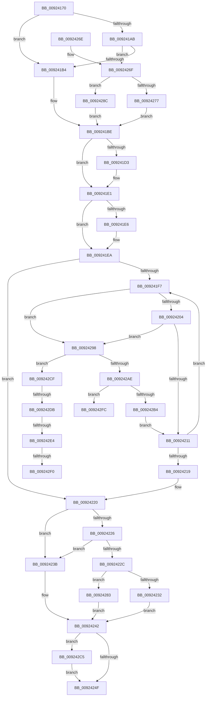

# AlpcpCancelMessagesByRequestor

- RVA: `0x00924170`–`0x00924303` (길이 `403` bytes)
- VA: `0x0000000140924170`
- 실행 섹션: `PAGE`
- PDB 이름 있음: `예`; PDB Function 태그: `예`
- unwind 정보 RVA: `0x0008D3AC`
- 디코드: `114`개 명령, `403/403` bytes 표시
- 미해석 바이트: `0` (있으면 어셈블리에 `.byte`로 보존)

> 이 문서는 커널 이미지의 기계어와 PDB 기호를 분석해 생성했습니다. 4번과 5번은 함수 원형과 자료형을 바이너리 사용 방식에서 추정한 C 해석이며 원본 소스 복구 결과는 아닙니다.

## 1. Dependencies

- 직접 호출 지점: **7**; 고유 호출 대상: **7**
- 직접 호출자로 확인된 함수: **1**
- RIP 상대 이미지 참조: **0**

### Outgoing calls
- `0x009241C3` → [KeAbPreAcquire](../../text/21/KeAbPreAcquire_function_00210230.md) (function, `0x00210230`)
- `0x009241DC` → [ExfAcquirePushLockExclusiveEx](../../text/20/ExfAcquirePushLockExclusiveEx_function_0020FC90.md) (function, `0x0020FC90`)
- `0x00924252` → [KeAbPostRelease](../../text/2E/KeAbPostRelease_function_002E1600.md) (function, `0x002E1600`)
- `0x0092429B` → [AlpcpReferenceBlob](../89/AlpcpReferenceBlob_function_00890110.md) (function, `0x00890110`)
- `0x009242A3` → [AlpcpTryLockForCachedReferenceBlob](../9E/AlpcpTryLockForCachedReferenceBlob_function_009E7920.md) (function, `0x009E7920`)
- `0x009242BB` → [AlpcpUnlockMessage](../89/AlpcpUnlockMessage_function_00897AE0.md) (function, `0x00897AE0`)
- `0x009242C8` → [ExfTryToWakePushLock](../../text/26/ExfTryToWakePushLock_function_00265DD0.md) (function, `0x00265DD0`)

### Direct callers
- [AlpcpDisconnectPort](AlpcpDisconnectPort_function_00924A68.md) at `0x00924BBA`
- [AlpcpDisconnectPort](AlpcpDisconnectPort_function_00924A68.md) at `0x00924BDD`
- [AlpcpDisconnectPort](AlpcpDisconnectPort_function_00924A68.md) at `0x00924C00`
- [AlpcpDisconnectPort](AlpcpDisconnectPort_function_00924A68.md) at `0x00924C23`

### Static image references
- 디코드된 RIP-relative 메모리 참조가 없습니다.

## 2. Other-region calls and transfers

- 다른 실행 섹션으로 향하는 call: **4**
  - `0x009241C3` → [KeAbPreAcquire](../../text/21/KeAbPreAcquire_function_00210230.md) (`PAGE` → `.text`)
  - `0x009241DC` → [ExfAcquirePushLockExclusiveEx](../../text/20/ExfAcquirePushLockExclusiveEx_function_0020FC90.md) (`PAGE` → `.text`)
  - `0x00924252` → [KeAbPostRelease](../../text/2E/KeAbPostRelease_function_002E1600.md) (`PAGE` → `.text`)
  - `0x009242C8` → [ExfTryToWakePushLock](../../text/26/ExfTryToWakePushLock_function_00265DD0.md) (`PAGE` → `.text`)
- call이 아닌 외부 분기/꼬리 이동: **5**
  - `0x009242D5` → [sub_00B22892 + 0x9](../B2/Unknown_function_00B22892.md) (`tail-transfer`)
  - `0x009242DE` → [sub_00B22892 + 0x9](../B2/Unknown_function_00B22892.md) (`tail-transfer`)
  - `0x009242EA` → [sub_00B22892](../B2/Unknown_function_00B22892.md) (`tail-transfer`)
  - `0x009242F7` → [sub_00B22892 + 0x13](../B2/Unknown_function_00B22892.md) (`tail-transfer`)
  - `0x009242FE` → [sub_00B22892 + 0xCE](../B2/Unknown_function_00B22892.md) (`tail-transfer`)

## 3. Assembly (complete function range)

```asm
00924170  48 89 5C 24 10                  mov qword ptr [rsp + 0x10], rbx
00924175  48 89 4C 24 08                  mov qword ptr [rsp + 8], rcx
0092417A  55                              push rbp
0092417B  56                              push rsi
0092417C  57                              push rdi
0092417D  41 54                           push r12
0092417F  41 55                           push r13
00924181  41 56                           push r14
00924183  41 57                           push r15
00924185  48 83 EC 30                     sub rsp, 0x30
00924189  45 33 ED                        xor r13d, r13d
0092418C  41 8B C1                        mov eax, r9d
0092418F  44 89 AC 24 88 00 00 00         mov dword ptr [rsp + 0x88], r13d
00924197  45 8B F1                        mov r14d, r9d
0092419A  4D 8B E0                        mov r12, r8
0092419D  48 8B EA                        mov rbp, rdx
009241A0  4C 8B F9                        mov r15, rcx
009241A3  41 8B F5                        mov esi, r13d
009241A6  83 E8 01                        sub eax, 1
009241A9  74 09                           je 0x1409241b4
009241AB  83 E8 01                        sub eax, 1
009241AE  0F 85 BB 00 00 00               jne 0x14092426f
009241B4  48 8D 9A 88 00 00 00            lea rbx, [rdx + 0x88]
009241BB  45 33 C0                        xor r8d, r8d
009241BE  33 D2                           xor edx, edx
009241C0  48 8B CB                        mov rcx, rbx
009241C3  E8 68 C0 8E FF                  call 0x140210230
009241C8  F0 48 0F BA 2B 00               lock bts qword ptr [rbx], 0
009241CE  48 8B F8                        mov rdi, rax
009241D1  73 0E                           jae 0x1409241e1
009241D3  4C 8B C3                        mov r8, rbx
009241D6  48 8B D0                        mov rdx, rax
009241D9  48 8B CB                        mov rcx, rbx
009241DC  E8 AF BA 8E FF                  call 0x14020fc90
009241E1  48 85 FF                        test rdi, rdi
009241E4  74 04                           je 0x1409241ea
009241E6  C6 47 0A 01                     mov byte ptr [rdi + 0xa], 1
009241EA  49 8B 3C 24                     mov rdi, qword ptr [r12]
009241EE  48 83 CB FF                     or rbx, 0xffffffffffffffff
009241F2  49 3B FC                        cmp rdi, r12
009241F5  74 29                           je 0x140924220
009241F7  4C 8B EF                        mov r13, rdi
009241FA  4C 39 7F 18                     cmp qword ptr [rdi + 0x18], r15
009241FE  0F 84 94 00 00 00               je 0x140924298
00924204  F7 47 28 00 00 01 00            test dword ptr [rdi + 0x28], 0x10000
0092420B  0F 85 87 00 00 00               jne 0x140924298
00924211  48 8B 3F                        mov rdi, qword ptr [rdi]
00924214  49 3B FC                        cmp rdi, r12
00924217  75 DE                           jne 0x1409241f7
00924219  8B B4 24 88 00 00 00            mov esi, dword ptr [rsp + 0x88]
00924220  41 83 EE 01                     sub r14d, 1
00924224  74 15                           je 0x14092423b
00924226  41 83 EE 01                     sub r14d, 1
0092422A  74 0F                           je 0x14092423b
0092422C  41 83 FE 01                     cmp r14d, 1
00924230  74 51                           je 0x140924283
00924232  48 8D BD C8 00 00 00            lea rdi, [rbp + 0xc8]
00924239  EB 07                           jmp 0x140924242
0092423B  48 8D BD 88 00 00 00            lea rdi, [rbp + 0x88]
00924242  F0 48 0F C1 1F                  lock xadd qword ptr [rdi], rbx
00924247  80 E3 06                        and bl, 6
0092424A  80 FB 02                        cmp bl, 2
0092424D  74 76                           je 0x1409242c5
0092424F  48 8B CF                        mov rcx, rdi
00924252  E8 A9 D3 9B FF                  call 0x1402e1600
00924257  48 8B 5C 24 78                  mov rbx, qword ptr [rsp + 0x78]
0092425C  8B C6                           mov eax, esi
0092425E  48 83 C4 30                     add rsp, 0x30
00924262  41 5F                           pop r15
00924264  41 5E                           pop r14
00924266  41 5D                           pop r13
00924268  41 5C                           pop r12
0092426A  5F                              pop rdi
0092426B  5E                              pop rsi
0092426C  5D                              pop rbp
0092426D  C3                              ret
0092426E  CC                              int3
0092426F  45 33 C0                        xor r8d, r8d
00924272  83 F8 01                        cmp eax, 1
00924275  74 15                           je 0x14092428c
00924277  48 8D 9A C8 00 00 00            lea rbx, [rdx + 0xc8]
0092427E  E9 3B FF FF FF                  jmp 0x1409241be
00924283  48 8D BD B0 00 00 00            lea rdi, [rbp + 0xb0]
0092428A  EB B6                           jmp 0x140924242
0092428C  48 8D 9A B0 00 00 00            lea rbx, [rdx + 0xb0]
00924293  E9 26 FF FF FF                  jmp 0x1409241be
00924298  48 8B CF                        mov rcx, rdi
0092429B  E8 70 BE F6 FF                  call 0x140890110
009242A0  48 8B CF                        mov rcx, rdi
009242A3  E8 78 36 0C 00                  call 0x1409e7920
009242A8  33 D2                           xor edx, edx
009242AA  84 C0                           test al, al
009242AC  74 21                           je 0x1409242cf
009242AE  4C 39 7F 18                     cmp qword ptr [rdi + 0x18], r15
009242B2  74 48                           je 0x1409242fc
009242B4  66 01 5F E2                     add word ptr [rdi - 0x1e], bx
009242B8  48 8B CF                        mov rcx, rdi
009242BB  E8 20 38 F7 FF                  call 0x140897ae0
009242C0  E9 4C FF FF FF                  jmp 0x140924211
009242C5  48 8B CF                        mov rcx, rdi
009242C8  E8 03 1B 94 FF                  call 0x140265dd0
009242CD  EB 80                           jmp 0x14092424f
009242CF  41 8B C6                        mov eax, r14d
009242D2  83 E8 01                        sub eax, 1
009242D5  0F 84 C0 E5 1F 00               je 0x140b2289b
009242DB  83 E8 01                        sub eax, 1
009242DE  0F 84 B7 E5 1F 00               je 0x140b2289b
009242E4  83 F8 01                        cmp eax, 1
009242E7  48 8B C3                        mov rax, rbx
009242EA  0F 84 A2 E5 1F 00               je 0x140b22892
009242F0  48 8D B5 C8 00 00 00            lea rsi, [rbp + 0xc8]
009242F7  E9 A9 E5 1F 00                  jmp 0x140b228a5
009242FC  8B F2                           mov esi, edx
009242FE  E9 5D E6 1F 00                  jmp 0x140b22960
```

## 4. C-style interpretation (structured pseudocode)

```c
__int64 __fastcall AlpcpCancelMessagesByRequestor(__int64 a1, __int64 a2, __int64 a3, int a4)
{
    __int64 result;
    __int64 v_r13;
    __int64 v_r14;
    __int64 v_rbx;
    __int64 v_rsp;
    unsigned __int64 v_stack_p10;
    unsigned int v_stack_p20;
    unsigned __int64 v_stack_p8;

    v_stack_p10 = v_rbx;
    v_stack_p8 = a1;
    v_rsp = (v_rsp) - (48);
    v_r13 = 0;
    v_stack_p20 = 0;
    result = (unsigned int)(((unsigned int)(a4)) - (1));
    if (condition_is_equal) goto loc_009241B4;
    result = (unsigned int)((result) - (1));
    if (condition_is_not_equal) goto loc_0092426F;
loc_009241B4:
    a3 = 0;
loc_009241BE:
    a2 = 0;
    result = KeAbPreAcquire(a2 + 136, a2, a3, a4);
    if (!(condition_is_above_or_equal)) {
        a3 = a2 + 136;
        a2 = result;
        a1 = a2 + 136;
        result = ExfAcquirePushLockExclusiveEx(a1, a2, a3, a4);
    }
    if (result != 0) {
        *(unsigned __int8 *)(result + 10) = 1;
    }
    v_rbx = (a2 + 136) | (-1);
    if ((*(unsigned __int64 *)(a3)) == a3) goto loc_00924220;
loc_009241F7:
    if ((*(unsigned __int64 *)(*(unsigned __int64 *)(a3) + 24)) == a1) goto loc_00924298;
    if (((*(unsigned int *)(*(unsigned __int64 *)(a3) + 40)) & (0x10000ULL)) != 0) goto loc_00924298;
loc_00924211:
    if ((*(unsigned __int64 *)(*(unsigned __int64 *)(a3))) != a3) goto loc_009241F7;
loc_00924220:
    v_r14 = (unsigned int)(((unsigned int)(a4)) - (1));
    if (condition_is_equal) goto loc_0092423B;
    v_r14 = (unsigned int)((v_r14) - (1));
    if (condition_is_equal) goto loc_0092423B;
    if (((unsigned int)(v_r14)) == 1) goto loc_00924283;
    goto loc_00924242;
loc_0092423B:
loc_00924242:
    v_rbx = (unsigned __int8)((v_rbx) & (6));
    if (((unsigned __int8)(v_rbx)) == 2) goto loc_009242C5;
loc_0092424F:
    result = KeAbPostRelease(a2 + 136, a2, a3, a4);
    v_rsp = (v_rsp) + (48);
    return (unsigned int)((unsigned int)((unsigned int)(v_stack_p20)));
loc_0092426F:
    a3 = 0;
    if (((unsigned int)((unsigned int)((unsigned int)((unsigned int)(v_stack_p20))))) == 1) goto loc_0092428C;
    goto loc_009241BE;
loc_00924283:
    goto loc_00924242;
loc_0092428C:
    goto loc_009241BE;
loc_00924298:
    result = AlpcpReferenceBlob(a2 + 176, a2, a3, a4);
    result = AlpcpTryLockForCachedReferenceBlob(a2 + 176, a2, a3, a4);
    a2 = 0;
    if ((unsigned __int8)(result) == 0) goto loc_009242CF;
    if ((*(unsigned __int64 *)(a2 + 176 + 24)) == a1) goto loc_009242FC;
    result = AlpcpUnlockMessage(a2 + 176, a2, a3, a4);
    goto loc_00924211;
loc_009242C5:
    result = ExfTryToWakePushLock(a2 + 176, a2, a3, a4);
    goto loc_0092424F;
loc_009242CF:
    result = (unsigned int)(((unsigned int)((unsigned int)(v_r14))) - (1));
    result = (unsigned int)((result) - (1));
loc_009242FC:
}
```

## 5. (Beta) C Style

```c
int64_t AlpcpCancelMessagesByRequestor(int64_t Arg1, void *Arg2, void *Arg3, int32_t Arg4)
{
    uint8_t *arg2 = (uint8_t *)Arg2;
    uint8_t *arg3 = (uint8_t *)Arg3;

    int64_t result;
    int64_t local_r13;
    int64_t local_r14;
    int64_t local_rbx;
    int64_t local_rsp;
    uint64_t v_stack_p10;
    uint32_t v_stack_p20;
    uint64_t v_stack_p8;

    v_stack_p10 = local_rbx;
    v_stack_p8 = Arg1;
    local_rsp = (local_rsp) - (48);
    local_r13 = 0;
    v_stack_p20 = 0;
    result = (uint32_t)(((uint32_t)(Arg4)) - (1));
    if (condition_is_equal) goto loc_009241B4;
    result = (uint32_t)((result) - (1));
    if (condition_is_not_equal) goto loc_0092426F;
loc_009241B4:
    Arg3 = 0;
loc_009241BE:
    Arg2 = 0;
    result = KeAbPreAcquire(Arg2 + 136, Arg2, Arg3, Arg4);
    if (!(condition_is_above_or_equal)) {
        Arg3 = Arg2 + 136;
        Arg2 = result;
        Arg1 = Arg2 + 136;
        result = ExfAcquirePushLockExclusiveEx(Arg1, Arg2, Arg3, Arg4);
    }
    if (result != 0) {
        *(uint8_t *)(result + 0xA) = 1;
    }
    local_rbx = (Arg2 + 136) | (-1);
    if ((*(uint64_t *)(arg3)) == Arg3) goto loc_00924220;
loc_009241F7:
    if ((*(uint64_t *)(*(uint64_t *)(arg3) + 0x18)) == Arg1) goto loc_00924298;
    if (((*(uint32_t *)(*(uint64_t *)(arg3) + 0x28)) & (0x10000ULL)) != 0) goto loc_00924298;
loc_00924211:
    if ((*(uint64_t *)(*(uint64_t *)(arg3))) != Arg3) goto loc_009241F7;
loc_00924220:
    local_r14 = (uint32_t)(((uint32_t)(Arg4)) - (1));
    if (condition_is_equal) goto loc_0092423B;
    local_r14 = (uint32_t)((local_r14) - (1));
    if (condition_is_equal) goto loc_0092423B;
    if (((uint32_t)(local_r14)) == 1) goto loc_00924283;
    goto loc_00924242;
loc_0092423B:
loc_00924242:
    local_rbx = (uint8_t)((local_rbx) & (6));
    if (((uint8_t)(local_rbx)) == 2) goto loc_009242C5;
loc_0092424F:
    result = KeAbPostRelease(Arg2 + 136, Arg2, Arg3, Arg4);
    local_rsp = (local_rsp) + (48);
    return (uint32_t)((uint32_t)((uint32_t)(v_stack_p20)));
loc_0092426F:
    Arg3 = 0;
    if (((uint32_t)((uint32_t)((uint32_t)((uint32_t)(v_stack_p20))))) == 1) goto loc_0092428C;
    goto loc_009241BE;
loc_00924283:
    goto loc_00924242;
loc_0092428C:
    goto loc_009241BE;
loc_00924298:
    result = AlpcpReferenceBlob(Arg2 + 176, Arg2, Arg3, Arg4);
    result = AlpcpTryLockForCachedReferenceBlob(Arg2 + 176, Arg2, Arg3, Arg4);
    Arg2 = 0;
    if ((uint8_t)(result) == 0) goto loc_009242CF;
    if ((*(uint64_t *)(arg2 + 0xB0 + 0x18)) == Arg1) goto loc_009242FC;
    result = AlpcpUnlockMessage(Arg2 + 176, Arg2, Arg3, Arg4);
    goto loc_00924211;
loc_009242C5:
    result = ExfTryToWakePushLock(Arg2 + 176, Arg2, Arg3, Arg4);
    goto loc_0092424F;
loc_009242CF:
    result = (uint32_t)(((uint32_t)((uint32_t)(local_r14))) - (1));
    result = (uint32_t)((result) - (1));
loc_009242FC:
}
```

### 관측된 메모리 오프셋

구조체 형식이 확인되지 않은 접근은 인자 기준의 오프셋으로만 기록했습니다.

| 기준 인자 | 오프셋 표현 | 폭 (bit) | 접근 |
|---|---:|---:|---|
| `Arg2` | `+ 0x0` | `64` | `R/W` |
| `Arg2` | `+ 0x88` | `64` | `R` |
| `Arg2` | `+ 0xB0` | `64` | `R` |
| `Arg2` | `+ 0xC8` | `64` | `R` |
| `Arg3` | `+ 0x0` | `64` | `R` |

## 6. Execution-region graph

[열기: 2D/3D 그래프와 함수 탐색 컨트롤 패널](../../../control-panel.html?section=page&rva=0x00924170&view=graph)

- 2D 그래프는 위에서 아래로 흐르고, 3D 그래프는 빈 공간을 드래그해 회전합니다. Shift+드래그는 이동, 휠은 확대·축소, 함수 노드 선택은 대상 보고서 이동입니다.

### Static fallback


