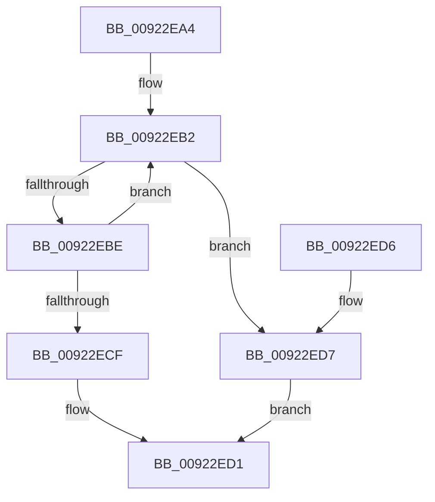

# AlpcpChargePagedPoolQuota

- RVA: `0x00922EA4`–`0x00922EE1` (길이 `61` bytes)
- VA: `0x0000000140922EA4`
- 실행 섹션: `PAGE`
- PDB 이름 있음: `예`; PDB Function 태그: `아니요`
- unwind 정보 RVA: `0x0005F758`
- 디코드: `17`개 명령, `61/61` bytes 표시
- 미해석 바이트: `0` (있으면 어셈블리에 `.byte`로 보존)

> 이 문서는 커널 이미지의 기계어와 PDB 기호를 분석해 생성했습니다. 4번과 5번은 함수 원형과 자료형을 바이너리 사용 방식에서 추정한 C 해석이며 원본 소스 복구 결과는 아닙니다.

## 1. Dependencies

- 직접 호출 지점: **1**; 고유 호출 대상: **1**
- 직접 호출자로 확인된 함수: **4**
- RIP 상대 이미지 참조: **0**

### Outgoing calls
- `0x00922EDA` → [PsChargeProcessPagedPoolQuota](../89/PsChargeProcessPagedPoolQuota_function_00891170.md) (function, `0x00891170`)

### Direct callers
- [AlpcpSendMessage](../88/AlpcpSendMessage_function_0088BD40.md) at `0x0088C25C`
- [AlpcpSendMessage](../88/AlpcpSendMessage_function_0088BD40.md) at `0x0088C7BF`
- [AlpcpCaptureMessageDataSafe](../88/AlpcpCaptureMessageDataSafe_function_0088F3B0.md) at `0x0088F534`
- [sub_00892B22](../89/Unknown_function_00892B22.md) at `0x00892B4D`
- [sub_00922E15](Unknown_function_00922E15.md) at `0x00922E31`

### Static image references
- 디코드된 RIP-relative 메모리 참조가 없습니다.

## 2. Other-region calls and transfers

- 다른 실행 섹션으로 향하는 call: **0**
- 별도 외부 분기/꼬리 이동을 확인하지 못했습니다.

## 3. Assembly (complete function range)

```asm
00922EA4  48 83 EC 28                     sub rsp, 0x28
00922EA8  4C 8B C2                        mov r8, rdx
00922EAB  0F 0D 89 98 05 00 00            prefetchw byte ptr [rcx + 0x598]
00922EB2  48 8B 81 98 05 00 00            mov rax, qword ptr [rcx + 0x598]
00922EB9  49 3B C0                        cmp rax, r8
00922EBC  72 19                           jb 0x140922ed7
00922EBE  48 8B D0                        mov rdx, rax
00922EC1  49 2B D0                        sub rdx, r8
00922EC4  F0 48 0F B1 91 98 05 00 00      lock cmpxchg qword ptr [rcx + 0x598], rdx
00922ECD  75 E3                           jne 0x140922eb2
00922ECF  33 C0                           xor eax, eax
00922ED1  48 83 C4 28                     add rsp, 0x28
00922ED5  C3                              ret
00922ED6  CC                              int3
00922ED7  49 8B D0                        mov rdx, r8
00922EDA  E8 91 E2 F6 FF                  call 0x140891170
00922EDF  EB F0                           jmp 0x140922ed1
```

## 4. C-style interpretation (structured pseudocode)

```c
__int64 __fastcall AlpcpChargePagedPoolQuota(__int64 a1, __int64 a2)
{
    __int64 result;
    __int64 v_rsp;

    v_rsp = (v_rsp) - (40);
loc_00922EB2:
    if ((*(unsigned __int64 *)(a1 + 1432)) < a2) goto loc_00922ED7;
    a2 = (*(unsigned __int64 *)(a1 + 1432)) - (a2);
    if (condition_is_not_equal) goto loc_00922EB2;
    result = 0;
loc_00922ED1:
    v_rsp = (v_rsp) + (40);
    return result;
loc_00922ED7:
    result = PsChargeProcessPagedPoolQuota(a1, a2, a2, a4);
    goto loc_00922ED1;
}
```

## 5. (Beta) C Style

```c
int64_t AlpcpChargePagedPoolQuota(void *Arg1, int64_t Arg2)
{
    uint8_t *arg1 = (uint8_t *)Arg1;

    int64_t result;
    int64_t local_rsp;

    local_rsp = (local_rsp) - (40);
loc_00922EB2:
    if ((*(uint64_t *)(arg1 + 0x598)) < Arg2) goto loc_00922ED7;
    Arg2 = (*(uint64_t *)(arg1 + 0x598)) - (Arg2);
    if (condition_is_not_equal) goto loc_00922EB2;
    result = 0;
loc_00922ED1:
    local_rsp = (local_rsp) + (40);
    return result;
loc_00922ED7:
    result = PsChargeProcessPagedPoolQuota(Arg1, Arg2, Arg2, a4);
    goto loc_00922ED1;
}
```

### 관측된 메모리 오프셋

구조체 형식이 확인되지 않은 접근은 인자 기준의 오프셋으로만 기록했습니다.

| 기준 인자 | 오프셋 표현 | 폭 (bit) | 접근 |
|---|---:|---:|---|
| `Arg1` | `+ 0x598` | `8` | `R` |
| `Arg1` | `+ 0x598` | `64` | `R` |

## 6. Execution-region graph

[열기: 2D/3D 그래프와 함수 탐색 컨트롤 패널](../../../control-panel.html?section=page&rva=0x00922EA4&view=graph)

- 2D 그래프는 위에서 아래로 흐르고, 3D 그래프는 빈 공간을 드래그해 회전합니다. Shift+드래그는 이동, 휠은 확대·축소, 함수 노드 선택은 대상 보고서 이동입니다.

### Static fallback


