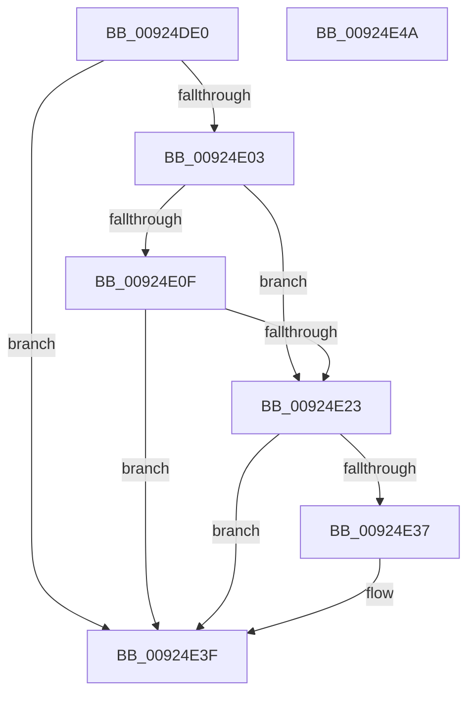

# AlpcpClosePort

- RVA: `0x00924DE0`–`0x00924E4B` (길이 `107` bytes)
- VA: `0x0000000140924DE0`
- 실행 섹션: `PAGE`
- PDB 이름 있음: `예`; PDB Function 태그: `아니요`
- unwind 정보 RVA: `0x0005CF00`
- 디코드: `28`개 명령, `107/107` bytes 표시
- 미해석 바이트: `0` (있으면 어셈블리에 `.byte`로 보존)

> 이 문서는 커널 이미지의 기계어와 PDB 기호를 분석해 생성했습니다. 4번과 5번은 함수 원형과 자료형을 바이너리 사용 방식에서 추정한 C 해석이며 원본 소스 복구 결과는 아닙니다.

## 1. Dependencies

- 직접 호출 지점: **3**; 고유 호출 대상: **3**
- 직접 호출자로 확인된 함수: **0**
- RIP 상대 이미지 참조: **0**

### Outgoing calls
- `0x00924E26` → [AlpcpDoPortCleanup](AlpcpDoPortCleanup_function_00924E54.md) (function, `0x00924E54`)
- `0x00924E3A` → [AlpcpSendCloseMessage](AlpcpSendCloseMessage_function_0092524C.md) (function, `0x0092524C`)
- `0x00924E3F` → [KeLeaveCriticalRegion](../../text/25/KeLeaveCriticalRegion_function_0025D8B0.md) (function, `0x0025D8B0`)

### Direct callers
- 이 함수 시작 RVA로 연결되는 직접 call은 확인되지 않았습니다. 간접 호출은 완전히 역산할 수 없습니다.

### Static image references
- 디코드된 RIP-relative 메모리 참조가 없습니다.

## 2. Other-region calls and transfers

- 다른 실행 섹션으로 향하는 call: **1**
  - `0x00924E3F` → [KeLeaveCriticalRegion](../../text/25/KeLeaveCriticalRegion_function_0025D8B0.md) (`PAGE` → `.text`)
- 별도 외부 분기/꼬리 이동을 확인하지 못했습니다.

## 3. Assembly (complete function range)

```asm
00924DE0  40 53                           push rbx
00924DE2  48 83 EC 20                     sub rsp, 0x20
00924DE6  65 48 8B 04 25 88 01 00 00      mov rax, qword ptr gs:[0x188]
00924DEF  48 8B DA                        mov rbx, rdx
00924DF2  48 8B D1                        mov rdx, rcx
00924DF5  66 FF 88 E4 01 00 00            dec word ptr [rax + 0x1e4]
00924DFC  90                              nop
00924DFD  49 83 F8 01                     cmp r8, 1
00924E01  75 3C                           jne 0x140924e3f
00924E03  F7 83 00 01 00 00 00 00 10 00   test dword ptr [rbx + 0x100], 0x100000
00924E0D  75 14                           jne 0x140924e23
00924E0F  48 8B 4B 18                     mov rcx, qword ptr [rbx + 0x18]
00924E13  41 8D 40 FF                     lea eax, [r8 - 1]
00924E17  41 84 C8                        test r8b, cl
00924E1A  48 0F 44 C1                     cmove rax, rcx
00924E1E  48 3B C2                        cmp rax, rdx
00924E21  75 1C                           jne 0x140924e3f
00924E23  48 8B CB                        mov rcx, rbx
00924E26  E8 29 00 00 00                  call 0x140924e54
00924E2B  F7 83 00 01 00 00 00 10 00 00   test dword ptr [rbx + 0x100], 0x1000
00924E35  75 08                           jne 0x140924e3f
00924E37  48 8B CB                        mov rcx, rbx
00924E3A  E8 0D 04 00 00                  call 0x14092524c
00924E3F  E8 6C 8A 93 FF                  call 0x14025d8b0
00924E44  48 83 C4 20                     add rsp, 0x20
00924E48  5B                              pop rbx
00924E49  C3                              ret
00924E4A  CC                              int3
```

## 4. C-style interpretation (structured pseudocode)

```c
__int64 __fastcall AlpcpClosePort(__int64 a1, __int64 a2, __int64 a3)
{
    __int64 result;
    __int64 v_rsp;

    v_rsp = (v_rsp) - (32);
    if (a3 != 1) goto loc_00924E3F;
    if (((*(unsigned int *)(a2 + 256)) & (0x100000ULL)) != 0) goto loc_00924E23;
    result = a3 - 1;
    if ((((unsigned __int8)(a3)) & ((unsigned __int8)(*(unsigned __int64 *)(a2 + 24)))) == 0) { result = *(unsigned __int64 *)(a2 + 24); }
    if (result != a1) goto loc_00924E3F;
loc_00924E23:
    result = AlpcpDoPortCleanup(a2, a1, a3, a4);
    if (((*(unsigned int *)(a2 + 256)) & (0x1000ULL)) == 0) {
        a1 = a2;
        result = AlpcpSendCloseMessage(a1, a1, a3, a4);
    }
    result = KeLeaveCriticalRegion(a1, a1, a3, a4);
    v_rsp = (v_rsp) + (32);
    return result;
}
```

## 5. (Beta) C Style

```c
int64_t AlpcpClosePort(int64_t Arg1, void *Arg2, int64_t Arg3)
{
    uint8_t *arg2 = (uint8_t *)Arg2;

    int64_t result;
    int64_t local_rsp;

    local_rsp = (local_rsp) - (32);
    if (Arg3 != 1) goto loc_00924E3F;
    if (((*(uint32_t *)(arg2 + 0x100)) & (0x100000ULL)) != 0) goto loc_00924E23;
    result = Arg3 - 1;
    if ((((uint8_t)(Arg3)) & ((uint8_t)(*(uint64_t *)(arg2 + 0x18)))) == 0) { result = *(uint64_t *)(arg2 + 0x18); }
    if (result != Arg1) goto loc_00924E3F;
loc_00924E23:
    result = AlpcpDoPortCleanup(Arg2, Arg1, Arg3, a4);
    if (((*(uint32_t *)(arg2 + 0x100)) & (0x1000ULL)) == 0) {
        Arg1 = Arg2;
        result = AlpcpSendCloseMessage(Arg1, Arg1, Arg3, a4);
    }
    result = KeLeaveCriticalRegion(Arg1, Arg1, Arg3, a4);
    local_rsp = (local_rsp) + (32);
    return result;
}
```

### 관측된 메모리 오프셋

구조체 형식이 확인되지 않은 접근은 인자 기준의 오프셋으로만 기록했습니다.

| 기준 인자 | 오프셋 표현 | 폭 (bit) | 접근 |
|---|---:|---:|---|
| `Arg2` | `+ 0x18` | `64` | `R` |
| `Arg2` | `+ 0x100` | `32` | `R` |

## 6. Execution-region graph

[열기: 2D/3D 그래프와 함수 탐색 컨트롤 패널](../../../control-panel.html?section=page&rva=0x00924DE0&view=graph)

- 2D 그래프는 위에서 아래로 흐르고, 3D 그래프는 빈 공간을 드래그해 회전합니다. Shift+드래그는 이동, 휠은 확대·축소, 함수 노드 선택은 대상 보고서 이동입니다.

### Static fallback


