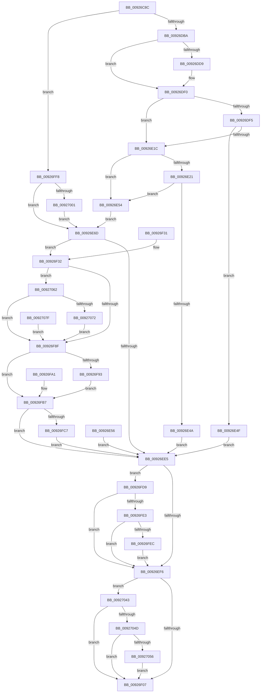

# AlpcpConnectPort

- RVA: `0x00926C8C`–`0x009270A4` (길이 `1,048` bytes)
- VA: `0x0000000140926C8C`
- 실행 섹션: `PAGE`
- PDB 이름 있음: `예`; PDB Function 태그: `아니요`
- unwind 정보 RVA: `0x0008D558`
- 디코드: `214`개 명령, `1,048/1,048` bytes 표시
- 미해석 바이트: `0` (있으면 어셈블리에 `.byte`로 보존)

> 이 문서는 커널 이미지의 기계어와 PDB 기호를 분석해 생성했습니다. 4번과 5번은 함수 원형과 자료형을 바이너리 사용 방식에서 추정한 C 해석이며 원본 소스 복구 결과는 아닙니다.

## 1. Dependencies

- 직접 호출 지점: **12**; 고유 호출 대상: **11**
- 직접 호출자로 확인된 함수: **2**
- RIP 상대 이미지 참조: **1**

### Outgoing calls
- `0x00926D67` → [memset](../../text/6C/memset_function_006C6C40.md) (function, `0x006C6C40`)
- `0x00926DEB` → [RtlCopyVolatileMemory](../../text/6B/RtlCopyVolatileMemory_function_006BC9D0.md) (function, `0x006BC9D0`)
- `0x00926E0D` → [SeCaptureSid](SeCaptureSid_function_009276D4.md) (function, `0x009276D4`)
- `0x00926E3B` → [SeCaptureSecurityDescriptor](SeCaptureSecurityDescriptor_function_00929F40.md) (function, `0x00929F40`)
- `0x00926EDA` → [AlpcpCreateClientPort](AlpcpCreateClientPort_function_009270AC.md) (function, `0x009270AC`)
- `0x00926F07` → [KeLeaveCriticalRegion](../../text/25/KeLeaveCriticalRegion_function_0025D8B0.md) (function, `0x0025D8B0`)
- `0x00926F19` → [_security_check_cookie](../../text/6A/_security_check_cookie_function_006AC640.md) (function, `0x006AC640`)
- `0x00926F79` → [AlpcpProcessConnectionRequest](AlpcpProcessConnectionRequest_function_00925FD4.md) (function, `0x00925FD4`)
- `0x00926FBA` → [ObfDereferenceObject](../../text/2F/ObfDereferenceObject_function_002F9350.md) (function, `0x002F9350`)
- `0x00926FCF` → [NtClose](../86/NtClose_function_00868870.md) (function, `0x00868870`)
- `0x00926FEE` → [ExFreePoolWithTag](../../poolcode/B8/ExFreePoolWithTag_function_00B82870.md) (function, `0x00B82870`)
- `0x00927058` → [ExFreePoolWithTag](../../poolcode/B8/ExFreePoolWithTag_function_00B82870.md) (function, `0x00B82870`)

### Direct callers
- [NtAlpcConnectPort](NtAlpcConnectPort_function_009264F0.md) at `0x00926559`
- [NtAlpcConnectPortEx](../A4/NtAlpcConnectPortEx_function_00A422B0.md) at `0x00A4231B`

### Static image references
- `0x00926C9F` → RVA `0x00E0A740` (`.data`; read)

## 2. Other-region calls and transfers

- 다른 실행 섹션으로 향하는 call: **7**
  - `0x00926D67` → [memset](../../text/6C/memset_function_006C6C40.md) (`PAGE` → `.text`)
  - `0x00926DEB` → [RtlCopyVolatileMemory](../../text/6B/RtlCopyVolatileMemory_function_006BC9D0.md) (`PAGE` → `.text`)
  - `0x00926F07` → [KeLeaveCriticalRegion](../../text/25/KeLeaveCriticalRegion_function_0025D8B0.md) (`PAGE` → `.text`)
  - `0x00926F19` → [_security_check_cookie](../../text/6A/_security_check_cookie_function_006AC640.md) (`PAGE` → `.text`)
  - `0x00926FBA` → [ObfDereferenceObject](../../text/2F/ObfDereferenceObject_function_002F9350.md) (`PAGE` → `.text`)
  - `0x00926FEE` → [ExFreePoolWithTag](../../poolcode/B8/ExFreePoolWithTag_function_00B82870.md) (`PAGE` → `POOLCODE`)
  - `0x00927058` → [ExFreePoolWithTag](../../poolcode/B8/ExFreePoolWithTag_function_00B82870.md) (`PAGE` → `POOLCODE`)
- 별도 외부 분기/꼬리 이동을 확인하지 못했습니다.

## 3. Assembly (complete function range)

```asm
00926C8C  40 53                           push rbx
00926C8E  56                              push rsi
00926C8F  57                              push rdi
00926C90  41 54                           push r12
00926C92  41 55                           push r13
00926C94  41 56                           push r14
00926C96  41 57                           push r15
00926C98  48 81 EC 40 01 00 00            sub rsp, 0x140
00926C9F  48 8B 05 9A 3A 4E 00            mov rax, qword ptr [rip + 0x4e3a9a]
00926CA6  48 33 C4                        xor rax, rsp
00926CA9  48 89 84 24 30 01 00 00         mov qword ptr [rsp + 0x130], rax
00926CB1  4C 89 8C 24 98 00 00 00         mov qword ptr [rsp + 0x98], r9
00926CB9  4C 89 84 24 A0 00 00 00         mov qword ptr [rsp + 0xa0], r8
00926CC1  48 89 94 24 A8 00 00 00         mov qword ptr [rsp + 0xa8], rdx
00926CC9  4C 8B E1                        mov r12, rcx
00926CCC  48 8B BC 24 A0 01 00 00         mov rdi, qword ptr [rsp + 0x1a0]
00926CD4  48 89 8C 24 D8 00 00 00         mov qword ptr [rsp + 0xd8], rcx
00926CDC  4C 8B BC 24 B0 01 00 00         mov r15, qword ptr [rsp + 0x1b0]
00926CE4  4C 89 7C 24 70                  mov qword ptr [rsp + 0x70], r15
00926CE9  4C 8B B4 24 B8 01 00 00         mov r14, qword ptr [rsp + 0x1b8]
00926CF1  4C 89 74 24 78                  mov qword ptr [rsp + 0x78], r14
00926CF6  48 8B 84 24 C0 01 00 00         mov rax, qword ptr [rsp + 0x1c0]
00926CFE  48 89 84 24 D0 00 00 00         mov qword ptr [rsp + 0xd0], rax
00926D06  48 8B 84 24 C8 01 00 00         mov rax, qword ptr [rsp + 0x1c8]
00926D0E  48 89 84 24 C8 00 00 00         mov qword ptr [rsp + 0xc8], rax
00926D16  48 8B 84 24 D0 01 00 00         mov rax, qword ptr [rsp + 0x1d0]
00926D1E  48 89 84 24 C0 00 00 00         mov qword ptr [rsp + 0xc0], rax
00926D26  48 8B 84 24 D8 01 00 00         mov rax, qword ptr [rsp + 0x1d8]
00926D2E  48 89 84 24 B8 00 00 00         mov qword ptr [rsp + 0xb8], rax
00926D36  48 8B 84 24 E0 01 00 00         mov rax, qword ptr [rsp + 0x1e0]
00926D3E  48 89 84 24 B0 00 00 00         mov qword ptr [rsp + 0xb0], rax
00926D46  48 83 64 24 68 00               and qword ptr [rsp + 0x68], 0
00926D4C  48 83 A4 24 80 00 00 00 00      and qword ptr [rsp + 0x80], 0
00926D55  BB 48 00 00 00                  mov ebx, 0x48
00926D5A  44 8B C3                        mov r8d, ebx
00926D5D  33 D2                           xor edx, edx
00926D5F  48 8D 8C 24 E0 00 00 00         lea rcx, [rsp + 0xe0]
00926D67  E8 D4 FE D9 FF                  call 0x1406c6c40
00926D6C  65 48 8B 04 25 88 01 00 00      mov rax, qword ptr gs:[0x188]
00926D75  66 FF 88 E4 01 00 00            dec word ptr [rax + 0x1e4]
00926D7C  90                              nop
00926D7D  65 48 8B 04 25 88 01 00 00      mov rax, qword ptr gs:[0x188]
00926D86  40 8A B0 32 02 00 00            mov sil, byte ptr [rax + 0x232]
00926D8D  40 88 74 24 60                  mov byte ptr [rsp + 0x60], sil
00926D92  44 8B AC 24 A8 01 00 00         mov r13d, dword ptr [rsp + 0x1a8]
00926D9A  41 81 E5 00 00 FF FF            and r13d, 0xffff0000
00926DA1  4C 89 B4 24 88 00 00 00         mov qword ptr [rsp + 0x88], r14
00926DA9  4C 89 BC 24 90 00 00 00         mov qword ptr [rsp + 0x90], r15
00926DB1  40 84 F6                        test sil, sil
00926DB4  0F 84 3E 02 00 00               je 0x140926ff8
00926DBA  48 BA 00 00 FF FF FF 7F 00 00   movabs rdx, 0x7fffffff0000
00926DC4  48 8B CA                        mov rcx, rdx
00926DC7  4C 3B E2                        cmp r12, rdx
00926DCA  49 0F 42 CC                     cmovb rcx, r12
00926DCE  48 8B 01                        mov rax, qword ptr [rcx]
00926DD1  48 89 01                        mov qword ptr [rcx], rax
00926DD4  48 85 FF                        test rdi, rdi
00926DD7  74 17                           je 0x140926df0
00926DD9  48 3B FA                        cmp rdi, rdx
00926DDC  48 0F 42 D7                     cmovb rdx, rdi
00926DE0  44 8B C3                        mov r8d, ebx
00926DE3  48 8D 8C 24 E0 00 00 00         lea rcx, [rsp + 0xe0]
00926DEB  E8 E0 5B D9 FF                  call 0x1406bc9d0
00926DF0  4D 85 F6                        test r14, r14
00926DF3  74 27                           je 0x140926e1c
00926DF5  48 8D 84 24 88 00 00 00         lea rax, [rsp + 0x88]
00926DFD  48 89 44 24 30                  mov qword ptr [rsp + 0x30], rax
00926E02  C6 44 24 28 01                  mov byte ptr [rsp + 0x28], 1
00926E07  40 8A D6                        mov dl, sil
00926E0A  49 8B CE                        mov rcx, r14
00926E0D  E8 C2 08 00 00                  call 0x1409276d4
00926E12  8B D8                           mov ebx, eax
00926E14  89 44 24 64                     mov dword ptr [rsp + 0x64], eax
00926E18  85 C0                           test eax, eax
00926E1A  78 33                           js 0x140926e4f
00926E1C  4D 85 FF                        test r15, r15
00926E1F  74 33                           je 0x140926e54
00926E21  48 8D 84 24 90 00 00 00         lea rax, [rsp + 0x90]
00926E29  48 89 44 24 20                  mov qword ptr [rsp + 0x20], rax
00926E2E  45 33 C9                        xor r9d, r9d
00926E31  45 8D 41 01                     lea r8d, [r9 + 1]
00926E35  40 8A D6                        mov dl, sil
00926E38  49 8B CF                        mov rcx, r15
00926E3B  E8 00 31 00 00                  call 0x140929f40
00926E40  8B D8                           mov ebx, eax
00926E42  89 44 24 64                     mov dword ptr [rsp + 0x64], eax
00926E46  85 C0                           test eax, eax
00926E48  79 0A                           jns 0x140926e54
00926E4A  E9 96 00 00 00                  jmp 0x140926ee5
00926E4F  E9 91 00 00 00                  jmp 0x140926ee5
00926E54  EB 17                           jmp 0x140926e6d
00926E56  8B D8                           mov ebx, eax
00926E58  89 44 24 64                     mov dword ptr [rsp + 0x64], eax
00926E5C  40 8A 74 24 60                  mov sil, byte ptr [rsp + 0x60]
00926E61  4C 8B 7C 24 70                  mov r15, qword ptr [rsp + 0x70]
00926E66  4C 8B 74 24 78                  mov r14, qword ptr [rsp + 0x78]
00926E6B  EB 78                           jmp 0x140926ee5
00926E6D  48 F7 DF                        neg rdi
00926E70  48 1B C9                        sbb rcx, rcx
00926E73  48 8D 84 24 E0 00 00 00         lea rax, [rsp + 0xe0]
00926E7B  48 23 C8                        and rcx, rax
00926E7E  C6 44 24 50 00                  mov byte ptr [rsp + 0x50], 0
00926E83  48 83 64 24 48 00               and qword ptr [rsp + 0x48], 0
00926E89  48 8B 84 24 88 00 00 00         mov rax, qword ptr [rsp + 0x88]
00926E91  48 89 44 24 40                  mov qword ptr [rsp + 0x40], rax
00926E96  48 8B 84 24 90 00 00 00         mov rax, qword ptr [rsp + 0x90]
00926E9E  48 89 44 24 38                  mov qword ptr [rsp + 0x38], rax
00926EA3  48 89 4C 24 30                  mov qword ptr [rsp + 0x30], rcx
00926EA8  48 8B 84 24 98 00 00 00         mov rax, qword ptr [rsp + 0x98]
00926EB0  48 89 44 24 28                  mov qword ptr [rsp + 0x28], rax
00926EB5  48 8B 84 24 A0 00 00 00         mov rax, qword ptr [rsp + 0xa0]
00926EBD  48 89 44 24 20                  mov qword ptr [rsp + 0x20], rax
00926EC2  4C 8B 8C 24 A8 00 00 00         mov r9, qword ptr [rsp + 0xa8]
00926ECA  45 8B C5                        mov r8d, r13d
00926ECD  48 8D 54 24 68                  lea rdx, [rsp + 0x68]
00926ED2  48 8D 8C 24 80 00 00 00         lea rcx, [rsp + 0x80]
00926EDA  E8 CD 01 00 00                  call 0x1409270ac
00926EDF  8B D8                           mov ebx, eax
00926EE1  85 C0                           test eax, eax
00926EE3  79 4D                           jns 0x140926f32
00926EE5  48 8B 8C 24 88 00 00 00         mov rcx, qword ptr [rsp + 0x88]
00926EED  48 85 C9                        test rcx, rcx
00926EF0  0F 85 E3 00 00 00               jne 0x140926fd9
00926EF6  48 8B 8C 24 90 00 00 00         mov rcx, qword ptr [rsp + 0x90]
00926EFE  48 85 C9                        test rcx, rcx
00926F01  0F 85 3C 01 00 00               jne 0x140927043
00926F07  E8 A4 69 93 FF                  call 0x14025d8b0
00926F0C  8B C3                           mov eax, ebx
00926F0E  48 8B 8C 24 30 01 00 00         mov rcx, qword ptr [rsp + 0x130]
00926F16  48 33 CC                        xor rcx, rsp
00926F19  E8 22 57 D8 FF                  call 0x1406ac640
00926F1E  48 81 C4 40 01 00 00            add rsp, 0x140
00926F25  41 5F                           pop r15
00926F27  41 5E                           pop r14
00926F29  41 5D                           pop r13
00926F2B  41 5C                           pop r12
00926F2D  5F                              pop rdi
00926F2E  5E                              pop rsi
00926F2F  5B                              pop rbx
00926F30  C3                              ret
00926F31  CC                              int3
00926F32  40 88 74 24 38                  mov byte ptr [rsp + 0x38], sil
00926F37  48 8B 84 24 B0 00 00 00         mov rax, qword ptr [rsp + 0xb0]
00926F3F  48 89 44 24 30                  mov qword ptr [rsp + 0x30], rax
00926F44  48 8B 84 24 B8 00 00 00         mov rax, qword ptr [rsp + 0xb8]
00926F4C  48 89 44 24 28                  mov qword ptr [rsp + 0x28], rax
00926F51  48 8B 84 24 C0 00 00 00         mov rax, qword ptr [rsp + 0xc0]
00926F59  48 89 44 24 20                  mov qword ptr [rsp + 0x20], rax
00926F5E  4C 8B 8C 24 C8 00 00 00         mov r9, qword ptr [rsp + 0xc8]
00926F66  4C 8B 84 24 D0 00 00 00         mov r8, qword ptr [rsp + 0xd0]
00926F6E  41 8B D5                        mov edx, r13d
00926F71  48 8B 7C 24 68                  mov rdi, qword ptr [rsp + 0x68]
00926F76  48 8B CF                        mov rcx, rdi
00926F79  E8 56 F0 FF FF                  call 0x140925fd4
00926F7E  8B D8                           mov ebx, eax
00926F80  89 44 24 64                     mov dword ptr [rsp + 0x64], eax
00926F84  3D 41 00 00 C0                  cmp eax, 0xc0000041
00926F89  0F 84 D3 00 00 00               je 0x140927062
00926F8F  85 DB                           test ebx, ebx
00926F91  75 24                           jne 0x140926fb7
00926F93  48 8B 84 24 80 00 00 00         mov rax, qword ptr [rsp + 0x80]
00926F9B  49 89 04 24                     mov qword ptr [r12], rax
00926F9F  EB 16                           jmp 0x140926fb7
00926FA1  8B D8                           mov ebx, eax
00926FA3  48 8B 7C 24 68                  mov rdi, qword ptr [rsp + 0x68]
00926FA8  40 8A 74 24 60                  mov sil, byte ptr [rsp + 0x60]
00926FAD  4C 8B 7C 24 70                  mov r15, qword ptr [rsp + 0x70]
00926FB2  4C 8B 74 24 78                  mov r14, qword ptr [rsp + 0x78]
00926FB7  48 8B CF                        mov rcx, rdi
00926FBA  E8 91 23 9D FF                  call 0x1402f9350
00926FBF  85 DB                           test ebx, ebx
00926FC1  0F 84 1E FF FF FF               je 0x140926ee5
00926FC7  48 8B 8C 24 80 00 00 00         mov rcx, qword ptr [rsp + 0x80]
00926FCF  E8 9C 18 F4 FF                  call 0x140868870
00926FD4  E9 0C FF FF FF                  jmp 0x140926ee5
00926FD9  40 80 FE 01                     cmp sil, 1
00926FDD  0F 87 13 FF FF FF               ja 0x140926ef6
00926FE3  49 3B CE                        cmp rcx, r14
00926FE6  0F 84 0A FF FF FF               je 0x140926ef6
00926FEC  33 D2                           xor edx, edx
00926FEE  E8 7D B8 25 00                  call 0x140b82870
00926FF3  E9 FE FE FF FF                  jmp 0x140926ef6
00926FF8  48 85 FF                        test rdi, rdi
00926FFB  0F 84 6C FE FF FF               je 0x140926e6d
00927001  0F 10 07                        movups xmm0, xmmword ptr [rdi]
00927004  0F 29 84 24 E0 00 00 00         movaps xmmword ptr [rsp + 0xe0], xmm0
0092700C  0F 10 4F 10                     movups xmm1, xmmword ptr [rdi + 0x10]
00927010  0F 29 8C 24 F0 00 00 00         movaps xmmword ptr [rsp + 0xf0], xmm1
00927018  0F 10 47 20                     movups xmm0, xmmword ptr [rdi + 0x20]
0092701C  0F 29 84 24 00 01 00 00         movaps xmmword ptr [rsp + 0x100], xmm0
00927024  0F 10 4F 30                     movups xmm1, xmmword ptr [rdi + 0x30]
00927028  0F 29 8C 24 10 01 00 00         movaps xmmword ptr [rsp + 0x110], xmm1
00927030  F2 0F 10 47 40                  movsd xmm0, qword ptr [rdi + 0x40]
00927035  F2 0F 11 84 24 20 01 00 00      movsd qword ptr [rsp + 0x120], xmm0
0092703E  E9 2A FE FF FF                  jmp 0x140926e6d
00927043  40 80 FE 01                     cmp sil, 1
00927047  0F 85 BA FE FF FF               jne 0x140926f07
0092704D  49 3B CF                        cmp rcx, r15
00927050  0F 84 B1 FE FF FF               je 0x140926f07
00927056  33 D2                           xor edx, edx
00927058  E8 13 B8 25 00                  call 0x140b82870
0092705D  E9 A5 FE FF FF                  jmp 0x140926f07
00927062  F7 87 A0 01 00 00 00 01 00 00   test dword ptr [rdi + 0x1a0], 0x100
0092706C  0F 84 1D FF FF FF               je 0x140926f8f
00927072  48 8B 47 38                     mov rax, qword ptr [rdi + 0x38]
00927076  49 89 04 24                     mov qword ptr [r12], rax
0092707A  E9 10 FF FF FF                  jmp 0x140926f8f
0092707F  48 8B 7C 24 68                  mov rdi, qword ptr [rsp + 0x68]
00927084  40 8A 74 24 60                  mov sil, byte ptr [rsp + 0x60]
00927089  8B 5C 24 64                     mov ebx, dword ptr [rsp + 0x64]
0092708D  4C 8B A4 24 D8 00 00 00         mov r12, qword ptr [rsp + 0xd8]
00927095  4C 8B 7C 24 70                  mov r15, qword ptr [rsp + 0x70]
0092709A  4C 8B 74 24 78                  mov r14, qword ptr [rsp + 0x78]
0092709F  E9 EB FE FF FF                  jmp 0x140926f8f
```

## 4. C-style interpretation (structured pseudocode)

```c
__int64 __fastcall AlpcpConnectPort(__int64 a1, __int64 a2, __int64 a3, __int64 a4, __int64 a5, unsigned int a6, __int64 a7, __int64 a8, __int64 a9, __int64 a10, __int64 a11, __int64 a12, __int64 a13)
{
    __int64 result;
    __int64 v_r13;
    __int64 v_rdi;
    __int64 v_rsp;
    unsigned __int64 v_stack_m100;
    unsigned __int64 v_stack_m108;
    unsigned __int64 v_stack_m110;
    unsigned int v_stack_m114;
    unsigned __int8 v_stack_m118;
    unsigned __int8 v_stack_m128;
    unsigned __int64 v_stack_m130;
    unsigned __int64 v_stack_m138;
    unsigned __int64 v_stack_m140;
    unsigned __int64 v_stack_m148;
    unsigned __int8 v_stack_m150;
    unsigned __int64 v_stack_m158;
    unsigned __int64 v_stack_m48;
    unsigned __int64 v_stack_m98;
    unsigned __int64 v_stack_mA0;
    unsigned __int64 v_stack_mA8;
    unsigned __int64 v_stack_mB0;
    unsigned __int64 v_stack_mB8;
    unsigned __int64 v_stack_mC0;
    unsigned __int64 v_stack_mC8;
    unsigned __int64 v_stack_mD0;
    unsigned __int64 v_stack_mD8;
    unsigned __int64 v_stack_mE0;
    unsigned __int64 v_stack_mE8;
    unsigned __int64 v_stack_mF0;
    unsigned __int64 v_stack_mF8;
    unsigned __int64 v_stack_p100;
    unsigned __int64 v_stack_p110;
    unsigned __int64 v_stack_p120;
    unsigned __int64 v_stack_p20;
    unsigned __int64 v_stack_p28;
    unsigned __int64 v_stack_p30;
    unsigned __int8 v_stack_p38;
    unsigned __int8 v_stack_p60;
    unsigned int v_stack_p64;
    unsigned __int64 v_stack_p68;
    unsigned __int64 v_stack_p70;
    unsigned __int64 v_stack_p78;
    unsigned __int64 v_stack_p80;
    unsigned __int64 v_stack_pB0;
    unsigned __int64 v_stack_pB8;
    unsigned __int64 v_stack_pC0;
    unsigned __int64 v_stack_pC8;
    unsigned __int64 v_stack_pD0;
    unsigned __int64 v_stack_pD8;
    unsigned __int64 v_stack_pE0;
    unsigned __int64 v_stack_pF0;

    v_rsp = (v_rsp) - (320);
    result = (*(unsigned __int64 *)(v_rip + 5126810)) ^ (v_rsp);
    v_stack_m48 = result;
    v_stack_mE0 = a4;
    v_stack_mD8 = a3;
    v_stack_mD0 = a2;
    v_stack_mA0 = a1;
    v_stack_m108 = a7;
    v_stack_m100 = a8;
    v_stack_mA8 = a9;
    v_stack_mB0 = a10;
    v_stack_mB8 = a11;
    v_stack_mC0 = a12;
    v_stack_mC8 = a13;
    a2 = 0;
    result = memset(v_stack_m98, a2, 72, a4);
    v_stack_m118 = (unsigned __int8)(*(unsigned __int8 *)(*(unsigned __int64 *)(gs_base + (0 + 392)) + 562));
    v_r13 = (unsigned int)(((unsigned int)(a6)) & (0xFFFF0000ULL));
    v_stack_mF0 = a8;
    v_stack_mE8 = a7;
    if ((unsigned __int8)(*(unsigned __int8 *)(*(unsigned __int64 *)(gs_base + (0 + 392)) + 562)) == 0) goto loc_00926FF8;
    a1 = 0;
    if (a1 < 0) { a1 = a1; }
    *(unsigned __int64 *)(a1) = *(unsigned __int64 *)(a1);
    result = *(unsigned __int64 *)(a1);
    if (a5 != 0) {
        if (a5 < 0) { a2 = a5; }
        a3 = 72;
        a1 = v_stack_m98;
        result = RtlCopyVolatileMemory(a1, a2, a3, a4);
    }
    if (a8 == 0) goto loc_00926E1C;
    v_stack_m148 = v_stack_mF0;
    v_stack_m150 = 1;
    result = SeCaptureSid(a8, (unsigned __int8)(*(unsigned __int8 *)(*(unsigned __int64 *)(gs_base + (0 + 392)) + 562)), a3, a4);
    v_stack_m114 = (unsigned int)(result);
    if (sign_flag) goto loc_00926E4F;
loc_00926E1C:
    if (a7 == 0) goto loc_00926E54;
    v_stack_m158 = v_stack_mE8;
    a4 = 0;
    result = SeCaptureSecurityDescriptor(a7, (unsigned __int8)(*(unsigned __int8 *)(*(unsigned __int64 *)(gs_base + (0 + 392)) + 562)), a4 + 1, a4);
    v_stack_m114 = (unsigned int)(result);
    if (!sign_flag) goto loc_00926E54;
    goto loc_00926EE5;
loc_00926E4F:
    goto loc_00926EE5;
loc_00926E54:
    goto loc_00926E6D;
loc_00926E6D:
    v_rdi = -(a5);
    a1 = (a7) & (v_stack_m98);
    v_stack_m128 = 0;
    v_stack_m138 = v_stack_mF0;
    v_stack_m140 = v_stack_mE8;
    v_stack_m148 = a1;
    v_stack_m150 = v_stack_mE0;
    v_stack_m158 = v_stack_mD8;
    result = AlpcpCreateClientPort(v_stack_mF8, v_stack_m110, (unsigned int)((unsigned int)(v_r13)), v_stack_mD0);
    if (!sign_flag) goto loc_00926F32;
loc_00926EE5:
    if (v_stack_mF0 != 0) goto loc_00926FD9;
loc_00926EF6:
    if (v_stack_mE8 != 0) goto loc_00927043;
loc_00926F07:
    result = KeLeaveCriticalRegion(v_stack_mE8, v_stack_m110, (unsigned int)((unsigned int)(v_r13)), v_stack_mD0);
    a1 = (v_stack_m48) ^ (v_rsp);
    result = _security_check_cookie(a1, v_stack_m110, (unsigned int)((unsigned int)(v_r13)), v_stack_mD0);
    v_rsp = (v_rsp) + (320);
    return result;
loc_00926F32:
    v_stack_p38 = (unsigned __int8)(*(unsigned __int8 *)(*(unsigned __int64 *)(gs_base + (0 + 392)) + 562));
    v_stack_p30 = v_stack_pB0;
    v_stack_p28 = v_stack_pB8;
    v_stack_p20 = v_stack_pC0;
    result = AlpcpProcessConnectionRequest(v_stack_p68, (unsigned int)((unsigned int)(v_r13)), v_stack_pD0, v_stack_pC8);
    v_stack_p64 = (unsigned int)(result);
    if (((unsigned int)(result)) == 0xC0000041ULL) goto loc_00927062;
loc_00926F8F:
    if ((unsigned int)((unsigned int)((unsigned int)(result))) != 0) goto loc_00926FB7;
    *(unsigned __int64 *)(a1) = v_stack_p80;
    goto loc_00926FB7;
loc_00926FB7:
    result = ObfDereferenceObject(v_stack_p68, (unsigned int)((unsigned int)(v_r13)), v_stack_pD0, v_stack_pC8);
    if ((unsigned int)((unsigned int)((unsigned int)(result))) == 0) goto loc_00926EE5;
    result = NtClose(v_stack_p80, (unsigned int)((unsigned int)(v_r13)), v_stack_pD0, v_stack_pC8);
    goto loc_00926EE5;
loc_00926FD9:
    if (((unsigned __int8)(*(unsigned __int8 *)(*(unsigned __int64 *)(gs_base + (0 + 392)) + 562))) > 1) goto loc_00926EF6;
    if (v_stack_p80 == a8) goto loc_00926EF6;
    a2 = 0;
    result = ExFreePoolWithTag(v_stack_p80, a2, v_stack_pD0, v_stack_pC8);
    goto loc_00926EF6;
loc_00926FF8:
    if (v_stack_p68 == 0) goto loc_00926E6D;
    v_stack_pE0 = v_xmm0;
    v_stack_pF0 = v_xmm1;
    v_stack_p100 = v_xmm0;
    v_stack_p110 = v_xmm1;
    v_stack_p120 = v_xmm0;
    goto loc_00926E6D;
loc_00927043:
    if (((unsigned __int8)(*(unsigned __int8 *)(*(unsigned __int64 *)(gs_base + (0 + 392)) + 562))) != 1) goto loc_00926F07;
    if (v_stack_p80 == a7) goto loc_00926F07;
    a2 = 0;
    result = ExFreePoolWithTag(v_stack_p80, a2, v_stack_pD0, v_stack_pC8);
    goto loc_00926F07;
loc_00927062:
    if (((*(unsigned int *)(v_stack_p68 + 416)) & (256)) == 0) goto loc_00926F8F;
    *(unsigned __int64 *)(a1) = *(unsigned __int64 *)(v_stack_p68 + 56);
    goto loc_00926F8F;
}
```

## 5. (Beta) C Style

```c
int64_t AlpcpConnectPort(int64_t Arg1, int64_t Arg2, int64_t Arg3, int64_t Arg4, int64_t Arg5, uint32_t Arg6, int64_t Arg7, int64_t Arg8, int64_t Arg9, int64_t Arg10, int64_t Arg11, int64_t Arg12, int64_t Arg13)
{
    int64_t result;
    int64_t local_r13;
    int64_t local_rdi;
    int64_t local_rsp;
    uint64_t v_stack_m100;
    uint64_t v_stack_m108;
    uint64_t v_stack_m110;
    uint32_t v_stack_m114;
    uint8_t v_stack_m118;
    uint8_t v_stack_m128;
    uint64_t v_stack_m130;
    uint64_t v_stack_m138;
    uint64_t v_stack_m140;
    uint64_t v_stack_m148;
    uint8_t v_stack_m150;
    uint64_t v_stack_m158;
    uint64_t v_stack_m48;
    uint64_t v_stack_m98;
    uint64_t v_stack_mA0;
    uint64_t v_stack_mA8;
    uint64_t v_stack_mB0;
    uint64_t v_stack_mB8;
    uint64_t v_stack_mC0;
    uint64_t v_stack_mC8;
    uint64_t v_stack_mD0;
    uint64_t v_stack_mD8;
    uint64_t v_stack_mE0;
    uint64_t v_stack_mE8;
    uint64_t v_stack_mF0;
    uint64_t v_stack_mF8;
    uint64_t v_stack_p100;
    uint64_t v_stack_p110;
    uint64_t v_stack_p120;
    uint64_t v_stack_p20;
    uint64_t v_stack_p28;
    uint64_t v_stack_p30;
    uint8_t v_stack_p38;
    uint8_t v_stack_p60;
    uint32_t v_stack_p64;
    uint64_t v_stack_p68;
    uint64_t v_stack_p70;
    uint64_t v_stack_p78;
    uint64_t v_stack_p80;
    uint64_t v_stack_pB0;
    uint64_t v_stack_pB8;
    uint64_t v_stack_pC0;
    uint64_t v_stack_pC8;
    uint64_t v_stack_pD0;
    uint64_t v_stack_pD8;
    uint64_t v_stack_pE0;
    uint64_t v_stack_pF0;

    local_rsp = (local_rsp) - (320);
    result = (*(uint64_t *)(v_rip + 0x4E3A9A)) ^ (local_rsp);
    v_stack_m48 = result;
    v_stack_mE0 = Arg4;
    v_stack_mD8 = Arg3;
    v_stack_mD0 = Arg2;
    v_stack_mA0 = Arg1;
    v_stack_m108 = Arg7;
    v_stack_m100 = Arg8;
    v_stack_mA8 = Arg9;
    v_stack_mB0 = Arg10;
    v_stack_mB8 = Arg11;
    v_stack_mC0 = Arg12;
    v_stack_mC8 = Arg13;
    Arg2 = 0;
    result = memset(v_stack_m98, Arg2, 72, Arg4);
    v_stack_m118 = (uint8_t)(*(uint8_t *)(*(uint64_t *)(gs_base + (0 + 0x188)) + 0x232));
    local_r13 = (uint32_t)(((uint32_t)(Arg6)) & (0xFFFF0000ULL));
    v_stack_mF0 = Arg8;
    v_stack_mE8 = Arg7;
    if ((uint8_t)(*(uint8_t *)(*(uint64_t *)(gs_base + (0 + 0x188)) + 0x232)) == 0) goto loc_00926FF8;
    Arg1 = 0;
    if (Arg1 < 0) { Arg1 = Arg1; }
    *(uint64_t *)(Arg1) = *(uint64_t *)(Arg1);
    result = *(uint64_t *)(Arg1);
    if (Arg5 != 0) {
        if (Arg5 < 0) { Arg2 = Arg5; }
        Arg3 = 72;
        Arg1 = v_stack_m98;
        result = RtlCopyVolatileMemory(Arg1, Arg2, Arg3, Arg4);
    }
    if (Arg8 == 0) goto loc_00926E1C;
    v_stack_m148 = v_stack_mF0;
    v_stack_m150 = 1;
    result = SeCaptureSid(Arg8, (uint8_t)(*(uint8_t *)(*(uint64_t *)(gs_base + (0 + 0x188)) + 0x232)), Arg3, Arg4);
    v_stack_m114 = (uint32_t)(result);
    if (sign_flag) goto loc_00926E4F;
loc_00926E1C:
    if (Arg7 == 0) goto loc_00926E54;
    v_stack_m158 = v_stack_mE8;
    Arg4 = 0;
    result = SeCaptureSecurityDescriptor(Arg7, (uint8_t)(*(uint8_t *)(*(uint64_t *)(gs_base + (0 + 0x188)) + 0x232)), Arg4 + 1, Arg4);
    v_stack_m114 = (uint32_t)(result);
    if (!sign_flag) goto loc_00926E54;
    goto loc_00926EE5;
loc_00926E4F:
    goto loc_00926EE5;
loc_00926E54:
    goto loc_00926E6D;
loc_00926E6D:
    local_rdi = -(Arg5);
    Arg1 = (Arg7) & (v_stack_m98);
    v_stack_m128 = 0;
    v_stack_m138 = v_stack_mF0;
    v_stack_m140 = v_stack_mE8;
    v_stack_m148 = Arg1;
    v_stack_m150 = v_stack_mE0;
    v_stack_m158 = v_stack_mD8;
    result = AlpcpCreateClientPort(v_stack_mF8, v_stack_m110, (uint32_t)((uint32_t)(local_r13)), v_stack_mD0);
    if (!sign_flag) goto loc_00926F32;
loc_00926EE5:
    if (v_stack_mF0 != 0) goto loc_00926FD9;
loc_00926EF6:
    if (v_stack_mE8 != 0) goto loc_00927043;
loc_00926F07:
    result = KeLeaveCriticalRegion(v_stack_mE8, v_stack_m110, (uint32_t)((uint32_t)(local_r13)), v_stack_mD0);
    Arg1 = (v_stack_m48) ^ (local_rsp);
    result = _security_check_cookie(Arg1, v_stack_m110, (uint32_t)((uint32_t)(local_r13)), v_stack_mD0);
    local_rsp = (local_rsp) + (320);
    return result;
loc_00926F32:
    v_stack_p38 = (uint8_t)(*(uint8_t *)(*(uint64_t *)(gs_base + (0 + 0x188)) + 0x232));
    v_stack_p30 = v_stack_pB0;
    v_stack_p28 = v_stack_pB8;
    v_stack_p20 = v_stack_pC0;
    result = AlpcpProcessConnectionRequest(v_stack_p68, (uint32_t)((uint32_t)(local_r13)), v_stack_pD0, v_stack_pC8);
    v_stack_p64 = (uint32_t)(result);
    if (((uint32_t)(result)) == 0xC0000041ULL) goto loc_00927062;
loc_00926F8F:
    if ((uint32_t)((uint32_t)((uint32_t)(result))) != 0) goto loc_00926FB7;
    *(uint64_t *)(Arg1) = v_stack_p80;
    goto loc_00926FB7;
loc_00926FB7:
    result = ObfDereferenceObject(v_stack_p68, (uint32_t)((uint32_t)(local_r13)), v_stack_pD0, v_stack_pC8);
    if ((uint32_t)((uint32_t)((uint32_t)(result))) == 0) goto loc_00926EE5;
    result = NtClose(v_stack_p80, (uint32_t)((uint32_t)(local_r13)), v_stack_pD0, v_stack_pC8);
    goto loc_00926EE5;
loc_00926FD9:
    if (((uint8_t)(*(uint8_t *)(*(uint64_t *)(gs_base + (0 + 0x188)) + 0x232))) > 1) goto loc_00926EF6;
    if (v_stack_p80 == Arg8) goto loc_00926EF6;
    Arg2 = 0;
    result = ExFreePoolWithTag(v_stack_p80, Arg2, v_stack_pD0, v_stack_pC8);
    goto loc_00926EF6;
loc_00926FF8:
    if (v_stack_p68 == 0) goto loc_00926E6D;
    v_stack_pE0 = v_xmm0;
    v_stack_pF0 = v_xmm1;
    v_stack_p100 = v_xmm0;
    v_stack_p110 = v_xmm1;
    v_stack_p120 = v_xmm0;
    goto loc_00926E6D;
loc_00927043:
    if (((uint8_t)(*(uint8_t *)(*(uint64_t *)(gs_base + (0 + 0x188)) + 0x232))) != 1) goto loc_00926F07;
    if (v_stack_p80 == Arg7) goto loc_00926F07;
    Arg2 = 0;
    result = ExFreePoolWithTag(v_stack_p80, Arg2, v_stack_pD0, v_stack_pC8);
    goto loc_00926F07;
loc_00927062:
    if (((*(uint32_t *)(v_stack_p68 + 0x1A0)) & (256)) == 0) goto loc_00926F8F;
    *(uint64_t *)(Arg1) = *(uint64_t *)(v_stack_p68 + 0x38);
    goto loc_00926F8F;
}
```

## 6. Execution-region graph

[열기: 2D/3D 그래프와 함수 탐색 컨트롤 패널](../../../control-panel.html?section=page&rva=0x00926C8C&view=graph)

- 2D 그래프는 위에서 아래로 흐르고, 3D 그래프는 빈 공간을 드래그해 회전합니다. Shift+드래그는 이동, 휠은 확대·축소, 함수 노드 선택은 대상 보고서 이동입니다.

### Static fallback


