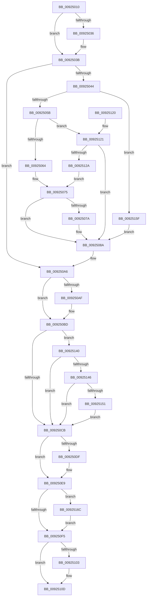

# AlpcpDeletePort

- RVA: `0x00925010`–`0x00925173` (길이 `355` bytes)
- VA: `0x0000000140925010`
- 실행 섹션: `PAGE`
- PDB 이름 있음: `예`; PDB Function 태그: `아니요`
- unwind 정보 RVA: `0x0008D440`
- 디코드: `87`개 명령, `355/355` bytes 표시
- 미해석 바이트: `0` (있으면 어셈블리에 `.byte`로 보존)

> 이 문서는 커널 이미지의 기계어와 PDB 기호를 분석해 생성했습니다. 4번과 5번은 함수 원형과 자료형을 바이너리 사용 방식에서 추정한 C 해석이며 원본 소스 복구 결과는 아닙니다.

## 1. Dependencies

- 직접 호출 지점: **12**; 고유 호출 대상: **10**
- 직접 호출자로 확인된 함수: **0**
- RIP 상대 이미지 참조: **0**

### Outgoing calls
- `0x00925036` → [AlpcpSendCloseMessage](AlpcpSendCloseMessage_function_0092524C.md) (function, `0x0092524C`)
- `0x00925044` → [AlpcpLockBlobExclusive](AlpcpLockBlobExclusive_function_009253A4.md) (function, `0x009253A4`)
- `0x0092508E` → [AlpcpUnlockBlobUncachedExclusive](AlpcpUnlockBlobUncachedExclusive_function_0092536C.md) (function, `0x0092536C`)
- `0x0092509C` → [AlpcpDereferenceBlobEx](../88/AlpcpDereferenceBlobEx_function_0088AF00.md) (function, `0x0088AF00`)
- `0x009250AF` → [ObfDereferenceObject](../../text/2F/ObfDereferenceObject_function_002F9350.md) (function, `0x002F9350`)
- `0x009250B8` → [AlpcpFreeCompletionPacketLookaside](../../text/47/AlpcpFreeCompletionPacketLookaside_function_0047BBB0.md) (function, `0x0047BBB0`)
- `0x009250E4` → [ObfDereferenceObjectWithTag](../../text/2F/ObfDereferenceObjectWithTag_function_002F78E0.md) (function, `0x002F78E0`)
- `0x00925108` → [AlpcpDereferenceBlobEx](../88/AlpcpDereferenceBlobEx_function_0088AF00.md) (function, `0x0088AF00`)
- `0x00925110` → [AlpcpDestroyPort](AlpcpDestroyPort_function_0092517C.md) (function, `0x0092517C`)
- `0x00925115` → [KeLeaveCriticalRegion](../../text/25/KeLeaveCriticalRegion_function_0025D8B0.md) (function, `0x0025D8B0`)
- `0x00925155` → [SeDeleteClientSecurity](SeDeleteClientSecurity_function_00923F90.md) (function, `0x00923F90`)
- `0x0092516C` → [ObfDereferenceObject](../../text/2F/ObfDereferenceObject_function_002F9350.md) (function, `0x002F9350`)

### Direct callers
- 이 함수 시작 RVA로 연결되는 직접 call은 확인되지 않았습니다. 간접 호출은 완전히 역산할 수 없습니다.

### Static image references
- 디코드된 RIP-relative 메모리 참조가 없습니다.

## 2. Other-region calls and transfers

- 다른 실행 섹션으로 향하는 call: **5**
  - `0x009250AF` → [ObfDereferenceObject](../../text/2F/ObfDereferenceObject_function_002F9350.md) (`PAGE` → `.text`)
  - `0x009250B8` → [AlpcpFreeCompletionPacketLookaside](../../text/47/AlpcpFreeCompletionPacketLookaside_function_0047BBB0.md) (`PAGE` → `.text`)
  - `0x009250E4` → [ObfDereferenceObjectWithTag](../../text/2F/ObfDereferenceObjectWithTag_function_002F78E0.md) (`PAGE` → `.text`)
  - `0x00925115` → [KeLeaveCriticalRegion](../../text/25/KeLeaveCriticalRegion_function_0025D8B0.md) (`PAGE` → `.text`)
  - `0x0092516C` → [ObfDereferenceObject](../../text/2F/ObfDereferenceObject_function_002F9350.md) (`PAGE` → `.text`)
- 별도 외부 분기/꼬리 이동을 확인하지 못했습니다.

## 3. Assembly (complete function range)

```asm
00925010  40 53                           push rbx
00925012  48 83 EC 20                     sub rsp, 0x20
00925016  65 48 8B 04 25 88 01 00 00      mov rax, qword ptr gs:[0x188]
0092501F  48 8B D9                        mov rbx, rcx
00925022  66 FF 88 E4 01 00 00            dec word ptr [rax + 0x1e4]
00925029  90                              nop
0092502A  F7 81 00 01 00 00 00 10 00 00   test dword ptr [rcx + 0x100], 0x1000
00925034  74 05                           je 0x14092503b
00925036  E8 11 02 00 00                  call 0x14092524c
0092503B  48 8B 4B 10                     mov rcx, qword ptr [rbx + 0x10]
0092503F  48 85 C9                        test rcx, rcx
00925042  74 62                           je 0x1409250a6
00925044  E8 5B 03 00 00                  call 0x1409253a4
00925049  8B 83 A0 01 00 00               mov eax, dword ptr [rbx + 0x1a0]
0092504F  83 E0 06                        and eax, 6
00925052  83 F8 02                        cmp eax, 2
00925055  0F 84 04 01 00 00               je 0x14092515f
0092505B  83 F8 04                        cmp eax, 4
0092505E  0F 85 BD 00 00 00               jne 0x140925121
00925064  48 8B 43 10                     mov rax, qword ptr [rbx + 0x10]
00925068  48 83 60 10 00                  and qword ptr [rax + 0x10], 0
0092506D  48 8B 43 10                     mov rax, qword ptr [rbx + 0x10]
00925071  48 8B 48 08                     mov rcx, qword ptr [rax + 8]
00925075  48 85 C9                        test rcx, rcx
00925078  74 10                           je 0x14092508a
0092507A  48 83 A1 A8 01 00 00 00         and qword ptr [rcx + 0x1a8], 0
00925082  48 83 A1 B0 01 00 00 00         and qword ptr [rcx + 0x1b0], 0
0092508A  48 8B 4B 10                     mov rcx, qword ptr [rbx + 0x10]
0092508E  E8 D9 02 00 00                  call 0x14092536c
00925093  48 8B 4B 10                     mov rcx, qword ptr [rbx + 0x10]
00925097  BA 01 00 00 00                  mov edx, 1
0092509C  E8 5F 5E F6 FF                  call 0x14088af00
009250A1  48 83 63 10 00                  and qword ptr [rbx + 0x10], 0
009250A6  48 8B 4B 20                     mov rcx, qword ptr [rbx + 0x20]
009250AA  48 85 C9                        test rcx, rcx
009250AD  74 0E                           je 0x1409250bd
009250AF  E8 9C 42 9D FF                  call 0x1402f9350
009250B4  48 8B 4B 30                     mov rcx, qword ptr [rbx + 0x30]
009250B8  E8 F3 6A B5 FF                  call 0x14047bbb0
009250BD  8B 8B A0 01 00 00               mov ecx, dword ptr [rbx + 0x1a0]
009250C3  8B C1                           mov eax, ecx
009250C5  24 06                           and al, 6
009250C7  3C 04                           cmp al, 4
009250C9  74 75                           je 0x140925140
009250CB  48 8B 43 18                     mov rax, qword ptr [rbx + 0x18]
009250CF  B9 00 00 00 00                  mov ecx, 0
009250D4  A8 01                           test al, 1
009250D6  48 0F 44 C8                     cmove rcx, rax
009250DA  48 85 C9                        test rcx, rcx
009250DD  74 0A                           je 0x1409250e9
009250DF  BA 41 6C 70 63                  mov edx, 0x63706c41
009250E4  E8 F7 27 9D FF                  call 0x1402f78e0
009250E9  48 8B 8B 70 01 00 00            mov rcx, qword ptr [rbx + 0x170]
009250F0  48 85 C9                        test rcx, rcx
009250F3  75 77                           jne 0x14092516c
009250F5  33 C9                           xor ecx, ecx
009250F7  48 87 8B B8 01 00 00            xchg qword ptr [rbx + 0x1b8], rcx
009250FE  48 85 C9                        test rcx, rcx
00925101  74 0A                           je 0x14092510d
00925103  BA 01 00 00 00                  mov edx, 1
00925108  E8 F3 5D F6 FF                  call 0x14088af00
0092510D  48 8B CB                        mov rcx, rbx
00925110  E8 67 00 00 00                  call 0x14092517c
00925115  E8 96 87 93 FF                  call 0x14025d8b0
0092511A  48 83 C4 20                     add rsp, 0x20
0092511E  5B                              pop rbx
0092511F  C3                              ret
00925120  CC                              int3
00925121  83 F8 06                        cmp eax, 6
00925124  0F 85 60 FF FF FF               jne 0x14092508a
0092512A  48 8B 43 10                     mov rax, qword ptr [rbx + 0x10]
0092512E  48 83 60 08 00                  and qword ptr [rax + 8], 0
00925133  48 8B 43 10                     mov rax, qword ptr [rbx + 0x10]
00925137  48 8B 48 10                     mov rcx, qword ptr [rax + 0x10]
0092513B  E9 35 FF FF FF                  jmp 0x140925075
00925140  0F BA E1 0A                     bt ecx, 0xa
00925144  72 85                           jb 0x1409250cb
00925146  48 83 7B 50 00                  cmp qword ptr [rbx + 0x50], 0
0092514B  0F 84 7A FF FF FF               je 0x1409250cb
00925151  48 8D 4B 40                     lea rcx, [rbx + 0x40]
00925155  E8 36 EE FF FF                  call 0x140923f90
0092515A  E9 6C FF FF FF                  jmp 0x1409250cb
0092515F  48 8B 43 10                     mov rax, qword ptr [rbx + 0x10]
00925163  48 83 20 00                     and qword ptr [rax], 0
00925167  E9 1E FF FF FF                  jmp 0x14092508a
0092516C  E8 DF 41 9D FF                  call 0x1402f9350
00925171  EB 82                           jmp 0x1409250f5
```

## 4. C-style interpretation (structured pseudocode)

```c
__int64 __fastcall AlpcpDeletePort(__int64 a1)
{
    __int64 result;
    __int64 v_rsp;

    v_rsp = (v_rsp) - (32);
    result = *(unsigned __int64 *)(gs_base + (0 + 392));
    if (((*(unsigned int *)(a1 + 256)) & (0x1000ULL)) != 0) {
        result = AlpcpSendCloseMessage(a1, a2, a3, a4);
    }
    if (*(unsigned __int64 *)(a1 + 16) == 0) goto loc_009250A6;
    result = AlpcpLockBlobExclusive(*(unsigned __int64 *)(a1 + 16), a2, a3, a4);
    result = (unsigned int)(((unsigned int)(*(unsigned int *)(a1 + 416))) & (6));
    if (((unsigned int)(result)) == 2) goto loc_0092515F;
    if (((unsigned int)(result)) != 4) goto loc_00925121;
loc_00925075:
    if (*(unsigned __int64 *)(*(unsigned __int64 *)(a1 + 16) + 8) != 0) {
    }
    result = AlpcpUnlockBlobUncachedExclusive(*(unsigned __int64 *)(a1 + 16), a2, a3, a4);
    result = AlpcpDereferenceBlobEx(*(unsigned __int64 *)(a1 + 16), 1, a3, a4);
loc_009250A6:
    if (*(unsigned __int64 *)(a1 + 32) != 0) {
        result = ObfDereferenceObject(*(unsigned __int64 *)(a1 + 32), 1, a3, a4);
        a1 = *(unsigned __int64 *)(a1 + 48);
        result = AlpcpFreeCompletionPacketLookaside(a1, 1, a3, a4);
    }
    result = (unsigned __int8)(((unsigned int)((unsigned int)((unsigned int)(*(unsigned int *)(a1 + 416))))) & (6));
    if (((unsigned __int8)(result)) == 4) goto loc_00925140;
loc_009250CB:
    a1 = 0;
    if ((((unsigned __int8)(*(unsigned __int64 *)(a1 + 24))) & (1)) == 0) { a1 = *(unsigned __int64 *)(a1 + 24); }
    result = *(unsigned __int64 *)(a1 + 24);
    if (a1 != 0) {
        a2 = 0x63706C41ULL;
        result = ObfDereferenceObjectWithTag(a1, a2, a3, a4);
    }
    if (*(unsigned __int64 *)(a1 + 368) != 0) goto loc_0092516C;
loc_009250F5:
    a1 = 0;
    if (0 != 0) {
        a2 = 1;
        result = AlpcpDereferenceBlobEx(a1, a2, a3, a4);
    }
    result = AlpcpDestroyPort(0, a2, a3, a4);
    result = KeLeaveCriticalRegion(0, a2, a3, a4);
    v_rsp = (v_rsp) + (32);
    return result;
loc_00925121:
    if (((unsigned int)(result)) != 6) goto loc_0092508A;
    goto loc_00925075;
loc_00925140:
    if (((unsigned int)(result)) < 6) goto loc_009250CB;
    if ((*(unsigned __int64 *)(a1 + 80)) == 0) goto loc_009250CB;
    result = SeDeleteClientSecurity(a1 + 64, a2, a3, a4);
    goto loc_009250CB;
loc_0092515F:
    goto loc_0092508A;
loc_0092516C:
    result = ObfDereferenceObject(a1 + 64, a2, a3, a4);
    goto loc_009250F5;
}
```

## 5. (Beta) C Style

```c
int64_t AlpcpDeletePort(void *Arg1)
{
    uint8_t *arg1 = (uint8_t *)Arg1;

    int64_t result;
    int64_t local_rsp;

    local_rsp = (local_rsp) - (32);
    result = *(uint64_t *)(gs_base + (0 + 0x188));
    if (((*(uint32_t *)(arg1 + 0x100)) & (0x1000ULL)) != 0) {
        result = AlpcpSendCloseMessage(Arg1, a2, a3, a4);
    }
    if (*(uint64_t *)(arg1 + 0x10) == 0) goto loc_009250A6;
    result = AlpcpLockBlobExclusive(*(uint64_t *)(arg1 + 0x10), a2, a3, a4);
    result = (uint32_t)(((uint32_t)(*(uint32_t *)(arg1 + 0x1A0))) & (6));
    if (((uint32_t)(result)) == 2) goto loc_0092515F;
    if (((uint32_t)(result)) != 4) goto loc_00925121;
loc_00925075:
    if (*(uint64_t *)(*(uint64_t *)(arg1 + 0x10) + 0x8) != 0) {
    }
    result = AlpcpUnlockBlobUncachedExclusive(*(uint64_t *)(arg1 + 0x10), a2, a3, a4);
    result = AlpcpDereferenceBlobEx(*(uint64_t *)(arg1 + 0x10), 1, a3, a4);
loc_009250A6:
    if (*(uint64_t *)(arg1 + 0x20) != 0) {
        result = ObfDereferenceObject(*(uint64_t *)(arg1 + 0x20), 1, a3, a4);
        Arg1 = *(uint64_t *)(arg1 + 0x30);
        result = AlpcpFreeCompletionPacketLookaside(Arg1, 1, a3, a4);
    }
    result = (uint8_t)(((uint32_t)((uint32_t)((uint32_t)(*(uint32_t *)(arg1 + 0x1A0))))) & (6));
    if (((uint8_t)(result)) == 4) goto loc_00925140;
loc_009250CB:
    Arg1 = 0;
    if ((((uint8_t)(*(uint64_t *)(arg1 + 0x18))) & (1)) == 0) { Arg1 = *(uint64_t *)(arg1 + 0x18); }
    result = *(uint64_t *)(arg1 + 0x18);
    if (Arg1 != NULL) {
        a2 = 0x63706C41ULL;
        result = ObfDereferenceObjectWithTag(Arg1, a2, a3, a4);
    }
    if (*(uint64_t *)(arg1 + 0x170) != 0) goto loc_0092516C;
loc_009250F5:
    Arg1 = 0;
    if (0 != 0) {
        a2 = 1;
        result = AlpcpDereferenceBlobEx(Arg1, a2, a3, a4);
    }
    result = AlpcpDestroyPort(0, a2, a3, a4);
    result = KeLeaveCriticalRegion(0, a2, a3, a4);
    local_rsp = (local_rsp) + (32);
    return result;
loc_00925121:
    if (((uint32_t)(result)) != 6) goto loc_0092508A;
    goto loc_00925075;
loc_00925140:
    if (((uint32_t)(result)) < 6) goto loc_009250CB;
    if ((*(uint64_t *)(arg1 + 0x50)) == 0) goto loc_009250CB;
    result = SeDeleteClientSecurity(Arg1 + 64, a2, a3, a4);
    goto loc_009250CB;
loc_0092515F:
    goto loc_0092508A;
loc_0092516C:
    result = ObfDereferenceObject(Arg1 + 64, a2, a3, a4);
    goto loc_009250F5;
}
```

### 관측된 메모리 오프셋

구조체 형식이 확인되지 않은 접근은 인자 기준의 오프셋으로만 기록했습니다.

| 기준 인자 | 오프셋 표현 | 폭 (bit) | 접근 |
|---|---:|---:|---|
| `Arg1` | `+ 0x10` | `64` | `R` |
| `Arg1` | `+ 0x10` | `64` | `R/W` |
| `Arg1` | `+ 0x18` | `64` | `R` |
| `Arg1` | `+ 0x20` | `64` | `R` |
| `Arg1` | `+ 0x30` | `64` | `R` |
| `Arg1` | `+ 0x40` | `64` | `R` |
| `Arg1` | `+ 0x50` | `64` | `R` |
| `Arg1` | `+ 0x100` | `32` | `R` |
| `Arg1` | `+ 0x170` | `64` | `R` |
| `Arg1` | `+ 0x1A0` | `32` | `R` |
| `Arg1` | `+ 0x1B8` | `64` | `R/W` |

## 6. Execution-region graph

[열기: 2D/3D 그래프와 함수 탐색 컨트롤 패널](../../../control-panel.html?section=page&rva=0x00925010&view=graph)

- 2D 그래프는 위에서 아래로 흐르고, 3D 그래프는 빈 공간을 드래그해 회전합니다. Shift+드래그는 이동, 휠은 확대·축소, 함수 노드 선택은 대상 보고서 이동입니다.

### Static fallback


