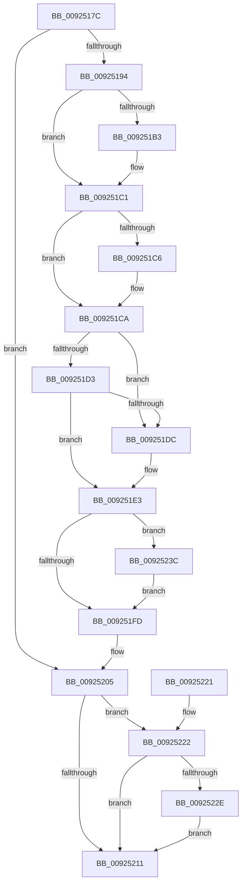

# AlpcpDestroyPort

- RVA: `0x0092517C`–`0x00925246` (길이 `202` bytes)
- VA: `0x000000014092517C`
- 실행 섹션: `PAGE`
- PDB 이름 있음: `예`; PDB Function 태그: `아니요`
- unwind 정보 RVA: `0x0008D44C`
- 디코드: `56`개 명령, `202/202` bytes 표시
- 미해석 바이트: `0` (있으면 어셈블리에 `.byte`로 보존)

> 이 문서는 커널 이미지의 기계어와 PDB 기호를 분석해 생성했습니다. 4번과 5번은 함수 원형과 자료형을 바이너리 사용 방식에서 추정한 C 해석이며 원본 소스 복구 결과는 아닙니다.

## 1. Dependencies

- 직접 호출 지점: **5**; 고유 호출 대상: **5**
- 직접 호출자로 확인된 함수: **1**
- RIP 상대 이미지 참조: **3**

### Outgoing calls
- `0x009251A3` → [KeAbPreAcquire](../../text/21/KeAbPreAcquire_function_00210230.md) (function, `0x00210230`)
- `0x009251BC` → [ExfAcquirePushLockExclusiveEx](../../text/20/ExfAcquirePushLockExclusiveEx_function_0020FC90.md) (function, `0x0020FC90`)
- `0x00925200` → [KeAbPostRelease](../../text/2E/KeAbPostRelease_function_002E1600.md) (function, `0x002E1600`)
- `0x00925235` → [ExFreeToNPagedLookasideList](../../text/38/ExFreeToNPagedLookasideList_function_0038D9D0.md) (function, `0x0038D9D0`)
- `0x0092523F` → [ExfTryToWakePushLock](../../text/26/ExfTryToWakePushLock_function_00265DD0.md) (function, `0x00265DD0`)

### Direct callers
- [AlpcpDeletePort](AlpcpDeletePort_function_00925010.md) at `0x00925110`

### Static image references
- `0x00925194` → RVA `0x00F10100` (`.data`; read)
- `0x009251EE` → RVA `0x00F10100` (`.data`; read/write)
- `0x0092522E` → RVA `0x00E27100` (`.data`; read)

## 2. Other-region calls and transfers

- 다른 실행 섹션으로 향하는 call: **5**
  - `0x009251A3` → [KeAbPreAcquire](../../text/21/KeAbPreAcquire_function_00210230.md) (`PAGE` → `.text`)
  - `0x009251BC` → [ExfAcquirePushLockExclusiveEx](../../text/20/ExfAcquirePushLockExclusiveEx_function_0020FC90.md) (`PAGE` → `.text`)
  - `0x00925200` → [KeAbPostRelease](../../text/2E/KeAbPostRelease_function_002E1600.md) (`PAGE` → `.text`)
  - `0x00925235` → [ExFreeToNPagedLookasideList](../../text/38/ExFreeToNPagedLookasideList_function_0038D9D0.md) (`PAGE` → `.text`)
  - `0x0092523F` → [ExfTryToWakePushLock](../../text/26/ExfTryToWakePushLock_function_00265DD0.md) (`PAGE` → `.text`)
- 별도 외부 분기/꼬리 이동을 확인하지 못했습니다.

## 3. Assembly (complete function range)

```asm
0092517C  48 89 5C 24 08                  mov qword ptr [rsp + 8], rbx
00925181  48 89 74 24 10                  mov qword ptr [rsp + 0x10], rsi
00925186  57                              push rdi
00925187  48 83 EC 20                     sub rsp, 0x20
0092518B  48 83 39 00                     cmp qword ptr [rcx], 0
0092518F  48 8B D9                        mov rbx, rcx
00925192  74 71                           je 0x140925205
00925194  48 8D 35 65 AF 5E 00            lea rsi, [rip + 0x5eaf65]
0092519B  45 33 C0                        xor r8d, r8d
0092519E  48 8B CE                        mov rcx, rsi
009251A1  33 D2                           xor edx, edx
009251A3  E8 88 B0 8E FF                  call 0x140210230
009251A8  F0 48 0F BA 2E 00               lock bts qword ptr [rsi], 0
009251AE  48 8B F8                        mov rdi, rax
009251B1  73 0E                           jae 0x1409251c1
009251B3  4C 8B C6                        mov r8, rsi
009251B6  48 8B D0                        mov rdx, rax
009251B9  48 8B CE                        mov rcx, rsi
009251BC  E8 CF AA 8E FF                  call 0x14020fc90
009251C1  48 85 FF                        test rdi, rdi
009251C4  74 04                           je 0x1409251ca
009251C6  C6 47 0A 01                     mov byte ptr [rdi + 0xa], 1
009251CA  48 8B 13                        mov rdx, qword ptr [rbx]
009251CD  48 39 5A 08                     cmp qword ptr [rdx + 8], rbx
009251D1  75 09                           jne 0x1409251dc
009251D3  48 8B 43 08                     mov rax, qword ptr [rbx + 8]
009251D7  48 39 18                        cmp qword ptr [rax], rbx
009251DA  74 07                           je 0x1409251e3
009251DC  B9 03 00 00 00                  mov ecx, 3
009251E1  CD 29                           int 0x29
009251E3  48 89 10                        mov qword ptr [rax], rdx
009251E6  48 89 42 08                     mov qword ptr [rdx + 8], rax
009251EA  48 83 C8 FF                     or rax, 0xffffffffffffffff
009251EE  F0 48 0F C1 05 09 AF 5E 00      lock xadd qword ptr [rip + 0x5eaf09], rax
009251F7  24 06                           and al, 6
009251F9  3C 02                           cmp al, 2
009251FB  74 3F                           je 0x14092523c
009251FD  48 8B CE                        mov rcx, rsi
00925200  E8 FB C3 9B FF                  call 0x1402e1600
00925205  F7 83 A0 01 00 00 00 02 00 00   test dword ptr [rbx + 0x1a0], 0x200
0092520F  75 11                           jne 0x140925222
00925211  48 8B 5C 24 30                  mov rbx, qword ptr [rsp + 0x30]
00925216  48 8B 74 24 38                  mov rsi, qword ptr [rsp + 0x38]
0092521B  48 83 C4 20                     add rsp, 0x20
0092521F  5F                              pop rdi
00925220  C3                              ret
00925221  CC                              int3
00925222  48 8B 93 F8 00 00 00            mov rdx, qword ptr [rbx + 0xf8]
00925229  48 85 D2                        test rdx, rdx
0092522C  74 E3                           je 0x140925211
0092522E  48 8D 0D CB 1E 50 00            lea rcx, [rip + 0x501ecb]
00925235  E8 96 87 A6 FF                  call 0x14038d9d0
0092523A  EB D5                           jmp 0x140925211
0092523C  48 8B CE                        mov rcx, rsi
0092523F  E8 8C 0B 94 FF                  call 0x140265dd0
00925244  EB B7                           jmp 0x1409251fd
```

## 4. C-style interpretation (structured pseudocode)

```c
__int64 __fastcall AlpcpDestroyPort(__int64 a1, int a2, int a3)
{
    __int64 result;
    __int64 v_rsp;
    unsigned __int64 v_stack_p10;
    unsigned __int64 v_stack_p8;

    v_stack_p8 = v_rbx;
    v_stack_p10 = v_rsi;
    v_rsp = (v_rsp) - (32);
    if ((*(unsigned __int64 *)(a1)) == 0) goto loc_00925205;
    a3 = 0;
    a2 = 0;
    result = KeAbPreAcquire(v_rip + 6205285, a2, a3, a4);
    if (!(condition_is_above_or_equal)) {
        a3 = v_rip + 6205285;
        a2 = result;
        a1 = v_rip + 6205285;
        result = ExfAcquirePushLockExclusiveEx(a1, a2, a3, a4);
    }
    if (result != 0) {
        *(unsigned __int8 *)(result + 10) = 1;
    }
    if ((*(unsigned __int64 *)(*(unsigned __int64 *)(a1) + 8)) != a1) goto loc_009251DC;
    if ((*(unsigned __int64 *)(*(unsigned __int64 *)(a1 + 8))) != a1) {
        a1 = 3;
    }
    *(unsigned __int64 *)(*(unsigned __int64 *)(a1 + 8)) = *(unsigned __int64 *)(a1);
    *(unsigned __int64 *)(*(unsigned __int64 *)(a1) + 8) = *(unsigned __int64 *)(a1 + 8);
    result = (*(unsigned __int64 *)(a1 + 8)) | (-1);
    result = (unsigned __int8)((result) & (6));
    if (((unsigned __int8)(result)) == 2) goto loc_0092523C;
loc_009251FD:
    result = KeAbPostRelease(v_rip + 6205285, *(unsigned __int64 *)(a1), a3, a4);
loc_00925205:
    if (((*(unsigned int *)(a1 + 416)) & (512)) != 0) goto loc_00925222;
loc_00925211:
    v_rsp = (v_rsp) + (32);
    return result;
loc_00925222:
    if (*(unsigned __int64 *)(v_stack_p8 + 248) == 0) goto loc_00925211;
    result = ExFreeToNPagedLookasideList(v_rip + 5250763, *(unsigned __int64 *)(v_stack_p8 + 248), a3, a4);
    goto loc_00925211;
loc_0092523C:
    result = ExfTryToWakePushLock(v_stack_p10, *(unsigned __int64 *)(v_stack_p8 + 248), a3, a4);
    goto loc_009251FD;
}
```

## 5. (Beta) C Style

```c
int64_t AlpcpDestroyPort(void *Arg1, int32_t Arg2, int32_t Arg3)
{
    uint8_t *arg1 = (uint8_t *)Arg1;

    int64_t result;
    int64_t local_rsp;
    uint64_t v_stack_p10;
    uint64_t v_stack_p8;

    v_stack_p8 = local_rbx;
    v_stack_p10 = local_rsi;
    local_rsp = (local_rsp) - (32);
    if ((*(uint64_t *)(arg1)) == 0) goto loc_00925205;
    Arg3 = 0;
    Arg2 = 0;
    result = KeAbPreAcquire(v_rip + 6205285, Arg2, Arg3, a4);
    if (!(condition_is_above_or_equal)) {
        Arg3 = v_rip + 6205285;
        Arg2 = result;
        Arg1 = v_rip + 6205285;
        result = ExfAcquirePushLockExclusiveEx(Arg1, Arg2, Arg3, a4);
    }
    if (result != 0) {
        *(uint8_t *)(result + 0xA) = 1;
    }
    if ((*(uint64_t *)(*(uint64_t *)(arg1) + 0x8)) != Arg1) goto loc_009251DC;
    if ((*(uint64_t *)(*(uint64_t *)(arg1 + 0x8))) != Arg1) {
        Arg1 = 3;
    }
    *(uint64_t *)(*(uint64_t *)(arg1 + 0x8)) = *(uint64_t *)(arg1);
    *(uint64_t *)(*(uint64_t *)(arg1) + 0x8) = *(uint64_t *)(arg1 + 0x8);
    result = (*(uint64_t *)(arg1 + 0x8)) | (-1);
    result = (uint8_t)((result) & (6));
    if (((uint8_t)(result)) == 2) goto loc_0092523C;
loc_009251FD:
    result = KeAbPostRelease(v_rip + 6205285, *(uint64_t *)(arg1), Arg3, a4);
loc_00925205:
    if (((*(uint32_t *)(arg1 + 0x1A0)) & (512)) != 0) goto loc_00925222;
loc_00925211:
    local_rsp = (local_rsp) + (32);
    return result;
loc_00925222:
    if (*(uint64_t *)(v_stack_p8 + 0xF8) == 0) goto loc_00925211;
    result = ExFreeToNPagedLookasideList(v_rip + 5250763, *(uint64_t *)(v_stack_p8 + 0xF8), Arg3, a4);
    goto loc_00925211;
loc_0092523C:
    result = ExfTryToWakePushLock(v_stack_p10, *(uint64_t *)(v_stack_p8 + 0xF8), Arg3, a4);
    goto loc_009251FD;
}
```

### 관측된 메모리 오프셋

구조체 형식이 확인되지 않은 접근은 인자 기준의 오프셋으로만 기록했습니다.

| 기준 인자 | 오프셋 표현 | 폭 (bit) | 접근 |
|---|---:|---:|---|
| `Arg1` | `+ 0x0` | `64` | `R` |
| `Arg1` | `+ 0x8` | `64` | `R` |
| `Arg1` | `+ 0xF8` | `64` | `R` |
| `Arg1` | `+ 0x1A0` | `32` | `R` |

## 6. Execution-region graph

[열기: 2D/3D 그래프와 함수 탐색 컨트롤 패널](../../../control-panel.html?section=page&rva=0x0092517C&view=graph)

- 2D 그래프는 위에서 아래로 흐르고, 3D 그래프는 빈 공간을 드래그해 회전합니다. Shift+드래그는 이동, 휠은 확대·축소, 함수 노드 선택은 대상 보고서 이동입니다.

### Static fallback


