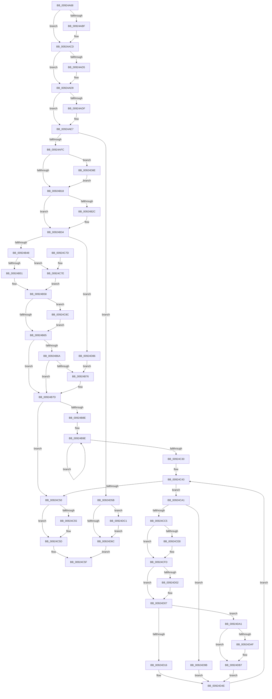

# AlpcpDisconnectPort

- RVA: `0x00924A68`–`0x00924DCB` (길이 `867` bytes)
- VA: `0x0000000140924A68`
- 실행 섹션: `PAGE`
- PDB 이름 있음: `예`; PDB Function 태그: `아니요`
- unwind 정보 RVA: `0x0008D3F4`
- 디코드: `228`개 명령, `867/867` bytes 표시
- 미해석 바이트: `0` (있으면 어셈블리에 `.byte`로 보존)

> 이 문서는 커널 이미지의 기계어와 PDB 기호를 분석해 생성했습니다. 4번과 5번은 함수 원형과 자료형을 바이너리 사용 방식에서 추정한 C 해석이며 원본 소스 복구 결과는 아닙니다.

## 1. Dependencies

- 직접 호출 지점: **26**; 고유 호출 대상: **16**
- 직접 호출자로 확인된 함수: **2**
- RIP 상대 이미지 참조: **0**

### Outgoing calls
- `0x00924A9B` → [AlpcpLockBlobExclusive](AlpcpLockBlobExclusive_function_009253A4.md) (function, `0x009253A4`)
- `0x00924AAF` → [KeAbPreAcquire](../../text/21/KeAbPreAcquire_function_00210230.md) (function, `0x00210230`)
- `0x00924AC8` → [ExfAcquirePushLockExclusiveEx](../../text/20/ExfAcquirePushLockExclusiveEx_function_0020FC90.md) (function, `0x0020FC90`)
- `0x00924B1B` → [KeAbPostRelease](../../text/2E/KeAbPostRelease_function_002E1600.md) (function, `0x002E1600`)
- `0x00924B2F` → [AlpcpWalkConnectionList](AlpcpWalkConnectionList_function_00925D20.md) (function, `0x00925D20`)
- `0x00924B6D` → [ObReferenceObjectSafe](../../text/41/ObReferenceObjectSafe_function_0041DAE0.md) (function, `0x0041DAE0`)
- `0x00924B80` → [AlpcpUnlockBlobUncachedExclusive](AlpcpUnlockBlobUncachedExclusive_function_0092536C.md) (function, `0x0092536C`)
- `0x00924BBA` → [AlpcpCancelMessagesByRequestor](AlpcpCancelMessagesByRequestor_function_00924170.md) (function, `0x00924170`)
- `0x00924BDD` → [AlpcpCancelMessagesByRequestor](AlpcpCancelMessagesByRequestor_function_00924170.md) (function, `0x00924170`)
- `0x00924C00` → [AlpcpCancelMessagesByRequestor](AlpcpCancelMessagesByRequestor_function_00924170.md) (function, `0x00924170`)
- `0x00924C23` → [AlpcpCancelMessagesByRequestor](AlpcpCancelMessagesByRequestor_function_00924170.md) (function, `0x00924170`)
- `0x00924C33` → [ObfDereferenceObject](../../text/2F/ObfDereferenceObject_function_002F9350.md) (function, `0x002F9350`)
- `0x00924C58` → [ObfDereferenceObject](../../text/2F/ObfDereferenceObject_function_002F9350.md) (function, `0x002F9350`)
- `0x00924C8F` → [ObReferenceObjectSafe](../../text/41/ObReferenceObjectSafe_function_0041DAE0.md) (function, `0x0041DAE0`)
- `0x00924CB7` → [AlpcpLockForCachedReferenceBlob](../88/AlpcpLockForCachedReferenceBlob_function_0088A8B0.md) (function, `0x0088A8B0`)
- `0x00924CD4` → [KeAbPreAcquire](../../text/21/KeAbPreAcquire_function_00210230.md) (function, `0x00210230`)
- `0x00924CF3` → [ExfAcquirePushLockSharedEx](../../text/21/ExfAcquirePushLockSharedEx_function_0021044C.md) (function, `0x0021044C`)
- `0x00924D41` → [AlpcpInsertMessageCanceledQueue](../A6/AlpcpInsertMessageCanceledQueue_function_00A6DC38.md) (function, `0x00A6DC38`)
- `0x00924D49` → [AlpcpSignalPortAndUnlock](../A7/AlpcpSignalPortAndUnlock_function_00A76910.md) (function, `0x00A76910`)
- `0x00924D51` → [AlpcpUnlockMessage](../89/AlpcpUnlockMessage_function_00897AE0.md) (function, `0x00897AE0`)
- `0x00924D6F` → [KeAbPostRelease](../../text/2E/KeAbPostRelease_function_002E1600.md) (function, `0x002E1600`)
- `0x00924D77` → [AlpcpUnlockBlobUncachedExclusive](AlpcpUnlockBlobUncachedExclusive_function_0092536C.md) (function, `0x0092536C`)
- `0x00924D91` → [ExfTryToWakePushLock](../../text/26/ExfTryToWakePushLock_function_00265DD0.md) (function, `0x00265DD0`)
- `0x00924DB2` → [ExfReleasePushLockShared](../../text/26/ExfReleasePushLockShared_function_00263440.md) (function, `0x00263440`)
- `0x00924DBA` → [KeAbPostRelease](../../text/2E/KeAbPostRelease_function_002E1600.md) (function, `0x002E1600`)
- `0x00924DC4` → [ExfTryToWakePushLock](../../text/26/ExfTryToWakePushLock_function_00265DD0.md) (function, `0x00265DD0`)

### Direct callers
- [AlpcpDoPortCleanup](AlpcpDoPortCleanup_function_00924E54.md) at `0x00924E72`
- [NtAlpcDisconnectPort](../A4/NtAlpcDisconnectPort_function_00A4F260.md) at `0x00A4F2DA`

### Static image references
- 디코드된 RIP-relative 메모리 참조가 없습니다.

## 2. Other-region calls and transfers

- 다른 실행 섹션으로 향하는 call: **14**
  - `0x00924AAF` → [KeAbPreAcquire](../../text/21/KeAbPreAcquire_function_00210230.md) (`PAGE` → `.text`)
  - `0x00924AC8` → [ExfAcquirePushLockExclusiveEx](../../text/20/ExfAcquirePushLockExclusiveEx_function_0020FC90.md) (`PAGE` → `.text`)
  - `0x00924B1B` → [KeAbPostRelease](../../text/2E/KeAbPostRelease_function_002E1600.md) (`PAGE` → `.text`)
  - `0x00924B6D` → [ObReferenceObjectSafe](../../text/41/ObReferenceObjectSafe_function_0041DAE0.md) (`PAGE` → `.text`)
  - `0x00924C33` → [ObfDereferenceObject](../../text/2F/ObfDereferenceObject_function_002F9350.md) (`PAGE` → `.text`)
  - `0x00924C58` → [ObfDereferenceObject](../../text/2F/ObfDereferenceObject_function_002F9350.md) (`PAGE` → `.text`)
  - `0x00924C8F` → [ObReferenceObjectSafe](../../text/41/ObReferenceObjectSafe_function_0041DAE0.md) (`PAGE` → `.text`)
  - `0x00924CD4` → [KeAbPreAcquire](../../text/21/KeAbPreAcquire_function_00210230.md) (`PAGE` → `.text`)
  - `0x00924CF3` → [ExfAcquirePushLockSharedEx](../../text/21/ExfAcquirePushLockSharedEx_function_0021044C.md) (`PAGE` → `.text`)
  - `0x00924D6F` → [KeAbPostRelease](../../text/2E/KeAbPostRelease_function_002E1600.md) (`PAGE` → `.text`)
  - `0x00924D91` → [ExfTryToWakePushLock](../../text/26/ExfTryToWakePushLock_function_00265DD0.md) (`PAGE` → `.text`)
  - `0x00924DB2` → [ExfReleasePushLockShared](../../text/26/ExfReleasePushLockShared_function_00263440.md) (`PAGE` → `.text`)
  - `0x00924DBA` → [KeAbPostRelease](../../text/2E/KeAbPostRelease_function_002E1600.md) (`PAGE` → `.text`)
  - `0x00924DC4` → [ExfTryToWakePushLock](../../text/26/ExfTryToWakePushLock_function_00265DD0.md) (`PAGE` → `.text`)
- 별도 외부 분기/꼬리 이동을 확인하지 못했습니다.

## 3. Assembly (complete function range)

```asm
00924A68  48 89 5C 24 10                  mov qword ptr [rsp + 0x10], rbx
00924A6D  48 89 74 24 18                  mov qword ptr [rsp + 0x18], rsi
00924A72  48 89 7C 24 20                  mov qword ptr [rsp + 0x20], rdi
00924A77  55                              push rbp
00924A78  41 54                           push r12
00924A7A  41 55                           push r13
00924A7C  41 56                           push r14
00924A7E  41 57                           push r15
00924A80  48 8B EC                        mov rbp, rsp
00924A83  48 83 EC 40                     sub rsp, 0x40
00924A87  4C 8B 61 10                     mov r12, qword ptr [rcx + 0x10]
00924A8B  48 8B F1                        mov rsi, rcx
00924A8E  0F 57 C0                        xorps xmm0, xmm0
00924A91  49 8B CC                        mov rcx, r12
00924A94  44 8B F2                        mov r14d, edx
00924A97  0F 11 45 F0                     movups xmmword ptr [rbp - 0x10], xmm0
00924A9B  E8 04 09 00 00                  call 0x1409253a4
00924AA0  48 8D 9E 60 01 00 00            lea rbx, [rsi + 0x160]
00924AA7  45 33 C0                        xor r8d, r8d
00924AAA  48 8B CB                        mov rcx, rbx
00924AAD  33 D2                           xor edx, edx
00924AAF  E8 7C B7 8E FF                  call 0x140210230
00924AB4  F0 48 0F BA 2B 00               lock bts qword ptr [rbx], 0
00924ABA  48 8B F8                        mov rdi, rax
00924ABD  73 0E                           jae 0x140924acd
00924ABF  4C 8B C3                        mov r8, rbx
00924AC2  48 8B D0                        mov rdx, rax
00924AC5  48 8B CB                        mov rcx, rbx
00924AC8  E8 C3 B1 8E FF                  call 0x14020fc90
00924ACD  45 33 ED                        xor r13d, r13d
00924AD0  48 85 FF                        test rdi, rdi
00924AD3  74 04                           je 0x140924ad9
00924AD5  C6 47 0A 01                     mov byte ptr [rdi + 0xa], 1
00924AD9  41 F6 C6 01                     test r14b, 1
00924ADD  74 08                           je 0x140924ae7
00924ADF  0F BA AE A0 01 00 00 07         bts dword ptr [rsi + 0x1a0], 7
00924AE7  8B 86 A0 01 00 00               mov eax, dword ptr [rsi + 0x1a0]
00924AED  48 8D BE 60 01 00 00            lea rdi, [rsi + 0x160]
00924AF4  A8 20                           test al, 0x20
00924AF6  0F 85 5F 02 00 00               jne 0x140924d5b
00924AFC  83 C8 20                        or eax, 0x20
00924AFF  89 86 A0 01 00 00               mov dword ptr [rsi + 0x1a0], eax
00924B05  48 83 C8 FF                     or rax, 0xffffffffffffffff
00924B09  F0 48 0F C1 07                  lock xadd qword ptr [rdi], rax
00924B0E  24 06                           and al, 6
00924B10  3C 02                           cmp al, 2
00924B12  0F 84 76 02 00 00               je 0x140924d8e
00924B18  48 8B CF                        mov rcx, rdi
00924B1B  E8 E0 CA 9B FF                  call 0x1402e1600
00924B20  8B 86 A0 01 00 00               mov eax, dword ptr [rsi + 0x1a0]
00924B26  24 06                           and al, 6
00924B28  3C 02                           cmp al, 2
00924B2A  75 08                           jne 0x140924b34
00924B2C  48 8B CE                        mov rcx, rsi
00924B2F  E8 EC 11 00 00                  call 0x140925d20
00924B34  8B 86 A0 01 00 00               mov eax, dword ptr [rsi + 0x1a0]
00924B3A  D1 E8                           shr eax, 1
00924B3C  83 E0 03                        and eax, 3
00924B3F  83 E8 01                        sub eax, 1
00924B42  0F 84 3E 02 00 00               je 0x140924d86
00924B48  83 F8 01                        cmp eax, 1
00924B4B  0F 85 2D 01 00 00               jne 0x140924c7e
00924B51  4D 8B 3C 24                     mov r15, qword ptr [r12]
00924B55  4C 8B F6                        mov r14, rsi
00924B58  4C 89 75 30                     mov qword ptr [rbp + 0x30], r14
00924B5C  4D 85 FF                        test r15, r15
00924B5F  0F 85 27 01 00 00               jne 0x140924c8c
00924B65  4D 85 F6                        test r14, r14
00924B68  74 13                           je 0x140924b7d
00924B6A  49 8B CE                        mov rcx, r14
00924B6D  E8 6E 8F AF FF                  call 0x14041dae0
00924B72  84 C0                           test al, al
00924B74  75 07                           jne 0x140924b7d
00924B76  4C 89 6D 30                     mov qword ptr [rbp + 0x30], r13
00924B7A  4D 8B F5                        mov r14, r13
00924B7D  49 8B CC                        mov rcx, r12
00924B80  E8 E7 07 00 00                  call 0x14092536c
00924B85  4D 85 FF                        test r15, r15
00924B88  0F 84 C2 00 00 00               je 0x140924c50
00924B8E  48 8D 45 F0                     lea rax, [rbp - 0x10]
00924B92  48 89 45 F8                     mov qword ptr [rbp - 8], rax
00924B96  48 8D 45 F0                     lea rax, [rbp - 0x10]
00924B9A  48 89 45 F0                     mov qword ptr [rbp - 0x10], rax
00924B9E  48 8D 45 F0                     lea rax, [rbp - 0x10]
00924BA2  41 B9 01 00 00 00               mov r9d, 1
00924BA8  4D 8D 87 90 00 00 00            lea r8, [r15 + 0x90]
00924BAF  48 89 44 24 20                  mov qword ptr [rsp + 0x20], rax
00924BB4  49 8B D7                        mov rdx, r15
00924BB7  48 8B CE                        mov rcx, rsi
00924BBA  E8 B1 F5 FF FF                  call 0x140924170
00924BBF  8B F8                           mov edi, eax
00924BC1  4D 8D 87 A0 00 00 00            lea r8, [r15 + 0xa0]
00924BC8  48 8D 45 F0                     lea rax, [rbp - 0x10]
00924BCC  41 B9 02 00 00 00               mov r9d, 2
00924BD2  49 8B D7                        mov rdx, r15
00924BD5  48 89 44 24 20                  mov qword ptr [rsp + 0x20], rax
00924BDA  48 8B CE                        mov rcx, rsi
00924BDD  E8 8E F5 FF FF                  call 0x140924170
00924BE2  0B F8                           or edi, eax
00924BE4  4D 8D 87 B8 00 00 00            lea r8, [r15 + 0xb8]
00924BEB  48 8D 45 F0                     lea rax, [rbp - 0x10]
00924BEF  41 B9 03 00 00 00               mov r9d, 3
00924BF5  49 8B D7                        mov rdx, r15
00924BF8  48 89 44 24 20                  mov qword ptr [rsp + 0x20], rax
00924BFD  48 8B CE                        mov rcx, rsi
00924C00  E8 6B F5 FF FF                  call 0x140924170
00924C05  0B F8                           or edi, eax
00924C07  4D 8D 87 D0 00 00 00            lea r8, [r15 + 0xd0]
00924C0E  48 8D 45 F0                     lea rax, [rbp - 0x10]
00924C12  41 B9 04 00 00 00               mov r9d, 4
00924C18  49 8B D7                        mov rdx, r15
00924C1B  48 89 44 24 20                  mov qword ptr [rsp + 0x20], rax
00924C20  48 8B CE                        mov rcx, rsi
00924C23  E8 48 F5 FF FF                  call 0x140924170
00924C28  0B C7                           or eax, edi
00924C2A  0F 85 6E FF FF FF               jne 0x140924b9e
00924C30  49 8B CF                        mov rcx, r15
00924C33  E8 18 47 9D FF                  call 0x1402f9350
00924C38  4C 8B 75 30                     mov r14, qword ptr [rbp + 0x30]
00924C3C  48 83 CB FF                     or rbx, 0xffffffffffffffff
00924C40  45 33 E4                        xor r12d, r12d
00924C43  48 8B 7D F0                     mov rdi, qword ptr [rbp - 0x10]
00924C47  48 8D 45 F0                     lea rax, [rbp - 0x10]
00924C4B  48 3B F8                        cmp rdi, rax
00924C4E  75 51                           jne 0x140924ca1
00924C50  4D 85 F6                        test r14, r14
00924C53  74 08                           je 0x140924c5d
00924C55  49 8B CE                        mov rcx, r14
00924C58  E8 F3 46 9D FF                  call 0x1402f9350
00924C5D  33 C0                           xor eax, eax
00924C5F  4C 8D 5C 24 40                  lea r11, [rsp + 0x40]
00924C64  49 8B 5B 38                     mov rbx, qword ptr [r11 + 0x38]
00924C68  49 8B 73 40                     mov rsi, qword ptr [r11 + 0x40]
00924C6C  49 8B 7B 48                     mov rdi, qword ptr [r11 + 0x48]
00924C70  49 8B E3                        mov rsp, r11
00924C73  41 5F                           pop r15
00924C75  41 5E                           pop r14
00924C77  41 5D                           pop r13
00924C79  41 5C                           pop r12
00924C7B  5D                              pop rbp
00924C7C  C3                              ret
00924C7D  CC                              int3
00924C7E  4D 8B 7C 24 10                  mov r15, qword ptr [r12 + 0x10]
00924C83  4D 8B 34 24                     mov r14, qword ptr [r12]
00924C87  E9 CC FE FF FF                  jmp 0x140924b58
00924C8C  49 8B CF                        mov rcx, r15
00924C8F  E8 4C 8E AF FF                  call 0x14041dae0
00924C94  F6 D8                           neg al
00924C96  48 1B C9                        sbb rcx, rcx
00924C99  4C 23 F9                        and r15, rcx
00924C9C  E9 C4 FE FF FF                  jmp 0x140924b65
00924CA1  48 8B 07                        mov rax, qword ptr [rdi]
00924CA4  48 8D 4D F0                     lea rcx, [rbp - 0x10]
00924CA8  48 89 45 F0                     mov qword ptr [rbp - 0x10], rax
00924CAC  48 83 C7 B0                     add rdi, -0x50
00924CB0  48 89 48 08                     mov qword ptr [rax + 8], rcx
00924CB4  48 8B CF                        mov rcx, rdi
00924CB7  E8 F4 5B F6 FF                  call 0x14088a8b0
00924CBC  4D 85 F6                        test r14, r14
00924CBF  0F 84 D6 00 00 00               je 0x140924d9b
00924CC5  4D 8D BE 60 01 00 00            lea r15, [r14 + 0x160]
00924CCC  45 33 C0                        xor r8d, r8d
00924CCF  49 8B CF                        mov rcx, r15
00924CD2  33 D2                           xor edx, edx
00924CD4  E8 57 B5 8E FF                  call 0x140210230
00924CD9  4C 8B E8                        mov r13, rax
00924CDC  33 C0                           xor eax, eax
00924CDE  8D 48 11                        lea ecx, [rax + 0x11]
00924CE1  F0 49 0F B1 0F                  lock cmpxchg qword ptr [r15], rcx
00924CE6  74 15                           je 0x140924cfd
00924CE8  4D 8B CF                        mov r9, r15
00924CEB  4D 8B C5                        mov r8, r13
00924CEE  33 D2                           xor edx, edx
00924CF0  49 8B CF                        mov rcx, r15
00924CF3  E8 54 B7 8E FF                  call 0x14021044c
00924CF8  B9 11 00 00 00                  mov ecx, 0x11
00924CFD  4D 85 ED                        test r13, r13
00924D00  74 05                           je 0x140924d07
00924D02  41 C6 45 0A 01                  mov byte ptr [r13 + 0xa], 1
00924D07  41 8B 86 A0 01 00 00            mov eax, dword ptr [r14 + 0x1a0]
00924D0E  A8 40                           test al, 0x40
00924D10  0F 85 8B 00 00 00               jne 0x140924da1
00924D16  B8 01 00 00 00                  mov eax, 1
00924D1B  F0 0F C1 86 90 01 00 00         lock xadd dword ptr [rsi + 0x190], eax
00924D23  FF C0                           inc eax
00924D25  48 8B D7                        mov rdx, rdi
00924D28  89 47 48                        mov dword ptr [rdi + 0x48], eax
00924D2B  49 8B CE                        mov rcx, r14
00924D2E  48 8B 46 38                     mov rax, qword ptr [rsi + 0x38]
00924D32  48 89 87 80 00 00 00            mov qword ptr [rdi + 0x80], rax
00924D39  48 89 77 38                     mov qword ptr [rdi + 0x38], rsi
00924D3D  4C 89 77 40                     mov qword ptr [rdi + 0x40], r14
00924D41  E8 F2 8E 14 00                  call 0x140a6dc38
00924D46  49 8B CE                        mov rcx, r14
00924D49  E8 C2 1B 15 00                  call 0x140a76910
00924D4E  48 8B CF                        mov rcx, rdi
00924D51  E8 8A 2D F7 FF                  call 0x140897ae0
00924D56  E9 E8 FE FF FF                  jmp 0x140924c43
00924D5B  48 83 CB FF                     or rbx, 0xffffffffffffffff
00924D5F  F0 48 0F C1 1F                  lock xadd qword ptr [rdi], rbx
00924D64  80 E3 06                        and bl, 6
00924D67  80 FB 02                        cmp bl, 2
00924D6A  74 55                           je 0x140924dc1
00924D6C  48 8B CF                        mov rcx, rdi
00924D6F  E8 8C C8 9B FF                  call 0x1402e1600
00924D74  49 8B CC                        mov rcx, r12
00924D77  E8 F0 05 00 00                  call 0x14092536c
00924D7C  B8 37 00 00 C0                  mov eax, 0xc0000037
00924D81  E9 D9 FE FF FF                  jmp 0x140924c5f
00924D86  4D 8B FD                        mov r15, r13
00924D89  E9 E8 FD FF FF                  jmp 0x140924b76
00924D8E  48 8B CF                        mov rcx, rdi
00924D91  E8 3A 10 94 FF                  call 0x140265dd0
00924D96  E9 7D FD FF FF                  jmp 0x140924b18
00924D9B  66 01 5F E2                     add word ptr [rdi - 0x1e], bx
00924D9F  EB AD                           jmp 0x140924d4e
00924DA1  66 01 5F E2                     add word ptr [rdi - 0x1e], bx
00924DA5  48 8B C1                        mov rax, rcx
00924DA8  F0 4D 0F B1 27                  lock cmpxchg qword ptr [r15], r12
00924DAD  74 08                           je 0x140924db7
00924DAF  49 8B CF                        mov rcx, r15
00924DB2  E8 89 E6 93 FF                  call 0x140263440
00924DB7  49 8B CF                        mov rcx, r15
00924DBA  E8 41 C8 9B FF                  call 0x1402e1600
00924DBF  EB 8D                           jmp 0x140924d4e
00924DC1  48 8B CF                        mov rcx, rdi
00924DC4  E8 07 10 94 FF                  call 0x140265dd0
00924DC9  EB A1                           jmp 0x140924d6c
```

## 4. C-style interpretation (structured pseudocode)

```c
__int64 __fastcall AlpcpDisconnectPort(__int64 a1, int a2, int a3)
{
    __int64 result;
    __int64 v_r12;
    __int64 v_r13;
    __int64 v_r14;
    __int64 v_r15;
    __int64 v_rbx;
    __int64 v_rdi;
    __int64 v_rsp;
    unsigned __int64 v_stack_m28;
    unsigned __int64 v_stack_m30;
    unsigned __int64 v_stack_m38;
    unsigned __int64 v_stack_m48;
    unsigned __int64 v_stack_p10;
    unsigned __int64 v_stack_p18;
    unsigned __int64 v_stack_p20;
    unsigned __int64 v_stack_p8;

    v_stack_p10 = v_rbx;
    v_stack_p18 = v_rsi;
    v_stack_p20 = v_rdi;
    v_rsp = (v_rsp) - (64);
    v_stack_m38 = v_xmm0;
    result = AlpcpLockBlobExclusive(*(unsigned __int64 *)(a1 + 16), a2, a3, a4);
    a3 = 0;
    a2 = 0;
    result = KeAbPreAcquire(a1 + 352, a2, a3, a4);
    if (!(condition_is_above_or_equal)) {
        a3 = a1 + 352;
        a2 = result;
        a1 = a1 + 352;
        result = ExfAcquirePushLockExclusiveEx(a1, a2, a3, a4);
    }
    v_r13 = 0;
    if (result != 0) {
        *(unsigned __int8 *)(result + 10) = 1;
    }
    if ((((unsigned __int8)((unsigned int)(a2))) & (1)) != 0) {
    }
    if ((((unsigned __int8)((unsigned int)(*(unsigned int *)(a1 + 416)))) & (32)) != 0) goto loc_00924D5B;
    result = (unsigned int)(((unsigned int)(*(unsigned int *)(a1 + 416))) | (32));
    *(unsigned int *)(a1 + 416) = (unsigned int)(result);
    result = (result) | (-1);
    result = (unsigned __int8)((result) & (6));
    if (((unsigned __int8)(result)) == 2) goto loc_00924D8E;
loc_00924B18:
    result = KeAbPostRelease(a1 + 352, a2, a3, a4);
    result = (unsigned __int8)(((unsigned int)(*(unsigned int *)(a1 + 416))) & (6));
    if (((unsigned __int8)(result)) == 2) {
        a1 = a1;
        result = AlpcpWalkConnectionList(a1, a2, a3, a4);
    }
    result = (unsigned int)(((unsigned int)(*(unsigned int *)(a1 + 416))) >> (1));
    result = (unsigned int)((result) & (3));
    result = (unsigned int)((result) - (1));
    if (condition_is_equal) goto loc_00924D86;
    if (((unsigned int)(result)) != 1) goto loc_00924C7E;
loc_00924B58:
    v_stack_p8 = a1;
    if (*(unsigned __int64 *)(*(unsigned __int64 *)(a1 + 16)) != 0) goto loc_00924C8C;
loc_00924B65:
    if (a1 == 0) goto loc_00924B7D;
    result = ObReferenceObjectSafe(a1, a2, a3, a4);
    v_r14 = a1;
    if ((unsigned __int8)(result) == 0) {
        v_stack_p8 = 0;
        v_r14 = 0;
    }
    result = AlpcpUnlockBlobUncachedExclusive(*(unsigned __int64 *)(a1 + 16), a2, a3, a4);
    if (*(unsigned __int64 *)(*(unsigned __int64 *)(a1 + 16)) == 0) goto loc_00924C50;
    v_stack_m30 = v_stack_m38;
    v_stack_m38 = v_stack_m38;
loc_00924B9E:
    v_stack_m48 = v_stack_m38;
    result = AlpcpCancelMessagesByRequestor(a1, *(unsigned __int64 *)(*(unsigned __int64 *)(a1 + 16)), *(unsigned __int64 *)(*(unsigned __int64 *)(a1 + 16)) + 144, 1);
    v_stack_m48 = v_stack_m38;
    result = AlpcpCancelMessagesByRequestor(a1, *(unsigned __int64 *)(*(unsigned __int64 *)(a1 + 16)), *(unsigned __int64 *)(*(unsigned __int64 *)(a1 + 16)) + 160, 2);
    v_rdi = (unsigned int)(((unsigned int)((unsigned int)(result))) | ((unsigned int)(result)));
    v_stack_m48 = v_stack_m38;
    result = AlpcpCancelMessagesByRequestor(a1, *(unsigned __int64 *)(*(unsigned __int64 *)(a1 + 16)), *(unsigned __int64 *)(*(unsigned __int64 *)(a1 + 16)) + 184, 3);
    v_rdi = (unsigned int)((v_rdi) | ((unsigned int)(result)));
    v_stack_m48 = v_stack_m38;
    result = AlpcpCancelMessagesByRequestor(a1, *(unsigned __int64 *)(*(unsigned __int64 *)(a1 + 16)), *(unsigned __int64 *)(*(unsigned __int64 *)(a1 + 16)) + 208, 4);
    result = (unsigned int)((result) | ((unsigned int)(v_rdi)));
    if (condition_is_not_equal) goto loc_00924B9E;
    result = ObfDereferenceObject(*(unsigned __int64 *)(*(unsigned __int64 *)(a1 + 16)), *(unsigned __int64 *)(*(unsigned __int64 *)(a1 + 16)), *(unsigned __int64 *)(*(unsigned __int64 *)(a1 + 16)) + 208, 4);
    v_rbx = (a1 + 352) | (-1);
    v_r12 = 0;
loc_00924C43:
    if (v_stack_m38 != v_stack_m38) goto loc_00924CA1;
loc_00924C50:
    result = v_stack_m38;
    if (v_stack_p8 != 0) {
        a1 = v_stack_p8;
        result = ObfDereferenceObject(a1, *(unsigned __int64 *)(*(unsigned __int64 *)(a1 + 16)), *(unsigned __int64 *)(*(unsigned __int64 *)(a1 + 16)) + 208, 4);
    }
    result = 0;
loc_00924C5F:
    return result;
loc_00924C7E:
    goto loc_00924B58;
loc_00924C8C:
    result = ObReferenceObjectSafe(*(unsigned __int64 *)(v_r12 + 16), *(unsigned __int64 *)(*(unsigned __int64 *)(a1 + 16)), *(unsigned __int64 *)(*(unsigned __int64 *)(a1 + 16)) + 208, 4);
    result = (unsigned __int8)(-(result));
    v_r15 = (*(unsigned __int64 *)(v_r12 + 16)) & (*(unsigned __int64 *)(v_r12 + 16));
    goto loc_00924B65;
loc_00924CA1:
    v_stack_m38 = *(unsigned __int64 *)(*(unsigned __int64 *)(v_stack_m28 + 72));
    v_rdi = (*(unsigned __int64 *)(v_stack_m28 + 72)) + (-80);
    *(unsigned __int64 *)(*(unsigned __int64 *)(*(unsigned __int64 *)(v_stack_m28 + 72)) + 8) = v_stack_m38;
    result = AlpcpLockForCachedReferenceBlob(v_rdi, *(unsigned __int64 *)(*(unsigned __int64 *)(a1 + 16)), *(unsigned __int64 *)(*(unsigned __int64 *)(a1 + 16)) + 208, 4);
    if (*(unsigned __int64 *)(v_r12) == 0) goto loc_00924D9B;
    a3 = 0;
    a2 = 0;
    result = KeAbPreAcquire(*(unsigned __int64 *)(v_r12) + 352, a2, a3, 4);
    result = 0;
    if (!(condition_is_equal)) {
        a4 = *(unsigned __int64 *)(v_r12) + 352;
        a3 = 0;
        a2 = 0;
        a1 = *(unsigned __int64 *)(v_r12) + 352;
        result = ExfAcquirePushLockSharedEx(a1, a2, a3, a4);
        a1 = 17;
    }
    if (result != 0) {
        *(unsigned __int8 *)(result + 10) = 1;
    }
    if ((((unsigned __int8)((unsigned int)(*(unsigned int *)(*(unsigned __int64 *)(v_r12) + 416)))) & (64)) != 0) goto loc_00924DA1;
    result = (unsigned int)((1) + 1);
    *(unsigned int *)(v_rdi + 72) = (unsigned int)(result);
    *(unsigned __int64 *)(v_rdi + 128) = *(unsigned __int64 *)(*(unsigned __int64 *)(v_stack_m28 + 64) + 56);
    *(unsigned __int64 *)(v_rdi + 56) = *(unsigned __int64 *)(v_stack_m28 + 64);
    *(unsigned __int64 *)(v_rdi + 64) = *(unsigned __int64 *)(v_r12);
    result = AlpcpInsertMessageCanceledQueue(*(unsigned __int64 *)(v_r12), v_rdi, a3, a4);
    result = AlpcpSignalPortAndUnlock(*(unsigned __int64 *)(v_r12), v_rdi, a3, a4);
loc_00924D4E:
    result = AlpcpUnlockMessage(v_rdi, v_rdi, a3, a4);
    goto loc_00924C43;
loc_00924D5B:
    v_rbx = (*(unsigned __int64 *)(v_stack_m28 + 56)) | (-1);
    v_rbx = (unsigned __int8)((v_rbx) & (6));
    if (((unsigned __int8)(v_rbx)) == 2) goto loc_00924DC1;
loc_00924D6C:
    result = KeAbPostRelease(v_rdi, v_rdi, a3, a4);
    result = AlpcpUnlockBlobUncachedExclusive(0, v_rdi, a3, a4);
    goto loc_00924C5F;
loc_00924D86:
    goto loc_00924B76;
loc_00924D8E:
    result = ExfTryToWakePushLock(v_rdi, v_rdi, a3, a4);
    goto loc_00924B18;
loc_00924D9B:
    goto loc_00924D4E;
loc_00924DA1:
    result = v_rdi;
    if (((unsigned __int8)(v_rbx)) != 2) {
        a1 = result;
        result = ExfReleasePushLockShared(a1, v_rdi, a3, a4);
    }
    result = KeAbPostRelease(result, v_rdi, a3, a4);
    goto loc_00924D4E;
loc_00924DC1:
    result = ExfTryToWakePushLock(v_rdi, v_rdi, a3, a4);
    goto loc_00924D6C;
}
```

## 5. (Beta) C Style

```c
int64_t AlpcpDisconnectPort(void *Arg1, int32_t Arg2, int32_t Arg3)
{
    uint8_t *arg1 = (uint8_t *)Arg1;

    int64_t result;
    int64_t local_r12;
    int64_t local_r13;
    int64_t local_r14;
    int64_t local_r15;
    int64_t local_rbx;
    int64_t local_rdi;
    int64_t local_rsp;
    uint64_t v_stack_m28;
    uint64_t v_stack_m30;
    uint64_t v_stack_m38;
    uint64_t v_stack_m48;
    uint64_t v_stack_p10;
    uint64_t v_stack_p18;
    uint64_t v_stack_p20;
    uint64_t v_stack_p8;

    v_stack_p10 = local_rbx;
    v_stack_p18 = local_rsi;
    v_stack_p20 = local_rdi;
    local_rsp = (local_rsp) - (64);
    v_stack_m38 = v_xmm0;
    result = AlpcpLockBlobExclusive(*(uint64_t *)(arg1 + 0x10), Arg2, Arg3, a4);
    Arg3 = 0;
    Arg2 = 0;
    result = KeAbPreAcquire(Arg1 + 352, Arg2, Arg3, a4);
    if (!(condition_is_above_or_equal)) {
        Arg3 = Arg1 + 352;
        Arg2 = result;
        Arg1 = Arg1 + 352;
        result = ExfAcquirePushLockExclusiveEx(Arg1, Arg2, Arg3, a4);
    }
    local_r13 = 0;
    if (result != 0) {
        *(uint8_t *)(result + 0xA) = 1;
    }
    if ((((uint8_t)((uint32_t)(Arg2))) & (1)) != 0) {
    }
    if ((((uint8_t)((uint32_t)(*(uint32_t *)(arg1 + 0x1A0)))) & (32)) != 0) goto loc_00924D5B;
    result = (uint32_t)(((uint32_t)(*(uint32_t *)(arg1 + 0x1A0))) | (32));
    *(uint32_t *)(arg1 + 0x1A0) = (uint32_t)(result);
    result = (result) | (-1);
    result = (uint8_t)((result) & (6));
    if (((uint8_t)(result)) == 2) goto loc_00924D8E;
loc_00924B18:
    result = KeAbPostRelease(Arg1 + 352, Arg2, Arg3, a4);
    result = (uint8_t)(((uint32_t)(*(uint32_t *)(arg1 + 0x1A0))) & (6));
    if (((uint8_t)(result)) == 2) {
        Arg1 = Arg1;
        result = AlpcpWalkConnectionList(Arg1, Arg2, Arg3, a4);
    }
    result = (uint32_t)(((uint32_t)(*(uint32_t *)(arg1 + 0x1A0))) >> (1));
    result = (uint32_t)((result) & (3));
    result = (uint32_t)((result) - (1));
    if (condition_is_equal) goto loc_00924D86;
    if (((uint32_t)(result)) != 1) goto loc_00924C7E;
loc_00924B58:
    v_stack_p8 = Arg1;
    if (*(uint64_t *)(*(uint64_t *)(arg1 + 0x10)) != 0) goto loc_00924C8C;
loc_00924B65:
    if (Arg1 == NULL) goto loc_00924B7D;
    result = ObReferenceObjectSafe(Arg1, Arg2, Arg3, a4);
    local_r14 = Arg1;
    if ((uint8_t)(result) == 0) {
        v_stack_p8 = 0;
        local_r14 = 0;
    }
    result = AlpcpUnlockBlobUncachedExclusive(*(uint64_t *)(arg1 + 0x10), Arg2, Arg3, a4);
    if (*(uint64_t *)(*(uint64_t *)(arg1 + 0x10)) == 0) goto loc_00924C50;
    v_stack_m30 = v_stack_m38;
    v_stack_m38 = v_stack_m38;
loc_00924B9E:
    v_stack_m48 = v_stack_m38;
    result = AlpcpCancelMessagesByRequestor(Arg1, *(uint64_t *)(*(uint64_t *)(arg1 + 0x10)), *(uint64_t *)(*(uint64_t *)(arg1 + 0x10)) + 144, 1);
    v_stack_m48 = v_stack_m38;
    result = AlpcpCancelMessagesByRequestor(Arg1, *(uint64_t *)(*(uint64_t *)(arg1 + 0x10)), *(uint64_t *)(*(uint64_t *)(arg1 + 0x10)) + 160, 2);
    local_rdi = (uint32_t)(((uint32_t)((uint32_t)(result))) | ((uint32_t)(result)));
    v_stack_m48 = v_stack_m38;
    result = AlpcpCancelMessagesByRequestor(Arg1, *(uint64_t *)(*(uint64_t *)(arg1 + 0x10)), *(uint64_t *)(*(uint64_t *)(arg1 + 0x10)) + 184, 3);
    local_rdi = (uint32_t)((local_rdi) | ((uint32_t)(result)));
    v_stack_m48 = v_stack_m38;
    result = AlpcpCancelMessagesByRequestor(Arg1, *(uint64_t *)(*(uint64_t *)(arg1 + 0x10)), *(uint64_t *)(*(uint64_t *)(arg1 + 0x10)) + 208, 4);
    result = (uint32_t)((result) | ((uint32_t)(local_rdi)));
    if (condition_is_not_equal) goto loc_00924B9E;
    result = ObfDereferenceObject(*(uint64_t *)(*(uint64_t *)(arg1 + 0x10)), *(uint64_t *)(*(uint64_t *)(arg1 + 0x10)), *(uint64_t *)(*(uint64_t *)(arg1 + 0x10)) + 208, 4);
    local_rbx = (Arg1 + 352) | (-1);
    local_r12 = 0;
loc_00924C43:
    if (v_stack_m38 != v_stack_m38) goto loc_00924CA1;
loc_00924C50:
    result = v_stack_m38;
    if (v_stack_p8 != 0) {
        Arg1 = v_stack_p8;
        result = ObfDereferenceObject(Arg1, *(uint64_t *)(*(uint64_t *)(arg1 + 0x10)), *(uint64_t *)(*(uint64_t *)(arg1 + 0x10)) + 208, 4);
    }
    result = 0;
loc_00924C5F:
    return result;
loc_00924C7E:
    goto loc_00924B58;
loc_00924C8C:
    result = ObReferenceObjectSafe(*(uint64_t *)(local_r12 + 0x10), *(uint64_t *)(*(uint64_t *)(arg1 + 0x10)), *(uint64_t *)(*(uint64_t *)(arg1 + 0x10)) + 208, 4);
    result = (uint8_t)(-(result));
    local_r15 = (*(uint64_t *)(local_r12 + 0x10)) & (*(uint64_t *)(local_r12 + 0x10));
    goto loc_00924B65;
loc_00924CA1:
    v_stack_m38 = *(uint64_t *)(*(uint64_t *)(v_stack_m28 + 0x48));
    local_rdi = (*(uint64_t *)(v_stack_m28 + 0x48)) + (-80);
    *(uint64_t *)(*(uint64_t *)(*(uint64_t *)(v_stack_m28 + 0x48)) + 0x8) = v_stack_m38;
    result = AlpcpLockForCachedReferenceBlob(local_rdi, *(uint64_t *)(*(uint64_t *)(arg1 + 0x10)), *(uint64_t *)(*(uint64_t *)(arg1 + 0x10)) + 208, 4);
    if (*(uint64_t *)(local_r12) == 0) goto loc_00924D9B;
    Arg3 = 0;
    Arg2 = 0;
    result = KeAbPreAcquire(*(uint64_t *)(local_r12) + 352, Arg2, Arg3, 4);
    result = 0;
    if (!(condition_is_equal)) {
        a4 = *(uint64_t *)(local_r12) + 352;
        Arg3 = 0;
        Arg2 = 0;
        Arg1 = *(uint64_t *)(local_r12) + 352;
        result = ExfAcquirePushLockSharedEx(Arg1, Arg2, Arg3, a4);
        Arg1 = 17;
    }
    if (result != 0) {
        *(uint8_t *)(result + 0xA) = 1;
    }
    if ((((uint8_t)((uint32_t)(*(uint32_t *)(*(uint64_t *)(local_r12) + 0x1A0)))) & (64)) != 0) goto loc_00924DA1;
    result = (uint32_t)((1) + 1);
    *(uint32_t *)(local_rdi + 0x48) = (uint32_t)(result);
    *(uint64_t *)(local_rdi + 0x80) = *(uint64_t *)(*(uint64_t *)(v_stack_m28 + 0x40) + 0x38);
    *(uint64_t *)(local_rdi + 0x38) = *(uint64_t *)(v_stack_m28 + 0x40);
    *(uint64_t *)(local_rdi + 0x40) = *(uint64_t *)(local_r12);
    result = AlpcpInsertMessageCanceledQueue(*(uint64_t *)(local_r12), local_rdi, Arg3, a4);
    result = AlpcpSignalPortAndUnlock(*(uint64_t *)(local_r12), local_rdi, Arg3, a4);
loc_00924D4E:
    result = AlpcpUnlockMessage(local_rdi, local_rdi, Arg3, a4);
    goto loc_00924C43;
loc_00924D5B:
    local_rbx = (*(uint64_t *)(v_stack_m28 + 0x38)) | (-1);
    local_rbx = (uint8_t)((local_rbx) & (6));
    if (((uint8_t)(local_rbx)) == 2) goto loc_00924DC1;
loc_00924D6C:
    result = KeAbPostRelease(local_rdi, local_rdi, Arg3, a4);
    result = AlpcpUnlockBlobUncachedExclusive(0, local_rdi, Arg3, a4);
    goto loc_00924C5F;
loc_00924D86:
    goto loc_00924B76;
loc_00924D8E:
    result = ExfTryToWakePushLock(local_rdi, local_rdi, Arg3, a4);
    goto loc_00924B18;
loc_00924D9B:
    goto loc_00924D4E;
loc_00924DA1:
    result = local_rdi;
    if (((uint8_t)(local_rbx)) != 2) {
        Arg1 = result;
        result = ExfReleasePushLockShared(Arg1, local_rdi, Arg3, a4);
    }
    result = KeAbPostRelease(result, local_rdi, Arg3, a4);
    goto loc_00924D4E;
loc_00924DC1:
    result = ExfTryToWakePushLock(local_rdi, local_rdi, Arg3, a4);
    goto loc_00924D6C;
}
```

### 관측된 메모리 오프셋

구조체 형식이 확인되지 않은 접근은 인자 기준의 오프셋으로만 기록했습니다.

| 기준 인자 | 오프셋 표현 | 폭 (bit) | 접근 |
|---|---:|---:|---|
| `Arg1` | `+ 0x0` | `64` | `R/W` |
| `Arg1` | `+ 0x10` | `64` | `R` |
| `Arg1` | `+ 0x38` | `64` | `R` |
| `Arg1` | `+ 0x160` | `64` | `R` |
| `Arg1` | `+ 0x190` | `32` | `R/W` |
| `Arg1` | `+ 0x1A0` | `32` | `R` |
| `Arg1` | `+ 0x1A0` | `32` | `R/W` |
| `Arg1` | `+ 0x1A0` | `32` | `W` |

## 6. Execution-region graph

[열기: 2D/3D 그래프와 함수 탐색 컨트롤 패널](../../../control-panel.html?section=page&rva=0x00924A68&view=graph)

- 2D 그래프는 위에서 아래로 흐르고, 3D 그래프는 빈 공간을 드래그해 회전합니다. Shift+드래그는 이동, 휠은 확대·축소, 함수 노드 선택은 대상 보고서 이동입니다.

### Static fallback


