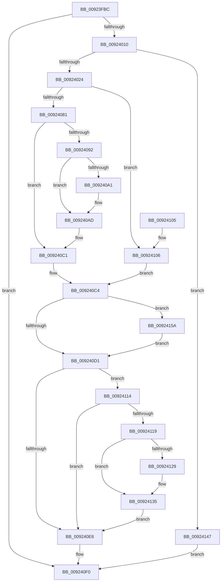

# AlpcpDispatchCloseMessage

- RVA: `0x00923FBC`–`0x00924167` (길이 `427` bytes)
- VA: `0x0000000140923FBC`
- 실행 섹션: `PAGE`
- PDB 이름 있음: `예`; PDB Function 태그: `아니요`
- unwind 정보 RVA: `0x0008D390`
- 디코드: `107`개 명령, `427/427` bytes 표시
- 미해석 바이트: `0` (있으면 어셈블리에 `.byte`로 보존)

> 이 문서는 커널 이미지의 기계어와 PDB 기호를 분석해 생성했습니다. 4번과 5번은 함수 원형과 자료형을 바이너리 사용 방식에서 추정한 C 해석이며 원본 소스 복구 결과는 아닙니다.

## 1. Dependencies

- 직접 호출 지점: **11**; 고유 호출 대상: **8**
- 직접 호출자로 확인된 함수: **1**
- RIP 상대 이미지 참조: **1**

### Outgoing calls
- `0x00924003` → [AlpcpReferenceAndLockTargetPortsAndCommunicationInfo](../88/AlpcpReferenceAndLockTargetPortsAndCommunicationInfo_function_0088FEE0.md) (function, `0x0088FEE0`)
- `0x00924084` → [AlpcpSetOwnerPortMessage](AlpcpSetOwnerPortMessage_function_00923E70.md) (function, `0x00923E70`)
- `0x009240A8` → [ExfReleasePushLockShared](../../text/26/ExfReleasePushLockShared_function_00263440.md) (function, `0x00263440`)
- `0x009240B4` → [KeAbPostRelease](../../text/2E/KeAbPostRelease_function_002E1600.md) (function, `0x002E1600`)
- `0x009240DC` → [AlpcpCompleteDispatchMessage](../88/AlpcpCompleteDispatchMessage_function_0088E140.md) (function, `0x0088E140`)
- `0x009240E9` → [ObfDereferenceObject](../../text/2F/ObfDereferenceObject_function_002F9350.md) (function, `0x002F9350`)
- `0x00924109` → [AlpcpSetOwnerPortMessage](AlpcpSetOwnerPortMessage_function_00923E70.md) (function, `0x00923E70`)
- `0x00924130` → [ExfReleasePushLockShared](../../text/26/ExfReleasePushLockShared_function_00263440.md) (function, `0x00263440`)
- `0x0092413C` → [KeAbPostRelease](../../text/2E/KeAbPostRelease_function_002E1600.md) (function, `0x002E1600`)
- `0x0092414E` → [AlpcpUnlockAndDereferenceTargetPortsAndCommunicationInfo](../88/AlpcpUnlockAndDereferenceTargetPortsAndCommunicationInfo_function_0088FE2C.md) (function, `0x0088FE2C`)
- `0x0092415D` → [AlpcpLogClosePort](../74/AlpcpLogClosePort_function_0074D068.md) (function, `0x0074D068`)

### Direct callers
- [AlpcpSendCloseMessage](AlpcpSendCloseMessage_function_0092524C.md) at `0x00925330`

### Static image references
- `0x009240C4` → RVA `0x00E66D00` (`.data`; read)

## 2. Other-region calls and transfers

- 다른 실행 섹션으로 향하는 call: **5**
  - `0x009240A8` → [ExfReleasePushLockShared](../../text/26/ExfReleasePushLockShared_function_00263440.md) (`PAGE` → `.text`)
  - `0x009240B4` → [KeAbPostRelease](../../text/2E/KeAbPostRelease_function_002E1600.md) (`PAGE` → `.text`)
  - `0x009240E9` → [ObfDereferenceObject](../../text/2F/ObfDereferenceObject_function_002F9350.md) (`PAGE` → `.text`)
  - `0x00924130` → [ExfReleasePushLockShared](../../text/26/ExfReleasePushLockShared_function_00263440.md) (`PAGE` → `.text`)
  - `0x0092413C` → [KeAbPostRelease](../../text/2E/KeAbPostRelease_function_002E1600.md) (`PAGE` → `.text`)
- 별도 외부 분기/꼬리 이동을 확인하지 못했습니다.

## 3. Assembly (complete function range)

```asm
00923FBC  48 89 5C 24 20                  mov qword ptr [rsp + 0x20], rbx
00923FC1  55                              push rbp
00923FC2  56                              push rsi
00923FC3  57                              push rdi
00923FC4  41 54                           push r12
00923FC6  41 55                           push r13
00923FC8  41 56                           push r14
00923FCA  41 57                           push r15
00923FCC  48 8B EC                        mov rbp, rsp
00923FCF  48 83 EC 20                     sub rsp, 0x20
00923FD3  48 8B 31                        mov rsi, qword ptr [rcx]
00923FD6  4C 8D 45 40                     lea r8, [rbp + 0x40]
00923FDA  4C 8B 71 08                     mov r14, qword ptr [rcx + 8]
00923FDE  48 8D 55 48                     lea rdx, [rbp + 0x48]
00923FE2  45 33 ED                        xor r13d, r13d
00923FE5  48 8B F9                        mov rdi, rcx
00923FE8  4C 89 69 20                     mov qword ptr [rcx + 0x20], r13
00923FEC  4C 89 69 18                     mov qword ptr [rcx + 0x18], r13
00923FF0  4C 89 69 28                     mov qword ptr [rcx + 0x28], r13
00923FF4  48 8B CE                        mov rcx, rsi
00923FF7  4C 8B 7E 10                     mov r15, qword ptr [rsi + 0x10]
00923FFB  4C 89 6D 48                     mov qword ptr [rbp + 0x48], r13
00923FFF  4C 89 6D 40                     mov qword ptr [rbp + 0x40], r13
00924003  E8 D8 BE F6 FF                  call 0x14088fee0
00924008  85 C0                           test eax, eax
0092400A  0F 88 E0 00 00 00               js 0x1409240f0
00924010  48 8B 55 48                     mov rdx, qword ptr [rbp + 0x48]
00924014  F7 82 00 01 00 00 00 00 02 00   test dword ptr [rdx + 0x100], 0x20000
0092401E  0F 84 23 01 00 00               je 0x140924147
00924024  41 0F BA 6E 28 09               bts dword ptr [r14 + 0x28], 9
0092402A  45 8D 65 01                     lea r12d, [r13 + 1]
0092402E  48 8B 4D 40                     mov rcx, qword ptr [rbp + 0x40]
00924032  B8 FF DF FF FF                  mov eax, 0xffffdfff
00924037  66 41 21 86 F4 00 00 00         and word ptr [r14 + 0xf4], ax
0092403F  41 8B C4                        mov eax, r12d
00924042  F0 0F C1 81 90 01 00 00         lock xadd dword ptr [rcx + 0x190], eax
0092404A  48 8B 5D 40                     mov rbx, qword ptr [rbp + 0x40]
0092404E  41 03 C4                        add eax, r12d
00924051  41 89 46 2C                     mov dword ptr [r14 + 0x2c], eax
00924055  49 8B CE                        mov rcx, r14
00924058  48 8B 43 38                     mov rax, qword ptr [rbx + 0x38]
0092405C  49 89 46 78                     mov qword ptr [r14 + 0x78], rax
00924060  4D 89 BE B8 00 00 00            mov qword ptr [r14 + 0xb8], r15
00924067  49 8B 07                        mov rax, qword ptr [r15]
0092406A  49 89 86 C0 00 00 00            mov qword ptr [r14 + 0xc0], rax
00924071  F7 86 00 01 00 00 00 10 00 00   test dword ptr [rsi + 0x100], 0x1000
0092407B  0F 85 85 00 00 00               jne 0x140924106
00924081  48 8B D6                        mov rdx, rsi
00924084  E8 E7 FD FF FF                  call 0x140923e70
00924089  48 8B 75 48                     mov rsi, qword ptr [rbp + 0x48]
0092408D  48 3B DE                        cmp rbx, rsi
00924090  74 2F                           je 0x1409240c1
00924092  41 8D 45 11                     lea eax, [r13 + 0x11]
00924096  F0 4C 0F B1 AB 60 01 00 00      lock cmpxchg qword ptr [rbx + 0x160], r13
0092409F  74 0C                           je 0x1409240ad
009240A1  48 8D 8B 60 01 00 00            lea rcx, [rbx + 0x160]
009240A8  E8 93 F3 93 FF                  call 0x140263440
009240AD  48 8D 8B 60 01 00 00            lea rcx, [rbx + 0x160]
009240B4  E8 47 D5 9B FF                  call 0x1402e1600
009240B9  48 8B 75 48                     mov rsi, qword ptr [rbp + 0x48]
009240BD  48 8B 5D 40                     mov rbx, qword ptr [rbp + 0x40]
009240C1  45 8A E5                        mov r12b, r13b
009240C4  44 38 2D 35 2C 54 00            cmp byte ptr [rip + 0x542c35], r13b
009240CB  0F 85 89 00 00 00               jne 0x14092415a
009240D1  48 8B CF                        mov rcx, rdi
009240D4  48 89 77 20                     mov qword ptr [rdi + 0x20], rsi
009240D8  4C 89 7F 10                     mov qword ptr [rdi + 0x10], r15
009240DC  E8 5F A0 F6 FF                  call 0x14088e140
009240E1  45 84 E4                        test r12b, r12b
009240E4  75 2E                           jne 0x140924114
009240E6  48 8B CB                        mov rcx, rbx
009240E9  E8 62 52 9D FF                  call 0x1402f9350
009240EE  33 C0                           xor eax, eax
009240F0  48 8B 5C 24 78                  mov rbx, qword ptr [rsp + 0x78]
009240F5  48 83 C4 20                     add rsp, 0x20
009240F9  41 5F                           pop r15
009240FB  41 5E                           pop r14
009240FD  41 5D                           pop r13
009240FF  41 5C                           pop r12
00924101  5F                              pop rdi
00924102  5E                              pop rsi
00924103  5D                              pop rbp
00924104  C3                              ret
00924105  CC                              int3
00924106  48 8B D3                        mov rdx, rbx
00924109  E8 62 FD FF FF                  call 0x140923e70
0092410E  48 8B 75 48                     mov rsi, qword ptr [rbp + 0x48]
00924112  EB B0                           jmp 0x1409240c4
00924114  48 3B DE                        cmp rbx, rsi
00924117  74 CD                           je 0x1409240e6
00924119  B8 11 00 00 00                  mov eax, 0x11
0092411E  F0 4C 0F B1 AB 60 01 00 00      lock cmpxchg qword ptr [rbx + 0x160], r13
00924127  74 0C                           je 0x140924135
00924129  48 8D 8B 60 01 00 00            lea rcx, [rbx + 0x160]
00924130  E8 0B F3 93 FF                  call 0x140263440
00924135  48 8D 8B 60 01 00 00            lea rcx, [rbx + 0x160]
0092413C  E8 BF D4 9B FF                  call 0x1402e1600
00924141  48 8B 5D 40                     mov rbx, qword ptr [rbp + 0x40]
00924145  EB 9F                           jmp 0x1409240e6
00924147  4C 8B 45 40                     mov r8, qword ptr [rbp + 0x40]
0092414B  49 8B CF                        mov rcx, r15
0092414E  E8 D9 BC F6 FF                  call 0x14088fe2c
00924153  B8 07 07 00 C0                  mov eax, 0xc0000707
00924158  EB 96                           jmp 0x1409240f0
0092415A  49 8B CE                        mov rcx, r14
0092415D  E8 06 8F E2 FF                  call 0x14074d068
00924162  E9 6A FF FF FF                  jmp 0x1409240d1
```

## 4. C-style interpretation (structured pseudocode)

```c
__int64 __fastcall AlpcpDispatchCloseMessage(__int64 a1)
{
    __int64 result;
    __int64 v_r13;
    __int64 v_rsp;
    unsigned __int64 v_stack_p10;
    unsigned __int64 v_stack_p20;
    unsigned __int64 v_stack_p8;

    v_stack_p20 = v_rbx;
    v_rsp = (v_rsp) - (32);
    v_r13 = 0;
    *(unsigned __int64 *)(a1 + 32) = 0;
    *(unsigned __int64 *)(a1 + 24) = 0;
    *(unsigned __int64 *)(a1 + 40) = 0;
    v_stack_p10 = 0;
    v_stack_p8 = 0;
    result = AlpcpReferenceAndLockTargetPortsAndCommunicationInfo(*(unsigned __int64 *)(a1), v_stack_p10, v_stack_p8, a4);
    if (sign_flag) goto loc_009240F0;
    if (((*(unsigned int *)(v_stack_p10 + 256)) & (0x20000ULL)) == 0) goto loc_00924147;
    result = (unsigned int)(((unsigned int)((unsigned int)(v_r13 + 1))) + ((unsigned int)(v_r13 + 1)));
    *(unsigned int *)(*(unsigned __int64 *)(a1 + 8) + 44) = (unsigned int)(result);
    *(unsigned __int64 *)(*(unsigned __int64 *)(a1 + 8) + 120) = *(unsigned __int64 *)(v_stack_p8 + 56);
    *(unsigned __int64 *)(*(unsigned __int64 *)(a1 + 8) + 184) = *(unsigned __int64 *)(*(unsigned __int64 *)(a1) + 16);
    *(unsigned __int64 *)(*(unsigned __int64 *)(a1 + 8) + 192) = *(unsigned __int64 *)(*(unsigned __int64 *)(*(unsigned __int64 *)(a1) + 16));
    if (((*(unsigned int *)(*(unsigned __int64 *)(a1) + 256)) & (0x1000ULL)) != 0) goto loc_00924106;
    result = AlpcpSetOwnerPortMessage(*(unsigned __int64 *)(a1 + 8), *(unsigned __int64 *)(a1), v_stack_p8, a4);
    if (v_stack_p8 == v_stack_p10) goto loc_009240C1;
    result = v_r13 + 17;
    if (v_stack_p8 != v_stack_p10) {
        a1 = v_stack_p8 + 352;
        result = ExfReleasePushLockShared(a1, *(unsigned __int64 *)(a1), v_stack_p8, a4);
    }
    result = KeAbPostRelease(v_stack_p8 + 352, *(unsigned __int64 *)(a1), v_stack_p8, a4);
loc_009240C1:
loc_009240C4:
    if ((*(unsigned __int8 *)(v_rip + 5516341)) != 0) goto loc_0092415A;
loc_009240D1:
    *(unsigned __int64 *)(a1 + 32) = v_stack_p10;
    *(unsigned __int64 *)(a1 + 16) = *(unsigned __int64 *)(*(unsigned __int64 *)(a1) + 16);
    result = AlpcpCompleteDispatchMessage(a1, *(unsigned __int64 *)(a1), v_stack_p8, a4);
    if (0 != 0) goto loc_00924114;
loc_009240E6:
    result = ObfDereferenceObject(v_stack_p8, *(unsigned __int64 *)(a1), v_stack_p8, a4);
    result = 0;
loc_009240F0:
    v_rsp = (v_rsp) + (32);
    return result;
loc_00924106:
    result = AlpcpSetOwnerPortMessage(v_stack_p8, v_stack_p20, v_stack_p8, a4);
    goto loc_009240C4;
loc_00924114:
    if (v_stack_p20 == v_stack_p10) goto loc_009240E6;
    result = 17;
    if (v_stack_p20 != v_stack_p10) {
        a1 = v_stack_p20 + 352;
        result = ExfReleasePushLockShared(a1, v_stack_p20, v_stack_p8, a4);
    }
    result = KeAbPostRelease(v_stack_p20 + 352, v_stack_p20, v_stack_p8, a4);
    goto loc_009240E6;
loc_00924147:
    result = AlpcpUnlockAndDereferenceTargetPortsAndCommunicationInfo(*(unsigned __int64 *)(*(unsigned __int64 *)(a1) + 16), v_stack_p20, v_stack_p8, a4);
    goto loc_009240F0;
loc_0092415A:
    result = AlpcpLogClosePort(*(unsigned __int64 *)(a1 + 8), v_stack_p20, v_stack_p8, a4);
    goto loc_009240D1;
}
```

## 5. (Beta) C Style

```c
int64_t AlpcpDispatchCloseMessage(void *Arg1)
{
    uint8_t *arg1 = (uint8_t *)Arg1;

    int64_t result;
    int64_t local_r13;
    int64_t local_rsp;
    uint64_t v_stack_p10;
    uint64_t v_stack_p20;
    uint64_t v_stack_p8;

    v_stack_p20 = local_rbx;
    local_rsp = (local_rsp) - (32);
    local_r13 = 0;
    *(uint64_t *)(arg1 + 0x20) = 0;
    *(uint64_t *)(arg1 + 0x18) = 0;
    *(uint64_t *)(arg1 + 0x28) = 0;
    v_stack_p10 = 0;
    v_stack_p8 = 0;
    result = AlpcpReferenceAndLockTargetPortsAndCommunicationInfo(*(uint64_t *)(arg1), v_stack_p10, v_stack_p8, a4);
    if (sign_flag) goto loc_009240F0;
    if (((*(uint32_t *)(v_stack_p10 + 0x100)) & (0x20000ULL)) == 0) goto loc_00924147;
    result = (uint32_t)(((uint32_t)((uint32_t)(local_r13 + 1))) + ((uint32_t)(local_r13 + 1)));
    *(uint32_t *)(*(uint64_t *)(arg1 + 0x8) + 0x2C) = (uint32_t)(result);
    *(uint64_t *)(*(uint64_t *)(arg1 + 0x8) + 0x78) = *(uint64_t *)(v_stack_p8 + 0x38);
    *(uint64_t *)(*(uint64_t *)(arg1 + 0x8) + 0xB8) = *(uint64_t *)(*(uint64_t *)(arg1) + 0x10);
    *(uint64_t *)(*(uint64_t *)(arg1 + 0x8) + 0xC0) = *(uint64_t *)(*(uint64_t *)(*(uint64_t *)(arg1) + 0x10));
    if (((*(uint32_t *)(*(uint64_t *)(arg1) + 0x100)) & (0x1000ULL)) != 0) goto loc_00924106;
    result = AlpcpSetOwnerPortMessage(*(uint64_t *)(arg1 + 0x8), *(uint64_t *)(arg1), v_stack_p8, a4);
    if (v_stack_p8 == v_stack_p10) goto loc_009240C1;
    result = local_r13 + 17;
    if (v_stack_p8 != v_stack_p10) {
        Arg1 = v_stack_p8 + 352;
        result = ExfReleasePushLockShared(Arg1, *(uint64_t *)(arg1), v_stack_p8, a4);
    }
    result = KeAbPostRelease(v_stack_p8 + 352, *(uint64_t *)(arg1), v_stack_p8, a4);
loc_009240C1:
loc_009240C4:
    if ((*(uint8_t *)(v_rip + 0x542C35)) != 0) goto loc_0092415A;
loc_009240D1:
    *(uint64_t *)(arg1 + 0x20) = v_stack_p10;
    *(uint64_t *)(arg1 + 0x10) = *(uint64_t *)(*(uint64_t *)(arg1) + 0x10);
    result = AlpcpCompleteDispatchMessage(Arg1, *(uint64_t *)(arg1), v_stack_p8, a4);
    if (0 != 0) goto loc_00924114;
loc_009240E6:
    result = ObfDereferenceObject(v_stack_p8, *(uint64_t *)(arg1), v_stack_p8, a4);
    result = 0;
loc_009240F0:
    local_rsp = (local_rsp) + (32);
    return result;
loc_00924106:
    result = AlpcpSetOwnerPortMessage(v_stack_p8, v_stack_p20, v_stack_p8, a4);
    goto loc_009240C4;
loc_00924114:
    if (v_stack_p20 == v_stack_p10) goto loc_009240E6;
    result = 17;
    if (v_stack_p20 != v_stack_p10) {
        Arg1 = v_stack_p20 + 352;
        result = ExfReleasePushLockShared(Arg1, v_stack_p20, v_stack_p8, a4);
    }
    result = KeAbPostRelease(v_stack_p20 + 352, v_stack_p20, v_stack_p8, a4);
    goto loc_009240E6;
loc_00924147:
    result = AlpcpUnlockAndDereferenceTargetPortsAndCommunicationInfo(*(uint64_t *)(*(uint64_t *)(arg1) + 0x10), v_stack_p20, v_stack_p8, a4);
    goto loc_009240F0;
loc_0092415A:
    result = AlpcpLogClosePort(*(uint64_t *)(arg1 + 0x8), v_stack_p20, v_stack_p8, a4);
    goto loc_009240D1;
}
```

### 관측된 메모리 오프셋

구조체 형식이 확인되지 않은 접근은 인자 기준의 오프셋으로만 기록했습니다.

| 기준 인자 | 오프셋 표현 | 폭 (bit) | 접근 |
|---|---:|---:|---|
| `Arg1` | `+ 0x0` | `64` | `R` |
| `Arg1` | `+ 0x8` | `64` | `R` |
| `Arg1` | `+ 0x10` | `64` | `W` |
| `Arg1` | `+ 0x18` | `64` | `W` |
| `Arg1` | `+ 0x20` | `64` | `W` |
| `Arg1` | `+ 0x28` | `64` | `W` |

## 6. Execution-region graph

[열기: 2D/3D 그래프와 함수 탐색 컨트롤 패널](../../../control-panel.html?section=page&rva=0x00923FBC&view=graph)

- 2D 그래프는 위에서 아래로 흐르고, 3D 그래프는 빈 공간을 드래그해 회전합니다. Shift+드래그는 이동, 휠은 확대·축소, 함수 노드 선택은 대상 보고서 이동입니다.

### Static fallback


