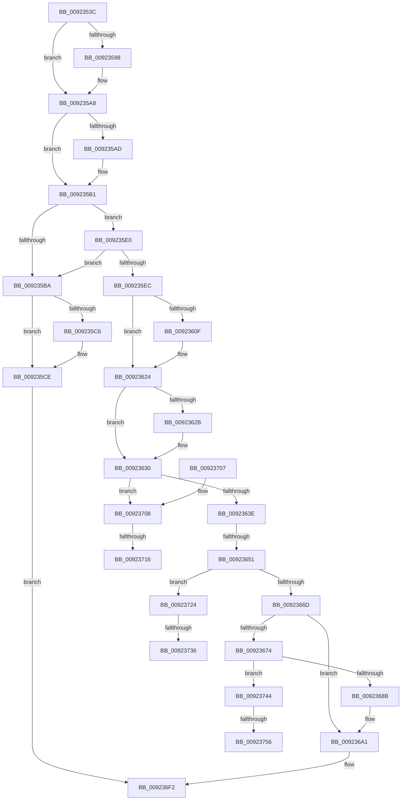

# AlpcpDispatchConnectionRequest

- RVA: `0x0092353C`–`0x00923764` (길이 `552` bytes)
- VA: `0x000000014092353C`
- 실행 섹션: `PAGE`
- PDB 이름 있음: `예`; PDB Function 태그: `예`
- unwind 정보 RVA: `0x0008D31C`
- 디코드: `147`개 명령, `552/552` bytes 표시
- 미해석 바이트: `0` (있으면 어셈블리에 `.byte`로 보존)

> 이 문서는 커널 이미지의 기계어와 PDB 기호를 분석해 생성했습니다. 4번과 5번은 함수 원형과 자료형을 바이너리 사용 방식에서 추정한 C 해석이며 원본 소스 복구 결과는 아닙니다.

## 1. Dependencies

- 직접 호출 지점: **12**; 고유 호출 대상: **7**
- 직접 호출자로 확인된 함수: **2**
- RIP 상대 이미지 참조: **0**

### Outgoing calls
- `0x00923583` → [KeAbPreAcquire](../../text/21/KeAbPreAcquire_function_00210230.md) (function, `0x00210230`)
- `0x009235A3` → [ExfAcquirePushLockSharedEx](../../text/21/ExfAcquirePushLockSharedEx_function_0021044C.md) (function, `0x0021044C`)
- `0x009235C9` → [ExfReleasePushLockShared](../../text/26/ExfReleasePushLockShared_function_00263440.md) (function, `0x00263440`)
- `0x009235D1` → [KeAbPostRelease](../../text/2E/KeAbPostRelease_function_002E1600.md) (function, `0x002E1600`)
- `0x009235E3` → [ObReferenceObjectSafe](../../text/41/ObReferenceObjectSafe_function_0041DAE0.md) (function, `0x0041DAE0`)
- `0x009235FB` → [KeAbPreAcquire](../../text/21/KeAbPreAcquire_function_00210230.md) (function, `0x00210230`)
- `0x0092361A` → [ExfAcquirePushLockSharedEx](../../text/21/ExfAcquirePushLockSharedEx_function_0021044C.md) (function, `0x0021044C`)
- `0x009236DB` → [AlpcpSetOwnerPortMessage](AlpcpSetOwnerPortMessage_function_00923E70.md) (function, `0x00923E70`)
- `0x009236EB` → [AlpcpCompleteDispatchMessage](../88/AlpcpCompleteDispatchMessage_function_0088E140.md) (function, `0x0088E140`)
- `0x00923719` → [ExfReleasePushLockShared](../../text/26/ExfReleasePushLockShared_function_00263440.md) (function, `0x00263440`)
- `0x00923739` → [ExfReleasePushLockShared](../../text/26/ExfReleasePushLockShared_function_00263440.md) (function, `0x00263440`)
- `0x00923759` → [ExfReleasePushLockShared](../../text/26/ExfReleasePushLockShared_function_00263440.md) (function, `0x00263440`)

### Direct callers
- [NtSecureConnectPort](NtSecureConnectPort_function_00922F20.md) at `0x009232FD`
- [AlpcpProcessConnectionRequest](AlpcpProcessConnectionRequest_function_00925FD4.md) at `0x0092618F`

### Static image references
- 디코드된 RIP-relative 메모리 참조가 없습니다.

## 2. Other-region calls and transfers

- 다른 실행 섹션으로 향하는 call: **10**
  - `0x00923583` → [KeAbPreAcquire](../../text/21/KeAbPreAcquire_function_00210230.md) (`PAGE` → `.text`)
  - `0x009235A3` → [ExfAcquirePushLockSharedEx](../../text/21/ExfAcquirePushLockSharedEx_function_0021044C.md) (`PAGE` → `.text`)
  - `0x009235C9` → [ExfReleasePushLockShared](../../text/26/ExfReleasePushLockShared_function_00263440.md) (`PAGE` → `.text`)
  - `0x009235D1` → [KeAbPostRelease](../../text/2E/KeAbPostRelease_function_002E1600.md) (`PAGE` → `.text`)
  - `0x009235E3` → [ObReferenceObjectSafe](../../text/41/ObReferenceObjectSafe_function_0041DAE0.md) (`PAGE` → `.text`)
  - `0x009235FB` → [KeAbPreAcquire](../../text/21/KeAbPreAcquire_function_00210230.md) (`PAGE` → `.text`)
  - `0x0092361A` → [ExfAcquirePushLockSharedEx](../../text/21/ExfAcquirePushLockSharedEx_function_0021044C.md) (`PAGE` → `.text`)
  - `0x00923719` → [ExfReleasePushLockShared](../../text/26/ExfReleasePushLockShared_function_00263440.md) (`PAGE` → `.text`)
  - `0x00923739` → [ExfReleasePushLockShared](../../text/26/ExfReleasePushLockShared_function_00263440.md) (`PAGE` → `.text`)
  - `0x00923759` → [ExfReleasePushLockShared](../../text/26/ExfReleasePushLockShared_function_00263440.md) (`PAGE` → `.text`)
- call이 아닌 외부 분기/꼬리 이동: **7**
  - `0x0092364B` → [sub_00B22776 + 0x30](../B2/Unknown_function_00B22776.md) (`tail-transfer`)
  - `0x00923710` → [sub_00B22776](../B2/Unknown_function_00B22776.md) (`tail-transfer`)
  - `0x0092371F` → [sub_00B22776](../B2/Unknown_function_00B22776.md) (`tail-transfer`)
  - `0x00923730` → [sub_00B22776 + 0xBD](../B2/Unknown_function_00B22776.md) (`tail-transfer`)
  - `0x0092373F` → [sub_00B22776 + 0xBD](../B2/Unknown_function_00B22776.md) (`tail-transfer`)
  - `0x00923750` → [sub_00B22776 + 0xE6](../B2/Unknown_function_00B22776.md) (`tail-transfer`)
  - `0x0092375F` → [sub_00B22776 + 0xE6](../B2/Unknown_function_00B22776.md) (`tail-transfer`)

## 3. Assembly (complete function range)

```asm
0092353C  48 89 5C 24 18                  mov qword ptr [rsp + 0x18], rbx
00923541  55                              push rbp
00923542  56                              push rsi
00923543  57                              push rdi
00923544  41 54                           push r12
00923546  41 55                           push r13
00923548  41 56                           push r14
0092354A  41 57                           push r15
0092354C  48 83 EC 20                     sub rsp, 0x20
00923550  48 8B 01                        mov rax, qword ptr [rcx]
00923553  45 33 FF                        xor r15d, r15d
00923556  48 8B 71 08                     mov rsi, qword ptr [rcx + 8]
0092355A  4C 8B F1                        mov r14, rcx
0092355D  44 8B 69 30                     mov r13d, dword ptr [rcx + 0x30]
00923561  45 33 C0                        xor r8d, r8d
00923564  4C 89 79 20                     mov qword ptr [rcx + 0x20], r15
00923568  33 D2                           xor edx, edx
0092356A  4C 89 79 18                     mov qword ptr [rcx + 0x18], r15
0092356E  4C 89 79 28                     mov qword ptr [rcx + 0x28], r15
00923572  4C 8B 60 10                     mov r12, qword ptr [rax + 0x10]
00923576  48 89 44 24 60                  mov qword ptr [rsp + 0x60], rax
0092357B  49 8D 5C 24 F0                  lea rbx, [r12 - 0x10]
00923580  48 8B CB                        mov rcx, rbx
00923583  E8 A8 CC 8E FF                  call 0x140210230
00923588  48 8B F8                        mov rdi, rax
0092358B  41 8D 4F 11                     lea ecx, [r15 + 0x11]
0092358F  33 C0                           xor eax, eax
00923591  F0 48 0F B1 0B                  lock cmpxchg qword ptr [rbx], rcx
00923596  74 10                           je 0x1409235a8
00923598  4C 8B CB                        mov r9, rbx
0092359B  4C 8B C7                        mov r8, rdi
0092359E  33 D2                           xor edx, edx
009235A0  48 8B CB                        mov rcx, rbx
009235A3  E8 A4 CE 8E FF                  call 0x14021044c
009235A8  48 85 FF                        test rdi, rdi
009235AB  74 04                           je 0x1409235b1
009235AD  C6 47 0A 01                     mov byte ptr [rdi + 0xa], 1
009235B1  49 8B 2C 24                     mov rbp, qword ptr [r12]
009235B5  48 85 ED                        test rbp, rbp
009235B8  75 26                           jne 0x1409235e0
009235BA  B8 11 00 00 00                  mov eax, 0x11
009235BF  F0 4C 0F B1 3B                  lock cmpxchg qword ptr [rbx], r15
009235C4  74 08                           je 0x1409235ce
009235C6  48 8B CB                        mov rcx, rbx
009235C9  E8 72 FE 93 FF                  call 0x140263440
009235CE  48 8B CB                        mov rcx, rbx
009235D1  E8 2A E0 9B FF                  call 0x1402e1600
009235D6  B8 37 00 00 C0                  mov eax, 0xc0000037
009235DB  E9 12 01 00 00                  jmp 0x1409236f2
009235E0  48 8B CD                        mov rcx, rbp
009235E3  E8 F8 A4 AF FF                  call 0x14041dae0
009235E8  84 C0                           test al, al
009235EA  74 CE                           je 0x1409235ba
009235EC  48 8D BD 60 01 00 00            lea rdi, [rbp + 0x160]
009235F3  45 33 C0                        xor r8d, r8d
009235F6  48 8B CF                        mov rcx, rdi
009235F9  33 D2                           xor edx, edx
009235FB  E8 30 CC 8E FF                  call 0x140210230
00923600  4C 8B F8                        mov r15, rax
00923603  33 C0                           xor eax, eax
00923605  8D 50 11                        lea edx, [rax + 0x11]
00923608  F0 48 0F B1 17                  lock cmpxchg qword ptr [rdi], rdx
0092360D  74 15                           je 0x140923624
0092360F  4C 8B CF                        mov r9, rdi
00923612  4D 8B C7                        mov r8, r15
00923615  33 D2                           xor edx, edx
00923617  48 8B CF                        mov rcx, rdi
0092361A  E8 2D CE 8E FF                  call 0x14021044c
0092361F  BA 11 00 00 00                  mov edx, 0x11
00923624  33 C9                           xor ecx, ecx
00923626  4D 85 FF                        test r15, r15
00923629  74 05                           je 0x140923630
0092362B  41 C6 47 0A 01                  mov byte ptr [r15 + 0xa], 1
00923630  8B 85 A0 01 00 00               mov eax, dword ptr [rbp + 0x1a0]
00923636  A8 20                           test al, 0x20
00923638  0F 85 CA 00 00 00               jne 0x140923708
0092363E  49 8B 06                        mov rax, qword ptr [r14]
00923641  F7 80 00 01 00 00 00 00 80 00   test dword ptr [rax + 0x100], 0x800000
0092364B  0F 85 55 F1 1F 00               jne 0x140b227a6
00923651  45 33 FF                        xor r15d, r15d
00923654  BA 01 00 00 00                  mov edx, 1
00923659  0F B7 86 F2 00 00 00            movzx eax, word ptr [rsi + 0xf2]
00923660  48 3B 85 10 01 00 00            cmp rax, qword ptr [rbp + 0x110]
00923667  0F 87 B7 00 00 00               ja 0x140923724
0092366D  41 0F BA E5 11                  bt r13d, 0x11
00923672  73 2D                           jae 0x1409236a1
00923674  65 48 8B 0C 25 88 01 00 00      mov rcx, qword ptr gs:[0x188]
0092367D  8B 81 A4 05 00 00               mov eax, dword ptr [rcx + 0x5a4]
00923683  A8 20                           test al, 0x20
00923685  0F 85 B9 00 00 00               jne 0x140923744
0092368B  66 01 56 E2                     add word ptr [rsi - 0x1e], dx
0092368F  48 8B C6                        mov rax, rsi
00923692  48 87 81 B8 05 00 00            xchg qword ptr [rcx + 0x5b8], rax
00923699  66 01 56 E2                     add word ptr [rsi - 0x1e], dx
0092369D  48 89 4E 20                     mov qword ptr [rsi + 0x20], rcx
009236A1  0F BA 76 28 09                  btr dword ptr [rsi + 0x28], 9
009236A6  B8 00 20 00 00                  mov eax, 0x2000
009236AB  66 09 86 F4 00 00 00            or word ptr [rsi + 0xf4], ax
009236B2  8B C2                           mov eax, edx
009236B4  F0 0F C1 85 90 01 00 00         lock xadd dword ptr [rbp + 0x190], eax
009236BC  03 C2                           add eax, edx
009236BE  4C 89 7E 78                     mov qword ptr [rsi + 0x78], r15
009236C2  48 8B 54 24 60                  mov rdx, qword ptr [rsp + 0x60]
009236C7  48 8B CE                        mov rcx, rsi
009236CA  89 46 2C                        mov dword ptr [rsi + 0x2c], eax
009236CD  4C 89 A6 B8 00 00 00            mov qword ptr [rsi + 0xb8], r12
009236D4  48 89 AE C0 00 00 00            mov qword ptr [rsi + 0xc0], rbp
009236DB  E8 90 07 00 00                  call 0x140923e70
009236E0  49 8B CE                        mov rcx, r14
009236E3  49 89 6E 20                     mov qword ptr [r14 + 0x20], rbp
009236E7  4D 89 66 10                     mov qword ptr [r14 + 0x10], r12
009236EB  E8 50 AA F6 FF                  call 0x14088e140
009236F0  33 C0                           xor eax, eax
009236F2  48 8B 5C 24 70                  mov rbx, qword ptr [rsp + 0x70]
009236F7  48 83 C4 20                     add rsp, 0x20
009236FB  41 5F                           pop r15
009236FD  41 5E                           pop r14
009236FF  41 5D                           pop r13
00923701  41 5C                           pop r12
00923703  5F                              pop rdi
00923704  5E                              pop rsi
00923705  5D                              pop rbp
00923706  C3                              ret
00923707  CC                              int3
00923708  48 8B C2                        mov rax, rdx
0092370B  F0 48 0F B1 0B                  lock cmpxchg qword ptr [rbx], rcx
00923710  0F 84 60 F0 1F 00               je 0x140b22776
00923716  48 8B CB                        mov rcx, rbx
00923719  E8 22 FD 93 FF                  call 0x140263440
0092371E  90                              nop
0092371F  E9 52 F0 1F 00                  jmp 0x140b22776
00923724  BE 11 00 00 00                  mov esi, 0x11
00923729  8B C6                           mov eax, esi
0092372B  F0 4C 0F B1 3B                  lock cmpxchg qword ptr [rbx], r15
00923730  0F 84 FD F0 1F 00               je 0x140b22833
00923736  48 8B CB                        mov rcx, rbx
00923739  E8 02 FD 93 FF                  call 0x140263440
0092373E  90                              nop
0092373F  E9 EF F0 1F 00                  jmp 0x140b22833
00923744  BE 11 00 00 00                  mov esi, 0x11
00923749  8B C6                           mov eax, esi
0092374B  F0 4C 0F B1 3B                  lock cmpxchg qword ptr [rbx], r15
00923750  0F 84 06 F1 1F 00               je 0x140b2285c
00923756  48 8B CB                        mov rcx, rbx
00923759  E8 E2 FC 93 FF                  call 0x140263440
0092375E  90                              nop
0092375F  E9 F8 F0 1F 00                  jmp 0x140b2285c
```

## 4. C-style interpretation (structured pseudocode)

```c
__int64 __fastcall AlpcpDispatchConnectionRequest(__int64 a1, int a2, int a3)
{
    __int64 result;
    __int64 v_r15;
    __int64 v_rsp;
    unsigned __int64 v_stack_p18;
    unsigned __int64 v_stack_p8;

    v_stack_p18 = v_rbx;
    v_rsp = (v_rsp) - (32);
    v_r15 = 0;
    a3 = 0;
    *(unsigned __int64 *)(a1 + 32) = 0;
    a2 = 0;
    *(unsigned __int64 *)(a1 + 24) = 0;
    *(unsigned __int64 *)(a1 + 40) = 0;
    v_stack_p8 = *(unsigned __int64 *)(a1);
    result = KeAbPreAcquire(*(unsigned __int64 *)(*(unsigned __int64 *)(a1) + 16) - 16, a2, a3, a4);
    result = 0;
    if (!(condition_is_equal)) {
        a4 = *(unsigned __int64 *)(*(unsigned __int64 *)(a1) + 16) - 16;
        a3 = 0;
        a2 = 0;
        a1 = *(unsigned __int64 *)(*(unsigned __int64 *)(a1) + 16) - 16;
        result = ExfAcquirePushLockSharedEx(a1, a2, a3, a4);
    }
    if (result != 0) {
        *(unsigned __int8 *)(result + 10) = 1;
    }
    if (*(unsigned __int64 *)(*(unsigned __int64 *)(*(unsigned __int64 *)(a1) + 16)) != 0) goto loc_009235E0;
loc_009235BA:
    result = 17;
    if (*(unsigned __int64 *)(*(unsigned __int64 *)(*(unsigned __int64 *)(a1) + 16)) != 0) {
        a1 = *(unsigned __int64 *)(*(unsigned __int64 *)(a1) + 16) - 16;
        result = ExfReleasePushLockShared(a1, a2, a3, a4);
    }
    result = KeAbPostRelease(*(unsigned __int64 *)(*(unsigned __int64 *)(a1) + 16) - 16, a2, a3, a4);
    goto loc_009236F2;
loc_009235E0:
    result = ObReferenceObjectSafe(*(unsigned __int64 *)(*(unsigned __int64 *)(*(unsigned __int64 *)(a1) + 16)), a2, a3, a4);
    if ((unsigned __int8)(result) == 0) goto loc_009235BA;
    a3 = 0;
    a2 = 0;
    result = KeAbPreAcquire(*(unsigned __int64 *)(*(unsigned __int64 *)(*(unsigned __int64 *)(a1) + 16)) + 352, a2, a3, a4);
    result = 0;
    if (!(condition_is_equal)) {
        a4 = *(unsigned __int64 *)(*(unsigned __int64 *)(*(unsigned __int64 *)(a1) + 16)) + 352;
        a3 = 0;
        a2 = 0;
        a1 = *(unsigned __int64 *)(*(unsigned __int64 *)(*(unsigned __int64 *)(a1) + 16)) + 352;
        result = ExfAcquirePushLockSharedEx(a1, a2, a3, a4);
        a2 = 17;
    }
    a1 = 0;
    if (result != 0) {
        *(unsigned __int8 *)(result + 10) = 1;
    }
    if ((((unsigned __int8)((unsigned int)(*(unsigned int *)(*(unsigned __int64 *)(*(unsigned __int64 *)(*(unsigned __int64 *)(a1) + 16)) + 416)))) & (32)) != 0) goto loc_00923708;
    v_r15 = 0;
    if ((*(unsigned __int16 *)(*(unsigned __int64 *)(a1 + 8) + 242)) > (*(unsigned __int64 *)(*(unsigned __int64 *)(*(unsigned __int64 *)(*(unsigned __int64 *)(a1) + 16)) + 272))) goto loc_00923724;
    if ((*(unsigned __int16 *)(*(unsigned __int64 *)(a1 + 8) + 242)) >= (*(unsigned __int64 *)(*(unsigned __int64 *)(*(unsigned __int64 *)(*(unsigned __int64 *)(a1) + 16)) + 272))) goto loc_009236A1;
    if ((((unsigned __int8)((unsigned int)(*(unsigned int *)(*(unsigned __int64 *)(gs_base + (0 + 392)) + 1444)))) & (32)) != 0) goto loc_00923744;
    *(unsigned __int64 *)(*(unsigned __int64 *)(a1 + 8) + 32) = *(unsigned __int64 *)(gs_base + (0 + 392));
loc_009236A1:
    result = (unsigned int)((1) + (1));
    *(unsigned __int64 *)(*(unsigned __int64 *)(a1 + 8) + 120) = 0;
    *(unsigned int *)(*(unsigned __int64 *)(a1 + 8) + 44) = (unsigned int)(result);
    *(unsigned __int64 *)(*(unsigned __int64 *)(a1 + 8) + 184) = *(unsigned __int64 *)(*(unsigned __int64 *)(a1) + 16);
    *(unsigned __int64 *)(*(unsigned __int64 *)(a1 + 8) + 192) = *(unsigned __int64 *)(*(unsigned __int64 *)(*(unsigned __int64 *)(a1) + 16));
    result = AlpcpSetOwnerPortMessage(*(unsigned __int64 *)(a1 + 8), v_stack_p8, a3, a4);
    *(unsigned __int64 *)(a1 + 32) = *(unsigned __int64 *)(*(unsigned __int64 *)(*(unsigned __int64 *)(a1) + 16));
    *(unsigned __int64 *)(a1 + 16) = *(unsigned __int64 *)(*(unsigned __int64 *)(a1) + 16);
    result = AlpcpCompleteDispatchMessage(0, v_stack_p8, a3, a4);
    result = 0;
loc_009236F2:
    v_rsp = (v_rsp) + (32);
    return result;
loc_00923708:
    result = ExfReleasePushLockShared(v_stack_p18, v_stack_p8, a3, a4);
loc_00923724:
    result = ExfReleasePushLockShared(v_stack_p18, v_stack_p8, a3, a4);
loc_00923744:
    result = ExfReleasePushLockShared(v_stack_p18, v_stack_p8, a3, a4);
}
```

## 5. (Beta) C Style

```c
int64_t AlpcpDispatchConnectionRequest(void *Arg1, int32_t Arg2, int32_t Arg3)
{
    uint8_t *arg1 = (uint8_t *)Arg1;

    int64_t result;
    int64_t local_r15;
    int64_t local_rsp;
    uint64_t v_stack_p18;
    uint64_t v_stack_p8;

    v_stack_p18 = local_rbx;
    local_rsp = (local_rsp) - (32);
    local_r15 = 0;
    Arg3 = 0;
    *(uint64_t *)(arg1 + 0x20) = 0;
    Arg2 = 0;
    *(uint64_t *)(arg1 + 0x18) = 0;
    *(uint64_t *)(arg1 + 0x28) = 0;
    v_stack_p8 = *(uint64_t *)(arg1);
    result = KeAbPreAcquire(*(uint64_t *)(*(uint64_t *)(arg1) + 0x10) - 16, Arg2, Arg3, a4);
    result = 0;
    if (!(condition_is_equal)) {
        a4 = *(uint64_t *)(*(uint64_t *)(arg1) + 0x10) - 16;
        Arg3 = 0;
        Arg2 = 0;
        Arg1 = *(uint64_t *)(*(uint64_t *)(arg1) + 0x10) - 16;
        result = ExfAcquirePushLockSharedEx(Arg1, Arg2, Arg3, a4);
    }
    if (result != 0) {
        *(uint8_t *)(result + 0xA) = 1;
    }
    if (*(uint64_t *)(*(uint64_t *)(*(uint64_t *)(arg1) + 0x10)) != 0) goto loc_009235E0;
loc_009235BA:
    result = 17;
    if (*(uint64_t *)(*(uint64_t *)(*(uint64_t *)(arg1) + 0x10)) != 0) {
        Arg1 = *(uint64_t *)(*(uint64_t *)(arg1) + 0x10) - 16;
        result = ExfReleasePushLockShared(Arg1, Arg2, Arg3, a4);
    }
    result = KeAbPostRelease(*(uint64_t *)(*(uint64_t *)(arg1) + 0x10) - 16, Arg2, Arg3, a4);
    goto loc_009236F2;
loc_009235E0:
    result = ObReferenceObjectSafe(*(uint64_t *)(*(uint64_t *)(*(uint64_t *)(arg1) + 0x10)), Arg2, Arg3, a4);
    if ((uint8_t)(result) == 0) goto loc_009235BA;
    Arg3 = 0;
    Arg2 = 0;
    result = KeAbPreAcquire(*(uint64_t *)(*(uint64_t *)(*(uint64_t *)(arg1) + 0x10)) + 352, Arg2, Arg3, a4);
    result = 0;
    if (!(condition_is_equal)) {
        a4 = *(uint64_t *)(*(uint64_t *)(*(uint64_t *)(arg1) + 0x10)) + 352;
        Arg3 = 0;
        Arg2 = 0;
        Arg1 = *(uint64_t *)(*(uint64_t *)(*(uint64_t *)(arg1) + 0x10)) + 352;
        result = ExfAcquirePushLockSharedEx(Arg1, Arg2, Arg3, a4);
        Arg2 = 17;
    }
    Arg1 = 0;
    if (result != 0) {
        *(uint8_t *)(result + 0xA) = 1;
    }
    if ((((uint8_t)((uint32_t)(*(uint32_t *)(*(uint64_t *)(*(uint64_t *)(*(uint64_t *)(arg1) + 0x10)) + 0x1A0)))) & (32)) != 0) goto loc_00923708;
    local_r15 = 0;
    if ((*(uint16_t *)(*(uint64_t *)(arg1 + 0x8) + 0xF2)) > (*(uint64_t *)(*(uint64_t *)(*(uint64_t *)(*(uint64_t *)(arg1) + 0x10)) + 0x110))) goto loc_00923724;
    if ((*(uint16_t *)(*(uint64_t *)(arg1 + 0x8) + 0xF2)) >= (*(uint64_t *)(*(uint64_t *)(*(uint64_t *)(*(uint64_t *)(arg1) + 0x10)) + 0x110))) goto loc_009236A1;
    if ((((uint8_t)((uint32_t)(*(uint32_t *)(*(uint64_t *)(gs_base + (0 + 0x188)) + 0x5A4)))) & (32)) != 0) goto loc_00923744;
    *(uint64_t *)(*(uint64_t *)(arg1 + 0x8) + 0x20) = *(uint64_t *)(gs_base + (0 + 0x188));
loc_009236A1:
    result = (uint32_t)((1) + (1));
    *(uint64_t *)(*(uint64_t *)(arg1 + 0x8) + 0x78) = 0;
    *(uint32_t *)(*(uint64_t *)(arg1 + 0x8) + 0x2C) = (uint32_t)(result);
    *(uint64_t *)(*(uint64_t *)(arg1 + 0x8) + 0xB8) = *(uint64_t *)(*(uint64_t *)(arg1) + 0x10);
    *(uint64_t *)(*(uint64_t *)(arg1 + 0x8) + 0xC0) = *(uint64_t *)(*(uint64_t *)(*(uint64_t *)(arg1) + 0x10));
    result = AlpcpSetOwnerPortMessage(*(uint64_t *)(arg1 + 0x8), v_stack_p8, Arg3, a4);
    *(uint64_t *)(arg1 + 0x20) = *(uint64_t *)(*(uint64_t *)(*(uint64_t *)(arg1) + 0x10));
    *(uint64_t *)(arg1 + 0x10) = *(uint64_t *)(*(uint64_t *)(arg1) + 0x10);
    result = AlpcpCompleteDispatchMessage(0, v_stack_p8, Arg3, a4);
    result = 0;
loc_009236F2:
    local_rsp = (local_rsp) + (32);
    return result;
loc_00923708:
    result = ExfReleasePushLockShared(v_stack_p18, v_stack_p8, Arg3, a4);
loc_00923724:
    result = ExfReleasePushLockShared(v_stack_p18, v_stack_p8, Arg3, a4);
loc_00923744:
    result = ExfReleasePushLockShared(v_stack_p18, v_stack_p8, Arg3, a4);
}
```

### 관측된 메모리 오프셋

구조체 형식이 확인되지 않은 접근은 인자 기준의 오프셋으로만 기록했습니다.

| 기준 인자 | 오프셋 표현 | 폭 (bit) | 접근 |
|---|---:|---:|---|
| `Arg1` | `+ 0x0` | `64` | `R` |
| `Arg1` | `+ 0x8` | `64` | `R` |
| `Arg1` | `+ 0x10` | `64` | `W` |
| `Arg1` | `+ 0x18` | `64` | `W` |
| `Arg1` | `+ 0x20` | `64` | `W` |
| `Arg1` | `+ 0x28` | `64` | `W` |
| `Arg1` | `+ 0x30` | `32` | `R` |

## 6. Execution-region graph

[열기: 2D/3D 그래프와 함수 탐색 컨트롤 패널](../../../control-panel.html?section=page&rva=0x0092353C&view=graph)

- 2D 그래프는 위에서 아래로 흐르고, 3D 그래프는 빈 공간을 드래그해 회전합니다. Shift+드래그는 이동, 휠은 확대·축소, 함수 노드 선택은 대상 보고서 이동입니다.

### Static fallback


