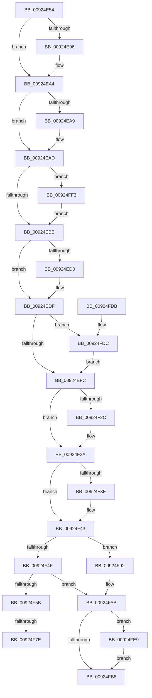

# AlpcpDoPortCleanup

- RVA: `0x00924E54`–`0x00925000` (길이 `428` bytes)
- VA: `0x0000000140924E54`
- 실행 섹션: `PAGE`
- PDB 이름 있음: `예`; PDB Function 태그: `예`
- unwind 정보 RVA: `0x0008D414`
- 디코드: `110`개 명령, `428/428` bytes 표시
- 미해석 바이트: `0` (있으면 어셈블리에 `.byte`로 보존)

> 이 문서는 커널 이미지의 기계어와 PDB 기호를 분석해 생성했습니다. 4번과 5번은 함수 원형과 자료형을 바이너리 사용 방식에서 추정한 C 해석이며 원본 소스 복구 결과는 아닙니다.

## 1. Dependencies

- 직접 호출 지점: **16**; 고유 호출 대상: **10**
- 직접 호출자로 확인된 함수: **1**
- RIP 상대 이미지 참조: **0**

### Outgoing calls
- `0x00924E72` → [AlpcpDisconnectPort](AlpcpDisconnectPort_function_00924A68.md) (function, `0x00924A68`)
- `0x00924E86` → [KeAbPreAcquire](../../text/21/KeAbPreAcquire_function_00210230.md) (function, `0x00210230`)
- `0x00924E9F` → [ExfAcquirePushLockExclusiveEx](../../text/20/ExfAcquirePushLockExclusiveEx_function_0020FC90.md) (function, `0x0020FC90`)
- `0x00924ED5` → [ObfDereferenceObjectWithTag](../../text/2F/ObfDereferenceObjectWithTag_function_002F78E0.md) (function, `0x002F78E0`)
- `0x00924EFF` → [KeAbPostRelease](../../text/2E/KeAbPostRelease_function_002E1600.md) (function, `0x002E1600`)
- `0x00924F07` → [AlpcpFlushMessagesPort](AlpcpFlushMessagesPort_function_00925554.md) (function, `0x00925554`)
- `0x00924F0F` → [AlpcpFlushResourcesPort](AlpcpFlushResourcesPort_function_009253F4.md) (function, `0x009253F4`)
- `0x00924F1C` → [KeAbPreAcquire](../../text/21/KeAbPreAcquire_function_00210230.md) (function, `0x00210230`)
- `0x00924F35` → [ExfAcquirePushLockExclusiveEx](../../text/20/ExfAcquirePushLockExclusiveEx_function_0020FC90.md) (function, `0x0020FC90`)
- `0x00924F6A` → [KeAbPreAcquire](../../text/21/KeAbPreAcquire_function_00210230.md) (function, `0x00210230`)
- `0x00924F87` → [ExfAcquirePushLockExclusiveEx](../../text/20/ExfAcquirePushLockExclusiveEx_function_0020FC90.md) (function, `0x0020FC90`)
- `0x00924FA6` → [KeReleaseSemaphore](../../text/39/KeReleaseSemaphore_function_00397080.md) (function, `0x00397080`)
- `0x00924FBB` → [KeAbPostRelease](../../text/2E/KeAbPostRelease_function_002E1600.md) (function, `0x002E1600`)
- `0x00924FDF` → [ExfTryToWakePushLock](../../text/26/ExfTryToWakePushLock_function_00265DD0.md) (function, `0x00265DD0`)
- `0x00924FEC` → [ExfTryToWakePushLock](../../text/26/ExfTryToWakePushLock_function_00265DD0.md) (function, `0x00265DD0`)
- `0x00924FF6` → [AlpcpFreeCompletionList](../A1/AlpcpFreeCompletionList_function_00A1AD08.md) (function, `0x00A1AD08`)

### Direct callers
- [AlpcpClosePort](AlpcpClosePort_function_00924DE0.md) at `0x00924E26`

### Static image references
- 디코드된 RIP-relative 메모리 참조가 없습니다.

## 2. Other-region calls and transfers

- 다른 실행 섹션으로 향하는 call: **12**
  - `0x00924E86` → [KeAbPreAcquire](../../text/21/KeAbPreAcquire_function_00210230.md) (`PAGE` → `.text`)
  - `0x00924E9F` → [ExfAcquirePushLockExclusiveEx](../../text/20/ExfAcquirePushLockExclusiveEx_function_0020FC90.md) (`PAGE` → `.text`)
  - `0x00924ED5` → [ObfDereferenceObjectWithTag](../../text/2F/ObfDereferenceObjectWithTag_function_002F78E0.md) (`PAGE` → `.text`)
  - `0x00924EFF` → [KeAbPostRelease](../../text/2E/KeAbPostRelease_function_002E1600.md) (`PAGE` → `.text`)
  - `0x00924F1C` → [KeAbPreAcquire](../../text/21/KeAbPreAcquire_function_00210230.md) (`PAGE` → `.text`)
  - `0x00924F35` → [ExfAcquirePushLockExclusiveEx](../../text/20/ExfAcquirePushLockExclusiveEx_function_0020FC90.md) (`PAGE` → `.text`)
  - `0x00924F6A` → [KeAbPreAcquire](../../text/21/KeAbPreAcquire_function_00210230.md) (`PAGE` → `.text`)
  - `0x00924F87` → [ExfAcquirePushLockExclusiveEx](../../text/20/ExfAcquirePushLockExclusiveEx_function_0020FC90.md) (`PAGE` → `.text`)
  - `0x00924FA6` → [KeReleaseSemaphore](../../text/39/KeReleaseSemaphore_function_00397080.md) (`PAGE` → `.text`)
  - `0x00924FBB` → [KeAbPostRelease](../../text/2E/KeAbPostRelease_function_002E1600.md) (`PAGE` → `.text`)
  - `0x00924FDF` → [ExfTryToWakePushLock](../../text/26/ExfTryToWakePushLock_function_00265DD0.md) (`PAGE` → `.text`)
  - `0x00924FEC` → [ExfTryToWakePushLock](../../text/26/ExfTryToWakePushLock_function_00265DD0.md) (`PAGE` → `.text`)
- call이 아닌 외부 분기/꼬리 이동: **2**
  - `0x00924F78` → [sub_00B22B6A](../B2/Unknown_function_00B22B6A.md) (`tail-transfer`)
  - `0x00924F8D` → [sub_00B22B6A](../B2/Unknown_function_00B22B6A.md) (`tail-transfer`)

## 3. Assembly (complete function range)

```asm
00924E54  48 8B C4                        mov rax, rsp
00924E57  48 89 58 08                     mov qword ptr [rax + 8], rbx
00924E5B  48 89 68 10                     mov qword ptr [rax + 0x10], rbp
00924E5F  48 89 70 18                     mov qword ptr [rax + 0x18], rsi
00924E63  48 89 78 20                     mov qword ptr [rax + 0x20], rdi
00924E67  41 56                           push r14
00924E69  48 83 EC 30                     sub rsp, 0x30
00924E6D  33 D2                           xor edx, edx
00924E6F  48 8B F1                        mov rsi, rcx
00924E72  E8 F1 FB FF FF                  call 0x140924a68
00924E77  48 8D BE 60 01 00 00            lea rdi, [rsi + 0x160]
00924E7E  45 33 C0                        xor r8d, r8d
00924E81  48 8B CF                        mov rcx, rdi
00924E84  33 D2                           xor edx, edx
00924E86  E8 A5 B3 8E FF                  call 0x140210230
00924E8B  F0 48 0F BA 2F 00               lock bts qword ptr [rdi], 0
00924E91  48 8B D8                        mov rbx, rax
00924E94  73 0E                           jae 0x140924ea4
00924E96  4C 8B C7                        mov r8, rdi
00924E99  48 8B D0                        mov rdx, rax
00924E9C  48 8B CF                        mov rcx, rdi
00924E9F  E8 EC AD 8E FF                  call 0x14020fc90
00924EA4  48 85 DB                        test rbx, rbx
00924EA7  74 04                           je 0x140924ead
00924EA9  C6 43 0A 01                     mov byte ptr [rbx + 0xa], 1
00924EAD  48 83 BE 68 01 00 00 00         cmp qword ptr [rsi + 0x168], 0
00924EB5  0F 85 38 01 00 00               jne 0x140924ff3
00924EBB  48 8B 4E 18                     mov rcx, qword ptr [rsi + 0x18]
00924EBF  B8 00 00 00 00                  mov eax, 0
00924EC4  F6 C1 01                        test cl, 1
00924EC7  48 0F 44 C1                     cmove rax, rcx
00924ECB  48 85 C0                        test rax, rax
00924ECE  74 0F                           je 0x140924edf
00924ED0  BA 41 6C 70 63                  mov edx, 0x63706c41
00924ED5  E8 06 2A 9D FF                  call 0x1402f78e0
00924EDA  48 83 4E 18 01                  or qword ptr [rsi + 0x18], 1
00924EDF  83 8E A0 01 00 00 40            or dword ptr [rsi + 0x1a0], 0x40
00924EE6  48 83 CB FF                     or rbx, 0xffffffffffffffff
00924EEA  48 8B C3                        mov rax, rbx
00924EED  F0 48 0F C1 07                  lock xadd qword ptr [rdi], rax
00924EF2  24 06                           and al, 6
00924EF4  3C 02                           cmp al, 2
00924EF6  0F 84 E0 00 00 00               je 0x140924fdc
00924EFC  48 8B CF                        mov rcx, rdi
00924EFF  E8 FC C6 9B FF                  call 0x1402e1600
00924F04  48 8B CE                        mov rcx, rsi
00924F07  E8 48 06 00 00                  call 0x140925554
00924F0C  48 8B CE                        mov rcx, rsi
00924F0F  E8 E0 04 00 00                  call 0x1409253f4
00924F14  45 33 C0                        xor r8d, r8d
00924F17  33 D2                           xor edx, edx
00924F19  48 8B CF                        mov rcx, rdi
00924F1C  E8 0F B3 8E FF                  call 0x140210230
00924F21  F0 48 0F BA 2F 00               lock bts qword ptr [rdi], 0
00924F27  48 8B E8                        mov rbp, rax
00924F2A  73 0E                           jae 0x140924f3a
00924F2C  4C 8B C7                        mov r8, rdi
00924F2F  48 8B D0                        mov rdx, rax
00924F32  48 8B CF                        mov rcx, rdi
00924F35  E8 56 AD 8E FF                  call 0x14020fc90
00924F3A  48 85 ED                        test rbp, rbp
00924F3D  74 04                           je 0x140924f43
00924F3F  C6 45 0A 01                     mov byte ptr [rbp + 0xa], 1
00924F43  F7 86 A0 01 00 00 00 02 00 00   test dword ptr [rsi + 0x1a0], 0x200
00924F4D  75 43                           jne 0x140924f92
00924F4F  4C 8D B6 E8 00 00 00            lea r14, [rsi + 0xe8]
00924F56  4D 39 36                        cmp qword ptr [r14], r14
00924F59  74 50                           je 0x140924fab
00924F5B  48 81 C6 E0 00 00 00            add rsi, 0xe0
00924F62  45 33 C0                        xor r8d, r8d
00924F65  48 8B CE                        mov rcx, rsi
00924F68  33 D2                           xor edx, edx
00924F6A  E8 C1 B2 8E FF                  call 0x140210230
00924F6F  F0 48 0F BA 2E 00               lock bts qword ptr [rsi], 0
00924F75  48 8B E8                        mov rbp, rax
00924F78  0F 83 EC DB 1F 00               jae 0x140b22b6a
00924F7E  4C 8B C6                        mov r8, rsi
00924F81  48 8B D0                        mov rdx, rax
00924F84  48 8B CE                        mov rcx, rsi
00924F87  E8 04 AD 8E FF                  call 0x14020fc90
00924F8C  90                              nop
00924F8D  E9 D8 DB 1F 00                  jmp 0x140b22b6a
00924F92  48 8B 8E F8 00 00 00            mov rcx, qword ptr [rsi + 0xf8]
00924F99  45 33 C9                        xor r9d, r9d
00924F9C  41 B8 00 00 00 01               mov r8d, 0x1000000
00924FA2  41 8D 51 01                     lea edx, [r9 + 1]
00924FA6  E8 D5 20 A7 FF                  call 0x140397080
00924FAB  F0 48 0F C1 1F                  lock xadd qword ptr [rdi], rbx
00924FB0  80 E3 06                        and bl, 6
00924FB3  80 FB 02                        cmp bl, 2
00924FB6  74 31                           je 0x140924fe9
00924FB8  48 8B CF                        mov rcx, rdi
00924FBB  E8 40 C6 9B FF                  call 0x1402e1600
00924FC0  48 8B 5C 24 40                  mov rbx, qword ptr [rsp + 0x40]
00924FC5  48 8B 6C 24 48                  mov rbp, qword ptr [rsp + 0x48]
00924FCA  48 8B 74 24 50                  mov rsi, qword ptr [rsp + 0x50]
00924FCF  48 8B 7C 24 58                  mov rdi, qword ptr [rsp + 0x58]
00924FD4  48 83 C4 30                     add rsp, 0x30
00924FD8  41 5E                           pop r14
00924FDA  C3                              ret
00924FDB  CC                              int3
00924FDC  48 8B CF                        mov rcx, rdi
00924FDF  E8 EC 0D 94 FF                  call 0x140265dd0
00924FE4  E9 13 FF FF FF                  jmp 0x140924efc
00924FE9  48 8B CF                        mov rcx, rdi
00924FEC  E8 DF 0D 94 FF                  call 0x140265dd0
00924FF1  EB C5                           jmp 0x140924fb8
00924FF3  48 8B CE                        mov rcx, rsi
00924FF6  E8 0D 5D 0F 00                  call 0x140a1ad08
00924FFB  E9 BB FE FF FF                  jmp 0x140924ebb
```

## 4. C-style interpretation (structured pseudocode)

```c
__int64 __fastcall AlpcpDoPortCleanup(__int64 a1, int a2, int a3, int a4)
{
    __int64 result;
    __int64 v_rbx;
    __int64 v_rsi;
    __int64 v_rsp;
    unsigned __int64 v_stack_p10;
    unsigned __int64 v_stack_p18;
    unsigned __int64 v_stack_p20;
    unsigned __int64 v_stack_p8;

    *(unsigned __int64 *)(v_rsp + 8) = v_rbx;
    *(unsigned __int64 *)(v_rsp + 16) = v_rbp;
    *(unsigned __int64 *)(v_rsp + 24) = v_rsi;
    *(unsigned __int64 *)(v_rsp + 32) = v_rdi;
    v_rsp = (v_rsp) - (48);
    a2 = 0;
    result = AlpcpDisconnectPort(a1, a2, a3, a4);
    a3 = 0;
    a2 = 0;
    result = KeAbPreAcquire(a1 + 352, a2, a3, a4);
    if (!(condition_is_above_or_equal)) {
        a3 = a1 + 352;
        a2 = result;
        a1 = a1 + 352;
        result = ExfAcquirePushLockExclusiveEx(a1, a2, a3, a4);
    }
    if (result != 0) {
        *(unsigned __int8 *)(result + 10) = 1;
    }
    if ((*(unsigned __int64 *)(a1 + 360)) != 0) goto loc_00924FF3;
loc_00924EBB:
    result = 0;
    if ((((unsigned __int8)(*(unsigned __int64 *)(a1 + 24))) & (1)) == 0) { result = *(unsigned __int64 *)(a1 + 24); }
    if (result != 0) {
        a2 = 0x63706C41ULL;
        result = ObfDereferenceObjectWithTag(*(unsigned __int64 *)(a1 + 24), a2, a3, a4);
    }
    v_rbx = (result) | (-1);
    result = (unsigned __int8)((v_rbx) & (6));
    if (((unsigned __int8)(result)) == 2) goto loc_00924FDC;
loc_00924EFC:
    result = KeAbPostRelease(a1 + 352, a2, a3, a4);
    result = AlpcpFlushMessagesPort(a1, a2, a3, a4);
    result = AlpcpFlushResourcesPort(a1, a2, a3, a4);
    a3 = 0;
    a2 = 0;
    result = KeAbPreAcquire(a1 + 352, a2, a3, a4);
    if (!(condition_is_above_or_equal)) {
        a3 = a1 + 352;
        a2 = result;
        a1 = a1 + 352;
        result = ExfAcquirePushLockExclusiveEx(a1, a2, a3, a4);
    }
    if (result != 0) {
        *(unsigned __int8 *)(result + 10) = 1;
    }
    if (((*(unsigned int *)(a1 + 416)) & (512)) != 0) goto loc_00924F92;
    if ((*(unsigned __int64 *)(a1 + 232)) == (a1 + 232)) goto loc_00924FAB;
    v_rsi = (a1) + (224);
    a3 = 0;
    a2 = 0;
    result = KeAbPreAcquire(v_rsi, a2, a3, a4);
    result = ExfAcquirePushLockExclusiveEx(v_rsi, result, v_rsi, a4);
loc_00924F92:
    a4 = 0;
    result = KeReleaseSemaphore(*(unsigned __int64 *)(v_rsi + 248), a4 + 1, (unsigned int)(0x1000000ULL), a4);
loc_00924FAB:
    v_rbx = (unsigned __int8)((v_rbx) & (6));
    if (((unsigned __int8)(v_rbx)) == 2) goto loc_00924FE9;
loc_00924FB8:
    result = KeAbPostRelease(a1 + 352, a4 + 1, (unsigned int)(0x1000000ULL), a4);
    v_rsp = (v_rsp) + (48);
    return result;
loc_00924FDC:
    result = ExfTryToWakePushLock(v_stack_p20, a4 + 1, (unsigned int)(0x1000000ULL), a4);
    goto loc_00924EFC;
loc_00924FE9:
    result = ExfTryToWakePushLock(v_stack_p20, a4 + 1, (unsigned int)(0x1000000ULL), a4);
    goto loc_00924FB8;
loc_00924FF3:
    result = AlpcpFreeCompletionList(v_stack_p18, a4 + 1, (unsigned int)(0x1000000ULL), a4);
    goto loc_00924EBB;
}
```

## 5. (Beta) C Style

```c
int64_t AlpcpDoPortCleanup(void *Arg1, int32_t Arg2, int32_t Arg3, int32_t Arg4)
{
    uint8_t *arg1 = (uint8_t *)Arg1;

    int64_t result;
    int64_t local_rbx;
    int64_t local_rsi;
    int64_t local_rsp;
    uint64_t v_stack_p10;
    uint64_t v_stack_p18;
    uint64_t v_stack_p20;
    uint64_t v_stack_p8;

    *(uint64_t *)(local_rsp + 0x8) = local_rbx;
    *(uint64_t *)(local_rsp + 0x10) = local_rbp;
    *(uint64_t *)(local_rsp + 0x18) = local_rsi;
    *(uint64_t *)(local_rsp + 0x20) = local_rdi;
    local_rsp = (local_rsp) - (48);
    Arg2 = 0;
    result = AlpcpDisconnectPort(Arg1, Arg2, Arg3, Arg4);
    Arg3 = 0;
    Arg2 = 0;
    result = KeAbPreAcquire(Arg1 + 352, Arg2, Arg3, Arg4);
    if (!(condition_is_above_or_equal)) {
        Arg3 = Arg1 + 352;
        Arg2 = result;
        Arg1 = Arg1 + 352;
        result = ExfAcquirePushLockExclusiveEx(Arg1, Arg2, Arg3, Arg4);
    }
    if (result != 0) {
        *(uint8_t *)(result + 0xA) = 1;
    }
    if ((*(uint64_t *)(arg1 + 0x168)) != 0) goto loc_00924FF3;
loc_00924EBB:
    result = 0;
    if ((((uint8_t)(*(uint64_t *)(arg1 + 0x18))) & (1)) == 0) { result = *(uint64_t *)(arg1 + 0x18); }
    if (result != 0) {
        Arg2 = 0x63706C41ULL;
        result = ObfDereferenceObjectWithTag(*(uint64_t *)(arg1 + 0x18), Arg2, Arg3, Arg4);
    }
    local_rbx = (result) | (-1);
    result = (uint8_t)((local_rbx) & (6));
    if (((uint8_t)(result)) == 2) goto loc_00924FDC;
loc_00924EFC:
    result = KeAbPostRelease(Arg1 + 352, Arg2, Arg3, Arg4);
    result = AlpcpFlushMessagesPort(Arg1, Arg2, Arg3, Arg4);
    result = AlpcpFlushResourcesPort(Arg1, Arg2, Arg3, Arg4);
    Arg3 = 0;
    Arg2 = 0;
    result = KeAbPreAcquire(Arg1 + 352, Arg2, Arg3, Arg4);
    if (!(condition_is_above_or_equal)) {
        Arg3 = Arg1 + 352;
        Arg2 = result;
        Arg1 = Arg1 + 352;
        result = ExfAcquirePushLockExclusiveEx(Arg1, Arg2, Arg3, Arg4);
    }
    if (result != 0) {
        *(uint8_t *)(result + 0xA) = 1;
    }
    if (((*(uint32_t *)(arg1 + 0x1A0)) & (512)) != 0) goto loc_00924F92;
    if ((*(uint64_t *)(arg1 + 0xE8)) == (Arg1 + 232)) goto loc_00924FAB;
    local_rsi = (Arg1) + (224);
    Arg3 = 0;
    Arg2 = 0;
    result = KeAbPreAcquire(local_rsi, Arg2, Arg3, Arg4);
    result = ExfAcquirePushLockExclusiveEx(local_rsi, result, local_rsi, Arg4);
loc_00924F92:
    Arg4 = 0;
    result = KeReleaseSemaphore(*(uint64_t *)(local_rsi + 0xF8), Arg4 + 1, (uint32_t)(0x1000000ULL), Arg4);
loc_00924FAB:
    local_rbx = (uint8_t)((local_rbx) & (6));
    if (((uint8_t)(local_rbx)) == 2) goto loc_00924FE9;
loc_00924FB8:
    result = KeAbPostRelease(Arg1 + 352, Arg4 + 1, (uint32_t)(0x1000000ULL), Arg4);
    local_rsp = (local_rsp) + (48);
    return result;
loc_00924FDC:
    result = ExfTryToWakePushLock(v_stack_p20, Arg4 + 1, (uint32_t)(0x1000000ULL), Arg4);
    goto loc_00924EFC;
loc_00924FE9:
    result = ExfTryToWakePushLock(v_stack_p20, Arg4 + 1, (uint32_t)(0x1000000ULL), Arg4);
    goto loc_00924FB8;
loc_00924FF3:
    result = AlpcpFreeCompletionList(v_stack_p18, Arg4 + 1, (uint32_t)(0x1000000ULL), Arg4);
    goto loc_00924EBB;
}
```

### 관측된 메모리 오프셋

구조체 형식이 확인되지 않은 접근은 인자 기준의 오프셋으로만 기록했습니다.

| 기준 인자 | 오프셋 표현 | 폭 (bit) | 접근 |
|---|---:|---:|---|
| `Arg1` | `+ 0x0` | `64` | `R` |
| `Arg1` | `+ 0x0` | `64` | `R/W` |
| `Arg1` | `+ 0x18` | `64` | `R` |
| `Arg1` | `+ 0x18` | `64` | `R/W` |
| `Arg1` | `+ 0xE8` | `64` | `R` |
| `Arg1` | `+ 0xF8` | `64` | `R` |
| `Arg1` | `+ 0x160` | `64` | `R` |
| `Arg1` | `+ 0x168` | `64` | `R` |
| `Arg1` | `+ 0x1A0` | `32` | `R` |
| `Arg1` | `+ 0x1A0` | `32` | `R/W` |

## 6. Execution-region graph

[열기: 2D/3D 그래프와 함수 탐색 컨트롤 패널](../../../control-panel.html?section=page&rva=0x00924E54&view=graph)

- 2D 그래프는 위에서 아래로 흐르고, 3D 그래프는 빈 공간을 드래그해 회전합니다. Shift+드래그는 이동, 휠은 확대·축소, 함수 노드 선택은 대상 보고서 이동입니다.

### Static fallback


