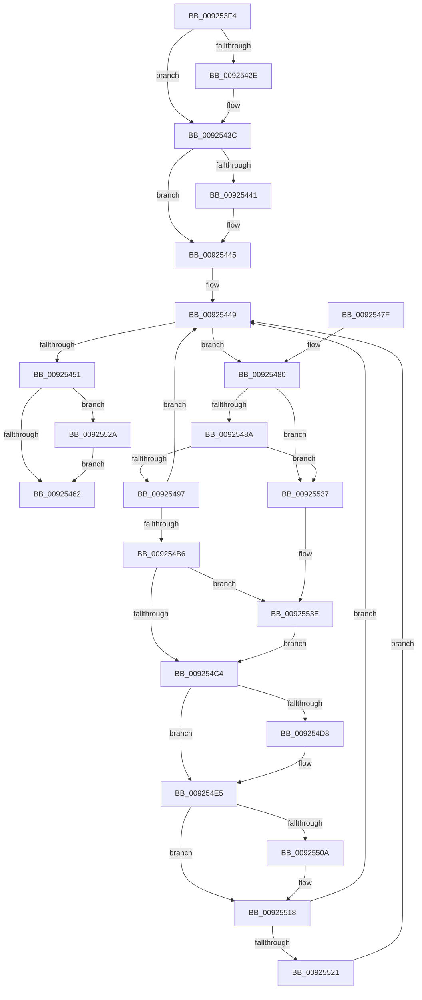

# AlpcpFlushResourcesPort

- RVA: `0x009253F4`–`0x0092554B` (길이 `343` bytes)
- VA: `0x00000001409253F4`
- 실행 섹션: `PAGE`
- PDB 이름 있음: `예`; PDB Function 태그: `아니요`
- unwind 정보 RVA: `0x0008D478`
- 디코드: `92`개 명령, `343/343` bytes 표시
- 미해석 바이트: `0` (있으면 어셈블리에 `.byte`로 보존)

> 이 문서는 커널 이미지의 기계어와 PDB 기호를 분석해 생성했습니다. 4번과 5번은 함수 원형과 자료형을 바이너리 사용 방식에서 추정한 C 해석이며 원본 소스 복구 결과는 아닙니다.

## 1. Dependencies

- 직접 호출 지점: **12**; 고유 호출 대상: **7**
- 직접 호출자로 확인된 함수: **2**
- RIP 상대 이미지 참조: **0**

### Outgoing calls
- `0x0092541E` → [KeAbPreAcquire](../../text/21/KeAbPreAcquire_function_00210230.md) (function, `0x00210230`)
- `0x00925437` → [ExfAcquirePushLockExclusiveEx](../../text/20/ExfAcquirePushLockExclusiveEx_function_0020FC90.md) (function, `0x0020FC90`)
- `0x00925465` → [KeAbPostRelease](../../text/2E/KeAbPostRelease_function_002E1600.md) (function, `0x002E1600`)
- `0x009254AC` → [AlpcpReferenceBlob](../89/AlpcpReferenceBlob_function_00890110.md) (function, `0x00890110`)
- `0x009254C7` → [KeAbPostRelease](../../text/2E/KeAbPostRelease_function_002E1600.md) (function, `0x002E1600`)
- `0x009254CF` → [AlpcpDeleteBlob](../88/AlpcpDeleteBlob_function_0088A11C.md) (function, `0x0088A11C`)
- `0x009254E0` → [AlpcpDereferenceBlobEx](../88/AlpcpDereferenceBlobEx_function_0088AF00.md) (function, `0x0088AF00`)
- `0x009254ED` → [AlpcpDereferenceBlobEx](../88/AlpcpDereferenceBlobEx_function_0088AF00.md) (function, `0x0088AF00`)
- `0x009254FA` → [KeAbPreAcquire](../../text/21/KeAbPreAcquire_function_00210230.md) (function, `0x00210230`)
- `0x00925513` → [ExfAcquirePushLockExclusiveEx](../../text/20/ExfAcquirePushLockExclusiveEx_function_0020FC90.md) (function, `0x0020FC90`)
- `0x0092552D` → [ExfTryToWakePushLock](../../text/26/ExfTryToWakePushLock_function_00265DD0.md) (function, `0x00265DD0`)
- `0x00925541` → [ExfTryToWakePushLock](../../text/26/ExfTryToWakePushLock_function_00265DD0.md) (function, `0x00265DD0`)

### Direct callers
- [AlpcpDoPortCleanup](AlpcpDoPortCleanup_function_00924E54.md) at `0x00924F0F`
- [AlpcpAcceptConnectPort](../A3/AlpcpAcceptConnectPort_function_00A34290.md) at `0x00A34D39`

### Static image references
- 디코드된 RIP-relative 메모리 참조가 없습니다.

## 2. Other-region calls and transfers

- 다른 실행 섹션으로 향하는 call: **8**
  - `0x0092541E` → [KeAbPreAcquire](../../text/21/KeAbPreAcquire_function_00210230.md) (`PAGE` → `.text`)
  - `0x00925437` → [ExfAcquirePushLockExclusiveEx](../../text/20/ExfAcquirePushLockExclusiveEx_function_0020FC90.md) (`PAGE` → `.text`)
  - `0x00925465` → [KeAbPostRelease](../../text/2E/KeAbPostRelease_function_002E1600.md) (`PAGE` → `.text`)
  - `0x009254C7` → [KeAbPostRelease](../../text/2E/KeAbPostRelease_function_002E1600.md) (`PAGE` → `.text`)
  - `0x009254FA` → [KeAbPreAcquire](../../text/21/KeAbPreAcquire_function_00210230.md) (`PAGE` → `.text`)
  - `0x00925513` → [ExfAcquirePushLockExclusiveEx](../../text/20/ExfAcquirePushLockExclusiveEx_function_0020FC90.md) (`PAGE` → `.text`)
  - `0x0092552D` → [ExfTryToWakePushLock](../../text/26/ExfTryToWakePushLock_function_00265DD0.md) (`PAGE` → `.text`)
  - `0x00925541` → [ExfTryToWakePushLock](../../text/26/ExfTryToWakePushLock_function_00265DD0.md) (`PAGE` → `.text`)
- 별도 외부 분기/꼬리 이동을 확인하지 못했습니다.

## 3. Assembly (complete function range)

```asm
009253F4  48 89 5C 24 08                  mov qword ptr [rsp + 8], rbx
009253F9  48 89 6C 24 10                  mov qword ptr [rsp + 0x10], rbp
009253FE  48 89 74 24 18                  mov qword ptr [rsp + 0x18], rsi
00925403  57                              push rdi
00925404  48 83 EC 20                     sub rsp, 0x20
00925408  48 8D B9 48 01 00 00            lea rdi, [rcx + 0x148]
0092540F  45 33 C0                        xor r8d, r8d
00925412  48 8D B1 50 01 00 00            lea rsi, [rcx + 0x150]
00925419  33 D2                           xor edx, edx
0092541B  48 8B CF                        mov rcx, rdi
0092541E  E8 0D AE 8E FF                  call 0x140210230
00925423  F0 48 0F BA 2F 00               lock bts qword ptr [rdi], 0
00925429  48 8B D8                        mov rbx, rax
0092542C  73 0E                           jae 0x14092543c
0092542E  4C 8B C7                        mov r8, rdi
00925431  48 8B D0                        mov rdx, rax
00925434  48 8B CF                        mov rcx, rdi
00925437  E8 54 A8 8E FF                  call 0x14020fc90
0092543C  48 85 DB                        test rbx, rbx
0092543F  74 04                           je 0x140925445
00925441  C6 43 0A 01                     mov byte ptr [rbx + 0xa], 1
00925445  48 83 CB FF                     or rbx, 0xffffffffffffffff
00925449  48 8B 06                        mov rax, qword ptr [rsi]
0092544C  48 3B C6                        cmp rax, rsi
0092544F  75 2F                           jne 0x140925480
00925451  F0 48 0F C1 1F                  lock xadd qword ptr [rdi], rbx
00925456  80 E3 06                        and bl, 6
00925459  80 FB 02                        cmp bl, 2
0092545C  0F 84 C8 00 00 00               je 0x14092552a
00925462  48 8B CF                        mov rcx, rdi
00925465  E8 96 C1 9B FF                  call 0x1402e1600
0092546A  48 8B 5C 24 30                  mov rbx, qword ptr [rsp + 0x30]
0092546F  48 8B 6C 24 38                  mov rbp, qword ptr [rsp + 0x38]
00925474  48 8B 74 24 40                  mov rsi, qword ptr [rsp + 0x40]
00925479  48 83 C4 20                     add rsp, 0x20
0092547D  5F                              pop rdi
0092547E  C3                              ret
0092547F  CC                              int3
00925480  48 39 70 08                     cmp qword ptr [rax + 8], rsi
00925484  0F 85 AD 00 00 00               jne 0x140925537
0092548A  48 8B 08                        mov rcx, qword ptr [rax]
0092548D  48 39 41 08                     cmp qword ptr [rcx + 8], rax
00925491  0F 85 A0 00 00 00               jne 0x140925537
00925497  48 89 0E                        mov qword ptr [rsi], rcx
0092549A  48 8D 68 30                     lea rbp, [rax + 0x30]
0092549E  48 89 71 08                     mov qword ptr [rcx + 8], rsi
009254A2  48 8B CD                        mov rcx, rbp
009254A5  48 89 40 08                     mov qword ptr [rax + 8], rax
009254A9  48 89 00                        mov qword ptr [rax], rax
009254AC  E8 5F AC F6 FF                  call 0x140890110
009254B1  48 85 C0                        test rax, rax
009254B4  74 93                           je 0x140925449
009254B6  48 8B C3                        mov rax, rbx
009254B9  F0 48 0F C1 07                  lock xadd qword ptr [rdi], rax
009254BE  24 06                           and al, 6
009254C0  3C 02                           cmp al, 2
009254C2  74 7A                           je 0x14092553e
009254C4  48 8B CF                        mov rcx, rdi
009254C7  E8 34 C1 9B FF                  call 0x1402e1600
009254CC  48 8B CD                        mov rcx, rbp
009254CF  E8 48 4C F6 FF                  call 0x14088a11c
009254D4  84 C0                           test al, al
009254D6  74 0D                           je 0x1409254e5
009254D8  BA 01 00 00 00                  mov edx, 1
009254DD  48 8B CD                        mov rcx, rbp
009254E0  E8 1B 5A F6 FF                  call 0x14088af00
009254E5  BA 01 00 00 00                  mov edx, 1
009254EA  48 8B CD                        mov rcx, rbp
009254ED  E8 0E 5A F6 FF                  call 0x14088af00
009254F2  45 33 C0                        xor r8d, r8d
009254F5  33 D2                           xor edx, edx
009254F7  48 8B CF                        mov rcx, rdi
009254FA  E8 31 AD 8E FF                  call 0x140210230
009254FF  F0 48 0F BA 2F 00               lock bts qword ptr [rdi], 0
00925505  48 8B E8                        mov rbp, rax
00925508  73 0E                           jae 0x140925518
0092550A  4C 8B C7                        mov r8, rdi
0092550D  48 8B D0                        mov rdx, rax
00925510  48 8B CF                        mov rcx, rdi
00925513  E8 78 A7 8E FF                  call 0x14020fc90
00925518  48 85 ED                        test rbp, rbp
0092551B  0F 84 28 FF FF FF               je 0x140925449
00925521  C6 45 0A 01                     mov byte ptr [rbp + 0xa], 1
00925525  E9 1F FF FF FF                  jmp 0x140925449
0092552A  48 8B CF                        mov rcx, rdi
0092552D  E8 9E 08 94 FF                  call 0x140265dd0
00925532  E9 2B FF FF FF                  jmp 0x140925462
00925537  B9 03 00 00 00                  mov ecx, 3
0092553C  CD 29                           int 0x29
0092553E  48 8B CF                        mov rcx, rdi
00925541  E8 8A 08 94 FF                  call 0x140265dd0
00925546  E9 79 FF FF FF                  jmp 0x1409254c4
```

## 4. C-style interpretation (structured pseudocode)

```c
__int64 __fastcall AlpcpFlushResourcesPort(__int64 a1, int a2, int a3)
{
    __int64 result;
    __int64 v_rbx;
    __int64 v_rsp;
    unsigned __int64 v_stack_p10;
    unsigned __int64 v_stack_p18;
    unsigned __int64 v_stack_p8;

    v_stack_p8 = v_rbx;
    v_stack_p10 = v_rbp;
    v_stack_p18 = v_rsi;
    v_rsp = (v_rsp) - (32);
    a3 = 0;
    a2 = 0;
    result = KeAbPreAcquire(a1 + 328, a2, a3, a4);
    if (!(condition_is_above_or_equal)) {
        a3 = a1 + 328;
        a2 = result;
        a1 = a1 + 328;
        result = ExfAcquirePushLockExclusiveEx(a1, a2, a3, a4);
    }
    if (result != 0) {
        *(unsigned __int8 *)(result + 10) = 1;
    }
    v_rbx = (result) | (-1);
loc_00925449:
    if ((*(unsigned __int64 *)(a1 + 336)) != (a1 + 336)) goto loc_00925480;
    v_rbx = (unsigned __int8)((v_rbx) & (6));
    if (((unsigned __int8)(v_rbx)) == 2) goto loc_0092552A;
loc_00925462:
    result = KeAbPostRelease(a1 + 328, a2, a3, a4);
    v_rsp = (v_rsp) + (32);
    return result;
loc_00925480:
    if ((*(unsigned __int64 *)(result + 8)) != v_stack_p18) goto loc_00925537;
    if ((*(unsigned __int64 *)(*(unsigned __int64 *)(result) + 8)) != result) goto loc_00925537;
    *(unsigned __int64 *)(v_stack_p18) = *(unsigned __int64 *)(result);
    *(unsigned __int64 *)(*(unsigned __int64 *)(result) + 8) = v_stack_p18;
    *(unsigned __int64 *)(result + 8) = result;
    *(unsigned __int64 *)(result) = result;
    result = AlpcpReferenceBlob(result + 48, a2, a3, a4);
    if (result == 0) goto loc_00925449;
    result = (unsigned __int8)((v_stack_p8) & (6));
    if (((unsigned __int8)(result)) == 2) goto loc_0092553E;
loc_009254C4:
    result = KeAbPostRelease(a1 + 328, a2, a3, a4);
    result = AlpcpDeleteBlob(result + 48, a2, a3, a4);
    if ((unsigned __int8)(result) != 0) {
        a2 = 1;
        a1 = result + 48;
        result = AlpcpDereferenceBlobEx(a1, a2, a3, a4);
    }
    result = AlpcpDereferenceBlobEx(result + 48, 1, a3, a4);
    a3 = 0;
    a2 = 0;
    result = KeAbPreAcquire(a1 + 328, a2, a3, a4);
    if (!(condition_is_above_or_equal)) {
        a3 = a1 + 328;
        a2 = result;
        a1 = a1 + 328;
        result = ExfAcquirePushLockExclusiveEx(a1, a2, a3, a4);
    }
    if (result == 0) goto loc_00925449;
    *(unsigned __int8 *)(result + 10) = 1;
    goto loc_00925449;
loc_0092552A:
    result = ExfTryToWakePushLock(a1 + 328, a2, a3, a4);
    goto loc_00925462;
loc_00925537:
loc_0092553E:
    result = ExfTryToWakePushLock(a1 + 328, a2, a3, a4);
    goto loc_009254C4;
}
```

## 5. (Beta) C Style

```c
int64_t AlpcpFlushResourcesPort(void *Arg1, int32_t Arg2, int32_t Arg3)
{
    uint8_t *arg1 = (uint8_t *)Arg1;

    int64_t result;
    int64_t local_rbx;
    int64_t local_rsp;
    uint64_t v_stack_p10;
    uint64_t v_stack_p18;
    uint64_t v_stack_p8;

    v_stack_p8 = local_rbx;
    v_stack_p10 = local_rbp;
    v_stack_p18 = local_rsi;
    local_rsp = (local_rsp) - (32);
    Arg3 = 0;
    Arg2 = 0;
    result = KeAbPreAcquire(Arg1 + 328, Arg2, Arg3, a4);
    if (!(condition_is_above_or_equal)) {
        Arg3 = Arg1 + 328;
        Arg2 = result;
        Arg1 = Arg1 + 328;
        result = ExfAcquirePushLockExclusiveEx(Arg1, Arg2, Arg3, a4);
    }
    if (result != 0) {
        *(uint8_t *)(result + 0xA) = 1;
    }
    local_rbx = (result) | (-1);
loc_00925449:
    if ((*(uint64_t *)(arg1 + 0x150)) != (Arg1 + 336)) goto loc_00925480;
    local_rbx = (uint8_t)((local_rbx) & (6));
    if (((uint8_t)(local_rbx)) == 2) goto loc_0092552A;
loc_00925462:
    result = KeAbPostRelease(Arg1 + 328, Arg2, Arg3, a4);
    local_rsp = (local_rsp) + (32);
    return result;
loc_00925480:
    if ((*(uint64_t *)(result + 0x8)) != v_stack_p18) goto loc_00925537;
    if ((*(uint64_t *)(*(uint64_t *)(result) + 0x8)) != result) goto loc_00925537;
    *(uint64_t *)(v_stack_p18) = *(uint64_t *)(result);
    *(uint64_t *)(*(uint64_t *)(result) + 0x8) = v_stack_p18;
    *(uint64_t *)(result + 0x8) = result;
    *(uint64_t *)(result) = result;
    result = AlpcpReferenceBlob(result + 48, Arg2, Arg3, a4);
    if (result == 0) goto loc_00925449;
    result = (uint8_t)((v_stack_p8) & (6));
    if (((uint8_t)(result)) == 2) goto loc_0092553E;
loc_009254C4:
    result = KeAbPostRelease(Arg1 + 328, Arg2, Arg3, a4);
    result = AlpcpDeleteBlob(result + 48, Arg2, Arg3, a4);
    if ((uint8_t)(result) != 0) {
        Arg2 = 1;
        Arg1 = result + 48;
        result = AlpcpDereferenceBlobEx(Arg1, Arg2, Arg3, a4);
    }
    result = AlpcpDereferenceBlobEx(result + 48, 1, Arg3, a4);
    Arg3 = 0;
    Arg2 = 0;
    result = KeAbPreAcquire(Arg1 + 328, Arg2, Arg3, a4);
    if (!(condition_is_above_or_equal)) {
        Arg3 = Arg1 + 328;
        Arg2 = result;
        Arg1 = Arg1 + 328;
        result = ExfAcquirePushLockExclusiveEx(Arg1, Arg2, Arg3, a4);
    }
    if (result == 0) goto loc_00925449;
    *(uint8_t *)(result + 0xA) = 1;
    goto loc_00925449;
loc_0092552A:
    result = ExfTryToWakePushLock(Arg1 + 328, Arg2, Arg3, a4);
    goto loc_00925462;
loc_00925537:
loc_0092553E:
    result = ExfTryToWakePushLock(Arg1 + 328, Arg2, Arg3, a4);
    goto loc_009254C4;
}
```

### 관측된 메모리 오프셋

구조체 형식이 확인되지 않은 접근은 인자 기준의 오프셋으로만 기록했습니다.

| 기준 인자 | 오프셋 표현 | 폭 (bit) | 접근 |
|---|---:|---:|---|
| `Arg1` | `+ 0x0` | `64` | `R` |
| `Arg1` | `+ 0x0` | `64` | `R/W` |
| `Arg1` | `+ 0x0` | `64` | `W` |
| `Arg1` | `+ 0x148` | `64` | `R` |
| `Arg1` | `+ 0x150` | `64` | `R` |

## 6. Execution-region graph

[열기: 2D/3D 그래프와 함수 탐색 컨트롤 패널](../../../control-panel.html?section=page&rva=0x009253F4&view=graph)

- 2D 그래프는 위에서 아래로 흐르고, 3D 그래프는 빈 공간을 드래그해 회전합니다. Shift+드래그는 이동, 휠은 확대·축소, 함수 노드 선택은 대상 보고서 이동입니다.

### Static fallback


