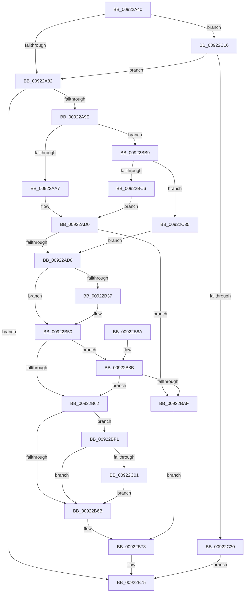

# AlpcpFormatConnectionRequest

- RVA: `0x00922A40`–`0x00922C4B` (길이 `523` bytes)
- VA: `0x0000000140922A40`
- 실행 섹션: `PAGE`
- PDB 이름 있음: `예`; PDB Function 태그: `아니요`
- unwind 정보 RVA: `0x0008D1BC`
- 디코드: `125`개 명령, `523/523` bytes 표시
- 미해석 바이트: `0` (있으면 어셈블리에 `.byte`로 보존)

> 이 문서는 커널 이미지의 기계어와 PDB 기호를 분석해 생성했습니다. 4번과 5번은 함수 원형과 자료형을 바이너리 사용 방식에서 추정한 C 해석이며 원본 소스 복구 결과는 아닙니다.

## 1. Dependencies

- 직접 호출 지점: **7**; 고유 호출 대상: **7**
- 직접 호출자로 확인된 함수: **2**
- RIP 상대 이미지 참조: **0**

### Outgoing calls
- `0x00922A8F` → [AlpcpAllocateMessage](../89/AlpcpAllocateMessage_function_008926C0.md) (function, `0x008926C0`)
- `0x00922AC9` → [AlpcpCaptureAttributes](../88/AlpcpCaptureAttributes_function_0088CD20.md) (function, `0x0088CD20`)
- `0x00922BA4` → [AlpcpSetupMessageDataForDeferredCopy](AlpcpSetupMessageDataForDeferredCopy_function_00922C60.md) (function, `0x00922C60`)
- `0x00922BB2` → [AlpcpUnlockMessage](../89/AlpcpUnlockMessage_function_00897AE0.md) (function, `0x00897AE0`)
- `0x00922BD8` → [AlpcpMapLegacyPortView](AlpcpMapLegacyPortView_function_00921588.md) (function, `0x00921588`)
- `0x00922C0C` → [AlpcpReferenceBlob](../89/AlpcpReferenceBlob_function_00890110.md) (function, `0x00890110`)
- `0x00922C23` → [AlpcpValidateConnectionMessage](AlpcpValidateConnectionMessage_function_00921C38.md) (function, `0x00921C38`)

### Direct callers
- [NtSecureConnectPort](NtSecureConnectPort_function_00922F20.md) at `0x009232AF`
- [AlpcpProcessConnectionRequest](AlpcpProcessConnectionRequest_function_00925FD4.md) at `0x00926142`

### Static image references
- 디코드된 RIP-relative 메모리 참조가 없습니다.

## 2. Other-region calls and transfers

- 다른 실행 섹션으로 향하는 call: **0**
- 별도 외부 분기/꼬리 이동을 확인하지 못했습니다.

## 3. Assembly (complete function range)

```asm
00922A40  48 8B C4                        mov rax, rsp
00922A43  48 89 58 10                     mov qword ptr [rax + 0x10], rbx
00922A47  48 89 48 08                     mov qword ptr [rax + 8], rcx
00922A4B  55                              push rbp
00922A4C  56                              push rsi
00922A4D  57                              push rdi
00922A4E  41 54                           push r12
00922A50  41 55                           push r13
00922A52  41 56                           push r14
00922A54  41 57                           push r15
00922A56  48 83 EC 30                     sub rsp, 0x30
00922A5A  40 8A B4 24 B0 00 00 00         mov sil, byte ptr [rsp + 0xb0]
00922A62  33 ED                           xor ebp, ebp
00922A64  4C 8B B4 24 90 00 00 00         mov r14, qword ptr [rsp + 0x90]
00922A6C  4D 8B E1                        mov r12, r9
00922A6F  48 89 68 18                     mov qword ptr [rax + 0x18], rbp
00922A73  4D 8B F8                        mov r15, r8
00922A76  44 8B EA                        mov r13d, edx
00922A79  4D 85 C9                        test r9, r9
00922A7C  0F 85 94 01 00 00               jne 0x140922c16
00922A82  45 33 C0                        xor r8d, r8d
00922A85  48 8D 8C 24 80 00 00 00         lea rcx, [rsp + 0x80]
00922A8D  33 D2                           xor edx, edx
00922A8F  E8 2C FC F6 FF                  call 0x1408926c0
00922A94  8B D8                           mov ebx, eax
00922A96  85 C0                           test eax, eax
00922A98  0F 88 D7 00 00 00               js 0x140922b75
00922A9E  40 84 F6                        test sil, sil
00922AA1  0F 85 12 01 00 00               jne 0x140922bb9
00922AA7  48 8B BC 24 80 00 00 00         mov rdi, qword ptr [rsp + 0x80]
00922AAF  41 8B D5                        mov edx, r13d
00922AB2  4C 8B 84 24 98 00 00 00         mov r8, qword ptr [rsp + 0x98]
00922ABA  4C 8B CF                        mov r9, rdi
00922ABD  49 8B CF                        mov rcx, r15
00922AC0  48 8D 47 68                     lea rax, [rdi + 0x68]
00922AC4  48 89 44 24 20                  mov qword ptr [rsp + 0x20], rax
00922AC9  E8 52 A2 F6 FF                  call 0x14088cd20
00922ACE  8B D8                           mov ebx, eax
00922AD0  85 DB                           test ebx, ebx
00922AD2  0F 88 D7 00 00 00               js 0x140922baf
00922AD8  65 48 8B 04 25 88 01 00 00      mov rax, qword ptr gs:[0x188]
00922AE1  BA 00 FF FF FF                  mov edx, 0xffffff00
00922AE6  48 8B 8C 24 80 00 00 00         mov rcx, qword ptr [rsp + 0x80]
00922AEE  0F 10 80 08 05 00 00            movups xmm0, xmmword ptr [rax + 0x508]
00922AF5  F3 0F 7F 81 F8 00 00 00         movdqu xmmword ptr [rcx + 0xf8], xmm0
00922AFD  41 0F B7 06                     movzx eax, word ptr [r14]
00922B01  66 89 81 F0 00 00 00            mov word ptr [rcx + 0xf0], ax
00922B08  66 83 C0 28                     add ax, 0x28
00922B0C  66 89 81 F2 00 00 00            mov word ptr [rcx + 0xf2], ax
00922B13  66 23 91 F4 00 00 00            and dx, word ptr [rcx + 0xf4]
00922B1A  66 83 CA 0A                     or dx, 0xa
00922B1E  66 89 91 F4 00 00 00            mov word ptr [rcx + 0xf4], dx
00922B25  65 48 8B 04 25 88 01 00 00      mov rax, qword ptr gs:[0x188]
00922B2E  40 38 A8 32 02 00 00            cmp byte ptr [rax + 0x232], bpl
00922B35  75 19                           jne 0x140922b50
00922B37  41 0F B7 46 04                  movzx eax, word ptr [r14 + 4]
00922B3C  41 B8 00 80 FF FF               mov r8d, 0xffff8000
00922B42  66 41 23 C0                     and ax, r8w
00922B46  66 0B C2                        or ax, dx
00922B49  66 89 81 F4 00 00 00            mov word ptr [rcx + 0xf4], ax
00922B50  45 0F B7 0E                     movzx r9d, word ptr [r14]
00922B54  48 8B BC 24 80 00 00 00         mov rdi, qword ptr [rsp + 0x80]
00922B5C  66 41 3B E9                     cmp bp, r9w
00922B60  75 29                           jne 0x140922b8b
00922B62  40 84 F6                        test sil, sil
00922B65  0F 85 86 00 00 00               jne 0x140922bf1
00922B6B  48 8B 44 24 70                  mov rax, qword ptr [rsp + 0x70]
00922B70  48 89 38                        mov qword ptr [rax], rdi
00922B73  8B C3                           mov eax, ebx
00922B75  48 8B 5C 24 78                  mov rbx, qword ptr [rsp + 0x78]
00922B7A  48 83 C4 30                     add rsp, 0x30
00922B7E  41 5F                           pop r15
00922B80  41 5E                           pop r14
00922B82  41 5D                           pop r13
00922B84  41 5C                           pop r12
00922B86  5F                              pop rdi
00922B87  5E                              pop rsi
00922B88  5D                              pop rbp
00922B89  C3                              ret
00922B8A  CC                              int3
00922B8B  8A 84 24 B8 00 00 00            mov al, byte ptr [rsp + 0xb8]
00922B92  45 8B C5                        mov r8d, r13d
00922B95  88 44 24 28                     mov byte ptr [rsp + 0x28], al
00922B99  49 8B D4                        mov rdx, r12
00922B9C  48 8B CF                        mov rcx, rdi
00922B9F  40 88 74 24 20                  mov byte ptr [rsp + 0x20], sil
00922BA4  E8 B7 00 00 00                  call 0x140922c60
00922BA9  8B D8                           mov ebx, eax
00922BAB  85 C0                           test eax, eax
00922BAD  79 B3                           jns 0x140922b62
00922BAF  48 8B CF                        mov rcx, rdi
00922BB2  E8 29 4F F7 FF                  call 0x140897ae0
00922BB7  EB BA                           jmp 0x140922b73
00922BB9  48 8B AC 24 A0 00 00 00         mov rbp, qword ptr [rsp + 0xa0]
00922BC1  48 85 ED                        test rbp, rbp
00922BC4  74 6F                           je 0x140922c35
00922BC6  48 8B BC 24 80 00 00 00         mov rdi, qword ptr [rsp + 0x80]
00922BCE  48 8B D5                        mov rdx, rbp
00922BD1  49 8B CF                        mov rcx, r15
00922BD4  4C 8D 47 68                     lea r8, [rdi + 0x68]
00922BD8  E8 AB E9 FF FF                  call 0x140921588
00922BDD  8B D8                           mov ebx, eax
00922BDF  48 8B 45 18                     mov rax, qword ptr [rbp + 0x18]
00922BE3  48 89 87 10 01 00 00            mov qword ptr [rdi + 0x110], rax
00922BEA  33 ED                           xor ebp, ebp
00922BEC  E9 DF FE FF FF                  jmp 0x140922ad0
00922BF1  48 8B 8F 90 00 00 00            mov rcx, qword ptr [rdi + 0x90]
00922BF8  48 85 C9                        test rcx, rcx
00922BFB  0F 84 6A FF FF FF               je 0x140922b6b
00922C01  48 8B 84 24 A8 00 00 00         mov rax, qword ptr [rsp + 0xa8]
00922C09  48 89 08                        mov qword ptr [rax], rcx
00922C0C  E8 FF D4 F6 FF                  call 0x140890110
00922C11  E9 55 FF FF FF                  jmp 0x140922b6b
00922C16  49 8B 40 10                     mov rax, qword ptr [r8 + 0x10]
00922C1A  49 8B D6                        mov rdx, r14
00922C1D  44 8A C6                        mov r8b, sil
00922C20  48 8B 08                        mov rcx, qword ptr [rax]
00922C23  E8 10 F0 FF FF                  call 0x140921c38
00922C28  85 C0                           test eax, eax
00922C2A  0F 89 52 FE FF FF               jns 0x140922a82
00922C30  E9 40 FF FF FF                  jmp 0x140922b75
00922C35  48 8B 84 24 80 00 00 00         mov rax, qword ptr [rsp + 0x80]
00922C3D  33 ED                           xor ebp, ebp
00922C3F  48 89 A8 10 01 00 00            mov qword ptr [rax + 0x110], rbp
00922C46  E9 8D FE FF FF                  jmp 0x140922ad8
```

## 4. C-style interpretation (structured pseudocode)

```c
__int64 __fastcall AlpcpFormatConnectionRequest(__int64 a1, int a2, __int64 a3, __int64 a4, __int64 a5, __int64 a6, __int64 a7, __int64 a8, unsigned __int8 a9, unsigned __int8 a10)
{
    __int64 result;
    __int64 v_rbp;
    __int64 v_rsp;
    unsigned __int64 v_stack_m48;
    unsigned __int64 v_stack_p10;
    unsigned __int64 v_stack_p18;
    unsigned __int8 v_stack_p20;
    unsigned __int8 v_stack_p28;
    unsigned __int64 v_stack_p8;
    unsigned __int64 v_stack_p80;

    *(unsigned __int64 *)(v_rsp + 16) = v_rbx;
    *(unsigned __int64 *)(v_rsp + 8) = a1;
    v_rsp = (v_rsp) - (48);
    v_rbp = 0;
    *(unsigned __int64 *)(v_rsp + 24) = 0;
    if (a4 != 0) goto loc_00922C16;
loc_00922A82:
    a3 = 0;
    a2 = 0;
    result = AlpcpAllocateMessage(v_stack_p18, a2, a3, a4);
    if (sign_flag) goto loc_00922B75;
    if (a9 != 0) goto loc_00922BB9;
    v_stack_m48 = v_stack_p18 + 104;
    result = AlpcpCaptureAttributes(0, (unsigned int)((unsigned int)((unsigned int)(a2))), a6, v_stack_p18);
loc_00922AD0:
    if (sign_flag) goto loc_00922BAF;
loc_00922AD8:
    *(unsigned __int64 *)(v_stack_p18 + 248) = v_xmm0;
    *(unsigned __int16 *)(v_stack_p18 + 240) = (unsigned __int16)(*(unsigned __int16 *)(a5));
    result = (unsigned __int16)((*(unsigned __int16 *)(a5)) + (40));
    *(unsigned __int16 *)(v_stack_p18 + 242) = (unsigned __int16)(result);
    a2 = (unsigned __int16)(((unsigned int)(0xFFFFFF00ULL)) & (*(unsigned __int16 *)(v_stack_p18 + 244)));
    a2 = (unsigned __int16)((a2) | (10));
    *(unsigned __int16 *)(v_stack_p18 + 244) = (unsigned __int16)(a2);
    result = *(unsigned __int64 *)(gs_base + (0 + 392));
    if ((*(unsigned __int8 *)(*(unsigned __int64 *)(gs_base + (0 + 392)) + 562)) == 0) {
        result = *(unsigned __int16 *)(a5 + 4);
        a3 = 0xFFFF8000ULL;
        result = (unsigned __int16)((result) & ((unsigned __int16)(a3)));
        result = (unsigned __int16)((result) | ((unsigned __int16)(a2)));
        *(unsigned __int16 *)(v_stack_p18 + 244) = (unsigned __int16)(result);
    }
    if (0 != ((unsigned __int16)(*(unsigned __int16 *)(a5)))) goto loc_00922B8B;
loc_00922B62:
    if (a9 != 0) goto loc_00922BF1;
loc_00922B6B:
    *(unsigned __int64 *)(v_stack_p8) = v_stack_p18;
loc_00922B73:
loc_00922B75:
    v_rsp = (v_rsp) + (48);
    return (unsigned int)((unsigned int)((unsigned int)((unsigned int)(result))));
loc_00922B8B:
    v_stack_p28 = a10;
    v_stack_p20 = a9;
    result = AlpcpSetupMessageDataForDeferredCopy(v_stack_p18, a4, (unsigned int)((unsigned int)((unsigned int)(a2))), *(unsigned __int16 *)(a5));
    if (!sign_flag) goto loc_00922B62;
loc_00922BAF:
    result = AlpcpUnlockMessage(v_stack_p18, a4, (unsigned int)((unsigned int)((unsigned int)(a2))), *(unsigned __int16 *)(a5));
    goto loc_00922B73;
loc_00922BB9:
    if (a7 == 0) goto loc_00922C35;
    result = AlpcpMapLegacyPortView(a3, a7, v_stack_p80 + 104, *(unsigned __int16 *)(a5));
    *(unsigned __int64 *)(v_stack_p80 + 272) = *(unsigned __int64 *)(a7 + 24);
    v_rbp = 0;
    goto loc_00922AD0;
loc_00922BF1:
    if (*(unsigned __int64 *)(v_stack_p80 + 144) == 0) goto loc_00922B6B;
    *(unsigned __int64 *)(a8) = *(unsigned __int64 *)(v_stack_p80 + 144);
    result = AlpcpReferenceBlob(*(unsigned __int64 *)(v_stack_p80 + 144), a7, v_stack_p80 + 104, *(unsigned __int16 *)(a5));
    goto loc_00922B6B;
loc_00922C16:
    result = AlpcpValidateConnectionMessage(*(unsigned __int64 *)(*(unsigned __int64 *)(v_stack_p80 + 104 + 16)), a5, a9, *(unsigned __int16 *)(a5));
    if (!sign_flag) goto loc_00922A82;
    goto loc_00922B75;
loc_00922C35:
    v_rbp = 0;
    *(unsigned __int64 *)(v_stack_p80 + 272) = 0;
    goto loc_00922AD8;
}
```

## 5. (Beta) C Style

```c
int64_t AlpcpFormatConnectionRequest(int64_t Arg1, int32_t Arg2, void *Arg3, int64_t Arg4, void *Arg5, int64_t Arg6, int64_t Arg7, void *Arg8, uint8_t Arg9, uint8_t Arg10)
{
    uint8_t *arg3 = (uint8_t *)Arg3;
    uint8_t *arg5 = (uint8_t *)Arg5;
    uint8_t *arg8 = (uint8_t *)Arg8;

    int64_t result;
    int64_t local_rbp;
    int64_t local_rsp;
    uint64_t v_stack_m48;
    uint64_t v_stack_p10;
    uint64_t v_stack_p18;
    uint8_t v_stack_p20;
    uint8_t v_stack_p28;
    uint64_t v_stack_p8;
    uint64_t v_stack_p80;

    *(uint64_t *)(local_rsp + 0x10) = local_rbx;
    *(uint64_t *)(local_rsp + 0x8) = Arg1;
    local_rsp = (local_rsp) - (48);
    local_rbp = 0;
    *(uint64_t *)(local_rsp + 0x18) = 0;
    if (Arg4 != 0) goto loc_00922C16;
loc_00922A82:
    Arg3 = 0;
    Arg2 = 0;
    result = AlpcpAllocateMessage(v_stack_p18, Arg2, Arg3, Arg4);
    if (sign_flag) goto loc_00922B75;
    if (Arg9 != 0) goto loc_00922BB9;
    v_stack_m48 = v_stack_p18 + 104;
    result = AlpcpCaptureAttributes(0, (uint32_t)((uint32_t)((uint32_t)(Arg2))), Arg6, v_stack_p18);
loc_00922AD0:
    if (sign_flag) goto loc_00922BAF;
loc_00922AD8:
    *(uint64_t *)(v_stack_p18 + 0xF8) = v_xmm0;
    *(uint16_t *)(v_stack_p18 + 0xF0) = (uint16_t)(*(uint16_t *)(arg5));
    result = (uint16_t)((*(uint16_t *)(arg5)) + (40));
    *(uint16_t *)(v_stack_p18 + 0xF2) = (uint16_t)(result);
    Arg2 = (uint16_t)(((uint32_t)(0xFFFFFF00ULL)) & (*(uint16_t *)(v_stack_p18 + 0xF4)));
    Arg2 = (uint16_t)((Arg2) | (10));
    *(uint16_t *)(v_stack_p18 + 0xF4) = (uint16_t)(Arg2);
    result = *(uint64_t *)(gs_base + (0 + 0x188));
    if ((*(uint8_t *)(*(uint64_t *)(gs_base + (0 + 0x188)) + 0x232)) == 0) {
        result = *(uint16_t *)(arg5 + 0x4);
        Arg3 = 0xFFFF8000ULL;
        result = (uint16_t)((result) & ((uint16_t)(Arg3)));
        result = (uint16_t)((result) | ((uint16_t)(Arg2)));
        *(uint16_t *)(v_stack_p18 + 0xF4) = (uint16_t)(result);
    }
    if (0 != ((uint16_t)(*(uint16_t *)(arg5)))) goto loc_00922B8B;
loc_00922B62:
    if (Arg9 != 0) goto loc_00922BF1;
loc_00922B6B:
    *(uint64_t *)(v_stack_p8) = v_stack_p18;
loc_00922B73:
loc_00922B75:
    local_rsp = (local_rsp) + (48);
    return (uint32_t)((uint32_t)((uint32_t)((uint32_t)(result))));
loc_00922B8B:
    v_stack_p28 = Arg10;
    v_stack_p20 = Arg9;
    result = AlpcpSetupMessageDataForDeferredCopy(v_stack_p18, Arg4, (uint32_t)((uint32_t)((uint32_t)(Arg2))), *(uint16_t *)(arg5));
    if (!sign_flag) goto loc_00922B62;
loc_00922BAF:
    result = AlpcpUnlockMessage(v_stack_p18, Arg4, (uint32_t)((uint32_t)((uint32_t)(Arg2))), *(uint16_t *)(arg5));
    goto loc_00922B73;
loc_00922BB9:
    if (Arg7 == 0) goto loc_00922C35;
    result = AlpcpMapLegacyPortView(Arg3, Arg7, v_stack_p80 + 104, *(uint16_t *)(arg5));
    *(uint64_t *)(v_stack_p80 + 0x110) = *(uint64_t *)(Arg7 + 0x18);
    local_rbp = 0;
    goto loc_00922AD0;
loc_00922BF1:
    if (*(uint64_t *)(v_stack_p80 + 0x90) == 0) goto loc_00922B6B;
    *(uint64_t *)(arg8) = *(uint64_t *)(v_stack_p80 + 0x90);
    result = AlpcpReferenceBlob(*(uint64_t *)(v_stack_p80 + 0x90), Arg7, v_stack_p80 + 104, *(uint16_t *)(arg5));
    goto loc_00922B6B;
loc_00922C16:
    result = AlpcpValidateConnectionMessage(*(uint64_t *)(*(uint64_t *)(v_stack_p80 + 0x68 + 0x10)), Arg5, Arg9, *(uint16_t *)(arg5));
    if (!sign_flag) goto loc_00922A82;
    goto loc_00922B75;
loc_00922C35:
    local_rbp = 0;
    *(uint64_t *)(v_stack_p80 + 0x110) = 0;
    goto loc_00922AD8;
}
```

### 관측된 메모리 오프셋

구조체 형식이 확인되지 않은 접근은 인자 기준의 오프셋으로만 기록했습니다.

| 기준 인자 | 오프셋 표현 | 폭 (bit) | 접근 |
|---|---:|---:|---|
| `Arg3` | `+ 0x10` | `64` | `R` |
| `Arg5` | `+ 0x0` | `16` | `R` |
| `Arg5` | `+ 0x4` | `16` | `R` |
| `Arg8` | `+ 0x0` | `64` | `W` |

## 6. Execution-region graph

[열기: 2D/3D 그래프와 함수 탐색 컨트롤 패널](../../../control-panel.html?section=page&rva=0x00922A40&view=graph)

- 2D 그래프는 위에서 아래로 흐르고, 3D 그래프는 빈 공간을 드래그해 회전합니다. Shift+드래그는 이동, 휠은 확대·축소, 함수 노드 선택은 대상 보고서 이동입니다.

### Static fallback


