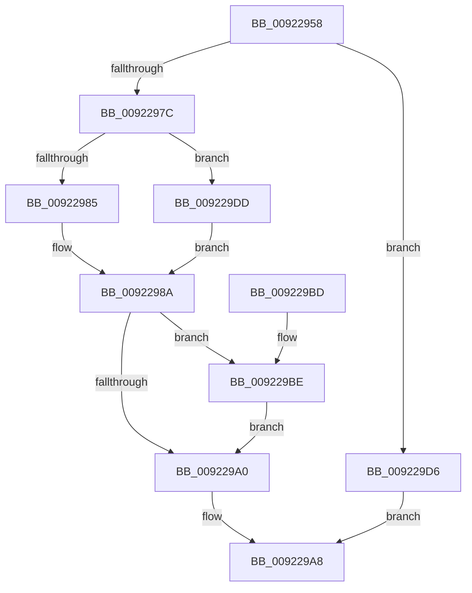

# AlpcpGetDataFromMessage

- RVA: `0x00922958`–`0x009229E7` (길이 `143` bytes)
- VA: `0x0000000140922958`
- 실행 섹션: `PAGE`
- PDB 이름 있음: `예`; PDB Function 태그: `아니요`
- unwind 정보 RVA: `0x000814C4`
- 디코드: `38`개 명령, `143/143` bytes 표시
- 미해석 바이트: `0` (있으면 어셈블리에 `.byte`로 보존)

> 이 문서는 커널 이미지의 기계어와 PDB 기호를 분석해 생성했습니다. 4번과 5번은 함수 원형과 자료형을 바이너리 사용 방식에서 추정한 C 해석이며 원본 소스 복구 결과는 아닙니다.

## 1. Dependencies

- 직접 호출 지점: **3**; 고유 호출 대상: **2**
- 직접 호출자로 확인된 함수: **5**
- RIP 상대 이미지 참조: **0**

### Outgoing calls
- `0x009229A3` → [memcpy](../../text/6C/memcpy_function_006C6840.md) (function, `0x006C6840`)
- `0x009229C1` → [memcpy](../../text/6C/memcpy_function_006C6840.md) (function, `0x006C6840`)
- `0x009229D6` → [AlpcpGetDataFromUserVaSafe](AlpcpGetDataFromUserVaSafe_function_00922908.md) (function, `0x00922908`)

### Direct callers
- [sub_0088EC77](../88/Unknown_function_0088EC77.md) at `0x0088F15D`
- [AlpcpReceiveMessage](../89/AlpcpReceiveMessage_function_00897ED0.md) at `0x008983A6`
- [AlpcpReceiveLegacyConnectionReply](AlpcpReceiveLegacyConnectionReply_function_00921CA0.md) at `0x00921DE5`
- [AlpcpProcessSynchronousRequest](AlpcpProcessSynchronousRequest_function_00921FCC.md) at `0x009221CF`
- [AlpcpProcessConnectionRequest](AlpcpProcessConnectionRequest_function_00925FD4.md) at `0x009262DC`

### Static image references
- 디코드된 RIP-relative 메모리 참조가 없습니다.

## 2. Other-region calls and transfers

- 다른 실행 섹션으로 향하는 call: **2**
  - `0x009229A3` → [memcpy](../../text/6C/memcpy_function_006C6840.md) (`PAGE` → `.text`)
  - `0x009229C1` → [memcpy](../../text/6C/memcpy_function_006C6840.md) (`PAGE` → `.text`)
- 별도 외부 분기/꼬리 이동을 확인하지 못했습니다.

## 3. Assembly (complete function range)

```asm
00922958  48 89 5C 24 08                  mov qword ptr [rsp + 8], rbx
0092295D  48 89 6C 24 10                  mov qword ptr [rsp + 0x10], rbp
00922962  48 89 74 24 18                  mov qword ptr [rsp + 0x18], rsi
00922967  57                              push rdi
00922968  48 83 EC 20                     sub rsp, 0x20
0092296C  48 83 B9 B0 00 00 00 00         cmp qword ptr [rcx + 0xb0], 0
00922974  48 8B EA                        mov rbp, rdx
00922977  48 8B D9                        mov rbx, rcx
0092297A  75 5A                           jne 0x1409229d6
0092297C  48 8B 79 60                     mov rdi, qword ptr [rcx + 0x60]
00922980  48 85 FF                        test rdi, rdi
00922983  75 58                           jne 0x1409229dd
00922985  BF 00 02 00 00                  mov edi, 0x200
0092298A  0F B7 B1 F0 00 00 00            movzx esi, word ptr [rcx + 0xf0]
00922991  48 8D 91 18 01 00 00            lea rdx, [rcx + 0x118]
00922998  48 8B CD                        mov rcx, rbp
0092299B  48 3B F7                        cmp rsi, rdi
0092299E  77 1E                           ja 0x1409229be
009229A0  4C 8B C6                        mov r8, rsi
009229A3  E8 98 3E DA FF                  call 0x1406c6840
009229A8  48 8B 5C 24 30                  mov rbx, qword ptr [rsp + 0x30]
009229AD  48 8B 6C 24 38                  mov rbp, qword ptr [rsp + 0x38]
009229B2  48 8B 74 24 40                  mov rsi, qword ptr [rsp + 0x40]
009229B7  48 83 C4 20                     add rsp, 0x20
009229BB  5F                              pop rdi
009229BC  C3                              ret
009229BD  CC                              int3
009229BE  4C 8B C7                        mov r8, rdi
009229C1  E8 7A 3E DA FF                  call 0x1406c6840
009229C6  48 8B 93 E0 00 00 00            mov rdx, qword ptr [rbx + 0xe0]
009229CD  48 8D 0C 2F                     lea rcx, [rdi + rbp]
009229D1  48 2B F7                        sub rsi, rdi
009229D4  EB CA                           jmp 0x1409229a0
009229D6  E8 2D FF FF FF                  call 0x140922908
009229DB  EB CB                           jmp 0x1409229a8
009229DD  48 8B 7F 20                     mov rdi, qword ptr [rdi + 0x20]
009229E1  48 83 EF 28                     sub rdi, 0x28
009229E5  EB A3                           jmp 0x14092298a
```

## 4. C-style interpretation (structured pseudocode)

```c
__int64 __fastcall AlpcpGetDataFromMessage(__int64 a1, __int64 a2)
{
    __int64 result;
    __int64 v_rdi;
    __int64 v_rsi;
    __int64 v_rsp;
    unsigned __int64 v_stack_p10;
    unsigned __int64 v_stack_p18;
    unsigned __int64 v_stack_p8;

    v_stack_p8 = v_rbx;
    v_stack_p10 = v_rbp;
    v_stack_p18 = v_rsi;
    v_rsp = (v_rsp) - (32);
    if ((*(unsigned __int64 *)(a1 + 176)) != 0) goto loc_009229D6;
    if (*(unsigned __int64 *)(a1 + 96) != 0) goto loc_009229DD;
loc_0092298A:
    if ((*(unsigned __int16 *)(a1 + 240)) > 512) goto loc_009229BE;
loc_009229A0:
    result = memcpy(a2, a1 + 280, *(unsigned __int16 *)(a1 + 240), a4);
loc_009229A8:
    v_rsp = (v_rsp) + (32);
    return result;
loc_009229BE:
    result = memcpy(a2, a1 + 280, 512, a4);
    v_rsi = (v_stack_p18) - (512);
    goto loc_009229A0;
loc_009229D6:
    result = AlpcpGetDataFromUserVaSafe(512 + v_stack_p10 * 1, *(unsigned __int64 *)(v_stack_p8 + 224), 512, a4);
    goto loc_009229A8;
loc_009229DD:
    v_rdi = (*(unsigned __int64 *)(512 + 32)) - (40);
    goto loc_0092298A;
}
```

## 5. (Beta) C Style

```c
int64_t AlpcpGetDataFromMessage(void *Arg1, int64_t Arg2)
{
    uint8_t *arg1 = (uint8_t *)Arg1;

    int64_t result;
    int64_t local_rdi;
    int64_t local_rsi;
    int64_t local_rsp;
    uint64_t v_stack_p10;
    uint64_t v_stack_p18;
    uint64_t v_stack_p8;

    v_stack_p8 = local_rbx;
    v_stack_p10 = local_rbp;
    v_stack_p18 = local_rsi;
    local_rsp = (local_rsp) - (32);
    if ((*(uint64_t *)(arg1 + 0xB0)) != 0) goto loc_009229D6;
    if (*(uint64_t *)(arg1 + 0x60) != 0) goto loc_009229DD;
loc_0092298A:
    if ((*(uint16_t *)(arg1 + 0xF0)) > 512) goto loc_009229BE;
loc_009229A0:
    result = memcpy(Arg2, Arg1 + 280, *(uint16_t *)(arg1 + 0xF0), a4);
loc_009229A8:
    local_rsp = (local_rsp) + (32);
    return result;
loc_009229BE:
    result = memcpy(Arg2, Arg1 + 280, 512, a4);
    local_rsi = (v_stack_p18) - (512);
    goto loc_009229A0;
loc_009229D6:
    result = AlpcpGetDataFromUserVaSafe(512 + v_stack_p10 * 1, *(uint64_t *)(v_stack_p8 + 0xE0), 512, a4);
    goto loc_009229A8;
loc_009229DD:
    local_rdi = (*(uint64_t *)(512 + 0x20)) - (40);
    goto loc_0092298A;
}
```

### 관측된 메모리 오프셋

구조체 형식이 확인되지 않은 접근은 인자 기준의 오프셋으로만 기록했습니다.

| 기준 인자 | 오프셋 표현 | 폭 (bit) | 접근 |
|---|---:|---:|---|
| `Arg1` | `+ 0x60` | `64` | `R` |
| `Arg1` | `+ 0xB0` | `64` | `R` |
| `Arg1` | `+ 0xE0` | `64` | `R` |
| `Arg1` | `+ 0xF0` | `16` | `R` |
| `Arg1` | `+ 0x118` | `64` | `R` |

## 6. Execution-region graph

[열기: 2D/3D 그래프와 함수 탐색 컨트롤 패널](../../../control-panel.html?section=page&rva=0x00922958&view=graph)

- 2D 그래프는 위에서 아래로 흐르고, 3D 그래프는 빈 공간을 드래그해 회전합니다. Shift+드래그는 이동, 휠은 확대·축소, 함수 노드 선택은 대상 보고서 이동입니다.

### Static fallback


