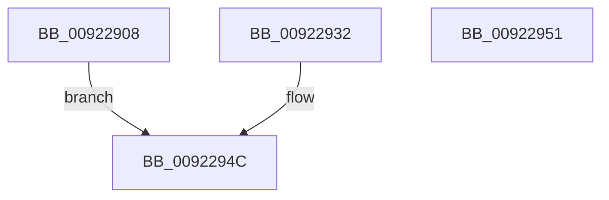

# AlpcpGetDataFromUserVaSafe

- RVA: `0x00922908`–`0x00922952` (길이 `74` bytes)
- VA: `0x0000000140922908`
- 실행 섹션: `PAGE`
- PDB 이름 있음: `예`; PDB Function 태그: `아니요`
- unwind 정보 RVA: `0x0008D198`
- 디코드: `18`개 명령, `74/74` bytes 표시
- 미해석 바이트: `0` (있으면 어셈블리에 `.byte`로 보존)

> 이 문서는 커널 이미지의 기계어와 PDB 기호를 분석해 생성했습니다. 4번과 5번은 함수 원형과 자료형을 바이너리 사용 방식에서 추정한 C 해석이며 원본 소스 복구 결과는 아닙니다.

## 1. Dependencies

- 직접 호출 지점: **2**; 고유 호출 대상: **2**
- 직접 호출자로 확인된 함수: **4**
- RIP 상대 이미지 참조: **0**

### Outgoing calls
- `0x0092292B` → [memcpy](../../text/6C/memcpy_function_006C6840.md) (function, `0x006C6840`)
- `0x00922946` → [memset](../../text/6C/memset_function_006C6C40.md) (function, `0x006C6C40`)

### Direct callers
- [sub_0088EC77](../88/Unknown_function_0088EC77.md) at `0x0088EE24`
- [AlpcpReceiveLegacyMessage](../89/AlpcpReceiveLegacyMessage_function_00895DE0.md) at `0x0089600F`
- [AlpcpReceiveMessage](../89/AlpcpReceiveMessage_function_00897ED0.md) at `0x00898301`
- [AlpcpGetDataFromMessage](AlpcpGetDataFromMessage_function_00922958.md) at `0x009229D6`

### Static image references
- 디코드된 RIP-relative 메모리 참조가 없습니다.

## 2. Other-region calls and transfers

- 다른 실행 섹션으로 향하는 call: **2**
  - `0x0092292B` → [memcpy](../../text/6C/memcpy_function_006C6840.md) (`PAGE` → `.text`)
  - `0x00922946` → [memset](../../text/6C/memset_function_006C6C40.md) (`PAGE` → `.text`)
- 별도 외부 분기/꼬리 이동을 확인하지 못했습니다.

## 3. Assembly (complete function range)

```asm
00922908  48 89 54 24 10                  mov qword ptr [rsp + 0x10], rdx
0092290D  48 89 4C 24 08                  mov qword ptr [rsp + 8], rcx
00922912  48 83 EC 28                     sub rsp, 0x28
00922916  48 8B C2                        mov rax, rdx
00922919  44 0F B7 81 F0 00 00 00         movzx r8d, word ptr [rcx + 0xf0]
00922921  48 8B 91 B0 00 00 00            mov rdx, qword ptr [rcx + 0xb0]
00922928  48 8B C8                        mov rcx, rax
0092292B  E8 10 3F DA FF                  call 0x1406c6840
00922930  EB 1A                           jmp 0x14092294c
00922932  48 8B 44 24 30                  mov rax, qword ptr [rsp + 0x30]
00922937  44 0F B7 80 F0 00 00 00         movzx r8d, word ptr [rax + 0xf0]
0092293F  33 D2                           xor edx, edx
00922941  48 8B 4C 24 38                  mov rcx, qword ptr [rsp + 0x38]
00922946  E8 F5 42 DA FF                  call 0x1406c6c40
0092294B  90                              nop
0092294C  48 83 C4 28                     add rsp, 0x28
00922950  C3                              ret
00922951  CC                              int3
```

## 4. C-style interpretation (structured pseudocode)

```c
__int64 __fastcall AlpcpGetDataFromUserVaSafe(__int64 a1, __int64 a2)
{
    __int64 result;
    __int64 v_rsp;
    unsigned __int64 v_stack_p10;
    unsigned __int64 v_stack_p8;

    v_stack_p10 = a2;
    v_stack_p8 = a1;
    v_rsp = (v_rsp) - (40);
    result = memcpy(a2, *(unsigned __int64 *)(a1 + 176), *(unsigned __int16 *)(a1 + 240), a4);
    goto loc_0092294C;
loc_0092294C:
    v_rsp = (v_rsp) + (40);
    return result;
}
```

## 5. (Beta) C Style

```c
int64_t AlpcpGetDataFromUserVaSafe(void *Arg1, int64_t Arg2)
{
    uint8_t *arg1 = (uint8_t *)Arg1;

    int64_t result;
    int64_t local_rsp;
    uint64_t v_stack_p10;
    uint64_t v_stack_p8;

    v_stack_p10 = Arg2;
    v_stack_p8 = Arg1;
    local_rsp = (local_rsp) - (40);
    result = memcpy(Arg2, *(uint64_t *)(arg1 + 0xB0), *(uint16_t *)(arg1 + 0xF0), a4);
    goto loc_0092294C;
loc_0092294C:
    local_rsp = (local_rsp) + (40);
    return result;
}
```

### 관측된 메모리 오프셋

구조체 형식이 확인되지 않은 접근은 인자 기준의 오프셋으로만 기록했습니다.

| 기준 인자 | 오프셋 표현 | 폭 (bit) | 접근 |
|---|---:|---:|---|
| `Arg1` | `+ 0xB0` | `64` | `R` |
| `Arg1` | `+ 0xF0` | `16` | `R` |

## 6. Execution-region graph

[열기: 2D/3D 그래프와 함수 탐색 컨트롤 패널](../../../control-panel.html?section=page&rva=0x00922908&view=graph)

- 2D 그래프는 위에서 아래로 흐르고, 3D 그래프는 빈 공간을 드래그해 회전합니다. Shift+드래그는 이동, 휠은 확대·축소, 함수 노드 선택은 대상 보고서 이동입니다.

### Static fallback


