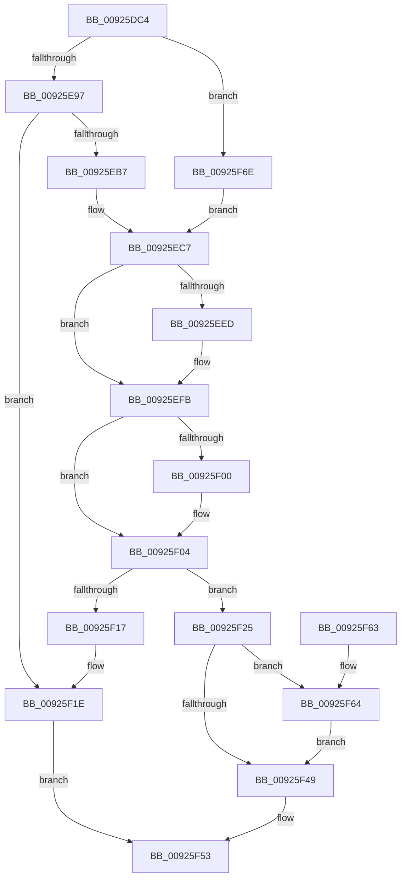

# AlpcpInitializePort

- RVA: `0x00925DC4`–`0x00925F81` (길이 `445` bytes)
- VA: `0x0000000140925DC4`
- 실행 섹션: `PAGE`
- PDB 이름 있음: `예`; PDB Function 태그: `아니요`
- unwind 정보 RVA: `0x0006B600`
- 디코드: `103`개 명령, `445/445` bytes 표시
- 미해석 바이트: `0` (있으면 어셈블리에 `.byte`로 보존)

> 이 문서는 커널 이미지의 기계어와 PDB 기호를 분석해 생성했습니다. 4번과 5번은 함수 원형과 자료형을 바이너리 사용 방식에서 추정한 C 해석이며 원본 소스 복구 결과는 아닙니다.

## 1. Dependencies

- 직접 호출 지점: **6**; 고유 호출 대상: **6**
- 직접 호출자로 확인된 함수: **3**
- RIP 상대 이미지 참조: **7**

### Outgoing calls
- `0x00925EA6` → [ExAllocateFromNPagedLookasideList](../../text/38/ExAllocateFromNPagedLookasideList_function_0038E6C0.md) (function, `0x0038E6C0`)
- `0x00925EC2` → [KeInitializeSemaphore](../../text/46/KeInitializeSemaphore_function_004660D0.md) (function, `0x004660D0`)
- `0x00925EDD` → [KeAbPreAcquire](../../text/21/KeAbPreAcquire_function_00210230.md) (function, `0x00210230`)
- `0x00925EF6` → [ExfAcquirePushLockExclusiveEx](../../text/20/ExfAcquirePushLockExclusiveEx_function_0020FC90.md) (function, `0x0020FC90`)
- `0x00925F4C` → [KeAbPostRelease](../../text/2E/KeAbPostRelease_function_002E1600.md) (function, `0x002E1600`)
- `0x00925F67` → [ExfTryToWakePushLock](../../text/26/ExfTryToWakePushLock_function_00265DD0.md) (function, `0x00265DD0`)

### Direct callers
- [AlpcpCreateClientPort](AlpcpCreateClientPort_function_009270AC.md) at `0x0092729F`
- [AlpcpCreateConnectionPort](../9E/AlpcpCreateConnectionPort_function_009E70B0.md) at `0x009E716F`
- [AlpcpAcceptConnectPort](../A3/AlpcpAcceptConnectPort_function_00A34290.md) at `0x00A34924`

### Static image references
- `0x00925E9F` → RVA `0x00E27100` (`.data`; read)
- `0x00925ECE` → RVA `0x00F10100` (`.data`; read)
- `0x00925F04` → RVA `0x00F100F8` (`.data`; read)
- `0x00925F0B` → RVA `0x00F100F0` (`.data`; read)
- `0x00925F33` → RVA `0x00F100F8` (`.data`; write)
- `0x00925F3A` → RVA `0x00F10100` (`.data`; read/write)
- `0x00925F6E` → RVA `0x00FC7050` (`ALMOSTRO`; read)

## 2. Other-region calls and transfers

- 다른 실행 섹션으로 향하는 call: **6**
  - `0x00925EA6` → [ExAllocateFromNPagedLookasideList](../../text/38/ExAllocateFromNPagedLookasideList_function_0038E6C0.md) (`PAGE` → `.text`)
  - `0x00925EC2` → [KeInitializeSemaphore](../../text/46/KeInitializeSemaphore_function_004660D0.md) (`PAGE` → `.text`)
  - `0x00925EDD` → [KeAbPreAcquire](../../text/21/KeAbPreAcquire_function_00210230.md) (`PAGE` → `.text`)
  - `0x00925EF6` → [ExfAcquirePushLockExclusiveEx](../../text/20/ExfAcquirePushLockExclusiveEx_function_0020FC90.md) (`PAGE` → `.text`)
  - `0x00925F4C` → [KeAbPostRelease](../../text/2E/KeAbPostRelease_function_002E1600.md) (`PAGE` → `.text`)
  - `0x00925F67` → [ExfTryToWakePushLock](../../text/26/ExfTryToWakePushLock_function_00265DD0.md) (`PAGE` → `.text`)
- 별도 외부 분기/꼬리 이동을 확인하지 못했습니다.

## 3. Assembly (complete function range)

```asm
00925DC4  48 89 5C 24 08                  mov qword ptr [rsp + 8], rbx
00925DC9  48 89 74 24 10                  mov qword ptr [rsp + 0x10], rsi
00925DCE  57                              push rdi
00925DCF  48 83 EC 20                     sub rsp, 0x20
00925DD3  48 83 A1 60 01 00 00 00         and qword ptr [rcx + 0x160], 0
00925DDB  48 8D 81 50 01 00 00            lea rax, [rcx + 0x150]
00925DE2  48 83 A1 48 01 00 00 00         and qword ptr [rcx + 0x148], 0
00925DEA  48 8B D9                        mov rbx, rcx
00925DED  48 89 40 08                     mov qword ptr [rax + 8], rax
00925DF1  48 89 00                        mov qword ptr [rax], rax
00925DF4  48 8D 81 90 00 00 00            lea rax, [rcx + 0x90]
00925DFB  48 89 40 08                     mov qword ptr [rax + 8], rax
00925DFF  48 89 00                        mov qword ptr [rax], rax
00925E02  48 8D 81 B8 00 00 00            lea rax, [rcx + 0xb8]
00925E09  48 89 40 08                     mov qword ptr [rax + 8], rax
00925E0D  48 89 00                        mov qword ptr [rax], rax
00925E10  48 8D 81 A0 00 00 00            lea rax, [rcx + 0xa0]
00925E17  48 89 40 08                     mov qword ptr [rax + 8], rax
00925E1B  48 89 00                        mov qword ptr [rax], rax
00925E1E  48 8D 81 80 01 00 00            lea rax, [rcx + 0x180]
00925E25  48 89 40 08                     mov qword ptr [rax + 8], rax
00925E29  48 89 00                        mov qword ptr [rax], rax
00925E2C  48 8D 81 D0 00 00 00            lea rax, [rcx + 0xd0]
00925E33  48 89 40 08                     mov qword ptr [rax + 8], rax
00925E37  48 89 00                        mov qword ptr [rax], rax
00925E3A  48 8D 81 E8 00 00 00            lea rax, [rcx + 0xe8]
00925E41  48 83 A1 88 00 00 00 00         and qword ptr [rcx + 0x88], 0
00925E49  48 83 A1 B0 00 00 00 00         and qword ptr [rcx + 0xb0], 0
00925E51  48 83 A1 C8 00 00 00 00         and qword ptr [rcx + 0xc8], 0
00925E59  48 89 40 08                     mov qword ptr [rax + 8], rax
00925E5D  48 89 00                        mov qword ptr [rax], rax
00925E60  8B 81 A0 01 00 00               mov eax, dword ptr [rcx + 0x1a0]
00925E66  48 83 A1 E0 00 00 00 00         and qword ptr [rcx + 0xe0], 0
00925E6E  8D 0C 12                        lea ecx, [rdx + rdx]
00925E71  33 C8                           xor ecx, eax
00925E73  83 E1 06                        and ecx, 6
00925E76  33 C8                           xor ecx, eax
00925E78  41 0F B6 C0                     movzx eax, r8b
00925E7C  C1 E0 09                        shl eax, 9
00925E7F  33 C1                           xor eax, ecx
00925E81  25 00 02 00 00                  and eax, 0x200
00925E86  33 C1                           xor eax, ecx
00925E88  89 83 A0 01 00 00               mov dword ptr [rbx + 0x1a0], eax
00925E8E  45 84 C0                        test r8b, r8b
00925E91  0F 84 D7 00 00 00               je 0x140925f6e
00925E97  0F BA AB 00 01 00 00 12         bts dword ptr [rbx + 0x100], 0x12
00925E9F  48 8D 0D 5A 12 50 00            lea rcx, [rip + 0x50125a]
00925EA6  E8 15 88 A6 FF                  call 0x14038e6c0
00925EAB  48 89 83 F8 00 00 00            mov qword ptr [rbx + 0xf8], rax
00925EB2  48 85 C0                        test rax, rax
00925EB5  74 67                           je 0x140925f1e
00925EB7  33 D2                           xor edx, edx
00925EB9  41 B8 FF FF FF 7F               mov r8d, 0x7fffffff
00925EBF  48 8B C8                        mov rcx, rax
00925EC2  E8 09 02 B4 FF                  call 0x1404660d0
00925EC7  83 8B A0 01 00 00 01            or dword ptr [rbx + 0x1a0], 1
00925ECE  48 8D 35 2B A2 5E 00            lea rsi, [rip + 0x5ea22b]
00925ED5  48 8B CE                        mov rcx, rsi
00925ED8  45 33 C0                        xor r8d, r8d
00925EDB  33 D2                           xor edx, edx
00925EDD  E8 4E A3 8E FF                  call 0x140210230
00925EE2  F0 48 0F BA 2E 00               lock bts qword ptr [rsi], 0
00925EE8  48 8B F8                        mov rdi, rax
00925EEB  73 0E                           jae 0x140925efb
00925EED  4C 8B C6                        mov r8, rsi
00925EF0  48 8B D0                        mov rdx, rax
00925EF3  48 8B CE                        mov rcx, rsi
00925EF6  E8 95 9D 8E FF                  call 0x14020fc90
00925EFB  48 85 FF                        test rdi, rdi
00925EFE  74 04                           je 0x140925f04
00925F00  C6 47 0A 01                     mov byte ptr [rdi + 0xa], 1
00925F04  48 8B 05 ED A1 5E 00            mov rax, qword ptr [rip + 0x5ea1ed]
00925F0B  48 8D 0D DE A1 5E 00            lea rcx, [rip + 0x5ea1de]
00925F12  48 39 08                        cmp qword ptr [rax], rcx
00925F15  74 0E                           je 0x140925f25
00925F17  B9 03 00 00 00                  mov ecx, 3
00925F1C  CD 29                           int 0x29
00925F1E  B8 9A 00 00 C0                  mov eax, 0xc000009a
00925F23  EB 2E                           jmp 0x140925f53
00925F25  48 89 43 08                     mov qword ptr [rbx + 8], rax
00925F29  48 89 0B                        mov qword ptr [rbx], rcx
00925F2C  48 89 18                        mov qword ptr [rax], rbx
00925F2F  48 83 C8 FF                     or rax, 0xffffffffffffffff
00925F33  48 89 1D BE A1 5E 00            mov qword ptr [rip + 0x5ea1be], rbx
00925F3A  F0 48 0F C1 05 BD A1 5E 00      lock xadd qword ptr [rip + 0x5ea1bd], rax
00925F43  24 06                           and al, 6
00925F45  3C 02                           cmp al, 2
00925F47  74 1B                           je 0x140925f64
00925F49  48 8B CE                        mov rcx, rsi
00925F4C  E8 AF B6 9B FF                  call 0x1402e1600
00925F51  33 C0                           xor eax, eax
00925F53  48 8B 5C 24 30                  mov rbx, qword ptr [rsp + 0x30]
00925F58  48 8B 74 24 38                  mov rsi, qword ptr [rsp + 0x38]
00925F5D  48 83 C4 20                     add rsp, 0x20
00925F61  5F                              pop rdi
00925F62  C3                              ret
00925F63  CC                              int3
00925F64  48 8B CE                        mov rcx, rsi
00925F67  E8 64 FE 93 FF                  call 0x140265dd0
00925F6C  EB DB                           jmp 0x140925f49
00925F6E  48 8B 05 DB 10 6A 00            mov rax, qword ptr [rip + 0x6a10db]
00925F75  48 89 83 F8 00 00 00            mov qword ptr [rbx + 0xf8], rax
00925F7C  E9 46 FF FF FF                  jmp 0x140925ec7
```

## 4. C-style interpretation (structured pseudocode)

```c
__int64 __fastcall AlpcpInitializePort(__int64 a1, __int64 a2, unsigned __int8 a3)
{
    __int64 result;
    __int64 v_rsp;
    unsigned __int64 v_stack_p10;
    unsigned __int64 v_stack_p8;

    v_stack_p8 = v_rbx;
    v_stack_p10 = v_rsi;
    v_rsp = (v_rsp) - (32);
    *(unsigned __int64 *)(a1 + 336 + 8) = a1 + 336;
    *(unsigned __int64 *)(a1 + 336) = a1 + 336;
    *(unsigned __int64 *)(a1 + 144 + 8) = a1 + 144;
    *(unsigned __int64 *)(a1 + 144) = a1 + 144;
    *(unsigned __int64 *)(a1 + 184 + 8) = a1 + 184;
    *(unsigned __int64 *)(a1 + 184) = a1 + 184;
    *(unsigned __int64 *)(a1 + 160 + 8) = a1 + 160;
    *(unsigned __int64 *)(a1 + 160) = a1 + 160;
    *(unsigned __int64 *)(a1 + 384 + 8) = a1 + 384;
    *(unsigned __int64 *)(a1 + 384) = a1 + 384;
    *(unsigned __int64 *)(a1 + 208 + 8) = a1 + 208;
    *(unsigned __int64 *)(a1 + 208) = a1 + 208;
    *(unsigned __int64 *)(a1 + 232 + 8) = a1 + 232;
    *(unsigned __int64 *)(a1 + 232) = a1 + 232;
    a1 = (unsigned int)((a2 + a2 * 1) ^ ((unsigned int)((unsigned int)(*(unsigned int *)(a1 + 416)))));
    a1 = (unsigned int)((a1) & (6));
    a1 = (unsigned int)((a1) ^ ((unsigned int)((unsigned int)(*(unsigned int *)(a1 + 416)))));
    result = (unsigned int)((a3) << (9));
    result = (unsigned int)((result) ^ ((unsigned int)(a1)));
    result = (unsigned int)((result) & (512));
    result = (unsigned int)((result) ^ ((unsigned int)(a1)));
    *(unsigned int *)(a1 + 416) = (unsigned int)(result);
    if (a3 == 0) goto loc_00925F6E;
    result = ExAllocateFromNPagedLookasideList(v_rip + 5247578, a2, a3, a4);
    *(unsigned __int64 *)(a1 + 248) = result;
    if (result == 0) goto loc_00925F1E;
    a2 = 0;
    result = KeInitializeSemaphore(result, a2, (unsigned int)(0x7FFFFFFFULL), a4);
loc_00925EC7:
    a3 = 0;
    a2 = 0;
    result = KeAbPreAcquire(v_rip + 6201899, a2, a3, a4);
    if (!(condition_is_above_or_equal)) {
        a3 = v_rip + 6201899;
        a2 = result;
        a1 = v_rip + 6201899;
        result = ExfAcquirePushLockExclusiveEx(a1, a2, a3, a4);
    }
    if (result != 0) {
        *(unsigned __int8 *)(result + 10) = 1;
    }
    if ((*(unsigned __int64 *)(*(unsigned __int64 *)(v_rip + 6201837))) == (v_rip + 6201822)) goto loc_00925F25;
loc_00925F1E:
    goto loc_00925F53;
loc_00925F25:
    *(unsigned __int64 *)(a1 + 8) = (unsigned int)(0xC000009AULL);
    *(unsigned __int64 *)(a1) = 3;
    *(unsigned __int64 *)((unsigned int)(0xC000009AULL)) = a1;
    result = ((unsigned int)(0xC000009AULL)) | (-1);
    *(unsigned __int64 *)(v_rip + 6201790) = a1;
    result = (unsigned __int8)((result) & (6));
    if (((unsigned __int8)(result)) == 2) goto loc_00925F64;
loc_00925F49:
    result = KeAbPostRelease(v_rip + 6201899, a2, a3, a4);
    result = 0;
loc_00925F53:
    v_rsp = (v_rsp) + (32);
    return result;
loc_00925F64:
    result = ExfTryToWakePushLock(v_stack_p10, a2, a3, a4);
    goto loc_00925F49;
loc_00925F6E:
    *(unsigned __int64 *)(v_stack_p8 + 248) = *(unsigned __int64 *)(v_rip + 6951131);
    goto loc_00925EC7;
}
```

## 5. (Beta) C Style

```c
int64_t AlpcpInitializePort(void *Arg1, void *Arg2, uint8_t Arg3)
{
    uint8_t *arg1 = (uint8_t *)Arg1;
    uint8_t *arg2 = (uint8_t *)Arg2;

    int64_t result;
    int64_t local_rsp;
    uint64_t v_stack_p10;
    uint64_t v_stack_p8;

    v_stack_p8 = local_rbx;
    v_stack_p10 = local_rsi;
    local_rsp = (local_rsp) - (32);
    *(void **)(arg1 + 0x150 + 0x8) = Arg1 + 336;
    *(void **)(arg1 + 0x150) = Arg1 + 336;
    *(void **)(arg1 + 0x90 + 0x8) = Arg1 + 144;
    *(void **)(arg1 + 0x90) = Arg1 + 144;
    *(void **)(arg1 + 0xB8 + 0x8) = Arg1 + 184;
    *(void **)(arg1 + 0xB8) = Arg1 + 184;
    *(void **)(arg1 + 0xA0 + 0x8) = Arg1 + 160;
    *(void **)(arg1 + 0xA0) = Arg1 + 160;
    *(void **)(arg1 + 0x180 + 0x8) = Arg1 + 384;
    *(void **)(arg1 + 0x180) = Arg1 + 384;
    *(void **)(arg1 + 0xD0 + 0x8) = Arg1 + 208;
    *(void **)(arg1 + 0xD0) = Arg1 + 208;
    *(void **)(arg1 + 0xE8 + 0x8) = Arg1 + 232;
    *(void **)(arg1 + 0xE8) = Arg1 + 232;
    Arg1 = (uint32_t)((Arg2 + Arg2 * 1) ^ ((uint32_t)((uint32_t)(*(uint32_t *)(arg1 + 0x1A0)))));
    Arg1 = (uint32_t)((Arg1) & (6));
    Arg1 = (uint32_t)((Arg1) ^ ((uint32_t)((uint32_t)(*(uint32_t *)(arg1 + 0x1A0)))));
    result = (uint32_t)((Arg3) << (9));
    result = (uint32_t)((result) ^ ((uint32_t)(Arg1)));
    result = (uint32_t)((result) & (512));
    result = (uint32_t)((result) ^ ((uint32_t)(Arg1)));
    *(uint32_t *)(arg1 + 0x1A0) = (uint32_t)(result);
    if (Arg3 == 0) goto loc_00925F6E;
    result = ExAllocateFromNPagedLookasideList(v_rip + 5247578, Arg2, Arg3, a4);
    *(uint64_t *)(arg1 + 0xF8) = result;
    if (result == 0) goto loc_00925F1E;
    Arg2 = 0;
    result = KeInitializeSemaphore(result, Arg2, (uint32_t)(0x7FFFFFFFULL), a4);
loc_00925EC7:
    Arg3 = 0;
    Arg2 = 0;
    result = KeAbPreAcquire(v_rip + 6201899, Arg2, Arg3, a4);
    if (!(condition_is_above_or_equal)) {
        Arg3 = v_rip + 6201899;
        Arg2 = result;
        Arg1 = v_rip + 6201899;
        result = ExfAcquirePushLockExclusiveEx(Arg1, Arg2, Arg3, a4);
    }
    if (result != 0) {
        *(uint8_t *)(result + 0xA) = 1;
    }
    if ((*(uint64_t *)(*(uint64_t *)(v_rip + 0x5EA1ED))) == (v_rip + 6201822)) goto loc_00925F25;
loc_00925F1E:
    goto loc_00925F53;
loc_00925F25:
    *(uint64_t *)(arg1 + 0x8) = (uint32_t)(0xC000009AULL);
    *(uint64_t *)(arg1) = 3;
    *(void **)((uint32_t)(0xC000009AULL)) = Arg1;
    result = ((uint32_t)(0xC000009AULL)) | (-1);
    *(void **)(v_rip + 0x5EA1BE) = Arg1;
    result = (uint8_t)((result) & (6));
    if (((uint8_t)(result)) == 2) goto loc_00925F64;
loc_00925F49:
    result = KeAbPostRelease(v_rip + 6201899, Arg2, Arg3, a4);
    result = 0;
loc_00925F53:
    local_rsp = (local_rsp) + (32);
    return result;
loc_00925F64:
    result = ExfTryToWakePushLock(v_stack_p10, Arg2, Arg3, a4);
    goto loc_00925F49;
loc_00925F6E:
    *(uint64_t *)(v_stack_p8 + 0xF8) = *(uint64_t *)(v_rip + 0x6A10DB);
    goto loc_00925EC7;
}
```

### 관측된 메모리 오프셋

구조체 형식이 확인되지 않은 접근은 인자 기준의 오프셋으로만 기록했습니다.

| 기준 인자 | 오프셋 표현 | 폭 (bit) | 접근 |
|---|---:|---:|---|
| `Arg1` | `+ 0x0` | `64` | `W` |
| `Arg1` | `+ 0x8` | `64` | `W` |
| `Arg1` | `+ 0x88` | `64` | `R/W` |
| `Arg1` | `+ 0x90` | `64` | `R` |
| `Arg1` | `+ 0xA0` | `64` | `R` |
| `Arg1` | `+ 0xB0` | `64` | `R/W` |
| `Arg1` | `+ 0xB8` | `64` | `R` |
| `Arg1` | `+ 0xC8` | `64` | `R/W` |
| `Arg1` | `+ 0xD0` | `64` | `R` |
| `Arg1` | `+ 0xE0` | `64` | `R/W` |
| `Arg1` | `+ 0xE8` | `64` | `R` |
| `Arg1` | `+ 0xF8` | `64` | `W` |
| `Arg1` | `+ 0x100` | `32` | `R/W` |
| `Arg1` | `+ 0x148` | `64` | `R/W` |
| `Arg1` | `+ 0x150` | `64` | `R` |
| `Arg1` | `+ 0x160` | `64` | `R/W` |
| `Arg1` | `+ 0x180` | `64` | `R` |
| `Arg1` | `+ 0x1A0` | `32` | `R` |
| `Arg1` | `+ 0x1A0` | `32` | `R/W` |
| `Arg1` | `+ 0x1A0` | `32` | `W` |
| `Arg2` | `+ 0x0 + rdx*1` | `32` | `R` |

## 6. Execution-region graph

[열기: 2D/3D 그래프와 함수 탐색 컨트롤 패널](../../../control-panel.html?section=page&rva=0x00925DC4&view=graph)

- 2D 그래프는 위에서 아래로 흐르고, 3D 그래프는 빈 공간을 드래그해 회전합니다. Shift+드래그는 이동, 휠은 확대·축소, 함수 노드 선택은 대상 보고서 이동입니다.

### Static fallback


