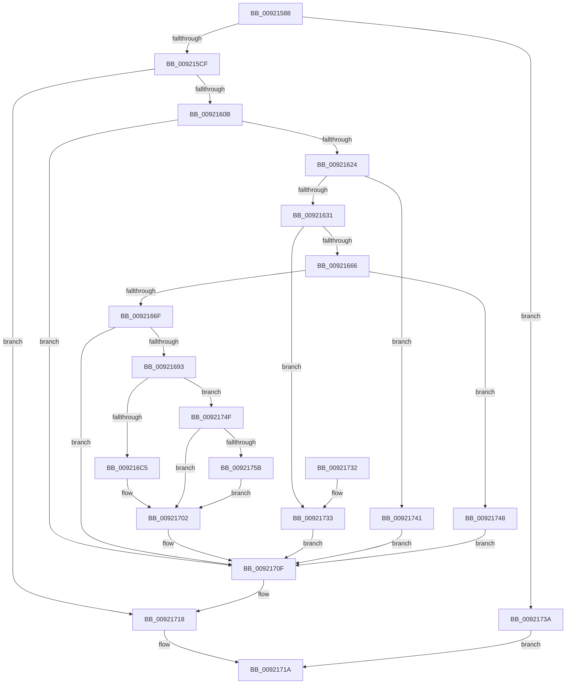

# AlpcpMapLegacyPortView

- RVA: `0x00921588`–`0x0092176A` (길이 `482` bytes)
- VA: `0x0000000140921588`
- 실행 섹션: `PAGE`
- PDB 이름 있음: `예`; PDB Function 태그: `아니요`
- unwind 정보 RVA: `0x0008CFEC`
- 디코드: `134`개 명령, `482/482` bytes 표시
- 미해석 바이트: `0` (있으면 어셈블리에 `.byte`로 보존)

> 이 문서는 커널 이미지의 기계어와 PDB 기호를 분석해 생성했습니다. 4번과 5번은 함수 원형과 자료형을 바이너리 사용 방식에서 추정한 C 해석이며 원본 소스 복구 결과는 아닙니다.

## 1. Dependencies

- 직접 호출 지점: **10**; 고유 호출 대상: **9**
- 직접 호출자로 확인된 함수: **2**
- RIP 상대 이미지 참조: **2**

### Outgoing calls
- `0x009215FC` → [ObReferenceObjectByHandle](../86/ObReferenceObjectByHandle_function_00868DB0.md) (function, `0x00868DB0`)
- `0x00921615` → [MmGetSectionInformation](MmGetSectionInformation_function_00921910.md) (function, `0x00921910`)
- `0x00921688` → [AlpcpCreateSection](../89/AlpcpCreateSection_function_0089307C.md) (function, `0x0089307C`)
- `0x009216B6` → [AlpcpCreateSectionView](../88/AlpcpCreateSectionView_function_0088850C.md) (function, `0x0088850C`)
- `0x009216F1` → [AlpcpLockForCachedReferenceBlob](../88/AlpcpLockForCachedReferenceBlob_function_0088A8B0.md) (function, `0x0088A8B0`)
- `0x009216FD` → [AlpcpUnlockBlob](../88/AlpcpUnlockBlob_function_0088B990.md) (function, `0x0088B990`)
- `0x0092170A` → [AlpcpDereferenceBlobEx](../88/AlpcpDereferenceBlobEx_function_0088AF00.md) (function, `0x0088AF00`)
- `0x00921713` → [ObfDereferenceObject](../../text/2F/ObfDereferenceObject_function_002F9350.md) (function, `0x002F9350`)
- `0x00921752` → [AlpcpDeleteBlob](../88/AlpcpDeleteBlob_function_0088A11C.md) (function, `0x0088A11C`)
- `0x00921763` → [AlpcpDereferenceBlobEx](../88/AlpcpDereferenceBlobEx_function_0088AF00.md) (function, `0x0088AF00`)

### Direct callers
- [AlpcpFormatConnectionRequest](AlpcpFormatConnectionRequest_function_00922A40.md) at `0x00922BD8`
- [AlpcpAcceptConnectPort](../A3/AlpcpAcceptConnectPort_function_00A34290.md) at `0x00A34AD1`

### Static image references
- `0x009215DB` → RVA `0x00FC6BD8` (`ALMOSTRO`; read)
- `0x00921631` → RVA `0x00FC6CE0` (`ALMOSTRO`; read)

## 2. Other-region calls and transfers

- 다른 실행 섹션으로 향하는 call: **1**
  - `0x00921713` → [ObfDereferenceObject](../../text/2F/ObfDereferenceObject_function_002F9350.md) (`PAGE` → `.text`)
- 별도 외부 분기/꼬리 이동을 확인하지 못했습니다.

## 3. Assembly (complete function range)

```asm
00921588  4C 8B DC                        mov r11, rsp
0092158B  49 89 5B 08                     mov qword ptr [r11 + 8], rbx
0092158F  4D 89 43 18                     mov qword ptr [r11 + 0x18], r8
00921593  55                              push rbp
00921594  56                              push rsi
00921595  57                              push rdi
00921596  41 54                           push r12
00921598  41 55                           push r13
0092159A  41 56                           push r14
0092159C  41 57                           push r15
0092159E  48 8B EC                        mov rbp, rsp
009215A1  48 83 EC 50                     sub rsp, 0x50
009215A5  48 8B 72 08                     mov rsi, qword ptr [rdx + 8]
009215A9  33 DB                           xor ebx, ebx
009215AB  33 C0                           xor eax, eax
009215AD  48 89 5D 58                     mov qword ptr [rbp + 0x58], rbx
009215B1  48 89 45 F8                     mov qword ptr [rbp - 8], rax
009215B5  0F 57 C0                        xorps xmm0, xmm0
009215B8  48 89 5D E0                     mov qword ptr [rbp - 0x20], rbx
009215BC  4C 8B F2                        mov r14, rdx
009215BF  4C 8B E9                        mov r13, rcx
009215C2  0F 11 45 E8                     movups xmmword ptr [rbp - 0x18], xmm0
009215C6  48 85 F6                        test rsi, rsi
009215C9  0F 84 6B 01 00 00               je 0x14092173a
009215CF  65 48 8B 04 25 88 01 00 00      mov rax, qword ptr gs:[0x188]
009215D8  8D 53 06                        lea edx, [rbx + 6]
009215DB  4C 8B 05 F6 55 6A 00            mov r8, qword ptr [rip + 0x6a55f6]
009215E2  48 8B CE                        mov rcx, rsi
009215E5  49 89 5B A0                     mov qword ptr [r11 - 0x60], rbx
009215E9  48 89 5D 48                     mov qword ptr [rbp + 0x48], rbx
009215ED  44 8A 88 32 02 00 00            mov r9b, byte ptr [rax + 0x232]
009215F4  48 8D 45 48                     lea rax, [rbp + 0x48]
009215F8  49 89 43 98                     mov qword ptr [r11 - 0x68], rax
009215FC  E8 AF 77 F4 FF                  call 0x140868db0
00921601  8B F8                           mov edi, eax
00921603  85 C0                           test eax, eax
00921605  0F 88 0D 01 00 00               js 0x140921718
0092160B  48 8B 4D 48                     mov rcx, qword ptr [rbp + 0x48]
0092160F  4C 8D 45 E8                     lea r8, [rbp - 0x18]
00921613  33 D2                           xor edx, edx
00921615  E8 F6 02 00 00                  call 0x140921910
0092161A  8B F8                           mov edi, eax
0092161C  85 C0                           test eax, eax
0092161E  0F 88 EB 00 00 00               js 0x14092170f
00921624  F7 45 F0 00 00 80 00            test dword ptr [rbp - 0x10], 0x800000
0092162B  0F 85 10 01 00 00               jne 0x140921741
00921631  8B 0D A9 56 6A 00               mov ecx, dword ptr [rip + 0x6a56a9]
00921637  45 8B 7E 10                     mov r15d, dword ptr [r14 + 0x10]
0092163B  4D 8B 66 18                     mov r12, qword ptr [r14 + 0x18]
0092163F  48 8B 5D F8                     mov rbx, qword ptr [rbp - 8]
00921643  8D 51 FF                        lea edx, [rcx - 1]
00921646  4C 03 FA                        add r15, rdx
00921649  48 8D 41 FF                     lea rax, [rcx - 1]
0092164D  48 F7 D0                        not rax
00921650  4C 03 E2                        add r12, rdx
00921653  4C 23 F8                        and r15, rax
00921656  4C 23 E0                        and r12, rax
00921659  4B 8D 04 3C                     lea rax, [r12 + r15]
0092165D  49 3B C7                        cmp rax, r15
00921660  0F 82 CD 00 00 00               jb 0x140921733
00921666  48 3B C3                        cmp rax, rbx
00921669  0F 87 D9 00 00 00               ja 0x140921748
0092166F  48 8D 45 58                     lea rax, [rbp + 0x58]
00921673  4C 8B CE                        mov r9, rsi
00921676  48 89 44 24 28                  mov qword ptr [rsp + 0x28], rax
0092167B  45 33 C0                        xor r8d, r8d
0092167E  33 D2                           xor edx, edx
00921680  48 89 5C 24 20                  mov qword ptr [rsp + 0x20], rbx
00921685  49 8B CD                        mov rcx, r13
00921688  E8 EF 19 F7 FF                  call 0x14089307c
0092168D  8B F8                           mov edi, eax
0092168F  85 C0                           test eax, eax
00921691  78 7C                           js 0x14092170f
00921693  48 8B 75 58                     mov rsi, qword ptr [rbp + 0x58]
00921697  48 8D 45 E0                     lea rax, [rbp - 0x20]
0092169B  49 2B DF                        sub rbx, r15
0092169E  48 89 44 24 20                  mov qword ptr [rsp + 0x20], rax
009216A3  4D 85 E4                        test r12, r12
009216A6  4D 8B C7                        mov r8, r15
009216A9  49 8B D5                        mov rdx, r13
009216AC  48 8B CE                        mov rcx, rsi
009216AF  49 0F 45 DC                     cmovne rbx, r12
009216B3  4C 8B CB                        mov r9, rbx
009216B6  E8 51 6E F6 FF                  call 0x14088850c
009216BB  8B F8                           mov edi, eax
009216BD  85 C0                           test eax, eax
009216BF  0F 88 8A 00 00 00               js 0x14092174f
009216C5  48 8B 5D E0                     mov rbx, qword ptr [rbp - 0x20]
009216C9  41 C7 06 30 00 00 00            mov dword ptr [r14], 0x30
009216D0  48 8B 43 28                     mov rax, qword ptr [rbx + 0x28]
009216D4  49 89 46 20                     mov qword ptr [r14 + 0x20], rax
009216D8  48 8B 43 30                     mov rax, qword ptr [rbx + 0x30]
009216DC  49 83 66 28 00                  and qword ptr [r14 + 0x28], 0
009216E1  49 89 46 18                     mov qword ptr [r14 + 0x18], rax
009216E5  48 8B 45 50                     mov rax, qword ptr [rbp + 0x50]
009216E9  48 89 58 28                     mov qword ptr [rax + 0x28], rbx
009216ED  48 8B 4B 10                     mov rcx, qword ptr [rbx + 0x10]
009216F1  E8 BA 91 F6 FF                  call 0x14088a8b0
009216F6  FF 43 4C                        inc dword ptr [rbx + 0x4c]
009216F9  48 8B 4B 10                     mov rcx, qword ptr [rbx + 0x10]
009216FD  E8 8E A2 F6 FF                  call 0x14088b990
00921702  BA 01 00 00 00                  mov edx, 1
00921707  48 8B CE                        mov rcx, rsi
0092170A  E8 F1 97 F6 FF                  call 0x14088af00
0092170F  48 8B 4D 48                     mov rcx, qword ptr [rbp + 0x48]
00921713  E8 38 7C 9D FF                  call 0x1402f9350
00921718  8B C7                           mov eax, edi
0092171A  48 8B 9C 24 90 00 00 00         mov rbx, qword ptr [rsp + 0x90]
00921722  48 83 C4 50                     add rsp, 0x50
00921726  41 5F                           pop r15
00921728  41 5E                           pop r14
0092172A  41 5D                           pop r13
0092172C  41 5C                           pop r12
0092172E  5F                              pop rdi
0092172F  5E                              pop rsi
00921730  5D                              pop rbp
00921731  C3                              ret
00921732  CC                              int3
00921733  BF 0D 00 00 C0                  mov edi, 0xc000000d
00921738  EB D5                           jmp 0x14092170f
0092173A  B8 08 00 00 C0                  mov eax, 0xc0000008
0092173F  EB D9                           jmp 0x14092171a
00921741  BF BB 00 00 C0                  mov edi, 0xc00000bb
00921746  EB C7                           jmp 0x14092170f
00921748  BF 9A 00 00 C0                  mov edi, 0xc000009a
0092174D  EB C0                           jmp 0x14092170f
0092174F  48 8B CE                        mov rcx, rsi
00921752  E8 C5 89 F6 FF                  call 0x14088a11c
00921757  84 C0                           test al, al
00921759  74 A7                           je 0x140921702
0092175B  BA 01 00 00 00                  mov edx, 1
00921760  48 8B CE                        mov rcx, rsi
00921763  E8 98 97 F6 FF                  call 0x14088af00
00921768  EB 98                           jmp 0x140921702
```

## 4. C-style interpretation (structured pseudocode)

```c
__int64 __fastcall AlpcpMapLegacyPortView(__int64 a1, __int64 a2, __int64 a3)
{
    __int64 result;
    __int64 v_r12;
    __int64 v_r15;
    __int64 v_rbx;
    __int64 v_rsp;
    unsigned __int64 v_stack_m40;
    unsigned int v_stack_m48;
    unsigned __int64 v_stack_m50;
    unsigned __int64 v_stack_m58;
    unsigned __int64 v_stack_m60;
    unsigned __int64 v_stack_m68;
    unsigned __int64 v_stack_p10;
    unsigned __int64 v_stack_p18;
    unsigned __int64 v_stack_p20;
    unsigned __int64 v_stack_p8;

    *(unsigned __int64 *)(v_rsp + 8) = v_rbx;
    *(unsigned __int64 *)(v_rsp + 24) = a3;
    v_rsp = (v_rsp) - (80);
    v_rbx = 0;
    result = 0;
    v_stack_p20 = 0;
    v_stack_m40 = 0;
    v_stack_m58 = 0;
    v_stack_m50 = v_xmm0;
    if (*(unsigned __int64 *)(a2 + 8) == 0) goto loc_0092173A;
    *(unsigned __int64 *)(v_rsp - 96) = 0;
    v_stack_p10 = 0;
    *(unsigned __int64 *)(v_rsp - 104) = v_stack_p10;
    result = ObReferenceObjectByHandle(*(unsigned __int64 *)(a2 + 8), v_rbx + 6, *(unsigned __int64 *)(v_rip + 6968822), *(unsigned __int8 *)(*(unsigned __int64 *)(gs_base + (0 + 392)) + 562));
    if (sign_flag) goto loc_00921718;
    a2 = 0;
    result = MmGetSectionInformation(v_stack_p10, a2, v_stack_m50, *(unsigned __int8 *)(*(unsigned __int64 *)(gs_base + (0 + 392)) + 562));
    if (sign_flag) goto loc_0092170F;
    if (((v_stack_m48) & (0x800000ULL)) != 0) goto loc_00921741;
    v_r15 = ((unsigned int)(*(unsigned int *)(a2 + 16))) + ((unsigned int)(*(unsigned int *)(v_rip + 6969001)) - 1);
    result = ~((unsigned int)(*(unsigned int *)(v_rip + 6969001)) - 1);
    v_r12 = (*(unsigned __int64 *)(a2 + 24)) + ((unsigned int)(*(unsigned int *)(v_rip + 6969001)) - 1);
    v_r15 = (v_r15) & (result);
    v_r12 = (v_r12) & (result);
    if ((v_r12 + v_r15 * 1) < v_r15) goto loc_00921733;
    if ((v_r12 + v_r15 * 1) > v_stack_m40) goto loc_00921748;
    v_stack_m60 = v_stack_p20;
    a3 = 0;
    a2 = 0;
    v_stack_m68 = v_stack_m40;
    result = AlpcpCreateSection(a1, a2, a3, *(unsigned __int64 *)(a2 + 8));
    if (sign_flag) goto loc_0092170F;
    v_rbx = (v_stack_m40) - (v_r15);
    v_stack_m68 = v_stack_m58;
    if (v_r12 != 0) { v_rbx = v_r12; }
    result = AlpcpCreateSectionView(v_stack_p20, a1, v_r15, v_rbx);
    if (sign_flag) goto loc_0092174F;
    *(unsigned int *)(a2) = 48;
    *(unsigned __int64 *)(a2 + 32) = *(unsigned __int64 *)(v_stack_m58 + 40);
    *(unsigned __int64 *)(a2 + 24) = *(unsigned __int64 *)(v_stack_m58 + 48);
    *(unsigned __int64 *)(v_stack_p18 + 40) = v_stack_m58;
    result = AlpcpLockForCachedReferenceBlob(*(unsigned __int64 *)(v_stack_m58 + 16), a1, v_r15, v_rbx);
    result = AlpcpUnlockBlob(*(unsigned __int64 *)(v_stack_m58 + 16), a1, v_r15, v_rbx);
loc_00921702:
    result = AlpcpDereferenceBlobEx(v_stack_p20, 1, v_r15, v_rbx);
loc_0092170F:
    result = ObfDereferenceObject(v_stack_p10, 1, v_r15, v_rbx);
loc_00921718:
loc_0092171A:
    v_rsp = (v_rsp) + (80);
    return (unsigned int)((unsigned int)((unsigned int)((unsigned int)(result))));
loc_00921733:
    goto loc_0092170F;
loc_0092173A:
    goto loc_0092171A;
loc_00921741:
    goto loc_0092170F;
loc_00921748:
    goto loc_0092170F;
loc_0092174F:
    result = AlpcpDeleteBlob(v_stack_p20, 1, v_r15, v_rbx);
    if ((unsigned __int8)(result) == 0) goto loc_00921702;
    result = AlpcpDereferenceBlobEx(v_stack_p20, 1, v_r15, v_rbx);
    goto loc_00921702;
}
```

## 5. (Beta) C Style

```c
int64_t AlpcpMapLegacyPortView(int64_t Arg1, void *Arg2, int64_t Arg3)
{
    uint8_t *arg2 = (uint8_t *)Arg2;

    int64_t result;
    int64_t local_r12;
    int64_t local_r15;
    int64_t local_rbx;
    int64_t local_rsp;
    uint64_t v_stack_m40;
    uint32_t v_stack_m48;
    uint64_t v_stack_m50;
    uint64_t v_stack_m58;
    uint64_t v_stack_m60;
    uint64_t v_stack_m68;
    uint64_t v_stack_p10;
    uint64_t v_stack_p18;
    uint64_t v_stack_p20;
    uint64_t v_stack_p8;

    *(uint64_t *)(local_rsp + 0x8) = local_rbx;
    *(uint64_t *)(local_rsp + 0x18) = Arg3;
    local_rsp = (local_rsp) - (80);
    local_rbx = 0;
    result = 0;
    v_stack_p20 = 0;
    v_stack_m40 = 0;
    v_stack_m58 = 0;
    v_stack_m50 = v_xmm0;
    if (*(uint64_t *)(arg2 + 0x8) == 0) goto loc_0092173A;
    *(uint64_t *)(local_rsp - 0x60) = 0;
    v_stack_p10 = 0;
    *(uint64_t *)(local_rsp - 0x68) = v_stack_p10;
    result = ObReferenceObjectByHandle(*(uint64_t *)(arg2 + 0x8), local_rbx + 6, *(uint64_t *)(v_rip + 0x6A55F6), *(uint8_t *)(*(uint64_t *)(gs_base + (0 + 0x188)) + 0x232));
    if (sign_flag) goto loc_00921718;
    Arg2 = 0;
    result = MmGetSectionInformation(v_stack_p10, Arg2, v_stack_m50, *(uint8_t *)(*(uint64_t *)(gs_base + (0 + 0x188)) + 0x232));
    if (sign_flag) goto loc_0092170F;
    if (((v_stack_m48) & (0x800000ULL)) != 0) goto loc_00921741;
    local_r15 = ((uint32_t)(*(uint32_t *)(arg2 + 0x10))) + ((uint32_t)(*(uint32_t *)(v_rip + 0x6A56A9)) - 1);
    result = ~((uint32_t)(*(uint32_t *)(v_rip + 0x6A56A9)) - 1);
    local_r12 = (*(uint64_t *)(arg2 + 0x18)) + ((uint32_t)(*(uint32_t *)(v_rip + 0x6A56A9)) - 1);
    local_r15 = (local_r15) & (result);
    local_r12 = (local_r12) & (result);
    if ((local_r12 + local_r15 * 1) < local_r15) goto loc_00921733;
    if ((local_r12 + local_r15 * 1) > v_stack_m40) goto loc_00921748;
    v_stack_m60 = v_stack_p20;
    Arg3 = 0;
    Arg2 = 0;
    v_stack_m68 = v_stack_m40;
    result = AlpcpCreateSection(Arg1, Arg2, Arg3, *(uint64_t *)(arg2 + 0x8));
    if (sign_flag) goto loc_0092170F;
    local_rbx = (v_stack_m40) - (local_r15);
    v_stack_m68 = v_stack_m58;
    if (local_r12 != 0) { local_rbx = local_r12; }
    result = AlpcpCreateSectionView(v_stack_p20, Arg1, local_r15, local_rbx);
    if (sign_flag) goto loc_0092174F;
    *(uint32_t *)(arg2) = 48;
    *(uint64_t *)(arg2 + 0x20) = *(uint64_t *)(v_stack_m58 + 0x28);
    *(uint64_t *)(arg2 + 0x18) = *(uint64_t *)(v_stack_m58 + 0x30);
    *(uint64_t *)(v_stack_p18 + 0x28) = v_stack_m58;
    result = AlpcpLockForCachedReferenceBlob(*(uint64_t *)(v_stack_m58 + 0x10), Arg1, local_r15, local_rbx);
    result = AlpcpUnlockBlob(*(uint64_t *)(v_stack_m58 + 0x10), Arg1, local_r15, local_rbx);
loc_00921702:
    result = AlpcpDereferenceBlobEx(v_stack_p20, 1, local_r15, local_rbx);
loc_0092170F:
    result = ObfDereferenceObject(v_stack_p10, 1, local_r15, local_rbx);
loc_00921718:
loc_0092171A:
    local_rsp = (local_rsp) + (80);
    return (uint32_t)((uint32_t)((uint32_t)((uint32_t)(result))));
loc_00921733:
    goto loc_0092170F;
loc_0092173A:
    goto loc_0092171A;
loc_00921741:
    goto loc_0092170F;
loc_00921748:
    goto loc_0092170F;
loc_0092174F:
    result = AlpcpDeleteBlob(v_stack_p20, 1, local_r15, local_rbx);
    if ((uint8_t)(result) == 0) goto loc_00921702;
    result = AlpcpDereferenceBlobEx(v_stack_p20, 1, local_r15, local_rbx);
    goto loc_00921702;
}
```

### 관측된 메모리 오프셋

구조체 형식이 확인되지 않은 접근은 인자 기준의 오프셋으로만 기록했습니다.

| 기준 인자 | 오프셋 표현 | 폭 (bit) | 접근 |
|---|---:|---:|---|
| `Arg2` | `+ 0x0` | `32` | `W` |
| `Arg2` | `+ 0x8` | `64` | `R` |
| `Arg2` | `+ 0x10` | `32` | `R` |
| `Arg2` | `+ 0x18` | `64` | `R` |
| `Arg2` | `+ 0x18` | `64` | `W` |
| `Arg2` | `+ 0x20` | `64` | `W` |
| `Arg2` | `+ 0x28` | `64` | `R/W` |

## 6. Execution-region graph

[열기: 2D/3D 그래프와 함수 탐색 컨트롤 패널](../../../control-panel.html?section=page&rva=0x00921588&view=graph)

- 2D 그래프는 위에서 아래로 흐르고, 3D 그래프는 빈 공간을 드래그해 회전합니다. Shift+드래그는 이동, 휠은 확대·축소, 함수 노드 선택은 대상 보고서 이동입니다.

### Static fallback


