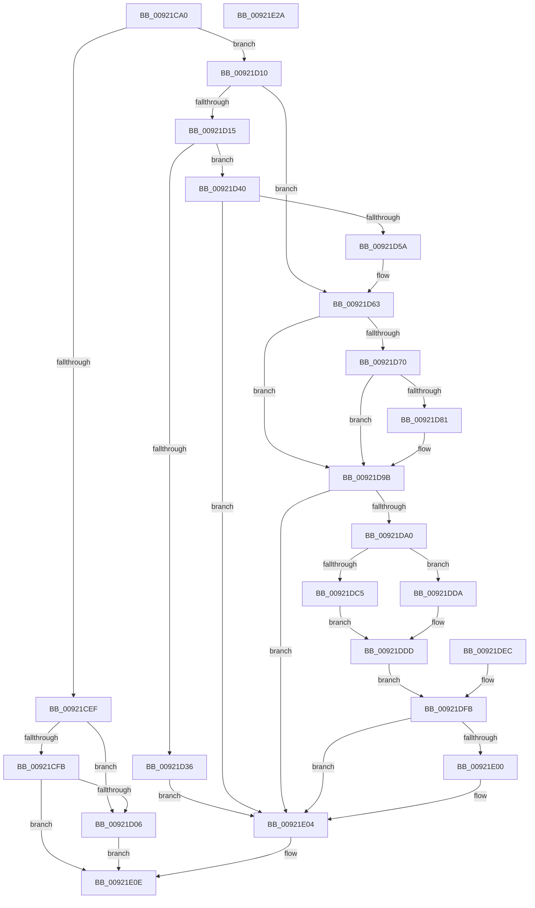

# AlpcpReceiveLegacyConnectionReply

- RVA: `0x00921CA0`–`0x00921E2B` (길이 `395` bytes)
- VA: `0x0000000140921CA0`
- 실행 섹션: `PAGE`
- PDB 이름 있음: `예`; PDB Function 태그: `아니요`
- unwind 정보 RVA: `0x0008D07C`
- 디코드: `104`개 명령, `395/395` bytes 표시
- 미해석 바이트: `0` (있으면 어셈블리에 `.byte`로 보존)

> 이 문서는 커널 이미지의 기계어와 PDB 기호를 분석해 생성했습니다. 4번과 5번은 함수 원형과 자료형을 바이너리 사용 방식에서 추정한 C 해석이며 원본 소스 복구 결과는 아닙니다.

## 1. Dependencies

- 직접 호출 지점: **4**; 고유 호출 대상: **4**
- 직접 호출자로 확인된 함수: **1**
- RIP 상대 이미지 참조: **0**

### Outgoing calls
- `0x00921CE4` → [AlpcpReceiveSynchronousReply](AlpcpReceiveSynchronousReply_function_009224F0.md) (function, `0x009224F0`)
- `0x00921D4B` → [AlpcpQueryRemoteView](../A4/AlpcpQueryRemoteView_function_00A49744.md) (function, `0x00A49744`)
- `0x00921DE5` → [AlpcpGetDataFromMessage](AlpcpGetDataFromMessage_function_00922958.md) (function, `0x00922958`)
- `0x00921E09` → [AlpcpUnlockMessage](../89/AlpcpUnlockMessage_function_00897AE0.md) (function, `0x00897AE0`)

### Direct callers
- [NtSecureConnectPort](NtSecureConnectPort_function_00922F20.md) at `0x0092334C`

### Static image references
- 디코드된 RIP-relative 메모리 참조가 없습니다.

## 2. Other-region calls and transfers

- 다른 실행 섹션으로 향하는 call: **0**
- 별도 외부 분기/꼬리 이동을 확인하지 못했습니다.

## 3. Assembly (complete function range)

```asm
00921CA0  4C 8B DC                        mov r11, rsp
00921CA3  49 89 5B 10                     mov qword ptr [r11 + 0x10], rbx
00921CA7  49 89 73 18                     mov qword ptr [r11 + 0x18], rsi
00921CAB  57                              push rdi
00921CAC  41 54                           push r12
00921CAE  41 55                           push r13
00921CB0  41 56                           push r14
00921CB2  41 57                           push r15
00921CB4  48 83 EC 60                     sub rsp, 0x60
00921CB8  4D 8B E1                        mov r12, r9
00921CBB  4D 8B F8                        mov r15, r8
00921CBE  4C 8B EA                        mov r13, rdx
00921CC1  65 48 8B 04 25 88 01 00 00      mov rax, qword ptr gs:[0x188]
00921CCA  8A 90 32 02 00 00               mov dl, byte ptr [rax + 0x232]
00921CD0  33 FF                           xor edi, edi
00921CD2  49 89 7B A8                     mov qword ptr [r11 - 0x58], rdi
00921CD6  4C 8B 31                        mov r14, qword ptr [rcx]
00921CD9  49 89 7B 98                     mov qword ptr [r11 - 0x68], rdi
00921CDD  45 33 C9                        xor r9d, r9d
00921CE0  4D 8D 43 A8                     lea r8, [r11 - 0x58]
00921CE4  E8 07 08 00 00                  call 0x1409224f0
00921CE9  8B D8                           mov ebx, eax
00921CEB  85 C0                           test eax, eax
00921CED  74 21                           je 0x140921d10
00921CEF  41 8B 8E A0 01 00 00            mov ecx, dword ptr [r14 + 0x1a0]
00921CF6  F6 C1 10                        test cl, 0x10
00921CF9  75 0B                           jne 0x140921d06
00921CFB  3D 01 07 00 C0                  cmp eax, 0xc0000701
00921D00  0F 85 08 01 00 00               jne 0x140921e0e
00921D06  BB 41 00 00 C0                  mov ebx, 0xc0000041
00921D0B  E9 FE 00 00 00                  jmp 0x140921e0e
00921D10  4D 85 E4                        test r12, r12
00921D13  74 4E                           je 0x140921d63
00921D15  48 8B B4 24 B0 00 00 00         mov rsi, qword ptr [rsp + 0xb0]
00921D1D  48 89 7E 28                     mov qword ptr [rsi + 0x28], rdi
00921D21  33 C0                           xor eax, eax
00921D23  48 89 44 24 50                  mov qword ptr [rsp + 0x50], rax
00921D28  48 8B 44 24 30                  mov rax, qword ptr [rsp + 0x30]
00921D2D  F7 40 28 00 40 00 00            test dword ptr [rax + 0x28], 0x4000
00921D34  75 0A                           jne 0x140921d40
00921D36  BB 22 00 00 C0                  mov ebx, 0xc0000022
00921D3B  E9 C4 00 00 00                  jmp 0x140921e04
00921D40  4C 8D 44 24 40                  lea r8, [rsp + 0x40]
00921D45  49 8B D4                        mov rdx, r12
00921D48  49 8B CE                        mov rcx, r14
00921D4B  E8 F4 79 12 00                  call 0x140a49744
00921D50  8B D8                           mov ebx, eax
00921D52  85 C0                           test eax, eax
00921D54  0F 88 AA 00 00 00               js 0x140921e04
00921D5A  48 8B 44 24 50                  mov rax, qword ptr [rsp + 0x50]
00921D5F  48 89 46 28                     mov qword ptr [rsi + 0x28], rax
00921D63  48 8B 94 24 B8 00 00 00         mov rdx, qword ptr [rsp + 0xb8]
00921D6B  48 85 D2                        test rdx, rdx
00921D6E  74 2B                           je 0x140921d9b
00921D70  48 8B 44 24 30                  mov rax, qword ptr [rsp + 0x30]
00921D75  48 8B 88 90 00 00 00            mov rcx, qword ptr [rax + 0x90]
00921D7C  48 85 C9                        test rcx, rcx
00921D7F  74 1A                           je 0x140921d9b
00921D81  C7 02 18 00 00 00               mov dword ptr [rdx], 0x18
00921D87  48 8B 41 28                     mov rax, qword ptr [rcx + 0x28]
00921D8B  48 89 42 10                     mov qword ptr [rdx + 0x10], rax
00921D8F  48 8B 41 10                     mov rax, qword ptr [rcx + 0x10]
00921D93  48 8B 48 28                     mov rcx, qword ptr [rax + 0x28]
00921D97  48 89 4A 08                     mov qword ptr [rdx + 8], rcx
00921D9B  4D 85 ED                        test r13, r13
00921D9E  74 64                           je 0x140921e04
00921DA0  0F B7 F7                        movzx esi, di
00921DA3  66 89 BC 24 90 00 00 00         mov word ptr [rsp + 0x90], di
00921DAB  4C 8B 74 24 30                  mov r14, qword ptr [rsp + 0x30]
00921DB0  49 81 C6 F0 00 00 00            add r14, 0xf0
00921DB7  4C 89 74 24 38                  mov qword ptr [rsp + 0x38], r14
00921DBC  41 0F B7 06                     movzx eax, word ptr [r14]
00921DC0  41 39 07                        cmp dword ptr [r15], eax
00921DC3  73 15                           jae 0x140921dda
00921DC5  0F B7 F0                        movzx esi, ax
00921DC8  66 89 84 24 90 00 00 00         mov word ptr [rsp + 0x90], ax
00921DD0  41 0F B7 07                     movzx eax, word ptr [r15]
00921DD4  66 41 89 06                     mov word ptr [r14], ax
00921DD8  EB 03                           jmp 0x140921ddd
00921DDA  41 89 07                        mov dword ptr [r15], eax
00921DDD  49 8B D5                        mov rdx, r13
00921DE0  48 8B 4C 24 30                  mov rcx, qword ptr [rsp + 0x30]
00921DE5  E8 6E 0B 00 00                  call 0x140922958
00921DEA  EB 0F                           jmp 0x140921dfb
00921DEC  8B D8                           mov ebx, eax
00921DEE  0F B7 B4 24 90 00 00 00         movzx esi, word ptr [rsp + 0x90]
00921DF6  4C 8B 74 24 38                  mov r14, qword ptr [rsp + 0x38]
00921DFB  66 85 F6                        test si, si
00921DFE  74 04                           je 0x140921e04
00921E00  66 41 89 36                     mov word ptr [r14], si
00921E04  48 8B 4C 24 30                  mov rcx, qword ptr [rsp + 0x30]
00921E09  E8 D2 5C F7 FF                  call 0x140897ae0
00921E0E  8B C3                           mov eax, ebx
00921E10  4C 8D 5C 24 60                  lea r11, [rsp + 0x60]
00921E15  49 8B 5B 38                     mov rbx, qword ptr [r11 + 0x38]
00921E19  49 8B 73 40                     mov rsi, qword ptr [r11 + 0x40]
00921E1D  49 8B E3                        mov rsp, r11
00921E20  41 5F                           pop r15
00921E22  41 5E                           pop r14
00921E24  41 5D                           pop r13
00921E26  41 5C                           pop r12
00921E28  5F                              pop rdi
00921E29  C3                              ret
00921E2A  CC                              int3
```

## 4. C-style interpretation (structured pseudocode)

```c
__int64 __fastcall AlpcpReceiveLegacyConnectionReply(__int64 a1, __int64 a2, __int64 a3, __int64 a4, __int64 a5, __int64 a6)
{
    __int64 result;
    __int64 v_r14;
    __int64 v_rdi;
    __int64 v_rsp;
    unsigned __int64 v_stack_m28;
    unsigned __int64 v_stack_m38;
    unsigned __int64 v_stack_m48;
    unsigned __int64 v_stack_m50;
    unsigned __int64 v_stack_m58;
    unsigned __int16 v_stack_p8;

    *(unsigned __int64 *)(v_rsp + 16) = v_rbx;
    *(unsigned __int64 *)(v_rsp + 24) = v_rsi;
    v_rsp = (v_rsp) - (96);
    v_rdi = 0;
    *(unsigned __int64 *)(v_rsp - 88) = 0;
    *(unsigned __int64 *)(v_rsp - 104) = 0;
    a4 = 0;
    result = AlpcpReceiveSynchronousReply(a1, *(unsigned __int8 *)(*(unsigned __int64 *)(gs_base + (0 + 392)) + 562), v_rsp - 88, a4);
    if ((unsigned int)(result) == 0) goto loc_00921D10;
    if ((((unsigned __int8)((unsigned int)(*(unsigned int *)(*(unsigned __int64 *)(a1) + 416)))) & (16)) != 0) goto loc_00921D06;
    if (((unsigned int)(result)) != 0xC0000701ULL) goto loc_00921E0E;
loc_00921D06:
    goto loc_00921E0E;
loc_00921D10:
    if (0 == 0) goto loc_00921D63;
    *(unsigned __int64 *)(a5 + 40) = 0;
    result = 0;
    v_stack_m38 = 0;
    if (((*(unsigned int *)(v_stack_m58 + 40)) & (0x4000ULL)) != 0) goto loc_00921D40;
    goto loc_00921E04;
loc_00921D40:
    result = AlpcpQueryRemoteView(*(unsigned __int64 *)(a1), 0, v_stack_m48, a4);
    if (sign_flag) goto loc_00921E04;
    *(unsigned __int64 *)(a5 + 40) = v_stack_m38;
loc_00921D63:
    if (a6 == 0) goto loc_00921D9B;
    result = v_stack_m58;
    if (*(unsigned __int64 *)(v_stack_m58 + 144) != 0) {
        *(unsigned int *)(a6) = 24;
        result = *(unsigned __int64 *)(*(unsigned __int64 *)(v_stack_m58 + 144) + 40);
        *(unsigned __int64 *)(a6 + 16) = result;
        result = *(unsigned __int64 *)(*(unsigned __int64 *)(v_stack_m58 + 144) + 16);
        a1 = *(unsigned __int64 *)(result + 40);
        *(unsigned __int64 *)(a6 + 8) = a1;
    }
    if (a2 == 0) goto loc_00921E04;
    v_stack_p8 = 0;
    v_r14 = (v_stack_m58) + (240);
    v_stack_m50 = v_r14;
    if ((*(unsigned int *)(a3)) >= ((unsigned int)(*(unsigned __int16 *)(v_r14)))) goto loc_00921DDA;
    v_stack_p8 = (unsigned __int16)(*(unsigned __int16 *)(v_r14));
    *(unsigned __int16 *)(v_r14) = (unsigned __int16)(*(unsigned __int16 *)(a3));
    goto loc_00921DDD;
loc_00921DDA:
    *(unsigned int *)(a3) = (unsigned int)(*(unsigned __int16 *)(a3));
loc_00921DDD:
    result = AlpcpGetDataFromMessage(v_stack_m58, a2, v_stack_m48, a4);
    goto loc_00921DFB;
loc_00921DFB:
    if ((unsigned __int16)((unsigned __int16)(*(unsigned __int16 *)(v_r14))) != 0) {
        *(unsigned __int16 *)(v_r14) = (unsigned __int16)((unsigned __int16)(*(unsigned __int16 *)(v_r14)));
    }
    result = AlpcpUnlockMessage(v_stack_m58, a2, v_stack_m48, a4);
loc_00921E0E:
    return (unsigned int)((unsigned int)((unsigned int)((unsigned int)(result))));
}
```

## 5. (Beta) C Style

```c
int64_t AlpcpReceiveLegacyConnectionReply(void *Arg1, int64_t Arg2, void *Arg3, int64_t Arg4, void *Arg5, int64_t Arg6)
{
    uint8_t *arg1 = (uint8_t *)Arg1;
    uint8_t *arg3 = (uint8_t *)Arg3;
    uint8_t *arg5 = (uint8_t *)Arg5;

    int64_t result;
    int64_t local_r14;
    int64_t local_rdi;
    int64_t local_rsp;
    uint64_t v_stack_m28;
    uint64_t v_stack_m38;
    uint64_t v_stack_m48;
    uint64_t v_stack_m50;
    uint64_t v_stack_m58;
    uint16_t v_stack_p8;

    *(uint64_t *)(local_rsp + 0x10) = local_rbx;
    *(uint64_t *)(local_rsp + 0x18) = local_rsi;
    local_rsp = (local_rsp) - (96);
    local_rdi = 0;
    *(uint64_t *)(local_rsp - 0x58) = 0;
    *(uint64_t *)(local_rsp - 0x68) = 0;
    Arg4 = 0;
    result = AlpcpReceiveSynchronousReply(Arg1, *(uint8_t *)(*(uint64_t *)(gs_base + (0 + 0x188)) + 0x232), local_rsp - 88, Arg4);
    if ((uint32_t)(result) == 0) goto loc_00921D10;
    if ((((uint8_t)((uint32_t)(*(uint32_t *)(*(uint64_t *)(arg1) + 0x1A0)))) & (16)) != 0) goto loc_00921D06;
    if (((uint32_t)(result)) != 0xC0000701ULL) goto loc_00921E0E;
loc_00921D06:
    goto loc_00921E0E;
loc_00921D10:
    if (0 == 0) goto loc_00921D63;
    *(uint64_t *)(arg5 + 0x28) = 0;
    result = 0;
    v_stack_m38 = 0;
    if (((*(uint32_t *)(v_stack_m58 + 0x28)) & (0x4000ULL)) != 0) goto loc_00921D40;
    goto loc_00921E04;
loc_00921D40:
    result = AlpcpQueryRemoteView(*(uint64_t *)(arg1), 0, v_stack_m48, Arg4);
    if (sign_flag) goto loc_00921E04;
    *(uint64_t *)(arg5 + 0x28) = v_stack_m38;
loc_00921D63:
    if (Arg6 == 0) goto loc_00921D9B;
    result = v_stack_m58;
    if (*(uint64_t *)(v_stack_m58 + 0x90) != 0) {
        *(uint32_t *)(Arg6) = 24;
        result = *(uint64_t *)(*(uint64_t *)(v_stack_m58 + 0x90) + 0x28);
        *(uint64_t *)(Arg6 + 0x10) = result;
        result = *(uint64_t *)(*(uint64_t *)(v_stack_m58 + 0x90) + 0x10);
        Arg1 = *(uint64_t *)(result + 0x28);
        *(void **)(Arg6 + 0x8) = Arg1;
    }
    if (Arg2 == 0) goto loc_00921E04;
    v_stack_p8 = 0;
    local_r14 = (v_stack_m58) + (240);
    v_stack_m50 = local_r14;
    if ((*(uint32_t *)(arg3)) >= ((uint32_t)(*(uint16_t *)(local_r14)))) goto loc_00921DDA;
    v_stack_p8 = (uint16_t)(*(uint16_t *)(local_r14));
    *(uint16_t *)(local_r14) = (uint16_t)(*(uint16_t *)(arg3));
    goto loc_00921DDD;
loc_00921DDA:
    *(uint32_t *)(arg3) = (uint32_t)(*(uint16_t *)(arg3));
loc_00921DDD:
    result = AlpcpGetDataFromMessage(v_stack_m58, Arg2, v_stack_m48, Arg4);
    goto loc_00921DFB;
loc_00921DFB:
    if ((uint16_t)((uint16_t)(*(uint16_t *)(local_r14))) != 0) {
        *(uint16_t *)(local_r14) = (uint16_t)((uint16_t)(*(uint16_t *)(local_r14)));
    }
    result = AlpcpUnlockMessage(v_stack_m58, Arg2, v_stack_m48, Arg4);
loc_00921E0E:
    return (uint32_t)((uint32_t)((uint32_t)((uint32_t)(result))));
}
```

### 관측된 메모리 오프셋

구조체 형식이 확인되지 않은 접근은 인자 기준의 오프셋으로만 기록했습니다.

| 기준 인자 | 오프셋 표현 | 폭 (bit) | 접근 |
|---|---:|---:|---|
| `Arg1` | `+ 0x0` | `64` | `R` |
| `Arg3` | `+ 0x0` | `16` | `R` |
| `Arg3` | `+ 0x0` | `32` | `R` |
| `Arg3` | `+ 0x0` | `32` | `W` |
| `Arg5` | `+ 0x28` | `64` | `W` |

## 6. Execution-region graph

[열기: 2D/3D 그래프와 함수 탐색 컨트롤 패널](../../../control-panel.html?section=page&rva=0x00921CA0&view=graph)

- 2D 그래프는 위에서 아래로 흐르고, 3D 그래프는 빈 공간을 드래그해 회전합니다. Shift+드래그는 이동, 휠은 확대·축소, 함수 노드 선택은 대상 보고서 이동입니다.

### Static fallback


