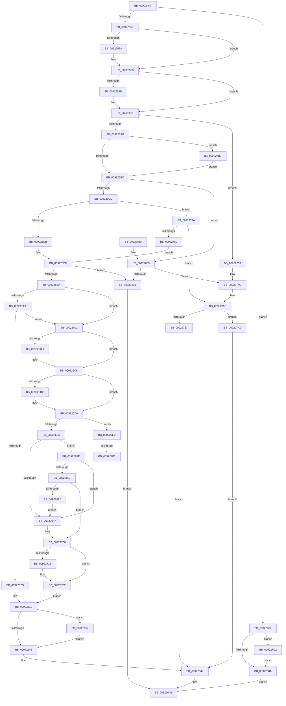

# AlpcpReceiveSynchronousReply

- RVA: `0x009224F0`–`0x00922824` (길이 `820` bytes)
- VA: `0x00000001409224F0`
- 실행 섹션: `PAGE`
- PDB 이름 있음: `예`; PDB Function 태그: `예`
- unwind 정보 RVA: `0x0008D150`
- 디코드: `205`개 명령, `820/820` bytes 표시
- 미해석 바이트: `0` (있으면 어셈블리에 `.byte`로 보존)

> 이 문서는 커널 이미지의 기계어와 PDB 기호를 분석해 생성했습니다. 4번과 5번은 함수 원형과 자료형을 바이너리 사용 방식에서 추정한 C 해석이며 원본 소스 복구 결과는 아닙니다.

## 1. Dependencies

- 직접 호출 지점: **16**; 고유 호출 대상: **12**
- 직접 호출자로 확인된 함수: **3**
- RIP 상대 이미지 참조: **1**

### Outgoing calls
- `0x00922543` → [AlpcpSignalAndWait](../../text/2F/AlpcpSignalAndWait_function_002F9620.md) (function, `0x002F9620`)
- `0x00922567` → [KeAbPreAcquire](../../text/21/KeAbPreAcquire_function_00210230.md) (function, `0x00210230`)
- `0x00922583` → [ExfAcquirePushLockExclusiveEx](../../text/20/ExfAcquirePushLockExclusiveEx_function_0020FC90.md) (function, `0x0020FC90`)
- `0x00922676` → [AlpcpUnlockMessage](../89/AlpcpUnlockMessage_function_00897AE0.md) (function, `0x00897AE0`)
- `0x009226AC` → [KeAbPreAcquire](../../text/21/KeAbPreAcquire_function_00210230.md) (function, `0x00210230`)
- `0x009226C8` → [ExfAcquirePushLockSharedEx](../../text/21/ExfAcquirePushLockSharedEx_function_0021044C.md) (function, `0x0021044C`)
- `0x00922701` → [AlpcpInsertMessagePendingQueue](AlpcpInsertMessagePendingQueue_function_00922830.md) (function, `0x00922830`)
- `0x0092271D` → [ExfReleasePushLockShared](../../text/26/ExfReleasePushLockShared_function_00263440.md) (function, `0x00263440`)
- `0x00922729` → [KeAbPostRelease](../../text/2E/KeAbPostRelease_function_002E1600.md) (function, `0x002E1600`)
- `0x00922746` → [KeBugCheckEx](../../text/4F/KeBugCheckEx_function_004FD660.md) (function, `0x004FD660`)
- `0x00922770` → [AlpcpCancelMessage](../89/AlpcpCancelMessage_function_00894120.md) (function, `0x00894120`)
- `0x0092279D` → [AlpcpWaitForSingleObject](../../text/43/AlpcpWaitForSingleObject_function_0043F680.md) (function, `0x0043F680`)
- `0x009227AC` → [AlpcpUnlockMessage](../89/AlpcpUnlockMessage_function_00897AE0.md) (function, `0x00897AE0`)
- `0x009227D6` → [AlpcpWaitForSingleObject](../../text/43/AlpcpWaitForSingleObject_function_0043F680.md) (function, `0x0043F680`)
- `0x009227F3` → [ExfReleasePushLockShared](../../text/26/ExfReleasePushLockShared_function_00263440.md) (function, `0x00263440`)
- `0x0092281A` → [AlpcpLogReceiveMessage](../88/AlpcpLogReceiveMessage_function_0088F80C.md) (function, `0x0088F80C`)

### Direct callers
- [AlpcpReceiveLegacyConnectionReply](AlpcpReceiveLegacyConnectionReply_function_00921CA0.md) at `0x00921CE4`
- [AlpcpProcessSynchronousRequest](AlpcpProcessSynchronousRequest_function_00921FCC.md) at `0x00922116`
- [AlpcpProcessConnectionRequest](AlpcpProcessConnectionRequest_function_00925FD4.md) at `0x009261EA`

### Static image references
- `0x00922639` → RVA `0x00E66D00` (`.data`; read)

## 2. Other-region calls and transfers

- 다른 실행 섹션으로 향하는 call: **11**
  - `0x00922543` → [AlpcpSignalAndWait](../../text/2F/AlpcpSignalAndWait_function_002F9620.md) (`PAGE` → `.text`)
  - `0x00922567` → [KeAbPreAcquire](../../text/21/KeAbPreAcquire_function_00210230.md) (`PAGE` → `.text`)
  - `0x00922583` → [ExfAcquirePushLockExclusiveEx](../../text/20/ExfAcquirePushLockExclusiveEx_function_0020FC90.md) (`PAGE` → `.text`)
  - `0x009226AC` → [KeAbPreAcquire](../../text/21/KeAbPreAcquire_function_00210230.md) (`PAGE` → `.text`)
  - `0x009226C8` → [ExfAcquirePushLockSharedEx](../../text/21/ExfAcquirePushLockSharedEx_function_0021044C.md) (`PAGE` → `.text`)
  - `0x0092271D` → [ExfReleasePushLockShared](../../text/26/ExfReleasePushLockShared_function_00263440.md) (`PAGE` → `.text`)
  - `0x00922729` → [KeAbPostRelease](../../text/2E/KeAbPostRelease_function_002E1600.md) (`PAGE` → `.text`)
  - `0x00922746` → [KeBugCheckEx](../../text/4F/KeBugCheckEx_function_004FD660.md) (`PAGE` → `.text`)
  - `0x0092279D` → [AlpcpWaitForSingleObject](../../text/43/AlpcpWaitForSingleObject_function_0043F680.md) (`PAGE` → `.text`)
  - `0x009227D6` → [AlpcpWaitForSingleObject](../../text/43/AlpcpWaitForSingleObject_function_0043F680.md) (`PAGE` → `.text`)
  - `0x009227F3` → [ExfReleasePushLockShared](../../text/26/ExfReleasePushLockShared_function_00263440.md) (`PAGE` → `.text`)
- call이 아닌 외부 분기/꼬리 이동: **2**
  - `0x009227EA` → [sub_00B22756](../B2/Unknown_function_00B22756.md) (`tail-transfer`)
  - `0x009227F9` → [sub_00B22756](../B2/Unknown_function_00B22756.md) (`tail-transfer`)

## 3. Assembly (complete function range)

```asm
009224F0  48 89 5C 24 10                  mov qword ptr [rsp + 0x10], rbx
009224F5  48 89 6C 24 18                  mov qword ptr [rsp + 0x18], rbp
009224FA  48 89 74 24 20                  mov qword ptr [rsp + 0x20], rsi
009224FF  57                              push rdi
00922500  41 54                           push r12
00922502  41 55                           push r13
00922504  41 56                           push r14
00922506  41 57                           push r15
00922508  48 83 EC 30                     sub rsp, 0x30
0092250C  65 4C 8B 3C 25 88 01 00 00      mov r15, qword ptr gs:[0x188]
00922515  45 8B E1                        mov r12d, r9d
00922518  48 8B 84 24 80 00 00 00         mov rax, qword ptr [rsp + 0x80]
00922520  4D 8B F0                        mov r14, r8
00922523  4C 8B 29                        mov r13, qword ptr [rcx]
00922526  44 0F B6 CA                     movzx r9d, dl
0092252A  BE 11 00 00 00                  mov esi, 0x11
0092252F  C6 44 24 28 01                  mov byte ptr [rsp + 0x28], 1
00922534  49 8D 97 18 05 00 00            lea rdx, [r15 + 0x518]
0092253B  48 89 44 24 20                  mov qword ptr [rsp + 0x20], rax
00922540  44 8B C6                        mov r8d, esi
00922543  E8 D8 70 9D FF                  call 0x1402f9620
00922548  8B E8                           mov ebp, eax
0092254A  33 C0                           xor eax, eax
0092254C  8B D8                           mov ebx, eax
0092254E  49 87 9F B8 05 00 00            xchg qword ptr [r15 + 0x5b8], rbx
00922555  48 85 DB                        test rbx, rbx
00922558  0F 84 24 01 00 00               je 0x140922682
0092255E  45 33 C0                        xor r8d, r8d
00922561  48 8D 4B F0                     lea rcx, [rbx - 0x10]
00922565  33 D2                           xor edx, edx
00922567  E8 C4 DC 8E FF                  call 0x140210230
0092256C  F0 48 0F BA 6B F0 00            lock bts qword ptr [rbx - 0x10], 0
00922573  48 8B F0                        mov rsi, rax
00922576  73 10                           jae 0x140922588
00922578  4C 8D 43 F0                     lea r8, [rbx - 0x10]
0092257C  48 8B D0                        mov rdx, rax
0092257F  48 8D 4B F0                     lea rcx, [rbx - 0x10]
00922583  E8 08 D7 8E FF                  call 0x14020fc90
00922588  48 85 F6                        test rsi, rsi
0092258B  74 04                           je 0x140922591
0092258D  C6 46 0A 01                     mov byte ptr [rsi + 0xa], 1
00922591  80 4B E0 01                     or byte ptr [rbx - 0x20], 1
00922595  B8 00 00 01 00                  mov eax, 0x10000
0092259A  F0 48 0F C1 43 E8               lock xadd qword ptr [rbx - 0x18], rax
009225A0  48 05 00 00 01 00               add rax, 0x10000
009225A6  48 85 C0                        test rax, rax
009225A9  0F 8E 84 01 00 00               jle 0x140922733
009225AF  8B 4B 28                        mov ecx, dword ptr [rbx + 0x28]
009225B2  0F BA E1 0B                     bt ecx, 0xb
009225B6  0F 82 FA 01 00 00               jb 0x1409227b6
009225BC  66 FF 4B E2                     dec word ptr [rbx - 0x1e]
009225C0  8B C1                           mov eax, ecx
009225C2  83 E0 07                        and eax, 7
009225C5  3C 05                           cmp al, 5
009225C7  0F 85 9C 00 00 00               jne 0x140922669
009225CD  83 E1 F8                        and ecx, 0xfffffff8
009225D0  89 4B 28                        mov dword ptr [rbx + 0x28], ecx
009225D3  85 ED                           test ebp, ebp
009225D5  0F 85 9F 01 00 00               jne 0x14092277a
009225DB  44 8D 7D 11                     lea r15d, [rbp + 0x11]
009225DF  8B 43 28                        mov eax, dword ptr [rbx + 0x28]
009225E2  84 C0                           test al, al
009225E4  0F 88 89 00 00 00               js 0x140922673
009225EA  0F BA E0 09                     bt eax, 9
009225EE  0F 83 9D 00 00 00               jae 0x140922691
009225F4  48 8B 83 88 00 00 00            mov rax, qword ptr [rbx + 0x88]
009225FB  48 F7 D8                        neg rax
009225FE  1B C9                           sbb ecx, ecx
00922600  81 E1 00 00 00 80               and ecx, 0x80000000
00922606  8B D1                           mov edx, ecx
00922608  0F BA EA 1E                     bts edx, 0x1e
0092260C  48 83 BB 90 00 00 00 00         cmp qword ptr [rbx + 0x90], 0
00922614  0F 44 D1                        cmove edx, ecx
00922617  8B CA                           mov ecx, edx
00922619  0F BA E9 1C                     bts ecx, 0x1c
0092261D  48 83 BB 98 00 00 00 00         cmp qword ptr [rbx + 0x98], 0
00922625  0F 44 CA                        cmove ecx, edx
00922628  41 85 CC                        test r12d, ecx
0092262B  75 64                           jne 0x140922691
0092262D  B8 FF DF FF FF                  mov eax, 0xffffdfff
00922632  66 21 83 F4 00 00 00            and word ptr [rbx + 0xf4], ax
00922639  80 3D C0 46 54 00 00            cmp byte ptr [rip + 0x5446c0], 0
00922640  0F 85 D1 01 00 00               jne 0x140922817
00922646  49 89 1E                        mov qword ptr [r14], rbx
00922649  8B C5                           mov eax, ebp
0092264B  48 8B 5C 24 68                  mov rbx, qword ptr [rsp + 0x68]
00922650  48 8B 6C 24 70                  mov rbp, qword ptr [rsp + 0x70]
00922655  48 8B 74 24 78                  mov rsi, qword ptr [rsp + 0x78]
0092265A  48 83 C4 30                     add rsp, 0x30
0092265E  41 5F                           pop r15
00922660  41 5E                           pop r14
00922662  41 5D                           pop r13
00922664  41 5C                           pop r12
00922666  5F                              pop rdi
00922667  C3                              ret
00922668  CC                              int3
00922669  4C 39 7B 20                     cmp qword ptr [rbx + 0x20], r15
0092266D  0F 84 D9 00 00 00               je 0x14092274c
00922673  48 8B CB                        mov rcx, rbx
00922676  E8 65 54 F7 FF                  call 0x140897ae0
0092267B  B8 01 07 00 C0                  mov eax, 0xc0000701
00922680  EB C9                           jmp 0x14092264b
00922682  85 ED                           test ebp, ebp
00922684  0F 85 38 01 00 00               jne 0x1409227c2
0092268A  B8 01 07 00 C0                  mov eax, 0xc0000701
0092268F  EB BA                           jmp 0x14092264b
00922691  B8 00 20 00 00                  mov eax, 0x2000
00922696  49 8D BD 60 01 00 00            lea rdi, [r13 + 0x160]
0092269D  66 09 83 F4 00 00 00            or word ptr [rbx + 0xf4], ax
009226A4  48 8B CF                        mov rcx, rdi
009226A7  45 33 C0                        xor r8d, r8d
009226AA  33 D2                           xor edx, edx
009226AC  E8 7F DB 8E FF                  call 0x140210230
009226B1  48 8B F0                        mov rsi, rax
009226B4  33 C0                           xor eax, eax
009226B6  F0 4C 0F B1 3F                  lock cmpxchg qword ptr [rdi], r15
009226BB  74 10                           je 0x1409226cd
009226BD  4C 8B CF                        mov r9, rdi
009226C0  4C 8B C6                        mov r8, rsi
009226C3  33 D2                           xor edx, edx
009226C5  48 8B CF                        mov rcx, rdi
009226C8  E8 7F DD 8E FF                  call 0x14021044c
009226CD  48 85 F6                        test rsi, rsi
009226D0  74 04                           je 0x1409226d6
009226D2  C6 46 0A 01                     mov byte ptr [rsi + 0xa], 1
009226D6  41 8B 8D A0 01 00 00            mov ecx, dword ptr [r13 + 0x1a0]
009226DD  F6 C1 40                        test cl, 0x40
009226E0  0F 85 FA 00 00 00               jne 0x1409227e0
009226E6  41 F7 85 00 01 00 00 00 10 00 00  test dword ptr [r13 + 0x100], 0x1000
009226F1  0F 85 07 01 00 00               jne 0x1409227fe
009226F7  66 FF 43 E2                     inc word ptr [rbx - 0x1e]
009226FB  48 8B D3                        mov rdx, rbx
009226FE  49 8B CD                        mov rcx, r13
00922701  E8 2A 01 00 00                  call 0x140922830
00922706  49 8B C7                        mov rax, r15
00922709  33 C9                           xor ecx, ecx
0092270B  F0 49 0F B1 8D 60 01 00 00      lock cmpxchg qword ptr [r13 + 0x160], rcx
00922714  74 0C                           je 0x140922722
00922716  49 8D 8D 60 01 00 00            lea rcx, [r13 + 0x160]
0092271D  E8 1E 0D 94 FF                  call 0x140263440
00922722  49 8D 8D 60 01 00 00            lea rcx, [r13 + 0x160]
00922729  E8 D2 EE 9B FF                  call 0x1402e1600
0092272E  E9 06 FF FF FF                  jmp 0x140922639
00922733  33 D2                           xor edx, edx
00922735  48 89 44 24 20                  mov qword ptr [rsp + 0x20], rax
0092273A  41 B9 26 00 00 00               mov r9d, 0x26
00922740  4C 8B C3                        mov r8, rbx
00922743  8D 4A 18                        lea ecx, [rdx + 0x18]
00922746  E8 15 AF BD FF                  call 0x1404fd660
0092274B  CC                              int3
0092274C  85 ED                           test ebp, ebp
0092274E  B8 01 07 00 C0                  mov eax, 0xc0000701
00922753  0F 44 E8                        cmove ebp, eax
00922756  33 C9                           xor ecx, ecx
00922758  48 89 4B 20                     mov qword ptr [rbx + 0x20], rcx
0092275C  66 FF 4B E2                     dec word ptr [rbx - 0x1e]
00922760  8B 43 28                        mov eax, dword ptr [rbx + 0x28]
00922763  84 C0                           test al, al
00922765  78 42                           js 0x1409227a9
00922767  45 33 C0                        xor r8d, r8d
0092276A  48 8B D3                        mov rdx, rbx
0092276D  49 8B CD                        mov rcx, r13
00922770  E8 AB 19 F7 FF                  call 0x140894120
00922775  E9 CF FE FF FF                  jmp 0x140922649
0092277A  4C 39 7B 20                     cmp qword ptr [rbx + 0x20], r15
0092277E  74 D6                           je 0x140922756
00922780  49 8D 8F 18 05 00 00            lea rcx, [r15 + 0x518]
00922787  33 FF                           xor edi, edi
00922789  41 BF 11 00 00 00               mov r15d, 0x11
0092278F  48 89 7C 24 20                  mov qword ptr [rsp + 0x20], rdi
00922794  41 8B D7                        mov edx, r15d
00922797  45 33 C9                        xor r9d, r9d
0092279A  45 33 C0                        xor r8d, r8d
0092279D  E8 DE CE B1 FF                  call 0x14043f680
009227A2  8B EF                           mov ebp, edi
009227A4  E9 36 FE FF FF                  jmp 0x1409225df
009227A9  48 8B CB                        mov rcx, rbx
009227AC  E8 2F 53 F7 FF                  call 0x140897ae0
009227B1  E9 93 FE FF FF                  jmp 0x140922649
009227B6  0F BA F1 0B                     btr ecx, 0xb
009227BA  89 4B 28                        mov dword ptr [rbx + 0x28], ecx
009227BD  E9 FA FD FF FF                  jmp 0x1409225bc
009227C2  45 33 C9                        xor r9d, r9d
009227C5  48 89 44 24 20                  mov qword ptr [rsp + 0x20], rax
009227CA  45 33 C0                        xor r8d, r8d
009227CD  49 8D 8F 18 05 00 00            lea rcx, [r15 + 0x518]
009227D4  8B D6                           mov edx, esi
009227D6  E8 A5 CE B1 FF                  call 0x14043f680
009227DB  E9 AA FE FF FF                  jmp 0x14092268a
009227E0  49 8B C7                        mov rax, r15
009227E3  33 C9                           xor ecx, ecx
009227E5  F0 48 0F B1 0F                  lock cmpxchg qword ptr [rdi], rcx
009227EA  0F 84 66 FF 1F 00               je 0x140b22756
009227F0  48 8B CF                        mov rcx, rdi
009227F3  E8 48 0C 94 FF                  call 0x140263440
009227F8  90                              nop
009227F9  E9 58 FF 1F 00                  jmp 0x140b22756
009227FE  F6 C1 20                        test cl, 0x20
00922801  0F 84 F0 FE FF FF               je 0x1409226f7
00922807  48 83 7B 20 00                  cmp qword ptr [rbx + 0x20], 0
0092280C  0F 85 F4 FE FF FF               jne 0x140922706
00922812  E9 E0 FE FF FF                  jmp 0x1409226f7
00922817  48 8B CB                        mov rcx, rbx
0092281A  E8 ED CF F6 FF                  call 0x14088f80c
0092281F  E9 22 FE FF FF                  jmp 0x140922646
```

## 4. C-style interpretation (structured pseudocode)

```c
__int64 __fastcall AlpcpReceiveSynchronousReply(__int64 a1, unsigned __int8 a2, __int64 a3, int a4, __int64 a5)
{
    __int64 result;
    __int64 v_rbp;
    __int64 v_rdi;
    __int64 v_rsp;
    unsigned __int8 v_stack_m30;
    unsigned __int64 v_stack_m38;
    unsigned __int64 v_stack_p10;
    unsigned __int64 v_stack_p18;
    unsigned __int64 v_stack_p20;

    v_stack_p10 = v_rbx;
    v_stack_p18 = v_rbp;
    v_stack_p20 = v_rsi;
    v_rsp = (v_rsp) - (48);
    v_stack_m30 = 1;
    v_stack_m38 = a5;
    result = AlpcpSignalAndWait(a1, *(unsigned __int64 *)(gs_base + (0 + 392)) + 1304, 17, a2);
    result = 0;
    if (0 == 0) goto loc_00922682;
    a3 = 0;
    a2 = 0;
    result = KeAbPreAcquire(0 - 16, a2, a3, a2);
    if (!(condition_is_above_or_equal)) {
        a3 = 0 - 16;
        a2 = result;
        a1 = 0 - 16;
        result = ExfAcquirePushLockExclusiveEx(a1, a2, a3, a2);
    }
    if (result != 0) {
        *(unsigned __int8 *)(result + 10) = 1;
    }
    result = ((unsigned int)(0x10000ULL)) + (0x10000ULL);
    if (condition_is_less_or_equal) goto loc_00922733;
    if (condition_is_below) goto loc_009227B6;
loc_009225BC:
    result = (unsigned int)(((unsigned int)((unsigned int)((unsigned int)(*(unsigned int *)(0 + 40))))) & (7));
    if (((unsigned __int8)(result)) != 5) goto loc_00922669;
    a1 = (unsigned int)(((unsigned int)(*(unsigned int *)(0 + 40))) & (0xFFFFFFF8ULL));
    *(unsigned int *)(0 + 40) = (unsigned int)(a1);
    if ((unsigned int)((unsigned int)((unsigned int)(result))) != 0) goto loc_0092277A;
loc_009225DF:
    if (sign_flag) goto loc_00922673;
    if (condition_is_above_or_equal) goto loc_00922691;
    result = -(*(unsigned __int64 *)(0 + 136));
    a1 = (unsigned int)((a1) & (0x80000000ULL));
    a2 = (unsigned int)((unsigned int)(a1));
    if ((*(unsigned __int64 *)(0 + 144)) == 0) { a2 = (unsigned int)(a1); }
    a1 = (unsigned int)(a2);
    if ((*(unsigned __int64 *)(0 + 152)) == 0) { a1 = a2; }
    if ((((unsigned int)((unsigned int)(a4))) & ((unsigned int)(a1))) != 0) goto loc_00922691;
loc_00922639:
    if ((*(unsigned __int8 *)(v_rip + 5523136)) != 0) goto loc_00922817;
loc_00922646:
    *(unsigned __int64 *)(a3) = 0;
loc_00922649:
loc_0092264B:
    v_rsp = (v_rsp) + (48);
    return (unsigned int)((unsigned int)((unsigned int)((unsigned int)(result))));
loc_00922669:
    if ((*(unsigned __int64 *)(v_stack_p10 + 32)) == ((unsigned int)((unsigned int)(result)) + 17)) goto loc_0092274C;
loc_00922673:
    result = AlpcpUnlockMessage(v_stack_p10, a2, a3, a2);
    goto loc_0092264B;
loc_00922682:
    if ((unsigned int)(v_stack_p18) != 0) goto loc_009227C2;
loc_0092268A:
    goto loc_0092264B;
loc_00922691:
    a3 = 0;
    a2 = 0;
    result = KeAbPreAcquire(*(unsigned __int64 *)(a1) + 352, a2, a3, a2);
    result = 0;
    if (!(condition_is_equal)) {
        a4 = *(unsigned __int64 *)(a1) + 352;
        a3 = 0;
        a2 = 0;
        a1 = *(unsigned __int64 *)(a1) + 352;
        result = ExfAcquirePushLockSharedEx(a1, a2, a3, a4);
    }
    if (result != 0) {
        *(unsigned __int8 *)(result + 10) = 1;
    }
    if ((((unsigned __int8)((unsigned int)(*(unsigned int *)(*(unsigned __int64 *)(a1) + 416)))) & (64)) != 0) goto loc_009227E0;
    if (((*(unsigned int *)(*(unsigned __int64 *)(a1) + 256)) & (0x1000ULL)) != 0) goto loc_009227FE;
loc_009226F7:
    result = AlpcpInsertMessagePendingQueue(*(unsigned __int64 *)(a1), v_stack_p10, a3, a4);
loc_00922706:
    a1 = 0;
    result = (unsigned int)((unsigned int)(result)) + 17;
    if (!(condition_is_equal)) {
        a1 = *(unsigned __int64 *)(a1) + 352;
        result = ExfReleasePushLockShared(a1, v_stack_p10, a3, a4);
    }
    result = KeAbPostRelease(*(unsigned __int64 *)(a1) + 352, v_stack_p10, a3, a4);
    goto loc_00922639;
loc_00922733:
    a2 = 0;
    v_stack_p20 = result;
    result = KeBugCheckEx(a2 + 24, a2, v_stack_p10, 38);
loc_0092274C:
    v_rbp = v_stack_p18;
    if ((unsigned int)(v_stack_p18) == 0) { v_rbp = (unsigned int)((unsigned int)(0xC0000701ULL)); }
loc_00922756:
    a1 = 0;
    *(unsigned __int64 *)(v_stack_p10 + 32) = 0;
    if (sign_flag) goto loc_009227A9;
    a3 = 0;
    result = AlpcpCancelMessage(*(unsigned __int64 *)(a1), v_stack_p10, a3, 38);
    goto loc_00922649;
loc_0092277A:
    if ((*(unsigned __int64 *)(v_stack_p10 + 32)) == ((unsigned int)((unsigned int)(result)) + 17)) goto loc_00922756;
    v_rdi = 0;
    v_stack_p20 = 0;
    a4 = 0;
    a3 = 0;
    result = AlpcpWaitForSingleObject((unsigned int)((unsigned int)(result)) + 17 + 1304, 17, a3, a4);
    goto loc_009225DF;
loc_009227A9:
    result = AlpcpUnlockMessage(v_stack_p10, 17, a3, a4);
    goto loc_00922649;
loc_009227B6:
    *(unsigned int *)(v_stack_p10 + 40) = (unsigned int)(v_stack_p10);
    goto loc_009225BC;
loc_009227C2:
    a4 = 0;
    v_stack_p20 = result;
    a3 = 0;
    result = AlpcpWaitForSingleObject(17 + 1304, (unsigned int)((unsigned int)(result)), a3, a4);
    goto loc_0092268A;
loc_009227E0:
    a1 = 0;
    result = ExfReleasePushLockShared(0, (unsigned int)((unsigned int)(result)), a3, a4);
loc_009227FE:
    if (((0) & (32)) == 0) goto loc_009226F7;
    if ((*(unsigned __int64 *)(v_stack_p10 + 32)) != 0) goto loc_00922706;
    goto loc_009226F7;
loc_00922817:
    result = AlpcpLogReceiveMessage(v_stack_p10, (unsigned int)((unsigned int)(result)), a3, a4);
    goto loc_00922646;
}
```

## 5. (Beta) C Style

```c
int64_t AlpcpReceiveSynchronousReply(void *Arg1, uint8_t Arg2, void *Arg3, int32_t Arg4, int64_t Arg5)
{
    uint8_t *arg1 = (uint8_t *)Arg1;
    uint8_t *arg3 = (uint8_t *)Arg3;

    int64_t result;
    int64_t local_rbp;
    int64_t local_rdi;
    int64_t local_rsp;
    uint8_t v_stack_m30;
    uint64_t v_stack_m38;
    uint64_t v_stack_p10;
    uint64_t v_stack_p18;
    uint64_t v_stack_p20;

    v_stack_p10 = local_rbx;
    v_stack_p18 = local_rbp;
    v_stack_p20 = local_rsi;
    local_rsp = (local_rsp) - (48);
    v_stack_m30 = 1;
    v_stack_m38 = Arg5;
    result = AlpcpSignalAndWait(Arg1, *(uint64_t *)(gs_base + (0 + 0x188)) + 1304, 17, Arg2);
    result = 0;
    if (0 == 0) goto loc_00922682;
    Arg3 = 0;
    Arg2 = 0;
    result = KeAbPreAcquire(0 - 16, Arg2, Arg3, Arg2);
    if (!(condition_is_above_or_equal)) {
        Arg3 = 0 - 16;
        Arg2 = result;
        Arg1 = 0 - 16;
        result = ExfAcquirePushLockExclusiveEx(Arg1, Arg2, Arg3, Arg2);
    }
    if (result != 0) {
        *(uint8_t *)(result + 0xA) = 1;
    }
    result = ((uint32_t)(0x10000ULL)) + (0x10000ULL);
    if (condition_is_less_or_equal) goto loc_00922733;
    if (condition_is_below) goto loc_009227B6;
loc_009225BC:
    result = (uint32_t)(((uint32_t)((uint32_t)((uint32_t)(*(uint32_t *)(0 + 0x28))))) & (7));
    if (((uint8_t)(result)) != 5) goto loc_00922669;
    Arg1 = (uint32_t)(((uint32_t)(*(uint32_t *)(0 + 0x28))) & (0xFFFFFFF8ULL));
    *(uint32_t *)(0 + 0x28) = (uint32_t)(Arg1);
    if ((uint32_t)((uint32_t)((uint32_t)(result))) != 0) goto loc_0092277A;
loc_009225DF:
    if (sign_flag) goto loc_00922673;
    if (condition_is_above_or_equal) goto loc_00922691;
    result = -(*(uint64_t *)(0 + 0x88));
    Arg1 = (uint32_t)((Arg1) & (0x80000000ULL));
    Arg2 = (uint32_t)((uint32_t)(Arg1));
    if ((*(uint64_t *)(0 + 0x90)) == 0) { Arg2 = (uint32_t)(Arg1); }
    Arg1 = (uint32_t)(Arg2);
    if ((*(uint64_t *)(0 + 0x98)) == 0) { Arg1 = Arg2; }
    if ((((uint32_t)((uint32_t)(Arg4))) & ((uint32_t)(Arg1))) != 0) goto loc_00922691;
loc_00922639:
    if ((*(uint8_t *)(v_rip + 0x5446C0)) != 0) goto loc_00922817;
loc_00922646:
    *(uint64_t *)(arg3) = 0;
loc_00922649:
loc_0092264B:
    local_rsp = (local_rsp) + (48);
    return (uint32_t)((uint32_t)((uint32_t)((uint32_t)(result))));
loc_00922669:
    if ((*(uint64_t *)(v_stack_p10 + 0x20)) == ((uint32_t)((uint32_t)(result)) + 17)) goto loc_0092274C;
loc_00922673:
    result = AlpcpUnlockMessage(v_stack_p10, Arg2, Arg3, Arg2);
    goto loc_0092264B;
loc_00922682:
    if ((uint32_t)(v_stack_p18) != 0) goto loc_009227C2;
loc_0092268A:
    goto loc_0092264B;
loc_00922691:
    Arg3 = 0;
    Arg2 = 0;
    result = KeAbPreAcquire(*(uint64_t *)(arg1) + 352, Arg2, Arg3, Arg2);
    result = 0;
    if (!(condition_is_equal)) {
        Arg4 = *(uint64_t *)(arg1) + 352;
        Arg3 = 0;
        Arg2 = 0;
        Arg1 = *(uint64_t *)(arg1) + 352;
        result = ExfAcquirePushLockSharedEx(Arg1, Arg2, Arg3, Arg4);
    }
    if (result != 0) {
        *(uint8_t *)(result + 0xA) = 1;
    }
    if ((((uint8_t)((uint32_t)(*(uint32_t *)(*(uint64_t *)(arg1) + 0x1A0)))) & (64)) != 0) goto loc_009227E0;
    if (((*(uint32_t *)(*(uint64_t *)(arg1) + 0x100)) & (0x1000ULL)) != 0) goto loc_009227FE;
loc_009226F7:
    result = AlpcpInsertMessagePendingQueue(*(uint64_t *)(arg1), v_stack_p10, Arg3, Arg4);
loc_00922706:
    Arg1 = 0;
    result = (uint32_t)((uint32_t)(result)) + 17;
    if (!(condition_is_equal)) {
        Arg1 = *(uint64_t *)(arg1) + 352;
        result = ExfReleasePushLockShared(Arg1, v_stack_p10, Arg3, Arg4);
    }
    result = KeAbPostRelease(*(uint64_t *)(arg1) + 352, v_stack_p10, Arg3, Arg4);
    goto loc_00922639;
loc_00922733:
    Arg2 = 0;
    v_stack_p20 = result;
    result = KeBugCheckEx(Arg2 + 24, Arg2, v_stack_p10, 38);
loc_0092274C:
    local_rbp = v_stack_p18;
    if ((uint32_t)(v_stack_p18) == 0) { local_rbp = (uint32_t)((uint32_t)(0xC0000701ULL)); }
loc_00922756:
    Arg1 = 0;
    *(uint64_t *)(v_stack_p10 + 0x20) = 0;
    if (sign_flag) goto loc_009227A9;
    Arg3 = 0;
    result = AlpcpCancelMessage(*(uint64_t *)(arg1), v_stack_p10, Arg3, 38);
    goto loc_00922649;
loc_0092277A:
    if ((*(uint64_t *)(v_stack_p10 + 0x20)) == ((uint32_t)((uint32_t)(result)) + 17)) goto loc_00922756;
    local_rdi = 0;
    v_stack_p20 = 0;
    Arg4 = 0;
    Arg3 = 0;
    result = AlpcpWaitForSingleObject((uint32_t)((uint32_t)(result)) + 17 + 1304, 17, Arg3, Arg4);
    goto loc_009225DF;
loc_009227A9:
    result = AlpcpUnlockMessage(v_stack_p10, 17, Arg3, Arg4);
    goto loc_00922649;
loc_009227B6:
    *(uint32_t *)(v_stack_p10 + 0x28) = (uint32_t)(v_stack_p10);
    goto loc_009225BC;
loc_009227C2:
    Arg4 = 0;
    v_stack_p20 = result;
    Arg3 = 0;
    result = AlpcpWaitForSingleObject(17 + 1304, (uint32_t)((uint32_t)(result)), Arg3, Arg4);
    goto loc_0092268A;
loc_009227E0:
    Arg1 = 0;
    result = ExfReleasePushLockShared(0, (uint32_t)((uint32_t)(result)), Arg3, Arg4);
loc_009227FE:
    if (((0) & (32)) == 0) goto loc_009226F7;
    if ((*(uint64_t *)(v_stack_p10 + 0x20)) != 0) goto loc_00922706;
    goto loc_009226F7;
loc_00922817:
    result = AlpcpLogReceiveMessage(v_stack_p10, (uint32_t)((uint32_t)(result)), Arg3, Arg4);
    goto loc_00922646;
}
```

### 관측된 메모리 오프셋

구조체 형식이 확인되지 않은 접근은 인자 기준의 오프셋으로만 기록했습니다.

| 기준 인자 | 오프셋 표현 | 폭 (bit) | 접근 |
|---|---:|---:|---|
| `Arg1` | `+ 0x0` | `64` | `R` |
| `Arg3` | `+ 0x0` | `64` | `W` |

## 6. Execution-region graph

[열기: 2D/3D 그래프와 함수 탐색 컨트롤 패널](../../../control-panel.html?section=page&rva=0x009224F0&view=graph)

- 2D 그래프는 위에서 아래로 흐르고, 3D 그래프는 빈 공간을 드래그해 회전합니다. Shift+드래그는 이동, 휠은 확대·축소, 함수 노드 선택은 대상 보고서 이동입니다.

### Static fallback


