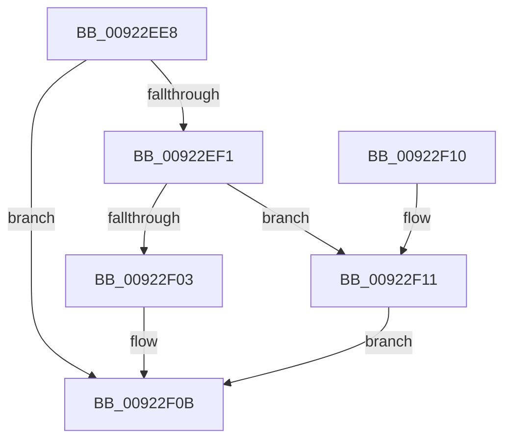

# AlpcpReleasePagedPoolQuota

- RVA: `0x00922EE8`–`0x00922F18` (길이 `48` bytes)
- VA: `0x0000000140922EE8`
- 실행 섹션: `PAGE`
- PDB 이름 있음: `예`; PDB Function 태그: `아니요`
- unwind 정보 RVA: `0x0005CEE8`
- 디코드: `13`개 명령, `48/48` bytes 표시
- 미해석 바이트: `0` (있으면 어셈블리에 `.byte`로 보존)

> 이 문서는 커널 이미지의 기계어와 PDB 기호를 분석해 생성했습니다. 4번과 5번은 함수 원형과 자료형을 바이너리 사용 방식에서 추정한 C 해석이며 원본 소스 복구 결과는 아닙니다.

## 1. Dependencies

- 직접 호출 지점: **1**; 고유 호출 대상: **1**
- 직접 호출자로 확인된 함수: **7**
- RIP 상대 이미지 참조: **0**

### Outgoing calls
- `0x00922F11` → [PsReturnProcessPagedPoolQuota](../../text/2A/PsReturnProcessPagedPoolQuota_function_002A6860.md) (function, `0x002A6860`)

### Direct callers
- [AlpcpSendMessage](../88/AlpcpSendMessage_function_0088BD40.md) at `0x0088C7F4`
- [AlpcpSendMessage](../88/AlpcpSendMessage_function_0088BD40.md) at `0x0088CAC7`
- [AlpcpCaptureMessageDataSafe](../88/AlpcpCaptureMessageDataSafe_function_0088F3B0.md) at `0x0088F50D`
- [AlpcpCaptureMessageDataSafe](../88/AlpcpCaptureMessageDataSafe_function_0088F3B0.md) at `0x0088F56B`
- [AlpcpCreateSecurityContext](../89/AlpcpCreateSecurityContext_function_00890D94.md) at `0x00891138`
- [AlpcpCreateReserve](../89/AlpcpCreateReserve_function_00892318.md) at `0x00892566`
- [sub_00892B22](../89/Unknown_function_00892B22.md) at `0x00892B82`
- [sub_00892B22](../89/Unknown_function_00892B22.md) at `0x00892B9B`
- [sub_00922E15](Unknown_function_00922E15.md) at `0x00922E66`
- [sub_00922E7C](Unknown_function_00922E7C.md) at `0x00922E7F`

### Static image references
- 디코드된 RIP-relative 메모리 참조가 없습니다.

## 2. Other-region calls and transfers

- 다른 실행 섹션으로 향하는 call: **1**
  - `0x00922F11` → [PsReturnProcessPagedPoolQuota](../../text/2A/PsReturnProcessPagedPoolQuota_function_002A6860.md) (`PAGE` → `.text`)
- 별도 외부 분기/꼬리 이동을 확인하지 못했습니다.

## 3. Assembly (complete function range)

```asm
00922EE8  48 83 EC 28                     sub rsp, 0x28
00922EEC  48 85 C9                        test rcx, rcx
00922EEF  74 1A                           je 0x140922f0b
00922EF1  48 8B 81 98 05 00 00            mov rax, qword ptr [rcx + 0x598]
00922EF8  48 03 C2                        add rax, rdx
00922EFB  48 3D 00 10 00 00               cmp rax, 0x1000
00922F01  73 0E                           jae 0x140922f11
00922F03  F0 48 01 91 98 05 00 00         lock add qword ptr [rcx + 0x598], rdx
00922F0B  48 83 C4 28                     add rsp, 0x28
00922F0F  C3                              ret
00922F10  CC                              int3
00922F11  E8 4A 39 98 FF                  call 0x1402a6860
00922F16  EB F3                           jmp 0x140922f0b
```

## 4. C-style interpretation (structured pseudocode)

```c
__int64 __fastcall AlpcpReleasePagedPoolQuota(__int64 a1, __int64 a2)
{
    __int64 result;
    __int64 v_rsp;

    v_rsp = (v_rsp) - (40);
    if (a1 == 0) goto loc_00922F0B;
    result = (*(unsigned __int64 *)(a1 + 1432)) + (a2);
    if (result >= 0x1000ULL) goto loc_00922F11;
loc_00922F0B:
    v_rsp = (v_rsp) + (40);
    return result;
loc_00922F11:
    result = PsReturnProcessPagedPoolQuota(a1, a2, a3, a4);
    goto loc_00922F0B;
}
```

## 5. (Beta) C Style

```c
int64_t AlpcpReleasePagedPoolQuota(int64_t Arg1, int64_t Arg2)
{
    int64_t result;
    int64_t local_rsp;

    local_rsp = (local_rsp) - (40);
    if (Arg1 == 0) goto loc_00922F0B;
    result = (*(uint64_t *)(Arg1 + 0x598)) + (Arg2);
    if (result >= 0x1000ULL) goto loc_00922F11;
loc_00922F0B:
    local_rsp = (local_rsp) + (40);
    return result;
loc_00922F11:
    result = PsReturnProcessPagedPoolQuota(Arg1, Arg2, a3, a4);
    goto loc_00922F0B;
}
```

## 6. Execution-region graph

[열기: 2D/3D 그래프와 함수 탐색 컨트롤 패널](../../../control-panel.html?section=page&rva=0x00922EE8&view=graph)

- 2D 그래프는 위에서 아래로 흐르고, 3D 그래프는 빈 공간을 드래그해 회전합니다. Shift+드래그는 이동, 휠은 확대·축소, 함수 노드 선택은 대상 보고서 이동입니다.

### Static fallback


