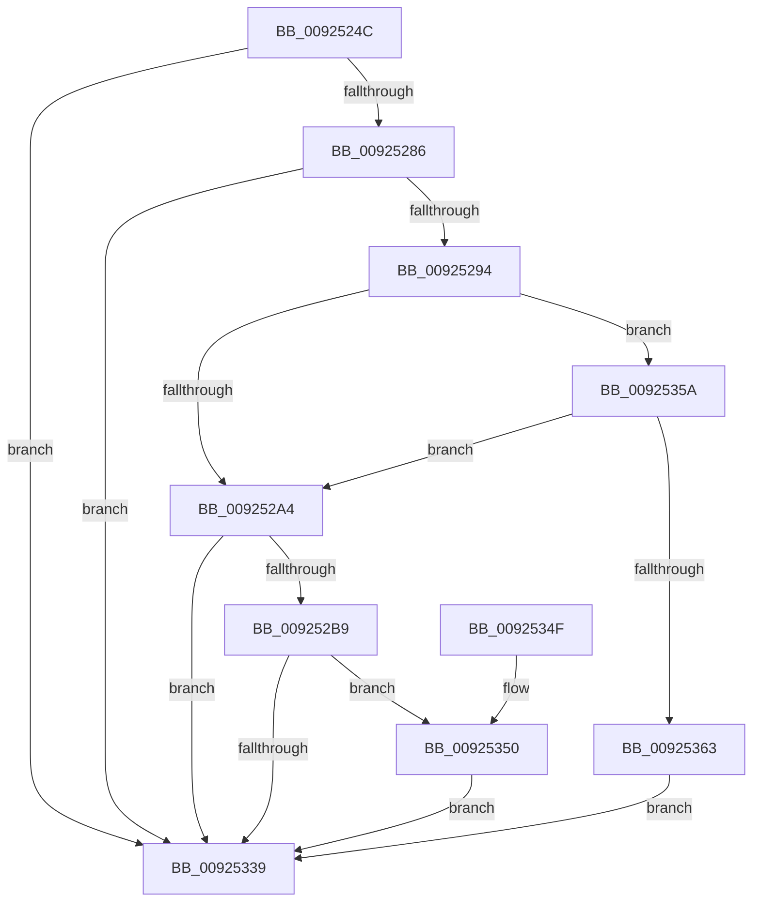

# AlpcpSendCloseMessage

- RVA: `0x0092524C`–`0x00925365` (길이 `281` bytes)
- VA: `0x000000014092524C`
- 실행 섹션: `PAGE`
- PDB 이름 있음: `예`; PDB Function 태그: `아니요`
- unwind 정보 RVA: `0x0008D460`
- 디코드: `62`개 명령, `281/281` bytes 표시
- 미해석 바이트: `0` (있으면 어셈블리에 `.byte`로 보존)

> 이 문서는 커널 이미지의 기계어와 PDB 기호를 분석해 생성했습니다. 4번과 5번은 함수 원형과 자료형을 바이너리 사용 방식에서 추정한 C 해석이며 원본 소스 복구 결과는 아닙니다.

## 1. Dependencies

- 직접 호출 지점: **4**; 고유 호출 대상: **4**
- 직접 호출자로 확인된 함수: **2**
- RIP 상대 이미지 참조: **0**

### Outgoing calls
- `0x0092526D` → [memset](../../text/6C/memset_function_006C6C40.md) (function, `0x006C6C40`)
- `0x009252BC` → [AlpcpLockForCachedReferenceBlob](../88/AlpcpLockForCachedReferenceBlob_function_0088A8B0.md) (function, `0x0088A8B0`)
- `0x00925330` → [AlpcpDispatchCloseMessage](AlpcpDispatchCloseMessage_function_00923FBC.md) (function, `0x00923FBC`)
- `0x00925353` → [AlpcpUnlockMessage](../89/AlpcpUnlockMessage_function_00897AE0.md) (function, `0x00897AE0`)

### Direct callers
- [AlpcpClosePort](AlpcpClosePort_function_00924DE0.md) at `0x00924E3A`
- [AlpcpDeletePort](AlpcpDeletePort_function_00925010.md) at `0x00925036`

### Static image references
- 디코드된 RIP-relative 메모리 참조가 없습니다.

## 2. Other-region calls and transfers

- 다른 실행 섹션으로 향하는 call: **1**
  - `0x0092526D` → [memset](../../text/6C/memset_function_006C6C40.md) (`PAGE` → `.text`)
- 별도 외부 분기/꼬리 이동을 확인하지 못했습니다.

## 3. Assembly (complete function range)

```asm
0092524C  48 8B C4                        mov rax, rsp
0092524F  48 89 58 08                     mov qword ptr [rax + 8], rbx
00925253  48 89 68 10                     mov qword ptr [rax + 0x10], rbp
00925257  48 89 70 18                     mov qword ptr [rax + 0x18], rsi
0092525B  57                              push rdi
0092525C  48 83 EC 60                     sub rsp, 0x60
00925260  33 D2                           xor edx, edx
00925262  48 8B F9                        mov rdi, rcx
00925265  48 8D 48 B8                     lea rcx, [rax - 0x48]
00925269  44 8D 42 40                     lea r8d, [rdx + 0x40]
0092526D  E8 CE 19 DA FF                  call 0x1406c6c40
00925272  8B 87 A0 01 00 00               mov eax, dword ptr [rdi + 0x1a0]
00925278  8B D0                           mov edx, eax
0092527A  83 E2 06                        and edx, 6
0092527D  83 FA 02                        cmp edx, 2
00925280  0F 84 B3 00 00 00               je 0x140925339
00925286  BD 08 00 00 00                  mov ebp, 8
0092528B  40 84 C5                        test bpl, al
0092528E  0F 85 A5 00 00 00               jne 0x140925339
00925294  F7 87 00 01 00 00 00 10 00 00   test dword ptr [rdi + 0x100], 0x1000
0092529E  0F 85 B6 00 00 00               jne 0x14092535a
009252A4  48 8B 47 10                     mov rax, qword ptr [rdi + 0x10]
009252A8  33 F6                           xor esi, esi
009252AA  8B DE                           mov ebx, esi
009252AC  48 87 58 48                     xchg qword ptr [rax + 0x48], rbx
009252B0  48 85 DB                        test rbx, rbx
009252B3  0F 84 80 00 00 00               je 0x140925339
009252B9  48 8B CB                        mov rcx, rbx
009252BC  E8 EF 55 F6 FF                  call 0x14088a8b0
009252C1  66 FF 4B E2                     dec word ptr [rbx - 0x1e]
009252C5  48 8D 4C 24 20                  lea rcx, [rsp + 0x20]
009252CA  0F BA B3 08 01 00 00 1F         btr dword ptr [rbx + 0x108], 0x1f
009252D2  C7 83 F0 00 00 00 08 00 30 00   mov dword ptr [rbx + 0xf0], 0x300008
009252DC  40 88 B3 F4 00 00 00            mov byte ptr [rbx + 0xf4], sil
009252E3  66 83 8B F4 00 00 00 05         or word ptr [rbx + 0xf4], 5
009252EB  66 89 B3 F6 00 00 00            mov word ptr [rbx + 0xf6], si
009252F2  65 48 8B 04 25 88 01 00 00      mov rax, qword ptr gs:[0x188]
009252FB  48 8B 90 B8 00 00 00            mov rdx, qword ptr [rax + 0xb8]
00925302  48 8B 82 F8 01 00 00            mov rax, qword ptr [rdx + 0x1f8]
00925309  48 89 83 18 01 00 00            mov qword ptr [rbx + 0x118], rax
00925310  48 89 B3 F8 00 00 00            mov qword ptr [rbx + 0xf8], rsi
00925317  48 89 B3 00 01 00 00            mov qword ptr [rbx + 0x100], rsi
0092531E  48 89 7C 24 20                  mov qword ptr [rsp + 0x20], rdi
00925323  48 89 5C 24 28                  mov qword ptr [rsp + 0x28], rbx
00925328  C7 44 24 50 00 00 01 00         mov dword ptr [rsp + 0x50], 0x10000
00925330  E8 87 EC FF FF                  call 0x140923fbc
00925335  85 C0                           test eax, eax
00925337  78 17                           js 0x140925350
00925339  4C 8D 5C 24 60                  lea r11, [rsp + 0x60]
0092533E  49 8B 5B 10                     mov rbx, qword ptr [r11 + 0x10]
00925342  49 8B 6B 18                     mov rbp, qword ptr [r11 + 0x18]
00925346  49 8B 73 20                     mov rsi, qword ptr [r11 + 0x20]
0092534A  49 8B E3                        mov rsp, r11
0092534D  5F                              pop rdi
0092534E  C3                              ret
0092534F  CC                              int3
00925350  48 8B CB                        mov rcx, rbx
00925353  E8 88 27 F7 FF                  call 0x140897ae0
00925358  EB DF                           jmp 0x140925339
0092535A  83 FA 04                        cmp edx, 4
0092535D  0F 84 41 FF FF FF               je 0x1409252a4
00925363  EB D4                           jmp 0x140925339
```

## 4. C-style interpretation (structured pseudocode)

```c
__int64 __fastcall AlpcpSendCloseMessage(__int64 a1, int a2)
{
    __int64 result;
    __int64 v_rsi;
    __int64 v_rsp;
    unsigned int v_stack_m18;
    unsigned __int64 v_stack_m40;
    unsigned __int64 v_stack_m48;
    unsigned __int64 v_stack_m8;

    *(unsigned __int64 *)(v_rsp + 8) = v_rbx;
    *(unsigned __int64 *)(v_rsp + 16) = v_rbp;
    *(unsigned __int64 *)(v_rsp + 24) = v_rsi;
    v_rsp = (v_rsp) - (96);
    a2 = 0;
    result = memset(v_rsp - 72, a2, a2 + 64, a4);
    a2 = (unsigned int)(((unsigned int)((unsigned int)((unsigned int)(*(unsigned int *)(a1 + 416))))) & (6));
    if (a2 == 2) goto loc_00925339;
    if (((8) & ((unsigned __int8)((unsigned int)(*(unsigned int *)(a1 + 416))))) != 0) goto loc_00925339;
    if (((*(unsigned int *)(a1 + 256)) & (0x1000ULL)) != 0) goto loc_0092535A;
loc_009252A4:
    v_rsi = 0;
    if (0 == 0) goto loc_00925339;
    result = AlpcpLockForCachedReferenceBlob(0, a2, a2 + 64, a4);
    *(unsigned int *)(0 + 240) = 0x300008ULL;
    *(unsigned __int8 *)(0 + 244) = 0;
    *(unsigned __int16 *)(0 + 246) = 0;
    *(unsigned __int64 *)(0 + 280) = *(unsigned __int64 *)(*(unsigned __int64 *)(*(unsigned __int64 *)(gs_base + (0 + 392)) + 184) + 504);
    *(unsigned __int64 *)(0 + 248) = 0;
    *(unsigned __int64 *)(0 + 256) = 0;
    v_stack_m48 = a1;
    v_stack_m40 = 0;
    v_stack_m18 = 0x10000ULL;
    result = AlpcpDispatchCloseMessage(v_stack_m48, *(unsigned __int64 *)(*(unsigned __int64 *)(gs_base + (0 + 392)) + 184), a2 + 64, a4);
    if (sign_flag) goto loc_00925350;
loc_00925339:
    return result;
loc_00925350:
    result = AlpcpUnlockMessage(*(unsigned __int64 *)(v_stack_m8 + 16), *(unsigned __int64 *)(*(unsigned __int64 *)(gs_base + (0 + 392)) + 184), a2 + 64, a4);
    goto loc_00925339;
loc_0092535A:
    if (((unsigned int)(*(unsigned __int64 *)(*(unsigned __int64 *)(gs_base + (0 + 392)) + 184))) == 4) goto loc_009252A4;
    goto loc_00925339;
}
```

## 5. (Beta) C Style

```c
int64_t AlpcpSendCloseMessage(void *Arg1, int32_t Arg2)
{
    uint8_t *arg1 = (uint8_t *)Arg1;

    int64_t result;
    int64_t local_rsi;
    int64_t local_rsp;
    uint32_t v_stack_m18;
    uint64_t v_stack_m40;
    uint64_t v_stack_m48;
    uint64_t v_stack_m8;

    *(uint64_t *)(local_rsp + 0x8) = local_rbx;
    *(uint64_t *)(local_rsp + 0x10) = local_rbp;
    *(uint64_t *)(local_rsp + 0x18) = local_rsi;
    local_rsp = (local_rsp) - (96);
    Arg2 = 0;
    result = memset(local_rsp - 72, Arg2, Arg2 + 64, a4);
    Arg2 = (uint32_t)(((uint32_t)((uint32_t)((uint32_t)(*(uint32_t *)(arg1 + 0x1A0))))) & (6));
    if (Arg2 == 2) goto loc_00925339;
    if (((8) & ((uint8_t)((uint32_t)(*(uint32_t *)(arg1 + 0x1A0))))) != 0) goto loc_00925339;
    if (((*(uint32_t *)(arg1 + 0x100)) & (0x1000ULL)) != 0) goto loc_0092535A;
loc_009252A4:
    local_rsi = 0;
    if (0 == 0) goto loc_00925339;
    result = AlpcpLockForCachedReferenceBlob(0, Arg2, Arg2 + 64, a4);
    *(uint32_t *)(0 + 0xF0) = 0x300008ULL;
    *(uint8_t *)(0 + 0xF4) = 0;
    *(uint16_t *)(0 + 0xF6) = 0;
    *(uint64_t *)(0 + 0x118) = *(uint64_t *)(*(uint64_t *)(*(uint64_t *)(gs_base + (0 + 0x188)) + 0xB8) + 0x1F8);
    *(uint64_t *)(0 + 0xF8) = 0;
    *(uint64_t *)(0 + 0x100) = 0;
    v_stack_m48 = Arg1;
    v_stack_m40 = 0;
    v_stack_m18 = 0x10000ULL;
    result = AlpcpDispatchCloseMessage(v_stack_m48, *(uint64_t *)(*(uint64_t *)(gs_base + (0 + 0x188)) + 0xB8), Arg2 + 64, a4);
    if (sign_flag) goto loc_00925350;
loc_00925339:
    return result;
loc_00925350:
    result = AlpcpUnlockMessage(*(uint64_t *)(v_stack_m8 + 0x10), *(uint64_t *)(*(uint64_t *)(gs_base + (0 + 0x188)) + 0xB8), Arg2 + 64, a4);
    goto loc_00925339;
loc_0092535A:
    if (((uint32_t)(*(uint64_t *)(*(uint64_t *)(gs_base + (0 + 0x188)) + 0xB8))) == 4) goto loc_009252A4;
    goto loc_00925339;
}
```

### 관측된 메모리 오프셋

구조체 형식이 확인되지 않은 접근은 인자 기준의 오프셋으로만 기록했습니다.

| 기준 인자 | 오프셋 표현 | 폭 (bit) | 접근 |
|---|---:|---:|---|
| `Arg1` | `+ 0x10` | `64` | `R` |
| `Arg1` | `+ 0x100` | `32` | `R` |
| `Arg1` | `+ 0x1A0` | `32` | `R` |

## 6. Execution-region graph

[열기: 2D/3D 그래프와 함수 탐색 컨트롤 패널](../../../control-panel.html?section=page&rva=0x0092524C&view=graph)

- 2D 그래프는 위에서 아래로 흐르고, 3D 그래프는 빈 공간을 드래그해 회전합니다. Shift+드래그는 이동, 휠은 확대·축소, 함수 노드 선택은 대상 보고서 이동입니다.

### Static fallback


