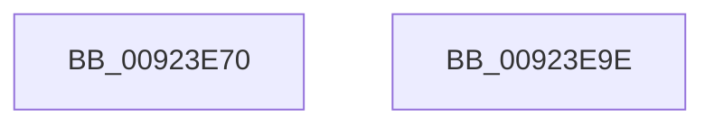

# AlpcpSetOwnerPortMessage

- RVA: `0x00923E70`–`0x00923E9F` (길이 `47` bytes)
- VA: `0x0000000140923E70`
- 실행 섹션: `PAGE`
- PDB 이름 있음: `예`; PDB Function 태그: `아니요`
- unwind 정보 RVA: `0x0005CAAC`
- 디코드: `14`개 명령, `47/47` bytes 표시
- 미해석 바이트: `0` (있으면 어셈블리에 `.byte`로 보존)

> 이 문서는 커널 이미지의 기계어와 PDB 기호를 분석해 생성했습니다. 4번과 5번은 함수 원형과 자료형을 바이너리 사용 방식에서 추정한 C 해석이며 원본 소스 복구 결과는 아닙니다.

## 1. Dependencies

- 직접 호출 지점: **1**; 고유 호출 대상: **1**
- 직접 호출자로 확인된 함수: **3**
- RIP 상대 이미지 참조: **0**

### Outgoing calls
- `0x00923E83` → [ObfReferenceObject](../../text/20/ObfReferenceObject_function_0020FA20.md) (function, `0x0020FA20`)

### Direct callers
- [AlpcpDispatchConnectionRequest](AlpcpDispatchConnectionRequest_function_0092353C.md) at `0x009236DB`
- [AlpcpSendLegacySynchronousRequest](AlpcpSendLegacySynchronousRequest_function_0092376C.md) at `0x00923AF4`
- [AlpcpDispatchCloseMessage](AlpcpDispatchCloseMessage_function_00923FBC.md) at `0x00924084`
- [AlpcpDispatchCloseMessage](AlpcpDispatchCloseMessage_function_00923FBC.md) at `0x00924109`

### Static image references
- 디코드된 RIP-relative 메모리 참조가 없습니다.

## 2. Other-region calls and transfers

- 다른 실행 섹션으로 향하는 call: **1**
  - `0x00923E83` → [ObfReferenceObject](../../text/20/ObfReferenceObject_function_0020FA20.md) (`PAGE` → `.text`)
- 별도 외부 분기/꼬리 이동을 확인하지 못했습니다.

## 3. Assembly (complete function range)

```asm
00923E70  48 89 5C 24 08                  mov qword ptr [rsp + 8], rbx
00923E75  57                              push rdi
00923E76  48 83 EC 20                     sub rsp, 0x20
00923E7A  48 8B F9                        mov rdi, rcx
00923E7D  48 8B DA                        mov rbx, rdx
00923E80  48 8B CA                        mov rcx, rdx
00923E83  E8 98 BB 8E FF                  call 0x14020fa20
00923E88  81 4F 28 00 10 00 00            or dword ptr [rdi + 0x28], 0x1000
00923E8F  48 89 5F 18                     mov qword ptr [rdi + 0x18], rbx
00923E93  48 8B 5C 24 30                  mov rbx, qword ptr [rsp + 0x30]
00923E98  48 83 C4 20                     add rsp, 0x20
00923E9C  5F                              pop rdi
00923E9D  C3                              ret
00923E9E  CC                              int3
```

## 4. C-style interpretation (structured pseudocode)

```c
__int64 __fastcall AlpcpSetOwnerPortMessage(__int64 a1, __int64 a2)
{
    __int64 result;
    __int64 v_rsp;
    unsigned __int64 v_stack_p8;

    v_stack_p8 = v_rbx;
    v_rsp = (v_rsp) - (32);
    result = ObfReferenceObject(a2, a2, a3, a4);
    *(unsigned __int64 *)(a1 + 24) = a2;
    v_rsp = (v_rsp) + (32);
    return result;
}
```

## 5. (Beta) C Style

```c
int64_t AlpcpSetOwnerPortMessage(void *Arg1, int64_t Arg2)
{
    uint8_t *arg1 = (uint8_t *)Arg1;

    int64_t result;
    int64_t local_rsp;
    uint64_t v_stack_p8;

    v_stack_p8 = local_rbx;
    local_rsp = (local_rsp) - (32);
    result = ObfReferenceObject(Arg2, Arg2, a3, a4);
    *(uint64_t *)(arg1 + 0x18) = Arg2;
    local_rsp = (local_rsp) + (32);
    return result;
}
```

### 관측된 메모리 오프셋

구조체 형식이 확인되지 않은 접근은 인자 기준의 오프셋으로만 기록했습니다.

| 기준 인자 | 오프셋 표현 | 폭 (bit) | 접근 |
|---|---:|---:|---|
| `Arg1` | `+ 0x18` | `64` | `W` |
| `Arg1` | `+ 0x28` | `32` | `R/W` |

## 6. Execution-region graph

[열기: 2D/3D 그래프와 함수 탐색 컨트롤 패널](../../../control-panel.html?section=page&rva=0x00923E70&view=graph)

- 2D 그래프는 위에서 아래로 흐르고, 3D 그래프는 빈 공간을 드래그해 회전합니다. Shift+드래그는 이동, 휠은 확대·축소, 함수 노드 선택은 대상 보고서 이동입니다.

### Static fallback


