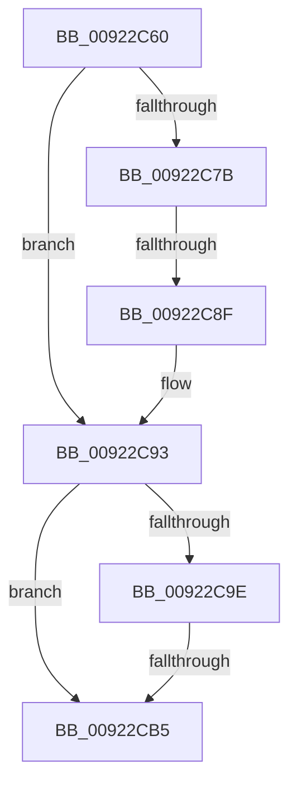

# AlpcpSetupMessageDataForDeferredCopy

- RVA: `0x00922C60`–`0x00922CB9` (길이 `89` bytes)
- VA: `0x0000000140922C60`
- 실행 섹션: `PAGE`
- PDB 이름 있음: `예`; PDB Function 태그: `아니요`
- unwind 정보 RVA: `0x0008D1D8`
- 디코드: `20`개 명령, `89/89` bytes 표시
- 미해석 바이트: `0` (있으면 어셈블리에 `.byte`로 보존)

> 이 문서는 커널 이미지의 기계어와 PDB 기호를 분석해 생성했습니다. 4번과 5번은 함수 원형과 자료형을 바이너리 사용 방식에서 추정한 C 해석이며 원본 소스 복구 결과는 아닙니다.

## 1. Dependencies

- 직접 호출 지점: **0**; 고유 호출 대상: **0**
- 직접 호출자로 확인된 함수: **2**
- RIP 상대 이미지 참조: **0**

### Outgoing calls
- 직접 디코드된 call 명령이 없습니다.

### Direct callers
- [AlpcpFormatConnectionRequest](AlpcpFormatConnectionRequest_function_00922A40.md) at `0x00922BA4`
- [AlpcpAcceptConnectPort](../A3/AlpcpAcceptConnectPort_function_00A34290.md) at `0x00A34A55`

### Static image references
- 디코드된 RIP-relative 메모리 참조가 없습니다.

## 2. Other-region calls and transfers

- 다른 실행 섹션으로 향하는 call: **0**
- call이 아닌 외부 분기/꼬리 이동: **2**
  - `0x00922C89` → [sub_00922E89](Unknown_function_00922E89.md) (`tail-transfer`)
  - `0x00922CAF` → [sub_00922DFF](Unknown_function_00922DFF.md) (`tail-transfer`)

## 3. Assembly (complete function range)

```asm
00922C60  48 89 5C 24 18                  mov qword ptr [rsp + 0x18], rbx
00922C65  48 89 6C 24 20                  mov qword ptr [rsp + 0x20], rbp
00922C6A  56                              push rsi
00922C6B  48 83 EC 20                     sub rsp, 0x20
00922C6F  33 ED                           xor ebp, ebp
00922C71  48 8B F1                        mov rsi, rcx
00922C74  40 38 6C 24 50                  cmp byte ptr [rsp + 0x50], bpl
00922C79  75 18                           jne 0x140922c93
00922C7B  41 81 E0 00 00 00 C0            and r8d, 0xc0000000
00922C82  41 81 F8 00 00 00 80            cmp r8d, 0x80000000
00922C89  0F 84 FA 01 00 00               je 0x140922e89
00922C8F  48 83 C2 28                     add rdx, 0x28
00922C93  41 0F B7 D9                     movzx ebx, r9w
00922C97  40 38 6C 24 58                  cmp byte ptr [rsp + 0x58], bpl
00922C9C  74 17                           je 0x140922cb5
00922C9E  48 8D 04 13                     lea rax, [rbx + rdx]
00922CA2  48 B9 00 00 FF FF FF 7F 00 00   movabs rcx, 0x7fffffff0000
00922CAC  48 3B C1                        cmp rax, rcx
00922CAF  0F 87 4A 01 00 00               ja 0x140922dff
00922CB5  48 8B 46 60                     mov rax, qword ptr [rsi + 0x60]
```

## 4. C-style interpretation (structured pseudocode)

```c
__int64 __fastcall AlpcpSetupMessageDataForDeferredCopy(__int64 a1, __int64 a2, int a3, unsigned __int16 a4, unsigned __int8 a5, unsigned __int8 a6)
{
    __int64 v_rbp;
    __int64 v_rsp;
    unsigned __int64 v_stack_p18;
    unsigned __int64 v_stack_p20;

    v_stack_p18 = v_rbx;
    v_stack_p20 = v_rbp;
    v_rsp = (v_rsp) - (32);
    v_rbp = 0;
    if (a5 != 0) goto loc_00922C93;
    a3 = (unsigned int)((a3) & (0xC0000000ULL));
    a2 = (a2) + (40);
loc_00922C93:
    if (a6 == 0) goto loc_00922CB5;
loc_00922CB5:
    return *(unsigned __int64 *)(a1 + 96);
}
```

## 5. (Beta) C Style

```c
int64_t AlpcpSetupMessageDataForDeferredCopy(void *Arg1, int64_t Arg2, int32_t Arg3, void *Arg4, uint8_t Arg5, uint8_t Arg6)
{
    uint8_t *arg1 = (uint8_t *)Arg1;
    uint8_t *arg4 = (uint8_t *)Arg4;

    int64_t local_rbp;
    int64_t local_rsp;
    uint64_t v_stack_p18;
    uint64_t v_stack_p20;

    v_stack_p18 = local_rbx;
    v_stack_p20 = local_rbp;
    local_rsp = (local_rsp) - (32);
    local_rbp = 0;
    if (Arg5 != 0) goto loc_00922C93;
    Arg3 = (uint32_t)((Arg3) & (0xC0000000ULL));
    Arg2 = (Arg2) + (40);
loc_00922C93:
    if (Arg6 == 0) goto loc_00922CB5;
loc_00922CB5:
    return *(uint64_t *)(arg1 + 0x60);
}
```

### 관측된 메모리 오프셋

구조체 형식이 확인되지 않은 접근은 인자 기준의 오프셋으로만 기록했습니다.

| 기준 인자 | 오프셋 표현 | 폭 (bit) | 접근 |
|---|---:|---:|---|
| `Arg1` | `+ 0x60` | `64` | `R` |
| `Arg4` | `+ 0x0 + rdx*1` | `64` | `R` |

## 6. Execution-region graph

[열기: 2D/3D 그래프와 함수 탐색 컨트롤 패널](../../../control-panel.html?section=page&rva=0x00922C60&view=graph)

- 2D 그래프는 위에서 아래로 흐르고, 3D 그래프는 빈 공간을 드래그해 회전합니다. Shift+드래그는 이동, 휠은 확대·축소, 함수 노드 선택은 대상 보고서 이동입니다.

### Static fallback


