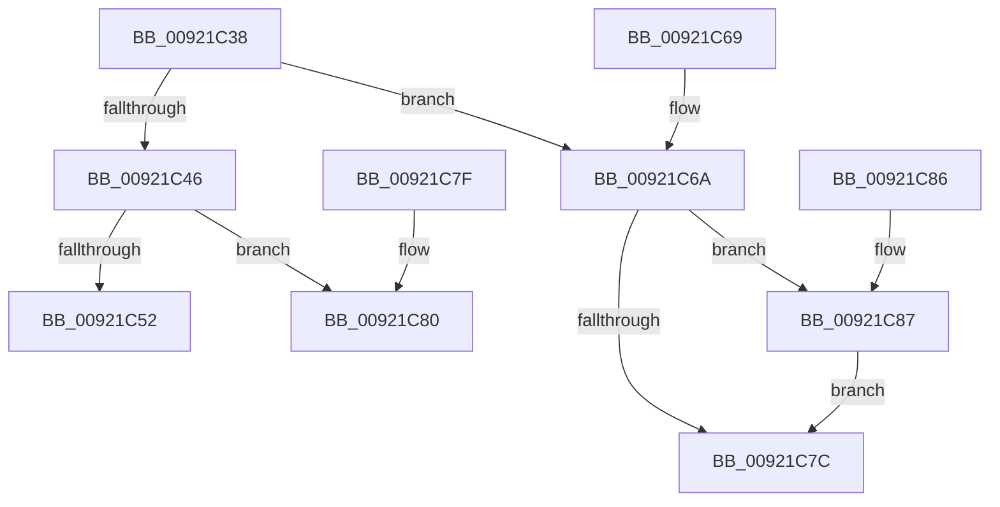

# AlpcpValidateConnectionMessage

- RVA: `0x00921C38`–`0x00921C98` (길이 `96` bytes)
- VA: `0x0000000140921C38`
- 실행 섹션: `PAGE`
- PDB 이름 있음: `예`; PDB Function 태그: `아니요`
- unwind 정보 RVA: `0x000DB714`
- 디코드: `32`개 명령, `96/96` bytes 표시
- 미해석 바이트: `0` (있으면 어셈블리에 `.byte`로 보존)

> 이 문서는 커널 이미지의 기계어와 PDB 기호를 분석해 생성했습니다. 4번과 5번은 함수 원형과 자료형을 바이너리 사용 방식에서 추정한 C 해석이며 원본 소스 복구 결과는 아닙니다.

## 1. Dependencies

- 직접 호출 지점: **0**; 고유 호출 대상: **0**
- 직접 호출자로 확인된 함수: **2**
- RIP 상대 이미지 참조: **0**

### Outgoing calls
- 직접 디코드된 call 명령이 없습니다.

### Direct callers
- [AlpcpFormatConnectionRequest](AlpcpFormatConnectionRequest_function_00922A40.md) at `0x00922C23`
- [AlpcpAcceptConnectPort](../A3/AlpcpAcceptConnectPort_function_00A34290.md) at `0x00A34800`

### Static image references
- 디코드된 RIP-relative 메모리 참조가 없습니다.

## 2. Other-region calls and transfers

- 다른 실행 섹션으로 향하는 call: **0**
- 별도 외부 분기/꼬리 이동을 확인하지 못했습니다.

## 3. Assembly (complete function range)

```asm
00921C38  45 84 C0                        test r8b, r8b
00921C3B  4C 8B C9                        mov r9, rcx
00921C3E  41 B8 28 00 00 00               mov r8d, 0x28
00921C44  75 24                           jne 0x140921c6a
00921C46  0F B7 0A                        movzx ecx, word ptr [rdx]
00921C49  41 8D 04 08                     lea eax, [r8 + rcx]
00921C4D  66 3B C8                        cmp cx, ax
00921C50  73 2E                           jae 0x140921c80
00921C52  0F B7 42 02                     movzx eax, word ptr [rdx + 2]
00921C56  49 03 C8                        add rcx, r8
00921C59  48 2B C8                        sub rcx, rax
00921C5C  B8 0D 00 00 C0                  mov eax, 0xc000000d
00921C61  48 F7 D9                        neg rcx
00921C64  1B C9                           sbb ecx, ecx
00921C66  23 C1                           and eax, ecx
00921C68  C3                              ret
00921C69  CC                              int3
00921C6A  48 8B 89 10 01 00 00            mov rcx, qword ptr [rcx + 0x110]
00921C71  0F B7 02                        movzx eax, word ptr [rdx]
00921C74  49 2B C8                        sub rcx, r8
00921C77  48 3B C1                        cmp rax, rcx
00921C7A  77 0B                           ja 0x140921c87
00921C7C  33 C0                           xor eax, eax
00921C7E  C3                              ret
00921C7F  CC                              int3
00921C80  B8 0D 00 00 C0                  mov eax, 0xc000000d
00921C85  C3                              ret
00921C86  CC                              int3
00921C87  41 0F B7 81 10 01 00 00         movzx eax, word ptr [r9 + 0x110]
00921C8F  66 41 2B C0                     sub ax, r8w
00921C93  66 89 02                        mov word ptr [rdx], ax
00921C96  EB E4                           jmp 0x140921c7c
```

## 4. C-style interpretation (structured pseudocode)

```c
__int64 __fastcall AlpcpValidateConnectionMessage(__int64 a1, __int64 a2, unsigned __int8 a3)
{
    __int64 result;

    if (a3 != 0) goto loc_00921C6A;
    if (((unsigned __int16)(*(unsigned __int16 *)(a2))) >= ((unsigned __int16)(40 + *(unsigned __int16 *)(a2) * 1))) goto loc_00921C80;
    a1 = (*(unsigned __int16 *)(a2)) + (40);
    a1 = (a1) - (*(unsigned __int16 *)(a2 + 2));
    a1 = -(a1);
    result = (unsigned int)(((unsigned int)(0xC000000DULL)) & ((unsigned int)(a1)));
    return result;
loc_00921C6A:
    a1 = (*(unsigned __int64 *)(a1 + 272)) - (40);
    if ((*(unsigned __int16 *)(a2)) > a1) goto loc_00921C87;
loc_00921C7C:
    result = 0;
    return result;
loc_00921C80:
    return (unsigned int)(0xC000000DULL);
loc_00921C87:
    result = (unsigned __int16)((*(unsigned __int16 *)(a1 + 272)) - (40));
    *(unsigned __int16 *)(a2) = (unsigned __int16)(result);
    goto loc_00921C7C;
}
```

## 5. (Beta) C Style

```c
int64_t AlpcpValidateConnectionMessage(void *Arg1, void *Arg2, uint8_t Arg3)
{
    uint8_t *arg1 = (uint8_t *)Arg1;
    uint8_t *arg2 = (uint8_t *)Arg2;

    int64_t result;

    if (Arg3 != 0) goto loc_00921C6A;
    if (((uint16_t)(*(uint16_t *)(arg2))) >= ((uint16_t)(40 + *(uint16_t *)(arg2) * 1))) goto loc_00921C80;
    Arg1 = (*(uint16_t *)(arg2)) + (40);
    Arg1 = (Arg1) - (*(uint16_t *)(arg2 + 0x2));
    Arg1 = -(Arg1);
    result = (uint32_t)(((uint32_t)(0xC000000DULL)) & ((uint32_t)(Arg1)));
    return result;
loc_00921C6A:
    Arg1 = (*(uint64_t *)(arg1 + 0x110)) - (40);
    if ((*(uint16_t *)(arg2)) > Arg1) goto loc_00921C87;
loc_00921C7C:
    result = 0;
    return result;
loc_00921C80:
    return (uint32_t)(0xC000000DULL);
loc_00921C87:
    result = (uint16_t)((*(uint16_t *)(arg1 + 0x110)) - (40));
    *(uint16_t *)(arg2) = (uint16_t)(result);
    goto loc_00921C7C;
}
```

### 관측된 메모리 오프셋

구조체 형식이 확인되지 않은 접근은 인자 기준의 오프셋으로만 기록했습니다.

| 기준 인자 | 오프셋 표현 | 폭 (bit) | 접근 |
|---|---:|---:|---|
| `Arg1` | `+ 0x110` | `16` | `R` |
| `Arg1` | `+ 0x110` | `64` | `R` |
| `Arg2` | `+ 0x0` | `16` | `R` |
| `Arg2` | `+ 0x0` | `16` | `W` |
| `Arg2` | `+ 0x2` | `16` | `R` |

## 6. Execution-region graph

[열기: 2D/3D 그래프와 함수 탐색 컨트롤 패널](../../../control-panel.html?section=page&rva=0x00921C38&view=graph)

- 2D 그래프는 위에서 아래로 흐르고, 3D 그래프는 빈 공간을 드래그해 회전합니다. Shift+드래그는 이동, 휠은 확대·축소, 함수 노드 선택은 대상 보고서 이동입니다.

### Static fallback


