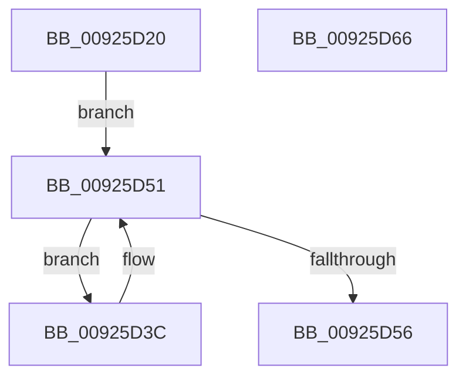

# AlpcpWalkConnectionList

- RVA: `0x00925D20`–`0x00925D67` (길이 `71` bytes)
- VA: `0x0000000140925D20`
- 실행 섹션: `PAGE`
- PDB 이름 있음: `예`; PDB Function 태그: `아니요`
- unwind 정보 RVA: `0x00060BC4`
- 디코드: `21`개 명령, `71/71` bytes 표시
- 미해석 바이트: `0` (있으면 어셈블리에 `.byte`로 보존)

> 이 문서는 커널 이미지의 기계어와 PDB 기호를 분석해 생성했습니다. 4번과 5번은 함수 원형과 자료형을 바이너리 사용 방식에서 추정한 C 해석이며 원본 소스 복구 결과는 아닙니다.

## 1. Dependencies

- 직접 호출 지점: **2**; 고유 호출 대상: **2**
- 직접 호출자로 확인된 함수: **1**
- RIP 상대 이미지 참조: **0**

### Outgoing calls
- `0x00925D40` → [AlpcpLockBlobExclusive](AlpcpLockBlobExclusive_function_009253A4.md) (function, `0x009253A4`)
- `0x00925D49` → [AlpcpUnlockBlobUncachedExclusive](AlpcpUnlockBlobUncachedExclusive_function_0092536C.md) (function, `0x0092536C`)

### Direct callers
- [AlpcpDisconnectPort](AlpcpDisconnectPort_function_00924A68.md) at `0x00924B2F`

### Static image references
- 디코드된 RIP-relative 메모리 참조가 없습니다.

## 2. Other-region calls and transfers

- 다른 실행 섹션으로 향하는 call: **0**
- 별도 외부 분기/꼬리 이동을 확인하지 못했습니다.

## 3. Assembly (complete function range)

```asm
00925D20  48 89 5C 24 08                  mov qword ptr [rsp + 8], rbx
00925D25  48 89 74 24 10                  mov qword ptr [rsp + 0x10], rsi
00925D2A  57                              push rdi
00925D2B  48 83 EC 20                     sub rsp, 0x20
00925D2F  48 8B 79 10                     mov rdi, qword ptr [rcx + 0x10]
00925D33  48 83 C7 18                     add rdi, 0x18
00925D37  48 8B 37                        mov rsi, qword ptr [rdi]
00925D3A  EB 15                           jmp 0x140925d51
00925D3C  48 8D 4E E8                     lea rcx, [rsi - 0x18]
00925D40  E8 5F F6 FF FF                  call 0x1409253a4
00925D45  48 8D 4E E8                     lea rcx, [rsi - 0x18]
00925D49  E8 1E F6 FF FF                  call 0x14092536c
00925D4E  48 8B 36                        mov rsi, qword ptr [rsi]
00925D51  48 3B F7                        cmp rsi, rdi
00925D54  75 E6                           jne 0x140925d3c
00925D56  48 8B 5C 24 30                  mov rbx, qword ptr [rsp + 0x30]
00925D5B  48 8B 74 24 38                  mov rsi, qword ptr [rsp + 0x38]
00925D60  48 83 C4 20                     add rsp, 0x20
00925D64  5F                              pop rdi
00925D65  C3                              ret
00925D66  CC                              int3
```

## 4. C-style interpretation (structured pseudocode)

```c
__int64 __fastcall AlpcpWalkConnectionList(__int64 a1)
{
    __int64 result;
    __int64 v_rdi;
    __int64 v_rsp;
    unsigned __int64 v_stack_p10;
    unsigned __int64 v_stack_p8;

    v_stack_p8 = v_rbx;
    v_stack_p10 = v_rsi;
    v_rsp = (v_rsp) - (32);
    v_rdi = (*(unsigned __int64 *)(a1 + 16)) + (24);
    goto loc_00925D51;
loc_00925D3C:
    result = AlpcpLockBlobExclusive(*(unsigned __int64 *)(v_rdi) - 24, a2, a3, a4);
    result = AlpcpUnlockBlobUncachedExclusive(*(unsigned __int64 *)(v_rdi) - 24, a2, a3, a4);
loc_00925D51:
    if ((*(unsigned __int64 *)(*(unsigned __int64 *)(v_rdi))) != v_rdi) goto loc_00925D3C;
    v_rsp = (v_rsp) + (32);
    return result;
}
```

## 5. (Beta) C Style

```c
int64_t AlpcpWalkConnectionList(void *Arg1)
{
    uint8_t *arg1 = (uint8_t *)Arg1;

    int64_t result;
    int64_t local_rdi;
    int64_t local_rsp;
    uint64_t v_stack_p10;
    uint64_t v_stack_p8;

    v_stack_p8 = local_rbx;
    v_stack_p10 = local_rsi;
    local_rsp = (local_rsp) - (32);
    local_rdi = (*(uint64_t *)(arg1 + 0x10)) + (24);
    goto loc_00925D51;
loc_00925D3C:
    result = AlpcpLockBlobExclusive(*(uint64_t *)(local_rdi) - 24, a2, a3, a4);
    result = AlpcpUnlockBlobUncachedExclusive(*(uint64_t *)(local_rdi) - 24, a2, a3, a4);
loc_00925D51:
    if ((*(uint64_t *)(*(uint64_t *)(local_rdi))) != local_rdi) goto loc_00925D3C;
    local_rsp = (local_rsp) + (32);
    return result;
}
```

### 관측된 메모리 오프셋

구조체 형식이 확인되지 않은 접근은 인자 기준의 오프셋으로만 기록했습니다.

| 기준 인자 | 오프셋 표현 | 폭 (bit) | 접근 |
|---|---:|---:|---|
| `Arg1` | `+ 0x10` | `64` | `R` |

## 6. Execution-region graph

[열기: 2D/3D 그래프와 함수 탐색 컨트롤 패널](../../../control-panel.html?section=page&rva=0x00925D20&view=graph)

- 2D 그래프는 위에서 아래로 흐르고, 3D 그래프는 빈 공간을 드래그해 회전합니다. Shift+드래그는 이동, 휠은 확대·축소, 함수 노드 선택은 대상 보고서 이동입니다.

### Static fallback


