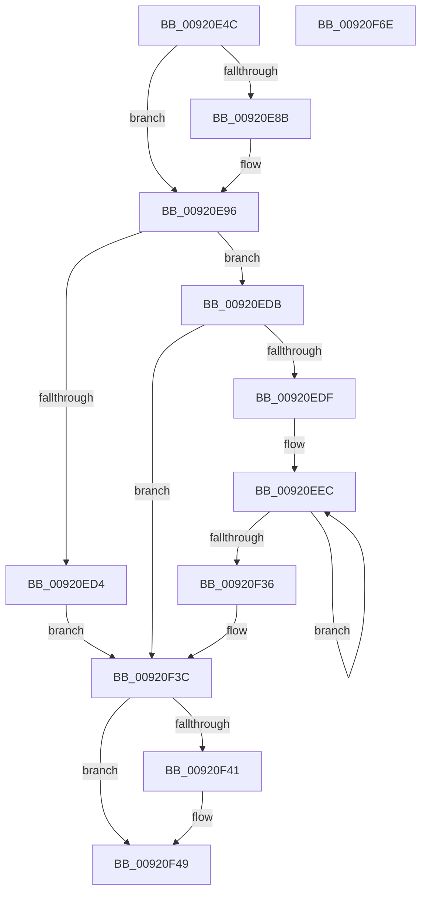

# DbgkpSendApiMessageLpc

- RVA: `0x00920E4C`–`0x00920F6F` (길이 `291` bytes)
- VA: `0x0000000140920E4C`
- 실행 섹션: `PAGE`
- PDB 이름 있음: `예`; PDB Function 태그: `아니요`
- unwind 정보 RVA: `0x0008CF88`
- 디코드: `75`개 명령, `291/291` bytes 표시
- 미해석 바이트: `0` (있으면 어셈블리에 `.byte`로 보존)

> 이 문서는 커널 이미지의 기계어와 PDB 기호를 분석해 생성했습니다. 4번과 5번은 함수 원형과 자료형을 바이너리 사용 방식에서 추정한 C 해석이며 원본 소스 복구 결과는 아닙니다.

## 1. Dependencies

- 직접 호출 지점: **4**; 고유 호출 대상: **4**
- 직접 호출자로 확인된 함수: **1**
- RIP 상대 이미지 참조: **1**

### Outgoing calls
- `0x00920E8E` → [DbgkpSuspendProcess](../8A/DbgkpSuspendProcess_function_008A34D4.md) (function, `0x008A34D4`)
- `0x00920EC6` → [LpcSendWaitReceivePort](LpcSendWaitReceivePort_function_00921F50.md) (function, `0x00921F50`)
- `0x00920F44` → [DbgkpResumeProcess](../A7/DbgkpResumeProcess_function_00A7954C.md) (function, `0x00A7954C`)
- `0x00920F56` → [_security_check_cookie](../../text/6A/_security_check_cookie_function_006AC640.md) (function, `0x006AC640`)

### Direct callers
- [DbgkForwardException](../8A/DbgkForwardException_function_008A2D60.md) at `0x008A30D2`

### Static image references
- `0x00920E5B` → RVA `0x00E0A740` (`.data`; read)

## 2. Other-region calls and transfers

- 다른 실행 섹션으로 향하는 call: **1**
  - `0x00920F56` → [_security_check_cookie](../../text/6A/_security_check_cookie_function_006AC640.md) (`PAGE` → `.text`)
- 별도 외부 분기/꼬리 이동을 확인하지 못했습니다.

## 3. Assembly (complete function range)

```asm
00920E4C  48 89 5C 24 18                  mov qword ptr [rsp + 0x18], rbx
00920E51  55                              push rbp
00920E52  56                              push rsi
00920E53  57                              push rdi
00920E54  48 81 EC 00 03 00 00            sub rsp, 0x300
00920E5B  48 8B 05 DE 98 4E 00            mov rax, qword ptr [rip + 0x4e98de]
00920E62  48 33 C4                        xor rax, rsp
00920E65  48 89 84 24 F0 02 00 00         mov qword ptr [rsp + 0x2f0], rax
00920E6D  65 48 8B 04 25 88 01 00 00      mov rax, qword ptr gs:[0x188]
00920E76  41 8A F0                        mov sil, r8b
00920E79  48 8B FA                        mov rdi, rdx
00920E7C  48 8B D9                        mov rbx, rcx
00920E7F  48 8B A8 B8 00 00 00            mov rbp, qword ptr [rax + 0xb8]
00920E86  45 84 C0                        test r8b, r8b
00920E89  74 0B                           je 0x140920e96
00920E8B  48 8B CD                        mov rcx, rbp
00920E8E  E8 41 26 F8 FF                  call 0x1408a34d4
00920E93  40 8A F0                        mov sil, al
00920E96  48 83 64 24 28 00               and qword ptr [rsp + 0x28], 0
00920E9C  48 8D 44 24 30                  lea rax, [rsp + 0x30]
00920EA1  4C 8D 4C 24 40                  lea r9, [rsp + 0x40]
00920EA6  48 89 44 24 20                  mov qword ptr [rsp + 0x20], rax
00920EAB  4C 8B C3                        mov r8, rbx
00920EAE  C7 43 2C 03 01 00 00            mov dword ptr [rbx + 0x2c], 0x103
00920EB5  BA 00 00 02 00                  mov edx, 0x20000
00920EBA  48 C7 44 24 30 B0 02 00 00      mov qword ptr [rsp + 0x30], 0x2b0
00920EC3  48 8B CF                        mov rcx, rdi
00920EC6  E8 85 10 00 00                  call 0x140921f50
00920ECB  8B F8                           mov edi, eax
00920ECD  3D C0 00 00 00                  cmp eax, 0xc0
00920ED2  75 07                           jne 0x140920edb
00920ED4  BF 4B 00 00 C0                  mov edi, 0xc000004b
00920ED9  EB 61                           jmp 0x140920f3c
00920EDB  85 C0                           test eax, eax
00920EDD  78 5D                           js 0x140920f3c
00920EDF  B9 02 00 00 00                  mov ecx, 2
00920EE4  48 8D 44 24 40                  lea rax, [rsp + 0x40]
00920EE9  8D 51 7E                        lea edx, [rcx + 0x7e]
00920EEC  0F 10 00                        movups xmm0, xmmword ptr [rax]
00920EEF  0F 10 48 10                     movups xmm1, xmmword ptr [rax + 0x10]
00920EF3  0F 11 03                        movups xmmword ptr [rbx], xmm0
00920EF6  0F 10 40 20                     movups xmm0, xmmword ptr [rax + 0x20]
00920EFA  0F 11 4B 10                     movups xmmword ptr [rbx + 0x10], xmm1
00920EFE  0F 10 48 30                     movups xmm1, xmmword ptr [rax + 0x30]
00920F02  0F 11 43 20                     movups xmmword ptr [rbx + 0x20], xmm0
00920F06  0F 10 40 40                     movups xmm0, xmmword ptr [rax + 0x40]
00920F0A  0F 11 4B 30                     movups xmmword ptr [rbx + 0x30], xmm1
00920F0E  0F 10 48 50                     movups xmm1, xmmword ptr [rax + 0x50]
00920F12  0F 11 43 40                     movups xmmword ptr [rbx + 0x40], xmm0
00920F16  0F 10 40 60                     movups xmm0, xmmword ptr [rax + 0x60]
00920F1A  0F 11 4B 50                     movups xmmword ptr [rbx + 0x50], xmm1
00920F1E  0F 10 48 70                     movups xmm1, xmmword ptr [rax + 0x70]
00920F22  48 03 C2                        add rax, rdx
00920F25  0F 11 43 60                     movups xmmword ptr [rbx + 0x60], xmm0
00920F29  48 03 DA                        add rbx, rdx
00920F2C  0F 11 4B F0                     movups xmmword ptr [rbx - 0x10], xmm1
00920F30  48 83 E9 01                     sub rcx, 1
00920F34  75 B6                           jne 0x140920eec
00920F36  0F 10 00                        movups xmm0, xmmword ptr [rax]
00920F39  0F 11 03                        movups xmmword ptr [rbx], xmm0
00920F3C  40 84 F6                        test sil, sil
00920F3F  74 08                           je 0x140920f49
00920F41  48 8B CD                        mov rcx, rbp
00920F44  E8 03 86 15 00                  call 0x140a7954c
00920F49  8B C7                           mov eax, edi
00920F4B  48 8B 8C 24 F0 02 00 00         mov rcx, qword ptr [rsp + 0x2f0]
00920F53  48 33 CC                        xor rcx, rsp
00920F56  E8 E5 B6 D8 FF                  call 0x1406ac640
00920F5B  48 8B 9C 24 30 03 00 00         mov rbx, qword ptr [rsp + 0x330]
00920F63  48 81 C4 00 03 00 00            add rsp, 0x300
00920F6A  5F                              pop rdi
00920F6B  5E                              pop rsi
00920F6C  5D                              pop rbp
00920F6D  C3                              ret
00920F6E  CC                              int3
```

## 4. C-style interpretation (structured pseudocode)

```c
__int64 __fastcall DbgkpSendApiMessageLpc(__int64 a1, __int64 a2, unsigned __int8 a3)
{
    __int64 result;
    __int64 v_rbx;
    __int64 v_rsi;
    __int64 v_rsp;
    unsigned __int64 v_stack_m28;
    unsigned __int64 v_stack_m2D8;
    unsigned __int64 v_stack_m2E8;
    unsigned __int64 v_stack_m2F0;
    unsigned __int64 v_stack_m2F8;
    unsigned __int64 v_stack_p18;

    v_stack_p18 = v_rbx;
    v_rsp = (v_rsp) - (768);
    result = (*(unsigned __int64 *)(v_rip + 5150942)) ^ (v_rsp);
    v_stack_m28 = result;
    result = *(unsigned __int64 *)(gs_base + (0 + 392));
    v_rsi = a3;
    if (a3 != 0) {
        a1 = *(unsigned __int64 *)(*(unsigned __int64 *)(gs_base + (0 + 392)) + 184);
        result = DbgkpSuspendProcess(a1, a2, a3, a4);
        v_rsi = (unsigned __int8)(result);
    }
    v_stack_m2F8 = v_stack_m2E8;
    *(unsigned int *)(a1 + 44) = 259;
    v_stack_m2E8 = 688;
    result = LpcSendWaitReceivePort(a2, (unsigned int)(0x20000ULL), a1, v_stack_m2D8);
    if (((unsigned int)(result)) != 192) goto loc_00920EDB;
    goto loc_00920F3C;
loc_00920EDB:
    if (sign_flag) goto loc_00920F3C;
loc_00920EEC:
    *(unsigned __int64 *)(a1) = v_xmm0;
    *(unsigned __int64 *)(a1 + 16) = v_xmm1;
    *(unsigned __int64 *)(a1 + 32) = v_xmm0;
    *(unsigned __int64 *)(a1 + 48) = v_xmm1;
    *(unsigned __int64 *)(a1 + 64) = v_xmm0;
    *(unsigned __int64 *)(a1 + 80) = v_xmm1;
    result = (v_stack_m2D8) + (2 + 126);
    *(unsigned __int64 *)(a1 + 96) = v_xmm0;
    v_rbx = (a1) + (2 + 126);
    *(unsigned __int64 *)(v_rbx - 16) = v_xmm1;
    a1 = (2) - (1);
    if (condition_is_not_equal) goto loc_00920EEC;
    *(unsigned __int64 *)(v_rbx) = v_xmm0;
loc_00920F3C:
    if ((unsigned __int8)(v_rsi) != 0) {
        a1 = *(unsigned __int64 *)(*(unsigned __int64 *)(gs_base + (0 + 392)) + 184);
        result = DbgkpResumeProcess(a1, 2 + 126, a1, v_stack_m2D8);
    }
    a1 = (v_stack_m28) ^ (v_rsp);
    result = _security_check_cookie(a1, 2 + 126, a1, v_stack_m2D8);
    v_rsp = (v_rsp) + (768);
    return result;
}
```

## 5. (Beta) C Style

```c
int64_t DbgkpSendApiMessageLpc(void *Arg1, int64_t Arg2, uint8_t Arg3)
{
    uint8_t *arg1 = (uint8_t *)Arg1;

    int64_t result;
    int64_t local_rbx;
    int64_t local_rsi;
    int64_t local_rsp;
    uint64_t v_stack_m28;
    uint64_t v_stack_m2D8;
    uint64_t v_stack_m2E8;
    uint64_t v_stack_m2F0;
    uint64_t v_stack_m2F8;
    uint64_t v_stack_p18;

    v_stack_p18 = local_rbx;
    local_rsp = (local_rsp) - (768);
    result = (*(uint64_t *)(v_rip + 0x4E98DE)) ^ (local_rsp);
    v_stack_m28 = result;
    result = *(uint64_t *)(gs_base + (0 + 0x188));
    local_rsi = Arg3;
    if (Arg3 != 0) {
        Arg1 = *(uint64_t *)(*(uint64_t *)(gs_base + (0 + 0x188)) + 0xB8);
        result = DbgkpSuspendProcess(Arg1, Arg2, Arg3, a4);
        local_rsi = (uint8_t)(result);
    }
    v_stack_m2F8 = v_stack_m2E8;
    *(uint32_t *)(arg1 + 0x2C) = 259;
    v_stack_m2E8 = 688;
    result = LpcSendWaitReceivePort(Arg2, (uint32_t)(0x20000ULL), Arg1, v_stack_m2D8);
    if (((uint32_t)(result)) != 192) goto loc_00920EDB;
    goto loc_00920F3C;
loc_00920EDB:
    if (sign_flag) goto loc_00920F3C;
loc_00920EEC:
    *(uint64_t *)(arg1) = v_xmm0;
    *(uint64_t *)(arg1 + 0x10) = v_xmm1;
    *(uint64_t *)(arg1 + 0x20) = v_xmm0;
    *(uint64_t *)(arg1 + 0x30) = v_xmm1;
    *(uint64_t *)(arg1 + 0x40) = v_xmm0;
    *(uint64_t *)(arg1 + 0x50) = v_xmm1;
    result = (v_stack_m2D8) + (2 + 126);
    *(uint64_t *)(arg1 + 0x60) = v_xmm0;
    local_rbx = (Arg1) + (2 + 126);
    *(uint64_t *)(local_rbx - 0x10) = v_xmm1;
    Arg1 = (2) - (1);
    if (condition_is_not_equal) goto loc_00920EEC;
    *(uint64_t *)(local_rbx) = v_xmm0;
loc_00920F3C:
    if ((uint8_t)(local_rsi) != 0) {
        Arg1 = *(uint64_t *)(*(uint64_t *)(gs_base + (0 + 0x188)) + 0xB8);
        result = DbgkpResumeProcess(Arg1, 2 + 126, Arg1, v_stack_m2D8);
    }
    Arg1 = (v_stack_m28) ^ (local_rsp);
    result = _security_check_cookie(Arg1, 2 + 126, Arg1, v_stack_m2D8);
    local_rsp = (local_rsp) + (768);
    return result;
}
```

### 관측된 메모리 오프셋

구조체 형식이 확인되지 않은 접근은 인자 기준의 오프셋으로만 기록했습니다.

| 기준 인자 | 오프셋 표현 | 폭 (bit) | 접근 |
|---|---:|---:|---|
| `Arg1` | `- 0x10` | `128` | `R` |
| `Arg1` | `+ 0x0` | `128` | `R` |
| `Arg1` | `+ 0x10` | `128` | `R` |
| `Arg1` | `+ 0x20` | `128` | `R` |
| `Arg1` | `+ 0x2C` | `32` | `W` |
| `Arg1` | `+ 0x30` | `128` | `R` |
| `Arg1` | `+ 0x40` | `128` | `R` |
| `Arg1` | `+ 0x50` | `128` | `R` |
| `Arg1` | `+ 0x60` | `128` | `R` |

## 6. Execution-region graph

[열기: 2D/3D 그래프와 함수 탐색 컨트롤 패널](../../../control-panel.html?section=page&rva=0x00920E4C&view=graph)

- 2D 그래프는 위에서 아래로 흐르고, 3D 그래프는 빈 공간을 드래그해 회전합니다. Shift+드래그는 이동, 휠은 확대·축소, 함수 노드 선택은 대상 보고서 이동입니다.

### Static fallback


