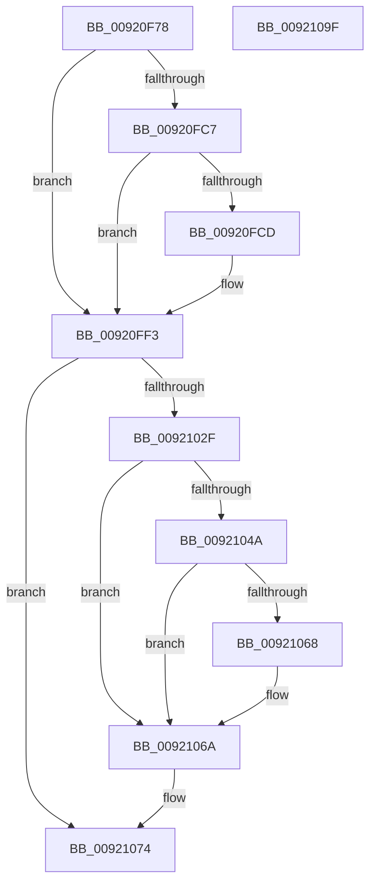

# DbgkpStartSystemErrorHandler

- RVA: `0x00920F78`–`0x009210A0` (길이 `296` bytes)
- VA: `0x0000000140920F78`
- 실행 섹션: `PAGE`
- PDB 이름 있음: `예`; PDB Function 태그: `아니요`
- unwind 정보 RVA: `0x0008CFA8`
- 디코드: `78`개 명령, `296/296` bytes 표시
- 미해석 바이트: `0` (있으면 어셈블리에 `.byte`로 보존)

> 이 문서는 커널 이미지의 기계어와 PDB 기호를 분석해 생성했습니다. 4번과 5번은 함수 원형과 자료형을 바이너리 사용 방식에서 추정한 C 해석이며 원본 소스 복구 결과는 아닙니다.

## 1. Dependencies

- 직접 호출 지점: **8**; 고유 호출 대상: **8**
- 직접 호출자로 확인된 함수: **1**
- RIP 상대 이미지 참조: **3**

### Outgoing calls
- `0x00920FBE` → [ZwQueryWnfStateNameInformation](../../text/6A/ZwQueryWnfStateNameInformation_function_006AFF10.md) (function, `0x006AFF10`)
- `0x00920FE9` → [ZwUpdateWnfStateData](../../text/6B/ZwUpdateWnfStateData_function_006B0D10.md) (function, `0x006B0D10`)
- `0x00920FF3` → [PsGetCurrentServerSiloGlobals](../../text/2F/PsGetCurrentServerSiloGlobals_function_002FE1F0.md) (function, `0x002FE1F0`)
- `0x00921026` → [EtwpRegisterKMProvider](EtwpRegisterKMProvider_function_009209A4.md) (function, `0x009209A4`)
- `0x00921041` → [EtwEventEnabled](../../text/39/EtwEventEnabled_function_00392450.md) (function, `0x00392450`)
- `0x0092105F` → [EtwWrite](../../text/41/EtwWrite_function_0041C720.md) (function, `0x0041C720`)
- `0x0092106F` → [EtwUnregister](../A7/EtwUnregister_function_00A723D0.md) (function, `0x00A723D0`)
- `0x00921088` → [_security_check_cookie](../../text/6A/_security_check_cookie_function_006AC640.md) (function, `0x006AC640`)

### Direct callers
- [DbgkpSendErrorMessage](DbgkpSendErrorMessage_function_009210A8.md) at `0x00921198`

### Static image references
- `0x00920F88` → RVA `0x00E0A740` (`.data`; read)
- `0x00920FB0` → RVA `0x00011D40` (`.rdata`; read)
- `0x00921005` → RVA `0x00011D48` (`.rdata`; read)

## 2. Other-region calls and transfers

- 다른 실행 섹션으로 향하는 call: **6**
  - `0x00920FBE` → [ZwQueryWnfStateNameInformation](../../text/6A/ZwQueryWnfStateNameInformation_function_006AFF10.md) (`PAGE` → `.text`)
  - `0x00920FE9` → [ZwUpdateWnfStateData](../../text/6B/ZwUpdateWnfStateData_function_006B0D10.md) (`PAGE` → `.text`)
  - `0x00920FF3` → [PsGetCurrentServerSiloGlobals](../../text/2F/PsGetCurrentServerSiloGlobals_function_002FE1F0.md) (`PAGE` → `.text`)
  - `0x00921041` → [EtwEventEnabled](../../text/39/EtwEventEnabled_function_00392450.md) (`PAGE` → `.text`)
  - `0x0092105F` → [EtwWrite](../../text/41/EtwWrite_function_0041C720.md) (`PAGE` → `.text`)
  - `0x00921088` → [_security_check_cookie](../../text/6A/_security_check_cookie_function_006AC640.md) (`PAGE` → `.text`)
- 별도 외부 분기/꼬리 이동을 확인하지 못했습니다.

## 3. Assembly (complete function range)

```asm
00920F78  4C 8B DC                        mov r11, rsp
00920F7B  49 89 5B 08                     mov qword ptr [r11 + 8], rbx
00920F7F  49 89 6B 10                     mov qword ptr [r11 + 0x10], rbp
00920F83  57                              push rdi
00920F84  48 83 EC 70                     sub rsp, 0x70
00920F88  48 8B 05 B1 97 4E 00            mov rax, qword ptr [rip + 0x4e97b1]
00920F8F  48 33 C4                        xor rax, rsp
00920F92  48 89 44 24 60                  mov qword ptr [rsp + 0x60], rax
00920F97  33 DB                           xor ebx, ebx
00920F99  C7 44 24 20 04 00 00 00         mov dword ptr [rsp + 0x20], 4
00920FA1  4D 8D 4B C8                     lea r9, [r11 - 0x38]
00920FA5  49 89 5B D0                     mov qword ptr [r11 - 0x30], rbx
00920FA9  45 33 C0                        xor r8d, r8d
00920FAC  89 5C 24 40                     mov dword ptr [rsp + 0x40], ebx
00920FB0  48 8D 0D 89 0D 6F FF            lea rcx, [rip - 0x90f277]
00920FB7  8B FB                           mov edi, ebx
00920FB9  8D 6B 01                        lea ebp, [rbx + 1]
00920FBC  8B D5                           mov edx, ebp
00920FBE  E8 4D EF D8 FF                  call 0x1406aff10
00920FC3  85 C0                           test eax, eax
00920FC5  78 2C                           js 0x140920ff3
00920FC7  39 5C 24 40                     cmp dword ptr [rsp + 0x40], ebx
00920FCB  74 26                           je 0x140920ff3
00920FCD  89 5C 24 30                     mov dword ptr [rsp + 0x30], ebx
00920FD1  48 8D 0D 68 0D 6F FF            lea rcx, [rip - 0x90f298]
00920FD8  89 5C 24 28                     mov dword ptr [rsp + 0x28], ebx
00920FDC  45 33 C9                        xor r9d, r9d
00920FDF  45 33 C0                        xor r8d, r8d
00920FE2  48 89 5C 24 20                  mov qword ptr [rsp + 0x20], rbx
00920FE7  33 D2                           xor edx, edx
00920FE9  E8 22 FD D8 FF                  call 0x1406b0d10
00920FEE  85 C0                           test eax, eax
00920FF0  0F 49 FD                        cmovns edi, ebp
00920FF3  E8 F8 D1 9D FF                  call 0x1402fe1f0
00920FF8  45 33 C9                        xor r9d, r9d
00920FFB  48 8D 54 24 48                  lea rdx, [rsp + 0x48]
00921000  48 89 54 24 30                  mov qword ptr [rsp + 0x30], rdx
00921005  48 8D 15 3C 0D 6F FF            lea rdx, [rip - 0x90f2c4]
0092100C  48 8B 88 40 03 00 00            mov rcx, qword ptr [rax + 0x340]
00921013  48 8B 44 24 78                  mov rax, qword ptr [rsp + 0x78]
00921018  45 8D 41 03                     lea r8d, [r9 + 3]
0092101C  48 89 44 24 28                  mov qword ptr [rsp + 0x28], rax
00921021  48 89 5C 24 20                  mov qword ptr [rsp + 0x20], rbx
00921026  E8 79 F9 FF FF                  call 0x1409209a4
0092102B  85 C0                           test eax, eax
0092102D  78 45                           js 0x140921074
0092102F  48 8B 4C 24 48                  mov rcx, qword ptr [rsp + 0x48]
00921034  48 8D 54 24 50                  lea rdx, [rsp + 0x50]
00921039  0F 57 C0                        xorps xmm0, xmm0
0092103C  0F 11 44 24 50                  movups xmmword ptr [rsp + 0x50], xmm0
00921041  E8 0A 14 A7 FF                  call 0x140392450
00921046  84 C0                           test al, al
00921048  74 20                           je 0x14092106a
0092104A  48 8B 4C 24 48                  mov rcx, qword ptr [rsp + 0x48]
0092104F  48 8D 54 24 50                  lea rdx, [rsp + 0x50]
00921054  45 33 C9                        xor r9d, r9d
00921057  48 89 5C 24 20                  mov qword ptr [rsp + 0x20], rbx
0092105C  45 33 C0                        xor r8d, r8d
0092105F  E8 BC B6 AF FF                  call 0x14041c720
00921064  85 C0                           test eax, eax
00921066  78 02                           js 0x14092106a
00921068  03 FD                           add edi, ebp
0092106A  48 8B 4C 24 48                  mov rcx, qword ptr [rsp + 0x48]
0092106F  E8 5C 13 15 00                  call 0x140a723d0
00921074  B8 80 00 00 C0                  mov eax, 0xc0000080
00921079  85 FF                           test edi, edi
0092107B  0F 44 D8                        cmove ebx, eax
0092107E  8B C3                           mov eax, ebx
00921080  48 8B 4C 24 60                  mov rcx, qword ptr [rsp + 0x60]
00921085  48 33 CC                        xor rcx, rsp
00921088  E8 B3 B5 D8 FF                  call 0x1406ac640
0092108D  4C 8D 5C 24 70                  lea r11, [rsp + 0x70]
00921092  49 8B 5B 10                     mov rbx, qword ptr [r11 + 0x10]
00921096  49 8B 6B 18                     mov rbp, qword ptr [r11 + 0x18]
0092109A  49 8B E3                        mov rsp, r11
0092109D  5F                              pop rdi
0092109E  C3                              ret
0092109F  CC                              int3
```

## 4. C-style interpretation (structured pseudocode)

```c
__int64 __fastcall DbgkpStartSystemErrorHandler(__int64 a1, __int64 a2, int a3)
{
    __int64 result;
    __int64 v_rbx;
    __int64 v_rdi;
    __int64 v_rsp;
    unsigned __int64 v_stack_m18;
    unsigned __int64 v_stack_m28;
    unsigned __int64 v_stack_m30;
    unsigned int v_stack_m38;
    unsigned int v_stack_m48;
    unsigned int v_stack_m50;
    unsigned int v_stack_m58;
    unsigned __int64 v_stack_m8;
    unsigned __int64 v_stack_p0;

    *(unsigned __int64 *)(v_rsp + 8) = v_rbx;
    *(unsigned __int64 *)(v_rsp + 16) = v_rbp;
    v_rsp = (v_rsp) - (112);
    result = (*(unsigned __int64 *)(v_rip + 5150641)) ^ (v_rsp);
    v_stack_m18 = result;
    v_rbx = 0;
    v_stack_m58 = 4;
    *(unsigned __int64 *)(v_rsp - 48) = 0;
    a3 = 0;
    v_stack_m38 = 0;
    result = ZwQueryWnfStateNameInformation(v_rip - 9499255, (unsigned int)((unsigned int)(v_rbx + 1)), a3, v_rsp - 56);
    if (sign_flag) goto loc_00920FF3;
    v_rdi = 0;
    if (v_stack_m38 != 0) {
        v_stack_m48 = 0;
        a1 = v_rip - 9499288;
        v_stack_m50 = 0;
        a4 = 0;
        a3 = 0;
        v_stack_m58 = 0;
        a2 = 0;
        result = ZwUpdateWnfStateData(a1, a2, a3, a4);
        v_rdi = 0;
        if (!sign_flag) { v_rdi = (unsigned int)(v_rbx + 1); }
    }
    result = PsGetCurrentServerSiloGlobals(a1, a2, a3, a4);
    a4 = 0;
    v_stack_m48 = v_stack_m30;
    v_stack_m50 = v_stack_p0;
    v_stack_m58 = 0;
    result = EtwpRegisterKMProvider(*(unsigned __int64 *)(result + 832), v_rip - 9499332, a4 + 3, a4);
    if (sign_flag) goto loc_00921074;
    v_stack_m28 = v_xmm0;
    result = EtwEventEnabled(v_stack_m30, v_stack_m28, a4 + 3, a4);
    if ((unsigned __int8)(result) == 0) goto loc_0092106A;
    a4 = 0;
    v_stack_m58 = 0;
    a3 = 0;
    result = EtwWrite(v_stack_m30, v_stack_m28, a3, a4);
    if (!(sign_flag)) {
        v_rdi = (unsigned int)((v_rdi) + ((unsigned int)(v_rbx + 1)));
    }
    result = EtwUnregister(v_stack_m30, v_stack_m28, a3, a4);
loc_00921074:
    if ((unsigned int)(v_rdi) == 0) { v_rbx = (unsigned int)((unsigned int)(0xC0000080ULL)); }
    a1 = (v_stack_m18) ^ (v_rsp);
    result = _security_check_cookie(a1, v_stack_m28, a3, a4);
    return result;
}
```

## 5. (Beta) C Style

```c
int64_t DbgkpStartSystemErrorHandler(int64_t Arg1, int64_t Arg2, int32_t Arg3)
{
    int64_t result;
    int64_t local_rbx;
    int64_t local_rdi;
    int64_t local_rsp;
    uint64_t v_stack_m18;
    uint64_t v_stack_m28;
    uint64_t v_stack_m30;
    uint32_t v_stack_m38;
    uint32_t v_stack_m48;
    uint32_t v_stack_m50;
    uint32_t v_stack_m58;
    uint64_t v_stack_m8;
    uint64_t v_stack_p0;

    *(uint64_t *)(local_rsp + 0x8) = local_rbx;
    *(uint64_t *)(local_rsp + 0x10) = local_rbp;
    local_rsp = (local_rsp) - (112);
    result = (*(uint64_t *)(v_rip + 0x4E97B1)) ^ (local_rsp);
    v_stack_m18 = result;
    local_rbx = 0;
    v_stack_m58 = 4;
    *(uint64_t *)(local_rsp - 0x30) = 0;
    Arg3 = 0;
    v_stack_m38 = 0;
    result = ZwQueryWnfStateNameInformation(v_rip - 9499255, (uint32_t)((uint32_t)(local_rbx + 1)), Arg3, local_rsp - 56);
    if (sign_flag) goto loc_00920FF3;
    local_rdi = 0;
    if (v_stack_m38 != 0) {
        v_stack_m48 = 0;
        Arg1 = v_rip - 9499288;
        v_stack_m50 = 0;
        a4 = 0;
        Arg3 = 0;
        v_stack_m58 = 0;
        Arg2 = 0;
        result = ZwUpdateWnfStateData(Arg1, Arg2, Arg3, a4);
        local_rdi = 0;
        if (!sign_flag) { local_rdi = (uint32_t)(local_rbx + 1); }
    }
    result = PsGetCurrentServerSiloGlobals(Arg1, Arg2, Arg3, a4);
    a4 = 0;
    v_stack_m48 = v_stack_m30;
    v_stack_m50 = v_stack_p0;
    v_stack_m58 = 0;
    result = EtwpRegisterKMProvider(*(uint64_t *)(result + 0x340), v_rip - 9499332, a4 + 3, a4);
    if (sign_flag) goto loc_00921074;
    v_stack_m28 = v_xmm0;
    result = EtwEventEnabled(v_stack_m30, v_stack_m28, a4 + 3, a4);
    if ((uint8_t)(result) == 0) goto loc_0092106A;
    a4 = 0;
    v_stack_m58 = 0;
    Arg3 = 0;
    result = EtwWrite(v_stack_m30, v_stack_m28, Arg3, a4);
    if (!(sign_flag)) {
        local_rdi = (uint32_t)((local_rdi) + ((uint32_t)(local_rbx + 1)));
    }
    result = EtwUnregister(v_stack_m30, v_stack_m28, Arg3, a4);
loc_00921074:
    if ((uint32_t)(local_rdi) == 0) { local_rbx = (uint32_t)((uint32_t)(0xC0000080ULL)); }
    Arg1 = (v_stack_m18) ^ (local_rsp);
    result = _security_check_cookie(Arg1, v_stack_m28, Arg3, a4);
    return result;
}
```

## 6. Execution-region graph

[열기: 2D/3D 그래프와 함수 탐색 컨트롤 패널](../../../control-panel.html?section=page&rva=0x00920F78&view=graph)

- 2D 그래프는 위에서 아래로 흐르고, 3D 그래프는 빈 공간을 드래그해 회전합니다. Shift+드래그는 이동, 휠은 확대·축소, 함수 노드 선택은 대상 보고서 이동입니다.

### Static fallback


