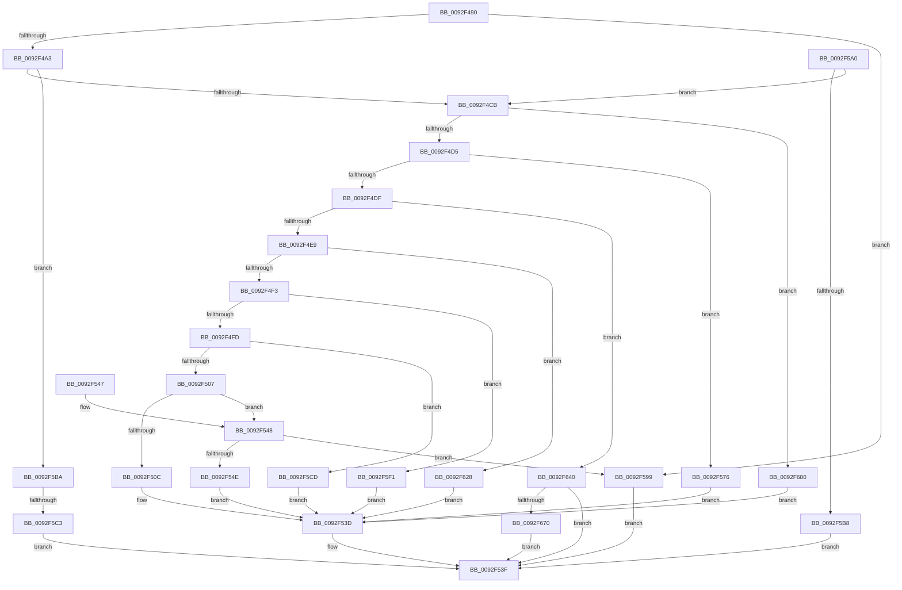

# DrvDbDispatchDeviceId

- RVA: `0x0092F490`–`0x0092F68A` (길이 `506` bytes)
- VA: `0x000000014092F490`
- 실행 섹션: `PAGE`
- PDB 이름 있음: `예`; PDB Function 태그: `예`
- unwind 정보 RVA: `0x0008EA98`
- 디코드: `127`개 명령, `506/506` bytes 표시
- 미해석 바이트: `0` (있으면 어셈블리에 `.byte`로 보존)

> 이 문서는 커널 이미지의 기계어와 PDB 기호를 분석해 생성했습니다. 4번과 5번은 함수 원형과 자료형을 바이너리 사용 방식에서 추정한 C 해석이며 원본 소스 복구 결과는 아닙니다.

## 1. Dependencies

- 직접 호출 지점: **8**; 고유 호출 대상: **7**
- 직접 호출자로 확인된 함수: **0**
- RIP 상대 이미지 참조: **0**

### Outgoing calls
- `0x0092F538` → [DrvDbGetDeviceIdMappedProperty](DrvDbGetDeviceIdMappedProperty_function_0092F690.md) (function, `0x0092F690`)
- `0x0092F56F` → [DrvDbSetDeviceIdMappedProperty](DrvDbSetDeviceIdMappedProperty_function_0092ECCC.md) (function, `0x0092ECCC`)
- `0x0092F592` → [DrvDbOpenDeviceIdRegKey](DrvDbOpenDeviceIdRegKey_function_0092F080.md) (function, `0x0092F080`)
- `0x0092F5E7` → [DrvDbGetDeviceIdMappedPropertyKeys](../83/DrvDbGetDeviceIdMappedPropertyKeys_function_00833360.md) (function, `0x00833360`)
- `0x0092F61E` → [DrvDbGetObjectList](DrvDbGetObjectList_function_0092F224.md) (function, `0x0092F224`)
- `0x0092F636` → [DrvDbDeleteObjectRegKey](../83/DrvDbDeleteObjectRegKey_function_00832D70.md) (function, `0x00832D70`)
- `0x0092F661` → [DrvDbOpenDeviceIdRegKey](DrvDbOpenDeviceIdRegKey_function_0092F080.md) (function, `0x0092F080`)
- `0x0092F680` → [DrvDbValidateDeviceIdName](../83/DrvDbValidateDeviceIdName_function_00834E60.md) (function, `0x00834E60`)

### Direct callers
- 이 함수 시작 RVA로 연결되는 직접 call은 확인되지 않았습니다. 간접 호출은 완전히 역산할 수 없습니다.

### Static image references
- 디코드된 RIP-relative 메모리 참조가 없습니다.

## 2. Other-region calls and transfers

- 다른 실행 섹션으로 향하는 call: **0**
- call이 아닌 외부 분기/꼬리 이동: **1**
  - `0x0092F5BD` → [sub_00B23774](../B2/Unknown_function_00B23774.md) (`tail-transfer`)

## 3. Assembly (complete function range)

```asm
0092F490  40 53                           push rbx
0092F492  48 83 EC 40                     sub rsp, 0x40
0092F496  41 8D 40 FF                     lea eax, [r8 - 1]
0092F49A  83 F8 0A                        cmp eax, 0xa
0092F49D  0F 87 F6 00 00 00               ja 0x14092f599
0092F4A3  0F AE E8                        lfence
0092F4A6  48 8B 5C 24 70                  mov rbx, qword ptr [rsp + 0x70]
0092F4AB  41 BB 02 00 00 00               mov r11d, 2
0092F4B1  49 63 C0                        movsxd rax, r8d
0092F4B4  4C 8B 94 C1 88 01 00 00         mov r10, qword ptr [rcx + rax*8 + 0x188]
0092F4BC  45 8B 42 0C                     mov r8d, dword ptr [r10 + 0xc]
0092F4C0  41 0F BA E0 1C                  bt r8d, 0x1c
0092F4C5  0F 83 EF 00 00 00               jae 0x14092f5ba
0092F4CB  41 83 E9 01                     sub r9d, 1
0092F4CF  0F 84 AB 01 00 00               je 0x14092f680
0092F4D5  41 83 E9 01                     sub r9d, 1
0092F4D9  0F 84 97 00 00 00               je 0x14092f576
0092F4DF  41 83 E9 01                     sub r9d, 1
0092F4E3  0F 84 57 01 00 00               je 0x14092f640
0092F4E9  41 83 E9 01                     sub r9d, 1
0092F4ED  0F 84 35 01 00 00               je 0x14092f628
0092F4F3  41 83 E9 01                     sub r9d, 1
0092F4F7  0F 84 F4 00 00 00               je 0x14092f5f1
0092F4FD  41 83 E9 01                     sub r9d, 1
0092F501  0F 84 C6 00 00 00               je 0x14092f5cd
0092F507  45 2B CB                        sub r9d, r11d
0092F50A  75 3C                           jne 0x14092f548
0092F50C  48 8B 43 30                     mov rax, qword ptr [rbx + 0x30]
0092F510  49 8B CA                        mov rcx, r10
0092F513  4C 8B 4B 10                     mov r9, qword ptr [rbx + 0x10]
0092F517  4C 8B 03                        mov r8, qword ptr [rbx]
0092F51A  48 89 44 24 38                  mov qword ptr [rsp + 0x38], rax
0092F51F  8B 43 28                        mov eax, dword ptr [rbx + 0x28]
0092F522  89 44 24 30                     mov dword ptr [rsp + 0x30], eax
0092F526  48 8B 43 20                     mov rax, qword ptr [rbx + 0x20]
0092F52A  48 89 44 24 28                  mov qword ptr [rsp + 0x28], rax
0092F52F  48 8B 43 18                     mov rax, qword ptr [rbx + 0x18]
0092F533  48 89 44 24 20                  mov qword ptr [rsp + 0x20], rax
0092F538  E8 53 01 00 00                  call 0x14092f690
0092F53D  8B C8                           mov ecx, eax
0092F53F  8B C1                           mov eax, ecx
0092F541  48 83 C4 40                     add rsp, 0x40
0092F545  5B                              pop rbx
0092F546  C3                              ret
0092F547  CC                              int3
0092F548  41 83 F9 01                     cmp r9d, 1
0092F54C  75 4B                           jne 0x14092f599
0092F54E  8B 43 28                        mov eax, dword ptr [rbx + 0x28]
0092F551  49 8B CA                        mov rcx, r10
0092F554  4C 8B 4B 10                     mov r9, qword ptr [rbx + 0x10]
0092F558  4C 8B 03                        mov r8, qword ptr [rbx]
0092F55B  89 44 24 30                     mov dword ptr [rsp + 0x30], eax
0092F55F  48 8B 43 20                     mov rax, qword ptr [rbx + 0x20]
0092F563  48 89 44 24 28                  mov qword ptr [rsp + 0x28], rax
0092F568  8B 43 18                        mov eax, dword ptr [rbx + 0x18]
0092F56B  89 44 24 20                     mov dword ptr [rsp + 0x20], eax
0092F56F  E8 58 F7 FF FF                  call 0x14092eccc
0092F574  EB C7                           jmp 0x14092f53d
0092F576  44 8A 4B 04                     mov r9b, byte ptr [rbx + 4]
0092F57A  48 8D 43 10                     lea rax, [rbx + 0x10]
0092F57E  44 8B 03                        mov r8d, dword ptr [rbx]
0092F581  49 8B CA                        mov rcx, r10
0092F584  48 89 44 24 28                  mov qword ptr [rsp + 0x28], rax
0092F589  48 8B 43 08                     mov rax, qword ptr [rbx + 8]
0092F58D  48 89 44 24 20                  mov qword ptr [rsp + 0x20], rax
0092F592  E8 E9 FA FF FF                  call 0x14092f080
0092F597  EB A4                           jmp 0x14092f53d
0092F599  B9 0D 00 00 C0                  mov ecx, 0xc000000d
0092F59E  EB 9F                           jmp 0x14092f53f
0092F5A0  41 8A C0                        mov al, r8b
0092F5A3  F6 D8                           neg al
0092F5A5  1B C9                           sbb ecx, ecx
0092F5A7  F7 D1                           not ecx
0092F5A9  81 E1 22 00 00 C0               and ecx, 0xc0000022
0092F5AF  45 84 C0                        test r8b, r8b
0092F5B2  0F 85 13 FF FF FF               jne 0x14092f4cb
0092F5B8  EB 85                           jmp 0x14092f53f
0092F5BA  45 85 C0                        test r8d, r8d
0092F5BD  0F 85 B1 41 1F 00               jne 0x140b23774
0092F5C3  B9 67 04 00 C0                  mov ecx, 0xc0000467
0092F5C8  E9 72 FF FF FF                  jmp 0x14092f53f
0092F5CD  48 8B 43 28                     mov rax, qword ptr [rbx + 0x28]
0092F5D1  49 8B CA                        mov rcx, r10
0092F5D4  4C 8B 4B 18                     mov r9, qword ptr [rbx + 0x18]
0092F5D8  4C 8B 03                        mov r8, qword ptr [rbx]
0092F5DB  48 89 44 24 28                  mov qword ptr [rsp + 0x28], rax
0092F5E0  8B 43 20                        mov eax, dword ptr [rbx + 0x20]
0092F5E3  89 44 24 20                     mov dword ptr [rsp + 0x20], eax
0092F5E7  E8 74 3D F0 FF                  call 0x140833360
0092F5EC  E9 4C FF FF FF                  jmp 0x14092f53d
0092F5F1  48 8B 43 20                     mov rax, qword ptr [rbx + 0x20]
0092F5F5  8B 4B 18                        mov ecx, dword ptr [rbx + 0x18]
0092F5F8  48 8B 53 10                     mov rdx, qword ptr [rbx + 0x10]
0092F5FC  4C 8B 4B 08                     mov r9, qword ptr [rbx + 8]
0092F600  4C 8B 03                        mov r8, qword ptr [rbx]
0092F603  44 89 5C 24 38                  mov dword ptr [rsp + 0x38], r11d
0092F608  48 89 44 24 30                  mov qword ptr [rsp + 0x30], rax
0092F60D  89 4C 24 28                     mov dword ptr [rsp + 0x28], ecx
0092F611  49 8B CA                        mov rcx, r10
0092F614  48 89 54 24 20                  mov qword ptr [rsp + 0x20], rdx
0092F619  BA 05 00 00 00                  mov edx, 5
0092F61E  E8 01 FC FF FF                  call 0x14092f224
0092F623  E9 15 FF FF FF                  jmp 0x14092f53d
0092F628  4C 8B C2                        mov r8, rdx
0092F62B  45 8B CB                        mov r9d, r11d
0092F62E  BA 05 00 00 00                  mov edx, 5
0092F633  49 8B CA                        mov rcx, r10
0092F636  E8 35 37 F0 FF                  call 0x140832d70
0092F63B  E9 FD FE FF FF                  jmp 0x14092f53d
0092F640  44 8B 03                        mov r8d, dword ptr [rbx]
0092F643  48 8D 4C 24 60                  lea rcx, [rsp + 0x60]
0092F648  83 64 24 60 00                  and dword ptr [rsp + 0x60], 0
0092F64D  48 8D 43 08                     lea rax, [rbx + 8]
0092F651  48 89 4C 24 28                  mov qword ptr [rsp + 0x28], rcx
0092F656  41 B1 01                        mov r9b, 1
0092F659  49 8B CA                        mov rcx, r10
0092F65C  48 89 44 24 20                  mov qword ptr [rsp + 0x20], rax
0092F661  E8 1A FA FF FF                  call 0x14092f080
0092F666  8B C8                           mov ecx, eax
0092F668  85 C0                           test eax, eax
0092F66A  0F 88 CF FE FF FF               js 0x14092f53f
0092F670  83 7C 24 60 01                  cmp dword ptr [rsp + 0x60], 1
0092F675  0F 94 C0                        sete al
0092F678  88 43 10                        mov byte ptr [rbx + 0x10], al
0092F67B  E9 BF FE FF FF                  jmp 0x14092f53f
0092F680  E8 DB 57 F0 FF                  call 0x140834e60
0092F685  E9 B3 FE FF FF                  jmp 0x14092f53d
```

## 4. C-style interpretation (structured pseudocode)

```c
__int64 __fastcall DrvDbDispatchDeviceId(__int64 a1, __int64 a2, __int64 a3, int a4, __int64 a5)
{
    __int64 result;
    __int64 v_rsp;
    unsigned __int64 v_stack_m10;
    unsigned int v_stack_m18;
    unsigned __int64 v_stack_m20;
    unsigned __int64 v_stack_m28;
    unsigned int v_stack_p20;
    unsigned __int64 v_stack_p28;
    unsigned int v_stack_p30;
    unsigned int v_stack_p38;
    unsigned __int64 v_stack_p60;

    v_rsp = (v_rsp) - (64);
    if (((unsigned int)(a3 - 1)) > 10) goto loc_0092F599;
    if (((unsigned int)(a3 - 1)) >= 10) goto loc_0092F5BA;
loc_0092F4CB:
    a4 = (unsigned int)((a4) - (1));
    if (condition_is_equal) goto loc_0092F680;
    a4 = (unsigned int)((a4) - (1));
    if (condition_is_equal) goto loc_0092F576;
    a4 = (unsigned int)((a4) - (1));
    if (condition_is_equal) goto loc_0092F640;
    a4 = (unsigned int)((a4) - (1));
    if (condition_is_equal) goto loc_0092F628;
    a4 = (unsigned int)((a4) - (1));
    if (condition_is_equal) goto loc_0092F5F1;
    a4 = (unsigned int)((a4) - (1));
    if (condition_is_equal) goto loc_0092F5CD;
    a4 = (unsigned int)((a4) - (2));
    if (condition_is_not_equal) goto loc_0092F548;
    v_stack_m10 = *(unsigned __int64 *)(a5 + 48);
    v_stack_m18 = (unsigned int)((unsigned int)(*(unsigned int *)(a5 + 40)));
    v_stack_m20 = *(unsigned __int64 *)(a5 + 32);
    v_stack_m28 = *(unsigned __int64 *)(a5 + 24);
    result = DrvDbGetDeviceIdMappedProperty(*(unsigned __int64 *)(a1 + (int)((unsigned int)(a3)) * 8 + 392), a2, *(unsigned __int64 *)(a5), *(unsigned __int64 *)(a5 + 16));
loc_0092F53D:
loc_0092F53F:
    v_rsp = (v_rsp) + (64);
    return (unsigned int)((unsigned int)((unsigned int)((unsigned int)(result))));
loc_0092F548:
    if (((unsigned int)(*(unsigned __int64 *)(a5 + 16))) != 1) goto loc_0092F599;
    v_stack_p30 = (unsigned int)((unsigned int)(*(unsigned int *)(a5 + 40)));
    v_stack_p28 = *(unsigned __int64 *)(a5 + 32);
    v_stack_p20 = (unsigned int)((unsigned int)(*(unsigned int *)(a5 + 24)));
    result = DrvDbSetDeviceIdMappedProperty(*(unsigned __int64 *)(a1 + (int)((unsigned int)(a3)) * 8 + 392), a2, *(unsigned __int64 *)(a5), *(unsigned __int64 *)(a5 + 16));
    goto loc_0092F53D;
loc_0092F576:
    v_stack_p28 = a5 + 16;
    v_stack_p20 = *(unsigned __int64 *)(a5 + 8);
    result = DrvDbOpenDeviceIdRegKey(*(unsigned __int64 *)(a1 + (int)((unsigned int)(a3)) * 8 + 392), a2, (unsigned int)(*(unsigned int *)(a5)), *(unsigned __int8 *)(a5 + 4));
    goto loc_0092F53D;
loc_0092F599:
    goto loc_0092F53F;
loc_0092F5BA:
    goto loc_0092F53F;
loc_0092F5CD:
    v_stack_p28 = *(unsigned __int64 *)(a5 + 40);
    v_stack_p20 = (unsigned int)((unsigned int)(*(unsigned int *)(a5 + 32)));
    result = DrvDbGetDeviceIdMappedPropertyKeys(*(unsigned __int64 *)(a1 + (int)((unsigned int)(a3)) * 8 + 392), a2, *(unsigned __int64 *)(a5), *(unsigned __int64 *)(a5 + 24));
    goto loc_0092F53D;
loc_0092F5F1:
    v_stack_p38 = 2;
    v_stack_p30 = *(unsigned __int64 *)(a5 + 32);
    v_stack_p28 = (unsigned int)((unsigned int)(*(unsigned int *)(a5 + 24)));
    v_stack_p20 = *(unsigned __int64 *)(a5 + 16);
    result = DrvDbGetObjectList(*(unsigned __int64 *)(a1 + (int)((unsigned int)(a3)) * 8 + 392), 5, *(unsigned __int64 *)(a5), *(unsigned __int64 *)(a5 + 8));
    goto loc_0092F53D;
loc_0092F628:
    result = DrvDbDeleteObjectRegKey(*(unsigned __int64 *)(a1 + (int)((unsigned int)(a3)) * 8 + 392), 5, 5, 2);
    goto loc_0092F53D;
loc_0092F640:
    v_stack_p28 = v_stack_p60;
    v_stack_p20 = a5 + 8;
    result = DrvDbOpenDeviceIdRegKey(*(unsigned __int64 *)(a1 + (int)((unsigned int)(a3)) * 8 + 392), 5, (unsigned int)(*(unsigned int *)(a5)), 1);
    if (sign_flag) goto loc_0092F53F;
    result = (v_stack_p60 == 1) ? 1 : 0;
    *(unsigned __int8 *)(a5 + 16) = (unsigned __int8)(result);
    goto loc_0092F53F;
loc_0092F680:
    result = DrvDbValidateDeviceIdName((unsigned int)((unsigned int)(result)), 5, (unsigned int)(*(unsigned int *)(a5)), 1);
    goto loc_0092F53D;
}
```

## 5. (Beta) C Style

```c
int64_t DrvDbDispatchDeviceId(void *Arg1, int64_t Arg2, void *Arg3, int32_t Arg4, void *Arg5)
{
    uint8_t *arg1 = (uint8_t *)Arg1;
    uint8_t *arg3 = (uint8_t *)Arg3;
    uint8_t *arg5 = (uint8_t *)Arg5;

    int64_t result;
    int64_t local_rsp;
    uint64_t v_stack_m10;
    uint32_t v_stack_m18;
    uint64_t v_stack_m20;
    uint64_t v_stack_m28;
    uint32_t v_stack_p20;
    uint64_t v_stack_p28;
    uint32_t v_stack_p30;
    uint32_t v_stack_p38;
    uint64_t v_stack_p60;

    local_rsp = (local_rsp) - (64);
    if (((uint32_t)(Arg3 - 1)) > 10) goto loc_0092F599;
    if (((uint32_t)(Arg3 - 1)) >= 10) goto loc_0092F5BA;
loc_0092F4CB:
    Arg4 = (uint32_t)((Arg4) - (1));
    if (condition_is_equal) goto loc_0092F680;
    Arg4 = (uint32_t)((Arg4) - (1));
    if (condition_is_equal) goto loc_0092F576;
    Arg4 = (uint32_t)((Arg4) - (1));
    if (condition_is_equal) goto loc_0092F640;
    Arg4 = (uint32_t)((Arg4) - (1));
    if (condition_is_equal) goto loc_0092F628;
    Arg4 = (uint32_t)((Arg4) - (1));
    if (condition_is_equal) goto loc_0092F5F1;
    Arg4 = (uint32_t)((Arg4) - (1));
    if (condition_is_equal) goto loc_0092F5CD;
    Arg4 = (uint32_t)((Arg4) - (2));
    if (condition_is_not_equal) goto loc_0092F548;
    v_stack_m10 = *(uint64_t *)(arg5 + 0x30);
    v_stack_m18 = (uint32_t)((uint32_t)(*(uint32_t *)(arg5 + 0x28)));
    v_stack_m20 = *(uint64_t *)(arg5 + 0x20);
    v_stack_m28 = *(uint64_t *)(arg5 + 0x18);
    result = DrvDbGetDeviceIdMappedProperty(*(uint64_t *)(arg1 + (int32_t)((uint32_t)(arg3)) * 8 + 0x188), Arg2, *(uint64_t *)(arg5), *(uint64_t *)(arg5 + 0x10));
loc_0092F53D:
loc_0092F53F:
    local_rsp = (local_rsp) + (64);
    return (uint32_t)((uint32_t)((uint32_t)((uint32_t)(result))));
loc_0092F548:
    if (((uint32_t)(*(uint64_t *)(arg5 + 0x10))) != 1) goto loc_0092F599;
    v_stack_p30 = (uint32_t)((uint32_t)(*(uint32_t *)(arg5 + 0x28)));
    v_stack_p28 = *(uint64_t *)(arg5 + 0x20);
    v_stack_p20 = (uint32_t)((uint32_t)(*(uint32_t *)(arg5 + 0x18)));
    result = DrvDbSetDeviceIdMappedProperty(*(uint64_t *)(arg1 + (int32_t)((uint32_t)(arg3)) * 8 + 0x188), Arg2, *(uint64_t *)(arg5), *(uint64_t *)(arg5 + 0x10));
    goto loc_0092F53D;
loc_0092F576:
    v_stack_p28 = Arg5 + 16;
    v_stack_p20 = *(uint64_t *)(arg5 + 0x8);
    result = DrvDbOpenDeviceIdRegKey(*(uint64_t *)(arg1 + (int32_t)((uint32_t)(arg3)) * 8 + 0x188), Arg2, (uint32_t)(*(uint32_t *)(arg5)), *(uint8_t *)(arg5 + 0x4));
    goto loc_0092F53D;
loc_0092F599:
    goto loc_0092F53F;
loc_0092F5BA:
    goto loc_0092F53F;
loc_0092F5CD:
    v_stack_p28 = *(uint64_t *)(arg5 + 0x28);
    v_stack_p20 = (uint32_t)((uint32_t)(*(uint32_t *)(arg5 + 0x20)));
    result = DrvDbGetDeviceIdMappedPropertyKeys(*(uint64_t *)(arg1 + (int32_t)((uint32_t)(arg3)) * 8 + 0x188), Arg2, *(uint64_t *)(arg5), *(uint64_t *)(arg5 + 0x18));
    goto loc_0092F53D;
loc_0092F5F1:
    v_stack_p38 = 2;
    v_stack_p30 = *(uint64_t *)(arg5 + 0x20);
    v_stack_p28 = (uint32_t)((uint32_t)(*(uint32_t *)(arg5 + 0x18)));
    v_stack_p20 = *(uint64_t *)(arg5 + 0x10);
    result = DrvDbGetObjectList(*(uint64_t *)(arg1 + (int32_t)((uint32_t)(arg3)) * 8 + 0x188), 5, *(uint64_t *)(arg5), *(uint64_t *)(arg5 + 0x8));
    goto loc_0092F53D;
loc_0092F628:
    result = DrvDbDeleteObjectRegKey(*(uint64_t *)(arg1 + (int32_t)((uint32_t)(arg3)) * 8 + 0x188), 5, 5, 2);
    goto loc_0092F53D;
loc_0092F640:
    v_stack_p28 = v_stack_p60;
    v_stack_p20 = Arg5 + 8;
    result = DrvDbOpenDeviceIdRegKey(*(uint64_t *)(arg1 + (int32_t)((uint32_t)(arg3)) * 8 + 0x188), 5, (uint32_t)(*(uint32_t *)(arg5)), 1);
    if (sign_flag) goto loc_0092F53F;
    result = (v_stack_p60 == 1) ? 1 : 0;
    *(uint8_t *)(arg5 + 0x10) = (uint8_t)(result);
    goto loc_0092F53F;
loc_0092F680:
    result = DrvDbValidateDeviceIdName((uint32_t)((uint32_t)(result)), 5, (uint32_t)(*(uint32_t *)(arg5)), 1);
    goto loc_0092F53D;
}
```

### 관측된 메모리 오프셋

구조체 형식이 확인되지 않은 접근은 인자 기준의 오프셋으로만 기록했습니다.

| 기준 인자 | 오프셋 표현 | 폭 (bit) | 접근 |
|---|---:|---:|---|
| `Arg1` | `+ 0x188 + rax*8` | `64` | `R` |
| `Arg3` | `- 0x1` | `32` | `R` |
| `Arg5` | `+ 0x0` | `32` | `R` |
| `Arg5` | `+ 0x0` | `64` | `R` |
| `Arg5` | `+ 0x4` | `8` | `R` |
| `Arg5` | `+ 0x8` | `64` | `R` |
| `Arg5` | `+ 0x10` | `8` | `W` |
| `Arg5` | `+ 0x10` | `64` | `R` |
| `Arg5` | `+ 0x18` | `32` | `R` |
| `Arg5` | `+ 0x18` | `64` | `R` |
| `Arg5` | `+ 0x20` | `32` | `R` |
| `Arg5` | `+ 0x20` | `64` | `R` |
| `Arg5` | `+ 0x28` | `32` | `R` |
| `Arg5` | `+ 0x28` | `64` | `R` |
| `Arg5` | `+ 0x30` | `64` | `R` |

## 6. Execution-region graph

[열기: 2D/3D 그래프와 함수 탐색 컨트롤 패널](../../../control-panel.html?section=page&rva=0x0092F490&view=graph)

- 2D 그래프는 위에서 아래로 흐르고, 3D 그래프는 빈 공간을 드래그해 회전합니다. Shift+드래그는 이동, 휠은 확대·축소, 함수 노드 선택은 대상 보고서 이동입니다.

### Static fallback


