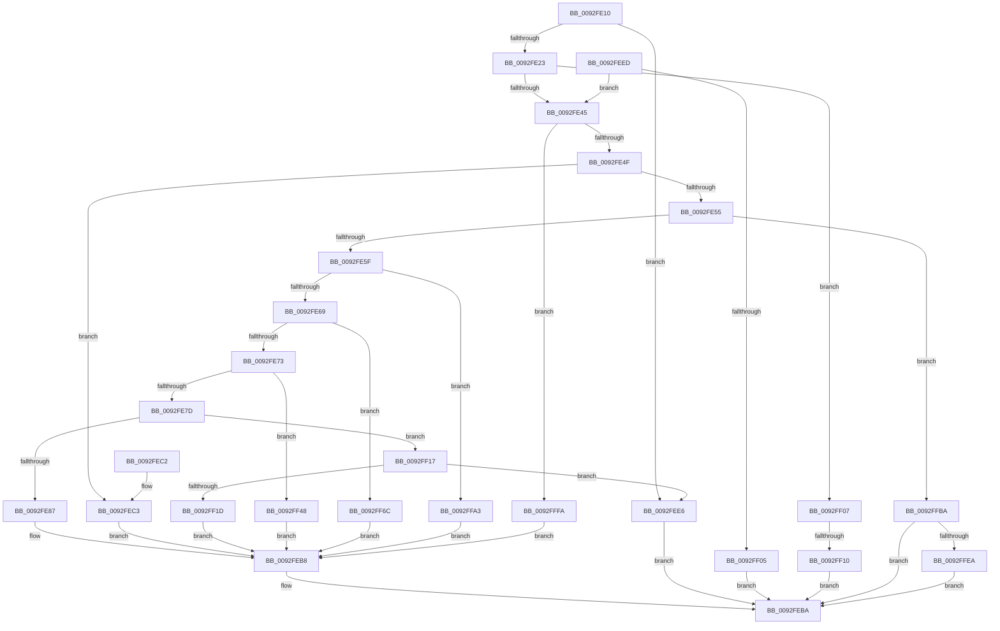

# DrvDbDispatchDriverInfFile

- RVA: `0x0092FE10`–`0x00930004` (길이 `500` bytes)
- VA: `0x000000014092FE10`
- 실행 섹션: `PAGE`
- PDB 이름 있음: `예`; PDB Function 태그: `예`
- unwind 정보 RVA: `0x0008EB04`
- 디코드: `126`개 명령, `500/500` bytes 표시
- 미해석 바이트: `0` (있으면 어셈블리에 `.byte`로 보존)

> 이 문서는 커널 이미지의 기계어와 PDB 기호를 분석해 생성했습니다. 4번과 5번은 함수 원형과 자료형을 바이너리 사용 방식에서 추정한 C 해석이며 원본 소스 복구 결과는 아닙니다.

## 1. Dependencies

- 직접 호출 지점: **8**; 고유 호출 대상: **7**
- 직접 호출자로 확인된 함수: **0**
- RIP 상대 이미지 참조: **0**

### Outgoing calls
- `0x0092FEB3` → [DrvDbGetDriverInfFileMappedProperty](../93/DrvDbGetDriverInfFileMappedProperty_function_00930080.md) (function, `0x00930080`)
- `0x0092FEDF` → [DrvDbOpenDriverInfFileRegKey](../93/DrvDbOpenDriverInfFileRegKey_function_00930354.md) (function, `0x00930354`)
- `0x0092FF3E` → [DrvDbSetDriverInfFileMappedProperty](../83/DrvDbSetDriverInfFileMappedProperty_function_00834718.md) (function, `0x00834718`)
- `0x0092FF62` → [DrvDbGetDriverInfFileMappedPropertyKeys](../83/DrvDbGetDriverInfFileMappedPropertyKeys_function_00833A18.md) (function, `0x00833A18`)
- `0x0092FF99` → [DrvDbGetObjectList](DrvDbGetObjectList_function_0092F224.md) (function, `0x0092F224`)
- `0x0092FFB0` → [DrvDbDeleteObjectRegKey](../83/DrvDbDeleteObjectRegKey_function_00832D70.md) (function, `0x00832D70`)
- `0x0092FFDB` → [DrvDbOpenDriverInfFileRegKey](../93/DrvDbOpenDriverInfFileRegKey_function_00930354.md) (function, `0x00930354`)
- `0x0092FFFA` → [DrvDbValidateDriverFileName](../83/DrvDbValidateDriverFileName_function_00834F3C.md) (function, `0x00834F3C`)

### Direct callers
- 이 함수 시작 RVA로 연결되는 직접 call은 확인되지 않았습니다. 간접 호출은 완전히 역산할 수 없습니다.

### Static image references
- 디코드된 RIP-relative 메모리 참조가 없습니다.

## 2. Other-region calls and transfers

- 다른 실행 섹션으로 향하는 call: **0**
- call이 아닌 외부 분기/꼬리 이동: **1**
  - `0x0092FF0A` → [sub_00B237E8](../B2/Unknown_function_00B237E8.md) (`tail-transfer`)

## 3. Assembly (complete function range)

```asm
0092FE10  40 53                           push rbx
0092FE12  48 83 EC 40                     sub rsp, 0x40
0092FE16  41 8D 40 FF                     lea eax, [r8 - 1]
0092FE1A  83 F8 0A                        cmp eax, 0xa
0092FE1D  0F 87 C3 00 00 00               ja 0x14092fee6
0092FE23  0F AE E8                        lfence
0092FE26  48 8B 5C 24 70                  mov rbx, qword ptr [rsp + 0x70]
0092FE2B  49 63 C0                        movsxd rax, r8d
0092FE2E  4C 8B 94 C1 88 01 00 00         mov r10, qword ptr [rcx + rax*8 + 0x188]
0092FE36  45 8B 42 0C                     mov r8d, dword ptr [r10 + 0xc]
0092FE3A  41 0F BA E0 1C                  bt r8d, 0x1c
0092FE3F  0F 83 C2 00 00 00               jae 0x14092ff07
0092FE45  41 83 E9 01                     sub r9d, 1
0092FE49  0F 84 AB 01 00 00               je 0x14092fffa
0092FE4F  41 83 E9 01                     sub r9d, 1
0092FE53  74 6E                           je 0x14092fec3
0092FE55  41 83 E9 01                     sub r9d, 1
0092FE59  0F 84 5B 01 00 00               je 0x14092ffba
0092FE5F  41 83 E9 01                     sub r9d, 1
0092FE63  0F 84 3A 01 00 00               je 0x14092ffa3
0092FE69  41 83 E9 01                     sub r9d, 1
0092FE6D  0F 84 F9 00 00 00               je 0x14092ff6c
0092FE73  41 83 E9 01                     sub r9d, 1
0092FE77  0F 84 CB 00 00 00               je 0x14092ff48
0092FE7D  41 83 E9 02                     sub r9d, 2
0092FE81  0F 85 90 00 00 00               jne 0x14092ff17
0092FE87  48 8B 43 30                     mov rax, qword ptr [rbx + 0x30]
0092FE8B  49 8B CA                        mov rcx, r10
0092FE8E  4C 8B 4B 10                     mov r9, qword ptr [rbx + 0x10]
0092FE92  4C 8B 03                        mov r8, qword ptr [rbx]
0092FE95  48 89 44 24 38                  mov qword ptr [rsp + 0x38], rax
0092FE9A  8B 43 28                        mov eax, dword ptr [rbx + 0x28]
0092FE9D  89 44 24 30                     mov dword ptr [rsp + 0x30], eax
0092FEA1  48 8B 43 20                     mov rax, qword ptr [rbx + 0x20]
0092FEA5  48 89 44 24 28                  mov qword ptr [rsp + 0x28], rax
0092FEAA  48 8B 43 18                     mov rax, qword ptr [rbx + 0x18]
0092FEAE  48 89 44 24 20                  mov qword ptr [rsp + 0x20], rax
0092FEB3  E8 C8 01 00 00                  call 0x140930080
0092FEB8  8B C8                           mov ecx, eax
0092FEBA  8B C1                           mov eax, ecx
0092FEBC  48 83 C4 40                     add rsp, 0x40
0092FEC0  5B                              pop rbx
0092FEC1  C3                              ret
0092FEC2  CC                              int3
0092FEC3  44 8A 4B 04                     mov r9b, byte ptr [rbx + 4]
0092FEC7  48 8D 43 10                     lea rax, [rbx + 0x10]
0092FECB  44 8B 03                        mov r8d, dword ptr [rbx]
0092FECE  49 8B CA                        mov rcx, r10
0092FED1  48 89 44 24 28                  mov qword ptr [rsp + 0x28], rax
0092FED6  48 8B 43 08                     mov rax, qword ptr [rbx + 8]
0092FEDA  48 89 44 24 20                  mov qword ptr [rsp + 0x20], rax
0092FEDF  E8 70 04 00 00                  call 0x140930354
0092FEE4  EB D2                           jmp 0x14092feb8
0092FEE6  B9 0D 00 00 C0                  mov ecx, 0xc000000d
0092FEEB  EB CD                           jmp 0x14092feba
0092FEED  41 8A C0                        mov al, r8b
0092FEF0  F6 D8                           neg al
0092FEF2  1B C9                           sbb ecx, ecx
0092FEF4  F7 D1                           not ecx
0092FEF6  81 E1 22 00 00 C0               and ecx, 0xc0000022
0092FEFC  45 84 C0                        test r8b, r8b
0092FEFF  0F 85 40 FF FF FF               jne 0x14092fe45
0092FF05  EB B3                           jmp 0x14092feba
0092FF07  45 85 C0                        test r8d, r8d
0092FF0A  0F 85 D8 38 1F 00               jne 0x140b237e8
0092FF10  B9 67 04 00 C0                  mov ecx, 0xc0000467
0092FF15  EB A3                           jmp 0x14092feba
0092FF17  41 83 F9 01                     cmp r9d, 1
0092FF1B  75 C9                           jne 0x14092fee6
0092FF1D  8B 43 28                        mov eax, dword ptr [rbx + 0x28]
0092FF20  49 8B CA                        mov rcx, r10
0092FF23  4C 8B 4B 10                     mov r9, qword ptr [rbx + 0x10]
0092FF27  4C 8B 03                        mov r8, qword ptr [rbx]
0092FF2A  89 44 24 30                     mov dword ptr [rsp + 0x30], eax
0092FF2E  48 8B 43 20                     mov rax, qword ptr [rbx + 0x20]
0092FF32  48 89 44 24 28                  mov qword ptr [rsp + 0x28], rax
0092FF37  8B 43 18                        mov eax, dword ptr [rbx + 0x18]
0092FF3A  89 44 24 20                     mov dword ptr [rsp + 0x20], eax
0092FF3E  E8 D5 47 F0 FF                  call 0x140834718
0092FF43  E9 70 FF FF FF                  jmp 0x14092feb8
0092FF48  48 8B 43 28                     mov rax, qword ptr [rbx + 0x28]
0092FF4C  49 8B CA                        mov rcx, r10
0092FF4F  4C 8B 4B 18                     mov r9, qword ptr [rbx + 0x18]
0092FF53  4C 8B 03                        mov r8, qword ptr [rbx]
0092FF56  48 89 44 24 28                  mov qword ptr [rsp + 0x28], rax
0092FF5B  8B 43 20                        mov eax, dword ptr [rbx + 0x20]
0092FF5E  89 44 24 20                     mov dword ptr [rsp + 0x20], eax
0092FF62  E8 B1 3A F0 FF                  call 0x140833a18
0092FF67  E9 4C FF FF FF                  jmp 0x14092feb8
0092FF6C  48 8B 43 20                     mov rax, qword ptr [rbx + 0x20]
0092FF70  8B 4B 18                        mov ecx, dword ptr [rbx + 0x18]
0092FF73  48 8B 53 10                     mov rdx, qword ptr [rbx + 0x10]
0092FF77  4C 8B 4B 08                     mov r9, qword ptr [rbx + 8]
0092FF7B  4C 8B 03                        mov r8, qword ptr [rbx]
0092FF7E  83 64 24 38 00                  and dword ptr [rsp + 0x38], 0
0092FF83  48 89 44 24 30                  mov qword ptr [rsp + 0x30], rax
0092FF88  89 4C 24 28                     mov dword ptr [rsp + 0x28], ecx
0092FF8C  49 8B CA                        mov rcx, r10
0092FF8F  48 89 54 24 20                  mov qword ptr [rsp + 0x20], rdx
0092FF94  BA 03 00 00 00                  mov edx, 3
0092FF99  E8 86 F2 FF FF                  call 0x14092f224
0092FF9E  E9 15 FF FF FF                  jmp 0x14092feb8
0092FFA3  45 33 C9                        xor r9d, r9d
0092FFA6  4C 8B C2                        mov r8, rdx
0092FFA9  49 8B CA                        mov rcx, r10
0092FFAC  41 8D 51 03                     lea edx, [r9 + 3]
0092FFB0  E8 BB 2D F0 FF                  call 0x140832d70
0092FFB5  E9 FE FE FF FF                  jmp 0x14092feb8
0092FFBA  44 8B 03                        mov r8d, dword ptr [rbx]
0092FFBD  48 8D 4C 24 60                  lea rcx, [rsp + 0x60]
0092FFC2  83 64 24 60 00                  and dword ptr [rsp + 0x60], 0
0092FFC7  48 8D 43 08                     lea rax, [rbx + 8]
0092FFCB  48 89 4C 24 28                  mov qword ptr [rsp + 0x28], rcx
0092FFD0  41 B1 01                        mov r9b, 1
0092FFD3  49 8B CA                        mov rcx, r10
0092FFD6  48 89 44 24 20                  mov qword ptr [rsp + 0x20], rax
0092FFDB  E8 74 03 00 00                  call 0x140930354
0092FFE0  8B C8                           mov ecx, eax
0092FFE2  85 C0                           test eax, eax
0092FFE4  0F 88 D0 FE FF FF               js 0x14092feba
0092FFEA  83 7C 24 60 01                  cmp dword ptr [rsp + 0x60], 1
0092FFEF  0F 94 C0                        sete al
0092FFF2  88 43 10                        mov byte ptr [rbx + 0x10], al
0092FFF5  E9 C0 FE FF FF                  jmp 0x14092feba
0092FFFA  E8 3D 4F F0 FF                  call 0x140834f3c
0092FFFF  E9 B4 FE FF FF                  jmp 0x14092feb8
```

## 4. C-style interpretation (structured pseudocode)

```c
__int64 __fastcall DrvDbDispatchDriverInfFile(__int64 a1, __int64 a2, __int64 a3, int a4, __int64 a5)
{
    __int64 result;
    __int64 v_rsp;
    unsigned __int64 v_stack_m10;
    unsigned int v_stack_m18;
    unsigned __int64 v_stack_m20;
    unsigned __int64 v_stack_m28;
    unsigned __int64 v_stack_p20;
    unsigned __int64 v_stack_p28;
    unsigned int v_stack_p30;
    unsigned int v_stack_p38;
    unsigned __int64 v_stack_p60;

    v_rsp = (v_rsp) - (64);
    if (((unsigned int)(a3 - 1)) > 10) goto loc_0092FEE6;
    if (((unsigned int)(a3 - 1)) >= 10) goto loc_0092FF07;
loc_0092FE45:
    a4 = (unsigned int)((a4) - (1));
    if (condition_is_equal) goto loc_0092FFFA;
    a4 = (unsigned int)((a4) - (1));
    if (condition_is_equal) goto loc_0092FEC3;
    a4 = (unsigned int)((a4) - (1));
    if (condition_is_equal) goto loc_0092FFBA;
    a4 = (unsigned int)((a4) - (1));
    if (condition_is_equal) goto loc_0092FFA3;
    a4 = (unsigned int)((a4) - (1));
    if (condition_is_equal) goto loc_0092FF6C;
    a4 = (unsigned int)((a4) - (1));
    if (condition_is_equal) goto loc_0092FF48;
    a4 = (unsigned int)((a4) - (2));
    if (condition_is_not_equal) goto loc_0092FF17;
    v_stack_m10 = *(unsigned __int64 *)(a5 + 48);
    v_stack_m18 = (unsigned int)((unsigned int)(*(unsigned int *)(a5 + 40)));
    v_stack_m20 = *(unsigned __int64 *)(a5 + 32);
    v_stack_m28 = *(unsigned __int64 *)(a5 + 24);
    result = DrvDbGetDriverInfFileMappedProperty(*(unsigned __int64 *)(a1 + (int)((unsigned int)(a3)) * 8 + 392), a2, *(unsigned __int64 *)(a5), *(unsigned __int64 *)(a5 + 16));
loc_0092FEB8:
loc_0092FEBA:
    v_rsp = (v_rsp) + (64);
    return (unsigned int)((unsigned int)((unsigned int)((unsigned int)(result))));
loc_0092FEC3:
    v_stack_p28 = a5 + 16;
    v_stack_p20 = *(unsigned __int64 *)(a5 + 8);
    result = DrvDbOpenDriverInfFileRegKey(*(unsigned __int64 *)(a1 + (int)((unsigned int)(a3)) * 8 + 392), a2, (unsigned int)(*(unsigned int *)(a5)), *(unsigned __int8 *)(a5 + 4));
    goto loc_0092FEB8;
loc_0092FEE6:
    goto loc_0092FEBA;
loc_0092FF07:
    goto loc_0092FEBA;
loc_0092FF17:
    if (((unsigned int)(*(unsigned __int8 *)(a5 + 4))) != 1) goto loc_0092FEE6;
    v_stack_p30 = (unsigned int)((unsigned int)(*(unsigned int *)(a5 + 40)));
    v_stack_p28 = *(unsigned __int64 *)(a5 + 32);
    v_stack_p20 = (unsigned int)((unsigned int)(*(unsigned int *)(a5 + 24)));
    result = DrvDbSetDriverInfFileMappedProperty(*(unsigned __int64 *)(a1 + (int)((unsigned int)(a3)) * 8 + 392), a2, *(unsigned __int64 *)(a5), *(unsigned __int64 *)(a5 + 16));
    goto loc_0092FEB8;
loc_0092FF48:
    v_stack_p28 = *(unsigned __int64 *)(a5 + 40);
    v_stack_p20 = (unsigned int)((unsigned int)(*(unsigned int *)(a5 + 32)));
    result = DrvDbGetDriverInfFileMappedPropertyKeys(*(unsigned __int64 *)(a1 + (int)((unsigned int)(a3)) * 8 + 392), a2, *(unsigned __int64 *)(a5), *(unsigned __int64 *)(a5 + 24));
    goto loc_0092FEB8;
loc_0092FF6C:
    v_stack_p30 = *(unsigned __int64 *)(a5 + 32);
    v_stack_p28 = (unsigned int)((unsigned int)(*(unsigned int *)(a5 + 24)));
    v_stack_p20 = *(unsigned __int64 *)(a5 + 16);
    result = DrvDbGetObjectList(*(unsigned __int64 *)(a1 + (int)((unsigned int)(a3)) * 8 + 392), 3, *(unsigned __int64 *)(a5), *(unsigned __int64 *)(a5 + 8));
    goto loc_0092FEB8;
loc_0092FFA3:
    a4 = 0;
    result = DrvDbDeleteObjectRegKey(*(unsigned __int64 *)(a1 + (int)((unsigned int)(a3)) * 8 + 392), a4 + 3, 3, a4);
    goto loc_0092FEB8;
loc_0092FFBA:
    v_stack_p28 = v_stack_p60;
    v_stack_p20 = a5 + 8;
    result = DrvDbOpenDriverInfFileRegKey(*(unsigned __int64 *)(a1 + (int)((unsigned int)(a3)) * 8 + 392), a4 + 3, (unsigned int)(*(unsigned int *)(a5)), 1);
    if (sign_flag) goto loc_0092FEBA;
    result = (v_stack_p60 == 1) ? 1 : 0;
    *(unsigned __int8 *)(a5 + 16) = (unsigned __int8)(result);
    goto loc_0092FEBA;
loc_0092FFFA:
    result = DrvDbValidateDriverFileName((unsigned int)((unsigned int)(result)), a4 + 3, (unsigned int)(*(unsigned int *)(a5)), 1);
    goto loc_0092FEB8;
}
```

## 5. (Beta) C Style

```c
int64_t DrvDbDispatchDriverInfFile(void *Arg1, int64_t Arg2, void *Arg3, int32_t Arg4, void *Arg5)
{
    uint8_t *arg1 = (uint8_t *)Arg1;
    uint8_t *arg3 = (uint8_t *)Arg3;
    uint8_t *arg5 = (uint8_t *)Arg5;

    int64_t result;
    int64_t local_rsp;
    uint64_t v_stack_m10;
    uint32_t v_stack_m18;
    uint64_t v_stack_m20;
    uint64_t v_stack_m28;
    uint64_t v_stack_p20;
    uint64_t v_stack_p28;
    uint32_t v_stack_p30;
    uint32_t v_stack_p38;
    uint64_t v_stack_p60;

    local_rsp = (local_rsp) - (64);
    if (((uint32_t)(Arg3 - 1)) > 10) goto loc_0092FEE6;
    if (((uint32_t)(Arg3 - 1)) >= 10) goto loc_0092FF07;
loc_0092FE45:
    Arg4 = (uint32_t)((Arg4) - (1));
    if (condition_is_equal) goto loc_0092FFFA;
    Arg4 = (uint32_t)((Arg4) - (1));
    if (condition_is_equal) goto loc_0092FEC3;
    Arg4 = (uint32_t)((Arg4) - (1));
    if (condition_is_equal) goto loc_0092FFBA;
    Arg4 = (uint32_t)((Arg4) - (1));
    if (condition_is_equal) goto loc_0092FFA3;
    Arg4 = (uint32_t)((Arg4) - (1));
    if (condition_is_equal) goto loc_0092FF6C;
    Arg4 = (uint32_t)((Arg4) - (1));
    if (condition_is_equal) goto loc_0092FF48;
    Arg4 = (uint32_t)((Arg4) - (2));
    if (condition_is_not_equal) goto loc_0092FF17;
    v_stack_m10 = *(uint64_t *)(arg5 + 0x30);
    v_stack_m18 = (uint32_t)((uint32_t)(*(uint32_t *)(arg5 + 0x28)));
    v_stack_m20 = *(uint64_t *)(arg5 + 0x20);
    v_stack_m28 = *(uint64_t *)(arg5 + 0x18);
    result = DrvDbGetDriverInfFileMappedProperty(*(uint64_t *)(arg1 + (int32_t)((uint32_t)(arg3)) * 8 + 0x188), Arg2, *(uint64_t *)(arg5), *(uint64_t *)(arg5 + 0x10));
loc_0092FEB8:
loc_0092FEBA:
    local_rsp = (local_rsp) + (64);
    return (uint32_t)((uint32_t)((uint32_t)((uint32_t)(result))));
loc_0092FEC3:
    v_stack_p28 = Arg5 + 16;
    v_stack_p20 = *(uint64_t *)(arg5 + 0x8);
    result = DrvDbOpenDriverInfFileRegKey(*(uint64_t *)(arg1 + (int32_t)((uint32_t)(arg3)) * 8 + 0x188), Arg2, (uint32_t)(*(uint32_t *)(arg5)), *(uint8_t *)(arg5 + 0x4));
    goto loc_0092FEB8;
loc_0092FEE6:
    goto loc_0092FEBA;
loc_0092FF07:
    goto loc_0092FEBA;
loc_0092FF17:
    if (((uint32_t)(*(uint8_t *)(arg5 + 0x4))) != 1) goto loc_0092FEE6;
    v_stack_p30 = (uint32_t)((uint32_t)(*(uint32_t *)(arg5 + 0x28)));
    v_stack_p28 = *(uint64_t *)(arg5 + 0x20);
    v_stack_p20 = (uint32_t)((uint32_t)(*(uint32_t *)(arg5 + 0x18)));
    result = DrvDbSetDriverInfFileMappedProperty(*(uint64_t *)(arg1 + (int32_t)((uint32_t)(arg3)) * 8 + 0x188), Arg2, *(uint64_t *)(arg5), *(uint64_t *)(arg5 + 0x10));
    goto loc_0092FEB8;
loc_0092FF48:
    v_stack_p28 = *(uint64_t *)(arg5 + 0x28);
    v_stack_p20 = (uint32_t)((uint32_t)(*(uint32_t *)(arg5 + 0x20)));
    result = DrvDbGetDriverInfFileMappedPropertyKeys(*(uint64_t *)(arg1 + (int32_t)((uint32_t)(arg3)) * 8 + 0x188), Arg2, *(uint64_t *)(arg5), *(uint64_t *)(arg5 + 0x18));
    goto loc_0092FEB8;
loc_0092FF6C:
    v_stack_p30 = *(uint64_t *)(arg5 + 0x20);
    v_stack_p28 = (uint32_t)((uint32_t)(*(uint32_t *)(arg5 + 0x18)));
    v_stack_p20 = *(uint64_t *)(arg5 + 0x10);
    result = DrvDbGetObjectList(*(uint64_t *)(arg1 + (int32_t)((uint32_t)(arg3)) * 8 + 0x188), 3, *(uint64_t *)(arg5), *(uint64_t *)(arg5 + 0x8));
    goto loc_0092FEB8;
loc_0092FFA3:
    Arg4 = 0;
    result = DrvDbDeleteObjectRegKey(*(uint64_t *)(arg1 + (int32_t)((uint32_t)(arg3)) * 8 + 0x188), Arg4 + 3, 3, Arg4);
    goto loc_0092FEB8;
loc_0092FFBA:
    v_stack_p28 = v_stack_p60;
    v_stack_p20 = Arg5 + 8;
    result = DrvDbOpenDriverInfFileRegKey(*(uint64_t *)(arg1 + (int32_t)((uint32_t)(arg3)) * 8 + 0x188), Arg4 + 3, (uint32_t)(*(uint32_t *)(arg5)), 1);
    if (sign_flag) goto loc_0092FEBA;
    result = (v_stack_p60 == 1) ? 1 : 0;
    *(uint8_t *)(arg5 + 0x10) = (uint8_t)(result);
    goto loc_0092FEBA;
loc_0092FFFA:
    result = DrvDbValidateDriverFileName((uint32_t)((uint32_t)(result)), Arg4 + 3, (uint32_t)(*(uint32_t *)(arg5)), 1);
    goto loc_0092FEB8;
}
```

### 관측된 메모리 오프셋

구조체 형식이 확인되지 않은 접근은 인자 기준의 오프셋으로만 기록했습니다.

| 기준 인자 | 오프셋 표현 | 폭 (bit) | 접근 |
|---|---:|---:|---|
| `Arg1` | `+ 0x188 + rax*8` | `64` | `R` |
| `Arg3` | `- 0x1` | `32` | `R` |
| `Arg5` | `+ 0x0` | `32` | `R` |
| `Arg5` | `+ 0x0` | `64` | `R` |
| `Arg5` | `+ 0x4` | `8` | `R` |
| `Arg5` | `+ 0x8` | `64` | `R` |
| `Arg5` | `+ 0x10` | `8` | `W` |
| `Arg5` | `+ 0x10` | `64` | `R` |
| `Arg5` | `+ 0x18` | `32` | `R` |
| `Arg5` | `+ 0x18` | `64` | `R` |
| `Arg5` | `+ 0x20` | `32` | `R` |
| `Arg5` | `+ 0x20` | `64` | `R` |
| `Arg5` | `+ 0x28` | `32` | `R` |
| `Arg5` | `+ 0x28` | `64` | `R` |
| `Arg5` | `+ 0x30` | `64` | `R` |

## 6. Execution-region graph

[열기: 2D/3D 그래프와 함수 탐색 컨트롤 패널](../../../control-panel.html?section=page&rva=0x0092FE10&view=graph)

- 2D 그래프는 위에서 아래로 흐르고, 3D 그래프는 빈 공간을 드래그해 회전합니다. Shift+드래그는 이동, 휠은 확대·축소, 함수 노드 선택은 대상 보고서 이동입니다.

### Static fallback


