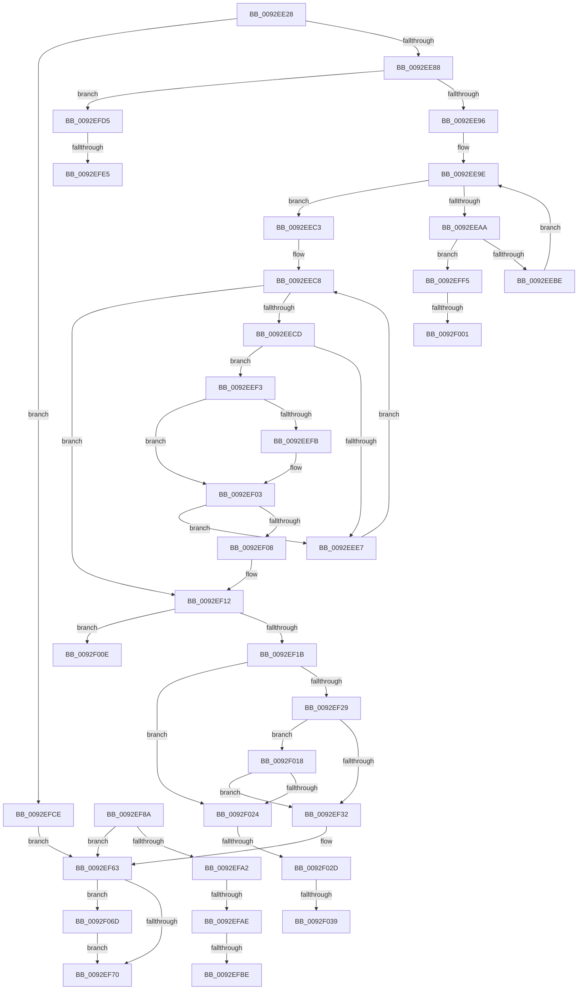

# DrvDbGetDriverDatabaseMappedProperty

- RVA: `0x0092EE28`–`0x0092F077` (길이 `591` bytes)
- VA: `0x000000014092EE28`
- 실행 섹션: `PAGE`
- PDB 이름 있음: `예`; PDB Function 태그: `예`
- unwind 정보 RVA: `0x0008EA10`
- 디코드: `159`개 명령, `591/591` bytes 표시
- 미해석 바이트: `0` (있으면 어셈블리에 `.byte`로 보존)

> 이 문서는 커널 이미지의 기계어와 PDB 기호를 분석해 생성했습니다. 4번과 5번은 함수 원형과 자료형을 바이너리 사용 방식에서 추정한 C 해석이며 원본 소스 복구 결과는 아닙니다.

## 1. Dependencies

- 직접 호출 지점: **5**; 고유 호출 대상: **5**
- 직접 호출자로 확인된 함수: **3**
- RIP 상대 이미지 참조: **6**

### Outgoing calls
- `0x0092EE79` → [wcsicmp](../../text/50/wcsicmp_function_00500080.md) (function, `0x00500080`)
- `0x0092EF5C` → [DrvDbGetRegValueMappedProperty](DrvDbGetRegValueMappedProperty_function_0092FB80.md) (function, `0x0092FB80`)
- `0x0092EF95` → [DrvDbFindDatabaseNode](../93/DrvDbFindDatabaseNode_function_00932628.md) (function, `0x00932628`)
- `0x0092F062` → [DrvDbOpenObjectRegKey](../93/DrvDbOpenObjectRegKey_function_00931060.md) (function, `0x00931060`)
- `0x0092F06D` → [ZwClose](../../text/6A/ZwClose_function_006AD2B0.md) (function, `0x006AD2B0`)

### Direct callers
- [DrvDbGetDriverDatabaseCompositeMappedPropertyKeys](../83/DrvDbGetDriverDatabaseCompositeMappedPropertyKeys_function_0083344C.md) at `0x008334D5`
- [sub_00B1D6D0](../B1/Unknown_function_00B1D6D0.md) at `0x00B1D705`
- [sub_00B24270](../B2/Unknown_function_00B24270.md) at `0x00B24369`
- [sub_00B24270](../B2/Unknown_function_00B24270.md) at `0x00B243E4`

### Static image references
- `0x0092EE5D` → RVA `0x00AFD260` (` ?? ::NNGAKEGL::`string'`; read)
- `0x0092EE9E` → RVA `0x00000000` (`image boundary/outside`; read)
- `0x0092EFB1` → RVA `0x00022540` (`.rdata`; read)
- `0x0092EFC2` → RVA `0x00022548` (`.rdata`; read)
- `0x0092EFD8` → RVA `0x00011F10` (`.rdata`; read)
- `0x0092EFE9` → RVA `0x00011F18` (`.rdata`; read)

## 2. Other-region calls and transfers

- 다른 실행 섹션으로 향하는 call: **2**
  - `0x0092EE79` → [wcsicmp](../../text/50/wcsicmp_function_00500080.md) (`PAGE` → `.text`)
  - `0x0092F06D` → [ZwClose](../../text/6A/ZwClose_function_006AD2B0.md) (`PAGE` → `.text`)
- call이 아닌 외부 분기/꼬리 이동: **11**
  - `0x0092EFA8` → [sub_00B233E6 + 0xA3](../B2/Unknown_function_00B233E6.md) (`tail-transfer`)
  - `0x0092EFB8` → [sub_00B233E6 + 0x6D](../B2/Unknown_function_00B233E6.md) (`tail-transfer`)
  - `0x0092EFC9` → [sub_00B233E6 + 0x6D](../B2/Unknown_function_00B233E6.md) (`tail-transfer`)
  - `0x0092EFDF` → [sub_00B233E6](../B2/Unknown_function_00B233E6.md) (`tail-transfer`)
  - `0x0092EFF0` → [sub_00B233E6](../B2/Unknown_function_00B233E6.md) (`tail-transfer`)
  - `0x0092EFFB` → [sub_00B233E6 + 0x5F](../B2/Unknown_function_00B233E6.md) (`tail-transfer`)
  - `0x0092F009` → [sub_00B233E6 + 0x5F](../B2/Unknown_function_00B233E6.md) (`tail-transfer`)
  - `0x0092F013` → [sub_00B233E6 + 0x2D8](../B2/Unknown_function_00B233E6.md) (`tail-transfer`)
  - `0x0092F027` → [sub_00B233E6 + 0x356](../B2/Unknown_function_00B233E6.md) (`tail-transfer`)
  - `0x0092F033` → [sub_00B233E6 + 0x356](../B2/Unknown_function_00B233E6.md) (`tail-transfer`)
  - `0x0092F068` → [sub_00B233E6 + 0x375](../B2/Unknown_function_00B233E6.md) (`tail-transfer`)

## 3. Assembly (complete function range)

```asm
0092EE28  48 89 5C 24 10                  mov qword ptr [rsp + 0x10], rbx
0092EE2D  4C 89 44 24 18                  mov qword ptr [rsp + 0x18], r8
0092EE32  48 89 4C 24 08                  mov qword ptr [rsp + 8], rcx
0092EE37  55                              push rbp
0092EE38  56                              push rsi
0092EE39  57                              push rdi
0092EE3A  41 54                           push r12
0092EE3C  41 55                           push r13
0092EE3E  41 56                           push r14
0092EE40  41 57                           push r15
0092EE42  48 8B EC                        mov rbp, rsp
0092EE45  48 83 EC 60                     sub rsp, 0x60
0092EE49  48 8B 75 60                     mov rsi, qword ptr [rbp + 0x60]
0092EE4D  33 C0                           xor eax, eax
0092EE4F  4C 8B 65 78                     mov r12, qword ptr [rbp + 0x78]
0092EE53  4C 8B EA                        mov r13, rdx
0092EE56  4C 8B F9                        mov r15, rcx
0092EE59  48 89 45 F8                     mov qword ptr [rbp - 8], rax
0092EE5D  48 8D 15 FC E3 1C 00            lea rdx, [rip + 0x1ce3fc]
0092EE64  48 89 45 F0                     mov qword ptr [rbp - 0x10], rax
0092EE68  89 06                           mov dword ptr [rsi], eax
0092EE6A  49 8B CD                        mov rcx, r13
0092EE6D  41 89 04 24                     mov dword ptr [r12], eax
0092EE71  49 8B F9                        mov rdi, r9
0092EE74  8B D8                           mov ebx, eax
0092EE76  44 8B F0                        mov r14d, eax
0092EE79  E8 02 12 BD FF                  call 0x140500080
0092EE7E  33 C9                           xor ecx, ecx
0092EE80  85 C0                           test eax, eax
0092EE82  0F 84 46 01 00 00               je 0x14092efce
0092EE88  44 8B 57 10                     mov r10d, dword ptr [rdi + 0x10]
0092EE8C  41 83 FA 02                     cmp r10d, 2
0092EE90  0F 84 3F 01 00 00               je 0x14092efd5
0092EE96  8B D3                           mov edx, ebx
0092EE98  41 BB 01 00 00 00               mov r11d, 1
0092EE9E  4C 8D 05 5B 11 6D FF            lea r8, [rip - 0x92eea5]
0092EEA5  83 FA 08                        cmp edx, 8
0092EEA8  73 19                           jae 0x14092eec3
0092EEAA  8B C2                           mov eax, edx
0092EEAC  4D 8B 84 C0 40 A5 E0 00         mov r8, qword ptr [r8 + rax*8 + 0xe0a540]
0092EEB4  45 39 50 10                     cmp dword ptr [r8 + 0x10], r10d
0092EEB8  0F 84 37 01 00 00               je 0x14092eff5
0092EEBE  41 03 D3                        add edx, r11d
0092EEC1  EB DB                           jmp 0x14092ee9e
0092EEC3  4C 8B FB                        mov r15, rbx
0092EEC6  8B D3                           mov edx, ebx
0092EEC8  83 FA 0C                        cmp edx, 0xc
0092EECB  73 45                           jae 0x14092ef12
0092EECD  4D 8D 88 E0 CC 00 00            lea r9, [r8 + 0xcce0]
0092EED4  8B C2                           mov eax, edx
0092EED6  48 8D 0C 80                     lea rcx, [rax + rax*4]
0092EEDA  4D 8D 0C C9                     lea r9, [r9 + rcx*8]
0092EEDE  4D 8B 01                        mov r8, qword ptr [r9]
0092EEE1  45 39 50 10                     cmp dword ptr [r8 + 0x10], r10d
0092EEE5  74 0C                           je 0x14092eef3
0092EEE7  41 03 D3                        add edx, r11d
0092EEEA  4C 8D 05 0F 11 6D FF            lea r8, [rip - 0x92eef1]
0092EEF1  EB D5                           jmp 0x14092eec8
0092EEF3  49 8B 08                        mov rcx, qword ptr [r8]
0092EEF6  48 2B 0F                        sub rcx, qword ptr [rdi]
0092EEF9  75 08                           jne 0x14092ef03
0092EEFB  49 8B 48 08                     mov rcx, qword ptr [r8 + 8]
0092EEFF  48 2B 4F 08                     sub rcx, qword ptr [rdi + 8]
0092EF03  48 85 C9                        test rcx, rcx
0092EF06  75 DF                           jne 0x14092eee7
0092EF08  4D 8B F9                        mov r15, r9
0092EF0B  4C 8D 05 EE 10 6D FF            lea r8, [rip - 0x92ef12]
0092EF12  4D 85 FF                        test r15, r15
0092EF15  0F 84 F3 00 00 00               je 0x14092f00e
0092EF1B  48 8B 7D 40                     mov rdi, qword ptr [rbp + 0x40]
0092EF1F  48 39 5D 50                     cmp qword ptr [rbp + 0x50], rbx
0092EF23  0F 84 FB 00 00 00               je 0x14092f024
0092EF29  4D 85 F6                        test r14, r14
0092EF2C  0F 85 E6 00 00 00               jne 0x14092f018
0092EF32  48 8B 45 F8                     mov rax, qword ptr [rbp - 8]
0092EF36  4C 8B CE                        mov r9, rsi
0092EF39  48 8B 55 50                     mov rdx, qword ptr [rbp + 0x50]
0092EF3D  48 85 C0                        test rax, rax
0092EF40  4C 89 64 24 30                  mov qword ptr [rsp + 0x30], r12
0092EF45  4D 8B C7                        mov r8, r15
0092EF48  48 0F 45 D0                     cmovne rdx, rax
0092EF4C  8B 45 70                        mov eax, dword ptr [rbp + 0x70]
0092EF4F  89 44 24 28                     mov dword ptr [rsp + 0x28], eax
0092EF53  48 8B 45 68                     mov rax, qword ptr [rbp + 0x68]
0092EF57  48 89 44 24 20                  mov qword ptr [rsp + 0x20], rax
0092EF5C  E8 1F 0C 00 00                  call 0x14092fb80
0092EF61  8B D8                           mov ebx, eax
0092EF63  48 8B 4D F8                     mov rcx, qword ptr [rbp - 8]
0092EF67  48 85 C9                        test rcx, rcx
0092EF6A  0F 85 FD 00 00 00               jne 0x14092f06d
0092EF70  8B C3                           mov eax, ebx
0092EF72  48 8B 9C 24 A8 00 00 00         mov rbx, qword ptr [rsp + 0xa8]
0092EF7A  48 83 C4 60                     add rsp, 0x60
0092EF7E  41 5F                           pop r15
0092EF80  41 5E                           pop r14
0092EF82  41 5D                           pop r13
0092EF84  41 5C                           pop r12
0092EF86  5F                              pop rdi
0092EF87  5E                              pop rsi
0092EF88  5D                              pop rbp
0092EF89  C3                              ret
0092EF8A  CC                              int3
0092EF8B  4C 8D 45 F0                     lea r8, [rbp - 0x10]
0092EF8F  49 8B D5                        mov rdx, r13
0092EF92  49 8B CF                        mov rcx, r15
0092EF95  E8 8E 36 00 00                  call 0x140932628
0092EF9A  33 C9                           xor ecx, ecx
0092EF9C  8B D8                           mov ebx, eax
0092EF9E  85 C0                           test eax, eax
0092EFA0  78 C1                           js 0x14092ef63
0092EFA2  8B 47 10                        mov eax, dword ptr [rdi + 0x10]
0092EFA5  83 F8 05                        cmp eax, 5
0092EFA8  0F 85 DB 44 1F 00               jne 0x140b23489
0092EFAE  48 8B 07                        mov rax, qword ptr [rdi]
0092EFB1  48 2B 05 88 35 6F FF            sub rax, qword ptr [rip - 0x90ca78]
0092EFB8  0F 85 95 44 1F 00               jne 0x140b23453
0092EFBE  48 8B 47 08                     mov rax, qword ptr [rdi + 8]
0092EFC2  48 2B 05 7F 35 6F FF            sub rax, qword ptr [rip - 0x90ca81]
0092EFC9  E9 85 44 1F 00                  jmp 0x140b23453
0092EFCE  BB BB 00 00 C0                  mov ebx, 0xc00000bb
0092EFD3  EB 8E                           jmp 0x14092ef63
0092EFD5  48 8B 07                        mov rax, qword ptr [rdi]
0092EFD8  48 2B 05 31 2F 6E FF            sub rax, qword ptr [rip - 0x91d0cf]
0092EFDF  0F 85 01 44 1F 00               jne 0x140b233e6
0092EFE5  48 8B 47 08                     mov rax, qword ptr [rdi + 8]
0092EFE9  48 2B 05 28 2F 6E FF            sub rax, qword ptr [rip - 0x91d0d8]
0092EFF0  E9 F1 43 1F 00                  jmp 0x140b233e6
0092EFF5  49 8B 08                        mov rcx, qword ptr [r8]
0092EFF8  48 2B 0F                        sub rcx, qword ptr [rdi]
0092EFFB  0F 85 44 44 1F 00               jne 0x140b23445
0092F001  49 8B 48 08                     mov rcx, qword ptr [r8 + 8]
0092F005  48 2B 4F 08                     sub rcx, qword ptr [rdi + 8]
0092F009  E9 37 44 1F 00                  jmp 0x140b23445
0092F00E  4C 8B FB                        mov r15, rbx
0092F011  8B D3                           mov edx, ebx
0092F013  E9 A6 46 1F 00                  jmp 0x140b236be
0092F018  41 8B 46 40                     mov eax, dword ptr [r14 + 0x40]
0092F01C  A8 10                           test al, 0x10
0092F01E  0F 84 0E FF FF FF               je 0x14092ef32
0092F024  4D 85 F6                        test r14, r14
0092F027  0F 84 0F 47 1F 00               je 0x140b2373c
0092F02D  41 8B 46 40                     mov eax, dword ptr [r14 + 0x40]
0092F031  A8 10                           test al, 0x10
0092F033  0F 84 03 47 1F 00               je 0x140b2373c
0092F039  48 8B 57 28                     mov rdx, qword ptr [rdi + 0x28]
0092F03D  48 8D 45 F8                     lea rax, [rbp - 8]
0092F041  48 89 5C 24 40                  mov qword ptr [rsp + 0x40], rbx
0092F046  4D 8B CD                        mov r9, r13
0092F049  48 89 5C 24 38                  mov qword ptr [rsp + 0x38], rbx
0092F04E  45 8B C3                        mov r8d, r11d
0092F051  48 89 44 24 30                  mov qword ptr [rsp + 0x30], rax
0092F056  48 8B CF                        mov rcx, rdi
0092F059  88 5C 24 28                     mov byte ptr [rsp + 0x28], bl
0092F05D  44 89 5C 24 20                  mov dword ptr [rsp + 0x20], r11d
0092F062  E8 F9 1F 00 00                  call 0x140931060
0092F067  90                              nop
0092F068  E9 EE 46 1F 00                  jmp 0x140b2375b
0092F06D  E8 3E E2 D7 FF                  call 0x1406ad2b0
0092F072  E9 F9 FE FF FF                  jmp 0x14092ef70
```

## 4. C-style interpretation (structured pseudocode)

```c
__int64 __fastcall DrvDbGetDriverDatabaseMappedProperty(__int64 a1, __int64 a2, __int64 a3, __int64 a4, __int64 a5, __int64 a6, unsigned int a7, __int64 a8)
{
    __int64 result;
    __int64 v_rsp;
    unsigned __int64 v_stack_m40;
    unsigned __int64 v_stack_m48;
    unsigned __int64 v_stack_m68;
    unsigned int v_stack_m70;
    unsigned __int64 v_stack_m78;
    unsigned __int64 v_stack_p10;
    unsigned __int64 v_stack_p18;
    unsigned int v_stack_p20;
    unsigned __int8 v_stack_p28;
    unsigned __int64 v_stack_p30;
    unsigned __int64 v_stack_p38;
    unsigned __int64 v_stack_p40;
    unsigned __int64 v_stack_p8;

    v_stack_p10 = v_rbx;
    v_stack_p18 = a3;
    v_stack_p8 = a1;
    v_rsp = (v_rsp) - (96);
    result = 0;
    v_stack_m40 = 0;
    v_stack_m48 = 0;
    *(unsigned int *)(a5) = 0;
    *(unsigned int *)(a8) = 0;
    result = wcsicmp(a2, v_rip + 1893372, a3, a4);
    a1 = 0;
    if ((unsigned int)(result) == 0) goto loc_0092EFCE;
    if (((unsigned int)((unsigned int)(*(unsigned int *)(a4 + 16)))) == 2) goto loc_0092EFD5;
loc_0092EE9E:
    if (0 >= 8) goto loc_0092EEC3;
    if ((*(unsigned int *)(*(unsigned __int64 *)(v_rip - 9629349 + 0 * 8 + 14722368) + 16)) == ((unsigned int)((unsigned int)(*(unsigned int *)(a4 + 16))))) goto loc_0092EFF5;
    a2 = (unsigned int)((0) + (1));
    goto loc_0092EE9E;
loc_0092EEC3:
loc_0092EEC8:
    if (0 >= 12) goto loc_0092EF12;
    if ((*(unsigned int *)(*(unsigned __int64 *)(*(unsigned __int64 *)(v_rip - 9629349 + 0 * 8 + 14722368) + 52448 + 0 + 0 * 4 * 8) + 16)) == ((unsigned int)((unsigned int)(*(unsigned int *)(a4 + 16))))) goto loc_0092EEF3;
loc_0092EEE7:
    a2 = (unsigned int)((0) + (1));
    goto loc_0092EEC8;
loc_0092EEF3:
    a1 = (*(unsigned __int64 *)(v_rip - 9629425)) - (*(unsigned __int64 *)(a4));
    if (!(condition_is_not_equal)) {
        a1 = *(unsigned __int64 *)(v_rip - 9629425 + 8);
        a1 = (a1) - (*(unsigned __int64 *)(a4 + 8));
    }
    if (a1 != 0) goto loc_0092EEE7;
loc_0092EF12:
    if (*(unsigned __int64 *)(v_rip - 9629349 + 0 * 8 + 14722368) + 52448 + 0 + 0 * 4 * 8 == 0) goto loc_0092F00E;
    if (v_stack_p18 == 0) goto loc_0092F024;
    if (0 != 0) goto loc_0092F018;
loc_0092EF32:
    v_stack_m68 = a8;
    a2 = v_stack_p18;
    if (v_stack_m40 != 0) { a2 = v_stack_m40; }
    v_stack_m70 = (unsigned int)((unsigned int)(a7));
    v_stack_m78 = a6;
    result = DrvDbGetRegValueMappedProperty(a1, a2, *(unsigned __int64 *)(v_rip - 9629349 + 0 * 8 + 14722368) + 52448 + 0 + 0 * 4 * 8, a5);
loc_0092EF63:
    if (v_stack_m40 != 0) goto loc_0092F06D;
loc_0092EF70:
    v_rsp = (v_rsp) + (96);
    return (unsigned int)((unsigned int)((unsigned int)((unsigned int)(result))));
loc_0092EFCE:
    goto loc_0092EF63;
loc_0092EFD5:
    result = (*(unsigned __int64 *)(v_stack_p8)) - (*(unsigned __int64 *)(v_rip - 9556175));
    result = (*(unsigned __int64 *)(v_stack_p8 + 8)) - (*(unsigned __int64 *)(v_rip - 9556184));
loc_0092EFF5:
    a1 = (*(unsigned __int64 *)(*(unsigned __int64 *)(v_rip - 9629349 + 0 * 8 + 14722368) + 52448 + 0 + 0 * 4 * 8)) - (*(unsigned __int64 *)(v_stack_p8));
    a1 = (*(unsigned __int64 *)(*(unsigned __int64 *)(v_rip - 9629349 + 0 * 8 + 14722368) + 52448 + 0 + 0 * 4 * 8 + 8)) - (*(unsigned __int64 *)(v_stack_p8 + 8));
loc_0092F00E:
loc_0092F018:
    if ((((unsigned __int8)((unsigned int)(*(unsigned int *)(0 + 64)))) & (16)) == 0) goto loc_0092EF32;
loc_0092F024:
    v_stack_p40 = (unsigned int)(0xC00000BBULL);
    v_stack_p38 = (unsigned int)(0xC00000BBULL);
    v_stack_p30 = v_stack_m40;
    v_stack_p28 = (unsigned __int8)((unsigned int)(0xC00000BBULL));
    v_stack_p20 = 1;
    result = DrvDbOpenObjectRegKey(v_stack_p8, *(unsigned __int64 *)(v_stack_p8 + 40), 1, a2);
loc_0092F06D:
    result = ZwClose(v_stack_p8, *(unsigned __int64 *)(v_stack_p8 + 40), 1, a2);
    goto loc_0092EF70;
}
```

## 5. (Beta) C Style

```c
int64_t DrvDbGetDriverDatabaseMappedProperty(int64_t Arg1, int64_t Arg2, int64_t Arg3, void *Arg4, void *Arg5, int64_t Arg6, uint32_t Arg7, void *Arg8)
{
    uint8_t *arg4 = (uint8_t *)Arg4;
    uint8_t *arg5 = (uint8_t *)Arg5;
    uint8_t *arg8 = (uint8_t *)Arg8;

    int64_t result;
    int64_t local_rsp;
    uint64_t v_stack_m40;
    uint64_t v_stack_m48;
    uint64_t v_stack_m68;
    uint32_t v_stack_m70;
    uint64_t v_stack_m78;
    uint64_t v_stack_p10;
    uint64_t v_stack_p18;
    uint32_t v_stack_p20;
    uint8_t v_stack_p28;
    uint64_t v_stack_p30;
    uint64_t v_stack_p38;
    uint64_t v_stack_p40;
    uint64_t v_stack_p8;

    v_stack_p10 = local_rbx;
    v_stack_p18 = Arg3;
    v_stack_p8 = Arg1;
    local_rsp = (local_rsp) - (96);
    result = 0;
    v_stack_m40 = 0;
    v_stack_m48 = 0;
    *(uint32_t *)(arg5) = 0;
    *(uint32_t *)(arg8) = 0;
    result = wcsicmp(Arg2, v_rip + 1893372, Arg3, Arg4);
    Arg1 = 0;
    if ((uint32_t)(result) == 0) goto loc_0092EFCE;
    if (((uint32_t)((uint32_t)(*(uint32_t *)(arg4 + 0x10)))) == 2) goto loc_0092EFD5;
loc_0092EE9E:
    if (0 >= 8) goto loc_0092EEC3;
    if ((*(uint32_t *)(*(uint64_t *)(v_rip - 0x92EEA5 + 0x0 * 8 + 0xE0A540) + 0x10)) == ((uint32_t)((uint32_t)(*(uint32_t *)(arg4 + 0x10))))) goto loc_0092EFF5;
    Arg2 = (uint32_t)((0) + (1));
    goto loc_0092EE9E;
loc_0092EEC3:
loc_0092EEC8:
    if (0 >= 12) goto loc_0092EF12;
    if ((*(uint32_t *)(*(uint64_t *)(*(uint64_t *)(v_rip - 0x92EEA5 + 0x0 * 8 + 0xE0A540) + 0xCCE0 + 0x0 + 0x0 * 4 * 8) + 0x10)) == ((uint32_t)((uint32_t)(*(uint32_t *)(arg4 + 0x10))))) goto loc_0092EEF3;
loc_0092EEE7:
    Arg2 = (uint32_t)((0) + (1));
    goto loc_0092EEC8;
loc_0092EEF3:
    Arg1 = (*(uint64_t *)(v_rip - 0x92EEF1)) - (*(uint64_t *)(arg4));
    if (!(condition_is_not_equal)) {
        Arg1 = *(uint64_t *)(v_rip - 0x92EEF1 + 0x8);
        Arg1 = (Arg1) - (*(uint64_t *)(arg4 + 0x8));
    }
    if (Arg1 != 0) goto loc_0092EEE7;
loc_0092EF12:
    if (*(uint64_t *)(v_rip - 0x92EEA5 + 0x0 * 8 + 0xE0A540) + 52448 + 0 + 0 * 4 * 8 == 0) goto loc_0092F00E;
    if (v_stack_p18 == 0) goto loc_0092F024;
    if (0 != 0) goto loc_0092F018;
loc_0092EF32:
    v_stack_m68 = Arg8;
    Arg2 = v_stack_p18;
    if (v_stack_m40 != 0) { Arg2 = v_stack_m40; }
    v_stack_m70 = (uint32_t)((uint32_t)(Arg7));
    v_stack_m78 = Arg6;
    result = DrvDbGetRegValueMappedProperty(Arg1, Arg2, *(uint64_t *)(v_rip - 0x92EEA5 + 0x0 * 8 + 0xE0A540) + 52448 + 0 + 0 * 4 * 8, Arg5);
loc_0092EF63:
    if (v_stack_m40 != 0) goto loc_0092F06D;
loc_0092EF70:
    local_rsp = (local_rsp) + (96);
    return (uint32_t)((uint32_t)((uint32_t)((uint32_t)(result))));
loc_0092EFCE:
    goto loc_0092EF63;
loc_0092EFD5:
    result = (*(uint64_t *)(v_stack_p8)) - (*(uint64_t *)(v_rip - 0x91D0CF));
    result = (*(uint64_t *)(v_stack_p8 + 0x8)) - (*(uint64_t *)(v_rip - 0x91D0D8));
loc_0092EFF5:
    Arg1 = (*(uint64_t *)(*(uint64_t *)(v_rip - 0x92EEA5 + 0x0 * 8 + 0xE0A540) + 0xCCE0 + 0x0 + 0x0 * 4 * 8)) - (*(uint64_t *)(v_stack_p8));
    Arg1 = (*(uint64_t *)(*(uint64_t *)(v_rip - 0x92EEA5 + 0x0 * 8 + 0xE0A540) + 0xCCE0 + 0x0 + 0x0 * 4 * 8 + 0x8)) - (*(uint64_t *)(v_stack_p8 + 0x8));
loc_0092F00E:
loc_0092F018:
    if ((((uint8_t)((uint32_t)(*(uint32_t *)(0 + 0x40)))) & (16)) == 0) goto loc_0092EF32;
loc_0092F024:
    v_stack_p40 = (uint32_t)(0xC00000BBULL);
    v_stack_p38 = (uint32_t)(0xC00000BBULL);
    v_stack_p30 = v_stack_m40;
    v_stack_p28 = (uint8_t)((uint32_t)(0xC00000BBULL));
    v_stack_p20 = 1;
    result = DrvDbOpenObjectRegKey(v_stack_p8, *(uint64_t *)(v_stack_p8 + 0x28), 1, Arg2);
loc_0092F06D:
    result = ZwClose(v_stack_p8, *(uint64_t *)(v_stack_p8 + 0x28), 1, Arg2);
    goto loc_0092EF70;
}
```

### 관측된 메모리 오프셋

구조체 형식이 확인되지 않은 접근은 인자 기준의 오프셋으로만 기록했습니다.

| 기준 인자 | 오프셋 표현 | 폭 (bit) | 접근 |
|---|---:|---:|---|
| `Arg4` | `+ 0x0` | `64` | `R` |
| `Arg4` | `+ 0x8` | `64` | `R` |
| `Arg4` | `+ 0x10` | `32` | `R` |
| `Arg5` | `+ 0x0` | `32` | `W` |
| `Arg8` | `+ 0x0` | `32` | `W` |

## 6. Execution-region graph

[열기: 2D/3D 그래프와 함수 탐색 컨트롤 패널](../../../control-panel.html?section=page&rva=0x0092EE28&view=graph)

- 2D 그래프는 위에서 아래로 흐르고, 3D 그래프는 빈 공간을 드래그해 회전합니다. Shift+드래그는 이동, 휠은 확대·축소, 함수 노드 선택은 대상 보고서 이동입니다.

### Static fallback


