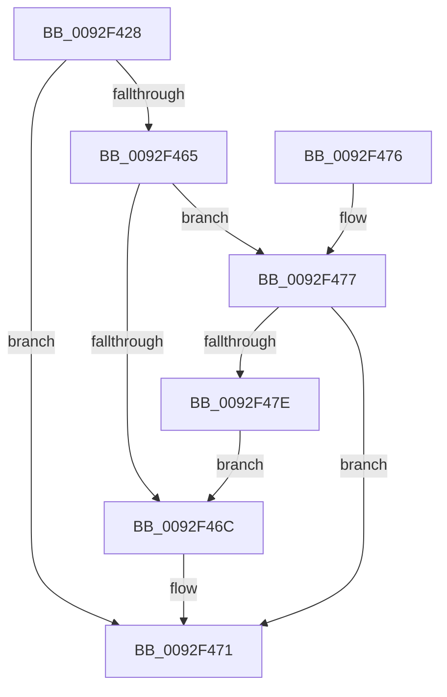

# DrvDbGetDriverPackageSignerScore

- RVA: `0x0092F428`–`0x0092F480` (길이 `88` bytes)
- VA: `0x000000014092F428`
- 실행 섹션: `PAGE`
- PDB 이름 있음: `예`; PDB Function 태그: `아니요`
- unwind 정보 RVA: `0x0008EA8C`
- 디코드: `23`개 명령, `88/88` bytes 표시
- 미해석 바이트: `0` (있으면 어셈블리에 `.byte`로 보존)

> 이 문서는 커널 이미지의 기계어와 PDB 기호를 분석해 생성했습니다. 4번과 5번은 함수 원형과 자료형을 바이너리 사용 방식에서 추정한 C 해석이며 원본 소스 복구 결과는 아닙니다.

## 1. Dependencies

- 직접 호출 지점: **1**; 고유 호출 대상: **1**
- 직접 호출자로 확인된 함수: **3**
- RIP 상대 이미지 참조: **1**

### Outgoing calls
- `0x0092F45C` → [DrvDbGetDriverPackageMappedProperty](../93/DrvDbGetDriverPackageMappedProperty_function_009305BC.md) (function, `0x009305BC`)

### Direct callers
- [DrvDbGetDriverPackageMappedPropertyKeys](../83/DrvDbGetDriverPackageMappedPropertyKeys_function_00833B34.md) at `0x00833D6A`
- [DrvDbSetDriverPackageMappedProperty](../83/DrvDbSetDriverPackageMappedProperty_function_00834848.md) at `0x00834B13`
- [DrvDbSetDriverPackageMappedProperty](../83/DrvDbSetDriverPackageMappedProperty_function_00834848.md) at `0x00834CF6`
- [sub_00B23888](../B2/Unknown_function_00B23888.md) at `0x00B2406D`

### Static image references
- `0x0092F451` → RVA `0x00011EE0` (`.rdata`; read)

## 2. Other-region calls and transfers

- 다른 실행 섹션으로 향하는 call: **0**
- 별도 외부 분기/꼬리 이동을 확인하지 못했습니다.

## 3. Assembly (complete function range)

```asm
0092F428  4C 8B DC                        mov r11, rsp
0092F42B  48 83 EC 58                     sub rsp, 0x58
0092F42F  83 64 24 40 00                  and dword ptr [rsp + 0x40], 0
0092F434  49 8D 43 EC                     lea rax, [r11 - 0x14]
0092F438  83 64 24 44 00                  and dword ptr [rsp + 0x44], 0
0092F43D  49 89 43 E0                     mov qword ptr [r11 - 0x20], rax
0092F441  49 8D 43 E8                     lea rax, [r11 - 0x18]
0092F445  C7 44 24 30 04 00 00 00         mov dword ptr [rsp + 0x30], 4
0092F44D  4D 89 4B D0                     mov qword ptr [r11 - 0x30], r9
0092F451  4C 8D 0D 88 2A 6E FF            lea r9, [rip - 0x91d578]
0092F458  49 89 43 C8                     mov qword ptr [r11 - 0x38], rax
0092F45C  E8 5B 11 00 00                  call 0x1409305bc
0092F461  85 C0                           test eax, eax
0092F463  78 0C                           js 0x14092f471
0092F465  83 7C 24 40 07                  cmp dword ptr [rsp + 0x40], 7
0092F46A  74 0B                           je 0x14092f477
0092F46C  B8 01 00 00 C0                  mov eax, 0xc0000001
0092F471  48 83 C4 58                     add rsp, 0x58
0092F475  C3                              ret
0092F476  CC                              int3
0092F477  83 7C 24 44 04                  cmp dword ptr [rsp + 0x44], 4
0092F47C  74 F3                           je 0x14092f471
0092F47E  EB EC                           jmp 0x14092f46c
```

## 4. C-style interpretation (structured pseudocode)

```c
__int64 __fastcall DrvDbGetDriverPackageSignerScore(__int64 a1, __int64 a2, __int64 a3, __int64 a4)
{
    __int64 result;
    __int64 v_rsp;
    unsigned int v_stack_m14;
    unsigned int v_stack_m18;
    unsigned int v_stack_m28;
    unsigned int v_stack_p44;

    v_rsp = (v_rsp) - (88);
    *(unsigned __int64 *)(v_rsp - 32) = v_rsp - 20;
    v_stack_m28 = 4;
    *(unsigned __int64 *)(v_rsp - 48) = a4;
    *(unsigned __int64 *)(v_rsp - 56) = v_rsp - 24;
    result = DrvDbGetDriverPackageMappedProperty(a1, a2, a3, v_rip - 9557368);
    if (sign_flag) goto loc_0092F471;
    if (v_stack_m18 == 7) goto loc_0092F477;
loc_0092F46C:
loc_0092F471:
    v_rsp = (v_rsp) + (88);
    return (unsigned int)(0xC0000001ULL);
loc_0092F477:
    if (v_stack_p44 == 4) goto loc_0092F471;
    goto loc_0092F46C;
}
```

## 5. (Beta) C Style

```c
int64_t DrvDbGetDriverPackageSignerScore(int64_t Arg1, int64_t Arg2, int64_t Arg3, int64_t Arg4)
{
    int64_t result;
    int64_t local_rsp;
    uint32_t v_stack_m14;
    uint32_t v_stack_m18;
    uint32_t v_stack_m28;
    uint32_t v_stack_p44;

    local_rsp = (local_rsp) - (88);
    *(uint64_t *)(local_rsp - 0x20) = local_rsp - 20;
    v_stack_m28 = 4;
    *(uint64_t *)(local_rsp - 0x30) = Arg4;
    *(uint64_t *)(local_rsp - 0x38) = local_rsp - 24;
    result = DrvDbGetDriverPackageMappedProperty(Arg1, Arg2, Arg3, v_rip - 9557368);
    if (sign_flag) goto loc_0092F471;
    if (v_stack_m18 == 7) goto loc_0092F477;
loc_0092F46C:
loc_0092F471:
    local_rsp = (local_rsp) + (88);
    return (uint32_t)(0xC0000001ULL);
loc_0092F477:
    if (v_stack_p44 == 4) goto loc_0092F471;
    goto loc_0092F46C;
}
```

## 6. Execution-region graph

[열기: 2D/3D 그래프와 함수 탐색 컨트롤 패널](../../../control-panel.html?section=page&rva=0x0092F428&view=graph)

- 2D 그래프는 위에서 아래로 흐르고, 3D 그래프는 빈 공간을 드래그해 회전합니다. Shift+드래그는 이동, 휠은 확대·축소, 함수 노드 선택은 대상 보고서 이동입니다.

### Static fallback


