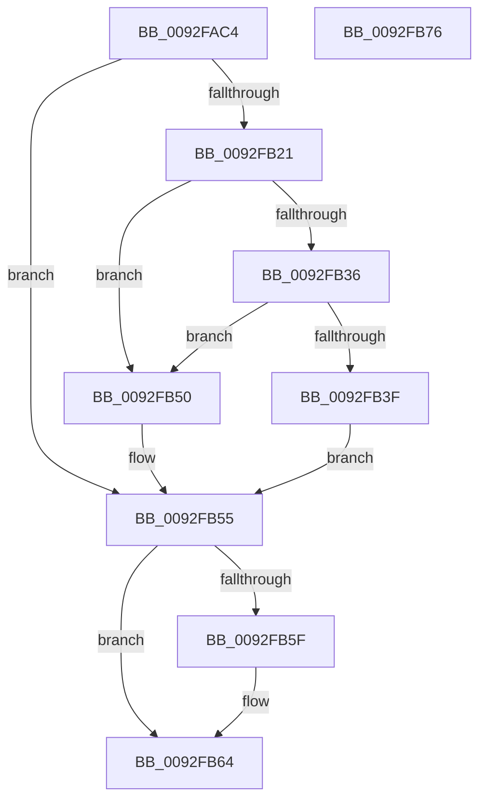

# DrvDbGetObjectDatabaseNodeName

- RVA: `0x0092FAC4`–`0x0092FB77` (길이 `179` bytes)
- VA: `0x000000014092FAC4`
- 실행 섹션: `PAGE`
- PDB 이름 있음: `예`; PDB Function 태그: `아니요`
- unwind 정보 RVA: `0x0007AFEC`
- 디코드: `50`개 명령, `179/179` bytes 표시
- 미해석 바이트: `0` (있으면 어셈블리에 `.byte`로 보존)

> 이 문서는 커널 이미지의 기계어와 PDB 기호를 분석해 생성했습니다. 4번과 5번은 함수 원형과 자료형을 바이너리 사용 방식에서 추정한 C 해석이며 원본 소스 복구 결과는 아닙니다.

## 1. Dependencies

- 직접 호출 지점: **3**; 고유 호출 대상: **3**
- 직접 호출자로 확인된 함수: **4**
- RIP 상대 이미지 참조: **0**

### Outgoing calls
- `0x0092FB16` → [DrvDbOpenObjectRegKey](../93/DrvDbOpenObjectRegKey_function_00931060.md) (function, `0x00931060`)
- `0x0092FB49` → [memcpy](../../text/6C/memcpy_function_006C6840.md) (function, `0x006C6840`)
- `0x0092FB5F` → [ZwClose](../../text/6A/ZwClose_function_006AD2B0.md) (function, `0x006AD2B0`)

### Direct callers
- [DrvDbGetDriverFileMappedProperty](../83/DrvDbGetDriverFileMappedProperty_function_00833778.md) at `0x008337FF`
- [DrvDbGetDeviceIdMappedProperty](DrvDbGetDeviceIdMappedProperty_function_0092F690.md) at `0x0092F90C`
- [DrvDbGetDriverInfFileMappedProperty](../93/DrvDbGetDriverInfFileMappedProperty_function_00930080.md) at `0x009301F8`
- [DrvDbGetDriverPackageMappedProperty](../93/DrvDbGetDriverPackageMappedProperty_function_009305BC.md) at `0x0093099D`

### Static image references
- 디코드된 RIP-relative 메모리 참조가 없습니다.

## 2. Other-region calls and transfers

- 다른 실행 섹션으로 향하는 call: **2**
  - `0x0092FB49` → [memcpy](../../text/6C/memcpy_function_006C6840.md) (`PAGE` → `.text`)
  - `0x0092FB5F` → [ZwClose](../../text/6A/ZwClose_function_006AD2B0.md) (`PAGE` → `.text`)
- 별도 외부 분기/꼬리 이동을 확인하지 못했습니다.

## 3. Assembly (complete function range)

```asm
0092FAC4  4C 8B DC                        mov r11, rsp
0092FAC7  49 89 5B 08                     mov qword ptr [r11 + 8], rbx
0092FACB  49 89 73 10                     mov qword ptr [r11 + 0x10], rsi
0092FACF  57                              push rdi
0092FAD0  48 83 EC 60                     sub rsp, 0x60
0092FAD4  48 8B B4 24 98 00 00 00         mov rsi, qword ptr [rsp + 0x98]
0092FADC  49 8D 43 E8                     lea rax, [r11 - 0x18]
0092FAE0  49 83 63 F0 00                  and qword ptr [r11 - 0x10], 0
0092FAE5  49 8B F9                        mov rdi, r9
0092FAE8  49 83 63 E8 00                  and qword ptr [r11 - 0x18], 0
0092FAED  4D 8B C8                        mov r9, r8
0092FAF0  49 89 43 D8                     mov qword ptr [r11 - 0x28], rax
0092FAF4  44 8B C2                        mov r8d, edx
0092FAF7  49 83 63 D0 00                  and qword ptr [r11 - 0x30], 0
0092FAFC  49 8D 43 F0                     lea rax, [r11 - 0x10]
0092FB00  83 26 00                        and dword ptr [rsi], 0
0092FB03  33 D2                           xor edx, edx
0092FB05  49 89 43 C8                     mov qword ptr [r11 - 0x38], rax
0092FB09  C6 44 24 28 00                  mov byte ptr [rsp + 0x28], 0
0092FB0E  C7 44 24 20 01 00 00 00         mov dword ptr [rsp + 0x20], 1
0092FB16  E8 45 15 00 00                  call 0x140931060
0092FB1B  8B D8                           mov ebx, eax
0092FB1D  85 C0                           test eax, eax
0092FB1F  78 34                           js 0x14092fb55
0092FB21  48 8B 54 24 50                  mov rdx, qword ptr [rsp + 0x50]
0092FB26  0F B7 4A 10                     movzx ecx, word ptr [rdx + 0x10]
0092FB2A  83 C1 02                        add ecx, 2
0092FB2D  8B C1                           mov eax, ecx
0092FB2F  89 0E                           mov dword ptr [rsi], ecx
0092FB31  48 85 FF                        test rdi, rdi
0092FB34  74 1A                           je 0x14092fb50
0092FB36  39 84 24 90 00 00 00            cmp dword ptr [rsp + 0x90], eax
0092FB3D  72 11                           jb 0x14092fb50
0092FB3F  48 8B 52 18                     mov rdx, qword ptr [rdx + 0x18]
0092FB43  44 8B C0                        mov r8d, eax
0092FB46  48 8B CF                        mov rcx, rdi
0092FB49  E8 F2 6C D9 FF                  call 0x1406c6840
0092FB4E  EB 05                           jmp 0x14092fb55
0092FB50  BB 23 00 00 C0                  mov ebx, 0xc0000023
0092FB55  48 8B 4C 24 58                  mov rcx, qword ptr [rsp + 0x58]
0092FB5A  48 85 C9                        test rcx, rcx
0092FB5D  74 05                           je 0x14092fb64
0092FB5F  E8 4C D7 D7 FF                  call 0x1406ad2b0
0092FB64  48 8B 74 24 78                  mov rsi, qword ptr [rsp + 0x78]
0092FB69  8B C3                           mov eax, ebx
0092FB6B  48 8B 5C 24 70                  mov rbx, qword ptr [rsp + 0x70]
0092FB70  48 83 C4 60                     add rsp, 0x60
0092FB74  5F                              pop rdi
0092FB75  C3                              ret
0092FB76  CC                              int3
```

## 4. C-style interpretation (structured pseudocode)

```c
__int64 __fastcall DrvDbGetObjectDatabaseNodeName(__int64 a1, int a2, __int64 a3, __int64 a4, unsigned int a5, __int64 a6)
{
    __int64 result;
    __int64 v_rsp;
    unsigned __int64 v_stack_m10;
    unsigned __int64 v_stack_m18;
    unsigned __int8 v_stack_m40;
    unsigned int v_stack_m48;
    unsigned __int64 v_stack_p10;
    unsigned __int64 v_stack_p8;

    *(unsigned __int64 *)(v_rsp + 8) = v_rbx;
    *(unsigned __int64 *)(v_rsp + 16) = v_rsi;
    v_rsp = (v_rsp) - (96);
    *(unsigned __int64 *)(v_rsp - 40) = v_rsp - 24;
    a2 = 0;
    *(unsigned __int64 *)(v_rsp - 56) = v_rsp - 16;
    v_stack_m40 = 0;
    v_stack_m48 = 1;
    result = DrvDbOpenObjectRegKey(a1, a2, (unsigned int)(a2), a3);
    if (sign_flag) goto loc_0092FB55;
    a1 = (unsigned int)((*(unsigned __int16 *)(v_stack_m18 + 16)) + (2));
    *(unsigned int *)(a6) = (unsigned int)(a1);
    if (a4 == 0) goto loc_0092FB50;
    if (a5 < ((unsigned int)((unsigned int)((unsigned int)(a1))))) goto loc_0092FB50;
    result = memcpy(a4, *(unsigned __int64 *)(v_stack_m18 + 24), (unsigned int)((unsigned int)((unsigned int)((unsigned int)(a1)))), a3);
    goto loc_0092FB55;
loc_0092FB50:
loc_0092FB55:
    if (v_stack_m10 != 0) {
        result = ZwClose(v_stack_m10, *(unsigned __int64 *)(v_stack_m18 + 24), (unsigned int)((unsigned int)((unsigned int)((unsigned int)(a1)))), a3);
    }
    v_rsp = (v_rsp) + (96);
    return (unsigned int)((unsigned int)((unsigned int)(0xC0000023ULL)));
}
```

## 5. (Beta) C Style

```c
int64_t DrvDbGetObjectDatabaseNodeName(int64_t Arg1, int32_t Arg2, int64_t Arg3, int64_t Arg4, uint32_t Arg5, void *Arg6)
{
    uint8_t *arg6 = (uint8_t *)Arg6;

    int64_t result;
    int64_t local_rsp;
    uint64_t v_stack_m10;
    uint64_t v_stack_m18;
    uint8_t v_stack_m40;
    uint32_t v_stack_m48;
    uint64_t v_stack_p10;
    uint64_t v_stack_p8;

    *(uint64_t *)(local_rsp + 0x8) = local_rbx;
    *(uint64_t *)(local_rsp + 0x10) = local_rsi;
    local_rsp = (local_rsp) - (96);
    *(uint64_t *)(local_rsp - 0x28) = local_rsp - 24;
    Arg2 = 0;
    *(uint64_t *)(local_rsp - 0x38) = local_rsp - 16;
    v_stack_m40 = 0;
    v_stack_m48 = 1;
    result = DrvDbOpenObjectRegKey(Arg1, Arg2, (uint32_t)(Arg2), Arg3);
    if (sign_flag) goto loc_0092FB55;
    Arg1 = (uint32_t)((*(uint16_t *)(v_stack_m18 + 0x10)) + (2));
    *(uint32_t *)(arg6) = (uint32_t)(Arg1);
    if (Arg4 == 0) goto loc_0092FB50;
    if (Arg5 < ((uint32_t)((uint32_t)((uint32_t)(Arg1))))) goto loc_0092FB50;
    result = memcpy(Arg4, *(uint64_t *)(v_stack_m18 + 0x18), (uint32_t)((uint32_t)((uint32_t)((uint32_t)(Arg1)))), Arg3);
    goto loc_0092FB55;
loc_0092FB50:
loc_0092FB55:
    if (v_stack_m10 != 0) {
        result = ZwClose(v_stack_m10, *(uint64_t *)(v_stack_m18 + 0x18), (uint32_t)((uint32_t)((uint32_t)((uint32_t)(Arg1)))), Arg3);
    }
    local_rsp = (local_rsp) + (96);
    return (uint32_t)((uint32_t)((uint32_t)(0xC0000023ULL)));
}
```

### 관측된 메모리 오프셋

구조체 형식이 확인되지 않은 접근은 인자 기준의 오프셋으로만 기록했습니다.

| 기준 인자 | 오프셋 표현 | 폭 (bit) | 접근 |
|---|---:|---:|---|
| `Arg6` | `+ 0x0` | `32` | `R/W` |
| `Arg6` | `+ 0x0` | `32` | `W` |

## 6. Execution-region graph

[열기: 2D/3D 그래프와 함수 탐색 컨트롤 패널](../../../control-panel.html?section=page&rva=0x0092FAC4&view=graph)

- 2D 그래프는 위에서 아래로 흐르고, 3D 그래프는 빈 공간을 드래그해 회전합니다. Shift+드래그는 이동, 휠은 확대·축소, 함수 노드 선택은 대상 보고서 이동입니다.

### Static fallback


