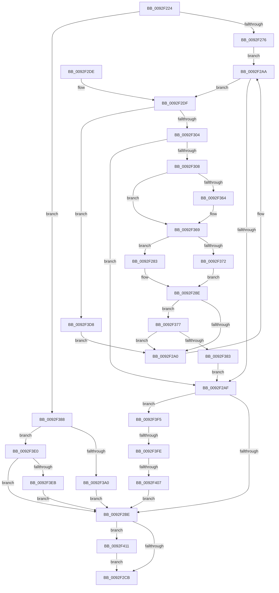

# DrvDbGetObjectList

- RVA: `0x0092F224`–`0x0092F421` (길이 `509` bytes)
- VA: `0x000000014092F224`
- 실행 섹션: `PAGE`
- PDB 이름 있음: `예`; PDB Function 태그: `예`
- unwind 정보 RVA: `0x0008EA60`
- 디코드: `147`개 명령, `509/509` bytes 표시
- 미해석 바이트: `0` (있으면 어셈블리에 `.byte`로 보존)

> 이 문서는 커널 이미지의 기계어와 PDB 기호를 분석해 생성했습니다. 4번과 5번은 함수 원형과 자료형을 바이너리 사용 방식에서 추정한 C 해석이며 원본 소스 복구 결과는 아닙니다.

## 1. Dependencies

- 직접 호출 지점: **6**; 고유 호출 대상: **3**
- 직접 호출자로 확인된 함수: **4**
- RIP 상대 이미지 참조: **0**

### Outgoing calls
- `0x0092F2EF` → [DrvDbAcquireDatabaseNodeBaseKey](../93/DrvDbAcquireDatabaseNodeBaseKey_function_00930DE0.md) (function, `0x00930DE0`)
- `0x0092F340` → [DrvDbGetObjectSubKeyList](DrvDbGetObjectSubKeyList_function_0092F0C8.md) (function, `0x0092F0C8`)
- `0x0092F351` → [DrvDbReleaseDatabaseNodeBaseKey](../93/DrvDbReleaseDatabaseNodeBaseKey_function_00930D44.md) (function, `0x00930D44`)
- `0x0092F395` → [DrvDbAcquireDatabaseNodeBaseKey](../93/DrvDbAcquireDatabaseNodeBaseKey_function_00930DE0.md) (function, `0x00930DE0`)
- `0x0092F3CC` → [DrvDbGetObjectSubKeyList](DrvDbGetObjectSubKeyList_function_0092F0C8.md) (function, `0x0092F0C8`)
- `0x0092F417` → [DrvDbReleaseDatabaseNodeBaseKey](../93/DrvDbReleaseDatabaseNodeBaseKey_function_00930D44.md) (function, `0x00930D44`)

### Direct callers
- [DrvDbDispatchDeviceId](DrvDbDispatchDeviceId_function_0092F490.md) at `0x0092F61E`
- [DrvDbDispatchDriverInfFile](DrvDbDispatchDriverInfFile_function_0092FE10.md) at `0x0092FF99`
- [DrvDbDispatchDriverPackage](../93/DrvDbDispatchDriverPackage_function_009303A0.md) at `0x009304C0`
- [DrvDbDispatchDriverFile](../AC/DrvDbDispatchDriverFile_function_00AC8880.md) at `0x00AC8A11`

### Static image references
- 디코드된 RIP-relative 메모리 참조가 없습니다.

## 2. Other-region calls and transfers

- 다른 실행 섹션으로 향하는 call: **0**
- call이 아닌 외부 분기/꼬리 이동: **2**
  - `0x0092F3F8` → [sub_00B2376A](../B2/Unknown_function_00B2376A.md) (`tail-transfer`)
  - `0x0092F401` → [sub_00B2376A](../B2/Unknown_function_00B2376A.md) (`tail-transfer`)

## 3. Assembly (complete function range)

```asm
0092F224  4C 89 4C 24 20                  mov qword ptr [rsp + 0x20], r9
0092F229  4C 89 44 24 18                  mov qword ptr [rsp + 0x18], r8
0092F22E  89 54 24 10                     mov dword ptr [rsp + 0x10], edx
0092F232  55                              push rbp
0092F233  53                              push rbx
0092F234  56                              push rsi
0092F235  57                              push rdi
0092F236  41 54                           push r12
0092F238  41 55                           push r13
0092F23A  41 56                           push r14
0092F23C  41 57                           push r15
0092F23E  48 8B EC                        mov rbp, rsp
0092F241  48 83 EC 58                     sub rsp, 0x58
0092F245  48 8B 75 78                     mov rsi, qword ptr [rbp + 0x78]
0092F249  4D 8B F1                        mov r14, r9
0092F24C  45 33 C9                        xor r9d, r9d
0092F24F  4D 8B F8                        mov r15, r8
0092F252  48 8B F9                        mov rdi, rcx
0092F255  4C 89 4D E8                     mov qword ptr [rbp - 0x18], r9
0092F259  41 8B D9                        mov ebx, r9d
0092F25C  44 89 4D 48                     mov dword ptr [rbp + 0x48], r9d
0092F260  44 89 0E                        mov dword ptr [rsi], r9d
0092F263  45 8B E1                        mov r12d, r9d
0092F266  48 8B 41 30                     mov rax, qword ptr [rcx + 0x30]
0092F26A  45 8B E9                        mov r13d, r9d
0092F26D  48 85 C0                        test rax, rax
0092F270  0F 85 12 01 00 00               jne 0x14092f388
0092F276  4C 8B 7D 68                     mov r15, qword ptr [rbp + 0x68]
0092F27A  48 8D 41 10                     lea rax, [rcx + 0x10]
0092F27E  4C 8B 30                        mov r14, qword ptr [rax]
0092F281  EB 27                           jmp 0x14092f2aa
0092F283  42 8D 04 29                     lea eax, [rcx + r13]
0092F287  3B 45 70                        cmp eax, dword ptr [rbp + 0x70]
0092F28A  44 0F 42 E8                     cmovb r13d, eax
0092F28E  01 0E                           add dword ptr [rsi], ecx
0092F290  B9 00 00 00 80                  mov ecx, 0x80000000
0092F295  8D 04 0B                        lea eax, [rbx + rcx]
0092F298  85 C1                           test ecx, eax
0092F29A  0F 84 D7 00 00 00               je 0x14092f377
0092F2A0  4D 8B 36                        mov r14, qword ptr [r14]
0092F2A3  48 8D 47 10                     lea rax, [rdi + 0x10]
0092F2A7  8B 55 50                        mov edx, dword ptr [rbp + 0x50]
0092F2AA  4C 3B F0                        cmp r14, rax
0092F2AD  75 30                           jne 0x14092f2df
0092F2AF  8B 0E                           mov ecx, dword ptr [rsi]
0092F2B1  8D 41 01                        lea eax, [rcx + 1]
0092F2B4  89 06                           mov dword ptr [rsi], eax
0092F2B6  85 DB                           test ebx, ebx
0092F2B8  0F 89 37 01 00 00               jns 0x14092f3f5
0092F2BE  4C 8B 4D E8                     mov r9, qword ptr [rbp - 0x18]
0092F2C2  4D 85 C9                        test r9, r9
0092F2C5  0F 85 46 01 00 00               jne 0x14092f411
0092F2CB  8B C3                           mov eax, ebx
0092F2CD  48 83 C4 58                     add rsp, 0x58
0092F2D1  41 5F                           pop r15
0092F2D3  41 5E                           pop r14
0092F2D5  41 5D                           pop r13
0092F2D7  41 5C                           pop r12
0092F2D9  5F                              pop rdi
0092F2DA  5E                              pop rsi
0092F2DB  5B                              pop rbx
0092F2DC  5D                              pop rbp
0092F2DD  C3                              ret
0092F2DE  CC                              int3
0092F2DF  44 8B C2                        mov r8d, edx
0092F2E2  4C 8D 4D E8                     lea r9, [rbp - 0x18]
0092F2E6  49 8B D6                        mov rdx, r14
0092F2E9  48 8B CF                        mov rcx, rdi
0092F2EC  4D 8B E6                        mov r12, r14
0092F2EF  E8 EC 1A 00 00                  call 0x140930de0
0092F2F4  45 33 C9                        xor r9d, r9d
0092F2F7  8B D8                           mov ebx, eax
0092F2F9  3D 67 04 00 C0                  cmp eax, 0xc0000467
0092F2FE  0F 84 D4 00 00 00               je 0x14092f3d8
0092F304  85 C0                           test eax, eax
0092F306  78 A7                           js 0x14092f2af
0092F308  8B 55 70                        mov edx, dword ptr [rbp + 0x70]
0092F30B  4C 8B 4D 60                     mov r9, qword ptr [rbp + 0x60]
0092F30F  41 2B D5                        sub edx, r13d
0092F312  4C 8B 45 58                     mov r8, qword ptr [rbp + 0x58]
0092F316  41 8B C5                        mov eax, r13d
0092F319  49 8D 0C 47                     lea rcx, [r15 + rax*2]
0092F31D  8B 85 80 00 00 00               mov eax, dword ptr [rbp + 0x80]
0092F323  89 44 24 38                     mov dword ptr [rsp + 0x38], eax
0092F327  48 8D 45 48                     lea rax, [rbp + 0x48]
0092F32B  48 89 44 24 30                  mov qword ptr [rsp + 0x30], rax
0092F330  89 54 24 28                     mov dword ptr [rsp + 0x28], edx
0092F334  48 8B 55 E8                     mov rdx, qword ptr [rbp - 0x18]
0092F338  48 89 4C 24 20                  mov qword ptr [rsp + 0x20], rcx
0092F33D  48 8B 0F                        mov rcx, qword ptr [rdi]
0092F340  E8 83 FD FF FF                  call 0x14092f0c8
0092F345  4C 8B 4D E8                     mov r9, qword ptr [rbp - 0x18]
0092F349  49 8B D6                        mov rdx, r14
0092F34C  48 8B CF                        mov rcx, rdi
0092F34F  8B D8                           mov ebx, eax
0092F351  E8 EE 19 00 00                  call 0x140930d44
0092F356  8B 4D 48                        mov ecx, dword ptr [rbp + 0x48]
0092F359  45 33 C9                        xor r9d, r9d
0092F35C  4C 89 4D E8                     mov qword ptr [rbp - 0x18], r9
0092F360  85 C9                           test ecx, ecx
0092F362  74 05                           je 0x14092f369
0092F364  FF C9                           dec ecx
0092F366  89 4D 48                        mov dword ptr [rbp + 0x48], ecx
0092F369  4D 85 FF                        test r15, r15
0092F36C  0F 85 11 FF FF FF               jne 0x14092f283
0092F372  E9 17 FF FF FF                  jmp 0x14092f28e
0092F377  81 FB 23 00 00 C0               cmp ebx, 0xc0000023
0092F37D  0F 84 1D FF FF FF               je 0x14092f2a0
0092F383  E9 27 FF FF FF                  jmp 0x14092f2af
0092F388  44 8B C2                        mov r8d, edx
0092F38B  4C 8D 4D E8                     lea r9, [rbp - 0x18]
0092F38F  48 8B D0                        mov rdx, rax
0092F392  4C 8B E0                        mov r12, rax
0092F395  E8 46 1A 00 00                  call 0x140930de0
0092F39A  8B D8                           mov ebx, eax
0092F39C  85 C0                           test eax, eax
0092F39E  78 40                           js 0x14092f3e0
0092F3A0  8B 85 80 00 00 00               mov eax, dword ptr [rbp + 0x80]
0092F3A6  4D 8B CE                        mov r9, r14
0092F3A9  48 8B 55 E8                     mov rdx, qword ptr [rbp - 0x18]
0092F3AD  4D 8B C7                        mov r8, r15
0092F3B0  48 8B 0F                        mov rcx, qword ptr [rdi]
0092F3B3  89 44 24 38                     mov dword ptr [rsp + 0x38], eax
0092F3B7  8B 45 70                        mov eax, dword ptr [rbp + 0x70]
0092F3BA  48 89 74 24 30                  mov qword ptr [rsp + 0x30], rsi
0092F3BF  89 44 24 28                     mov dword ptr [rsp + 0x28], eax
0092F3C3  48 8B 45 68                     mov rax, qword ptr [rbp + 0x68]
0092F3C7  48 89 44 24 20                  mov qword ptr [rsp + 0x20], rax
0092F3CC  E8 F7 FC FF FF                  call 0x14092f0c8
0092F3D1  8B D8                           mov ebx, eax
0092F3D3  E9 E6 FE FF FF                  jmp 0x14092f2be
0092F3D8  41 8B D9                        mov ebx, r9d
0092F3DB  E9 C0 FE FF FF                  jmp 0x14092f2a0
0092F3E0  3D 67 04 00 C0                  cmp eax, 0xc0000467
0092F3E5  0F 85 D3 FE FF FF               jne 0x14092f2be
0092F3EB  BB 3A 00 00 C0                  mov ebx, 0xc000003a
0092F3F0  E9 C9 FE FF FF                  jmp 0x14092f2be
0092F3F5  4D 85 FF                        test r15, r15
0092F3F8  0F 84 6C 43 1F 00               je 0x140b2376a
0092F3FE  3B 45 70                        cmp eax, dword ptr [rbp + 0x70]
0092F401  0F 87 63 43 1F 00               ja 0x140b2376a
0092F407  66 45 89 0C 4F                  mov word ptr [r15 + rcx*2], r9w
0092F40C  E9 AD FE FF FF                  jmp 0x14092f2be
0092F411  49 8B D4                        mov rdx, r12
0092F414  48 8B CF                        mov rcx, rdi
0092F417  E8 28 19 00 00                  call 0x140930d44
0092F41C  E9 AA FE FF FF                  jmp 0x14092f2cb
```

## 4. C-style interpretation (structured pseudocode)

```c
__int64 __fastcall DrvDbGetObjectList(__int64 a1, int a2, __int64 a3, __int64 a4, __int64 a5, unsigned int a6, __int64 a7, unsigned int a8)
{
    __int64 result;
    __int64 v_r13;
    __int64 v_rsp;
    unsigned __int64 v_stack_m58;
    unsigned int v_stack_p10;
    unsigned __int64 v_stack_p18;
    unsigned __int64 v_stack_p20;
    unsigned int v_stack_p28;
    unsigned __int64 v_stack_p30;
    unsigned int v_stack_p38;
    unsigned int v_stack_p8;

    v_stack_p20 = a4;
    v_stack_p18 = a3;
    v_stack_p10 = a2;
    v_rsp = (v_rsp) - (88);
    a4 = 0;
    v_stack_m58 = 0;
    v_stack_p8 = 0;
    *(unsigned int *)(a7) = 0;
    if (*(unsigned __int64 *)(a1 + 48) != 0) goto loc_0092F388;
    goto loc_0092F2AA;
loc_0092F283:
    v_r13 = 0;
    if (((unsigned int)(a1 + 0 * 1)) < a6) { v_r13 = (unsigned int)(a1 + 0 * 1); }
loc_0092F28E:
    if ((((unsigned int)((unsigned int)(0x80000000ULL))) & ((unsigned int)(0 + (unsigned int)(0x80000000ULL) * 1))) == 0) goto loc_0092F377;
loc_0092F2A0:
loc_0092F2AA:
    if ((*(unsigned __int64 *)(*(unsigned __int64 *)(a1 + 16))) != (a1 + 16)) goto loc_0092F2DF;
loc_0092F2AF:
    *(unsigned int *)(a7) = (unsigned int)((unsigned int)(*(unsigned int *)(a7)) + 1);
    if (!sign_flag) goto loc_0092F3F5;
loc_0092F2BE:
    if (v_stack_m58 != 0) goto loc_0092F411;
loc_0092F2CB:
    v_rsp = (v_rsp) + (88);
    return 0;
loc_0092F2DF:
    result = DrvDbAcquireDatabaseNodeBaseKey(a1, *(unsigned __int64 *)(*(unsigned __int64 *)(a1 + 16)), (unsigned int)((unsigned int)((unsigned int)(v_stack_p10))), v_stack_m58);
    a4 = 0;
    if (((unsigned int)(result)) == 0xC0000467ULL) goto loc_0092F3D8;
    if (sign_flag) goto loc_0092F2AF;
    a2 = (unsigned int)(((unsigned int)(a6)) - ((unsigned int)(v_r13)));
    v_stack_p38 = (unsigned int)((unsigned int)(a8));
    v_stack_p30 = v_stack_p8;
    v_stack_p28 = a2;
    v_stack_p20 = a5 + (unsigned int)((unsigned int)(v_r13)) * 2;
    result = DrvDbGetObjectSubKeyList(*(unsigned __int64 *)(a1), v_stack_m58, v_stack_p18, v_stack_p20);
    result = DrvDbReleaseDatabaseNodeBaseKey(a1, *(unsigned __int64 *)(*(unsigned __int64 *)(a1 + 16)), v_stack_p18, v_stack_m58);
    a4 = 0;
    v_stack_m58 = 0;
    if ((unsigned int)((unsigned int)(v_stack_p8)) != 0) {
        a1 = (unsigned int)(((unsigned int)(v_stack_p8)) - 1);
        v_stack_p8 = (unsigned int)(a1);
    }
    if (a5 != 0) goto loc_0092F283;
    goto loc_0092F28E;
loc_0092F377:
    if (((unsigned int)((unsigned int)((unsigned int)(result)))) == 0xC0000023ULL) goto loc_0092F2A0;
    goto loc_0092F2AF;
loc_0092F388:
    result = DrvDbAcquireDatabaseNodeBaseKey(a1, result, (unsigned int)((unsigned int)(*(unsigned __int64 *)(*(unsigned __int64 *)(a1 + 16)))), v_stack_m58);
    if (sign_flag) goto loc_0092F3E0;
    v_stack_p38 = (unsigned int)((unsigned int)(a8));
    v_stack_p30 = a7;
    v_stack_p28 = (unsigned int)((unsigned int)(a6));
    v_stack_p20 = a5;
    result = DrvDbGetObjectSubKeyList(*(unsigned __int64 *)(a1), v_stack_m58, a5, *(unsigned __int64 *)(*(unsigned __int64 *)(a1 + 16)));
    goto loc_0092F2BE;
loc_0092F3D8:
    goto loc_0092F2A0;
loc_0092F3E0:
    if (((unsigned int)(result)) != 0xC0000467ULL) goto loc_0092F2BE;
    goto loc_0092F2BE;
loc_0092F3F5:
    *(unsigned __int16 *)(a5 + *(unsigned __int64 *)(a1) * 2) = (unsigned __int16)(*(unsigned __int64 *)(*(unsigned __int64 *)(a1 + 16)));
    goto loc_0092F2BE;
loc_0092F411:
    result = DrvDbReleaseDatabaseNodeBaseKey(a1, result, a5, *(unsigned __int64 *)(*(unsigned __int64 *)(a1 + 16)));
    goto loc_0092F2CB;
}
```

## 5. (Beta) C Style

```c
int64_t DrvDbGetObjectList(void *Arg1, int32_t Arg2, int64_t Arg3, int64_t Arg4, int64_t Arg5, uint32_t Arg6, void *Arg7, uint32_t Arg8)
{
    uint8_t *arg1 = (uint8_t *)Arg1;
    uint8_t *arg7 = (uint8_t *)Arg7;

    int64_t result;
    int64_t local_r13;
    int64_t local_rsp;
    uint64_t v_stack_m58;
    uint32_t v_stack_p10;
    uint64_t v_stack_p18;
    uint64_t v_stack_p20;
    uint32_t v_stack_p28;
    uint64_t v_stack_p30;
    uint32_t v_stack_p38;
    uint32_t v_stack_p8;

    v_stack_p20 = Arg4;
    v_stack_p18 = Arg3;
    v_stack_p10 = Arg2;
    local_rsp = (local_rsp) - (88);
    Arg4 = 0;
    v_stack_m58 = 0;
    v_stack_p8 = 0;
    *(uint32_t *)(arg7) = 0;
    if (*(uint64_t *)(arg1 + 0x30) != 0) goto loc_0092F388;
    goto loc_0092F2AA;
loc_0092F283:
    local_r13 = 0;
    if (((uint32_t)(Arg1 + 0 * 1)) < Arg6) { local_r13 = (uint32_t)(Arg1 + 0 * 1); }
loc_0092F28E:
    if ((((uint32_t)((uint32_t)(0x80000000ULL))) & ((uint32_t)(0 + (uint32_t)(0x80000000ULL) * 1))) == 0) goto loc_0092F377;
loc_0092F2A0:
loc_0092F2AA:
    if ((*(uint64_t *)(*(uint64_t *)(arg1 + 0x10))) != (Arg1 + 16)) goto loc_0092F2DF;
loc_0092F2AF:
    *(uint32_t *)(arg7) = (uint32_t)((uint32_t)(*(uint32_t *)(arg7)) + 1);
    if (!sign_flag) goto loc_0092F3F5;
loc_0092F2BE:
    if (v_stack_m58 != 0) goto loc_0092F411;
loc_0092F2CB:
    local_rsp = (local_rsp) + (88);
    return 0;
loc_0092F2DF:
    result = DrvDbAcquireDatabaseNodeBaseKey(Arg1, *(uint64_t *)(*(uint64_t *)(arg1 + 0x10)), (uint32_t)((uint32_t)((uint32_t)(v_stack_p10))), v_stack_m58);
    Arg4 = 0;
    if (((uint32_t)(result)) == 0xC0000467ULL) goto loc_0092F3D8;
    if (sign_flag) goto loc_0092F2AF;
    Arg2 = (uint32_t)(((uint32_t)(Arg6)) - ((uint32_t)(local_r13)));
    v_stack_p38 = (uint32_t)((uint32_t)(Arg8));
    v_stack_p30 = v_stack_p8;
    v_stack_p28 = Arg2;
    v_stack_p20 = Arg5 + (uint32_t)((uint32_t)(local_r13)) * 2;
    result = DrvDbGetObjectSubKeyList(*(uint64_t *)(arg1), v_stack_m58, v_stack_p18, v_stack_p20);
    result = DrvDbReleaseDatabaseNodeBaseKey(Arg1, *(uint64_t *)(*(uint64_t *)(arg1 + 0x10)), v_stack_p18, v_stack_m58);
    Arg4 = 0;
    v_stack_m58 = 0;
    if ((uint32_t)((uint32_t)(v_stack_p8)) != 0) {
        Arg1 = (uint32_t)(((uint32_t)(v_stack_p8)) - 1);
        v_stack_p8 = (uint32_t)(Arg1);
    }
    if (Arg5 != 0) goto loc_0092F283;
    goto loc_0092F28E;
loc_0092F377:
    if (((uint32_t)((uint32_t)((uint32_t)(result)))) == 0xC0000023ULL) goto loc_0092F2A0;
    goto loc_0092F2AF;
loc_0092F388:
    result = DrvDbAcquireDatabaseNodeBaseKey(Arg1, result, (uint32_t)((uint32_t)(*(uint64_t *)(*(uint64_t *)(arg1 + 0x10)))), v_stack_m58);
    if (sign_flag) goto loc_0092F3E0;
    v_stack_p38 = (uint32_t)((uint32_t)(Arg8));
    v_stack_p30 = Arg7;
    v_stack_p28 = (uint32_t)((uint32_t)(Arg6));
    v_stack_p20 = Arg5;
    result = DrvDbGetObjectSubKeyList(*(uint64_t *)(arg1), v_stack_m58, Arg5, *(uint64_t *)(*(uint64_t *)(arg1 + 0x10)));
    goto loc_0092F2BE;
loc_0092F3D8:
    goto loc_0092F2A0;
loc_0092F3E0:
    if (((uint32_t)(result)) != 0xC0000467ULL) goto loc_0092F2BE;
    goto loc_0092F2BE;
loc_0092F3F5:
    *(uint16_t *)(Arg5 + *(uint64_t *)(arg1) * 2) = (uint16_t)(*(uint64_t *)(*(uint64_t *)(arg1 + 0x10)));
    goto loc_0092F2BE;
loc_0092F411:
    result = DrvDbReleaseDatabaseNodeBaseKey(Arg1, result, Arg5, *(uint64_t *)(*(uint64_t *)(arg1 + 0x10)));
    goto loc_0092F2CB;
}
```

### 관측된 메모리 오프셋

구조체 형식이 확인되지 않은 접근은 인자 기준의 오프셋으로만 기록했습니다.

| 기준 인자 | 오프셋 표현 | 폭 (bit) | 접근 |
|---|---:|---:|---|
| `Arg1` | `+ 0x0` | `64` | `R` |
| `Arg1` | `+ 0x10` | `64` | `R` |
| `Arg1` | `+ 0x30` | `64` | `R` |
| `Arg7` | `+ 0x0` | `32` | `R` |
| `Arg7` | `+ 0x0` | `32` | `R/W` |
| `Arg7` | `+ 0x0` | `32` | `W` |

## 6. Execution-region graph

[열기: 2D/3D 그래프와 함수 탐색 컨트롤 패널](../../../control-panel.html?section=page&rva=0x0092F224&view=graph)

- 2D 그래프는 위에서 아래로 흐르고, 3D 그래프는 빈 공간을 드래그해 회전합니다. Shift+드래그는 이동, 휠은 확대·축소, 함수 노드 선택은 대상 보고서 이동입니다.

### Static fallback


