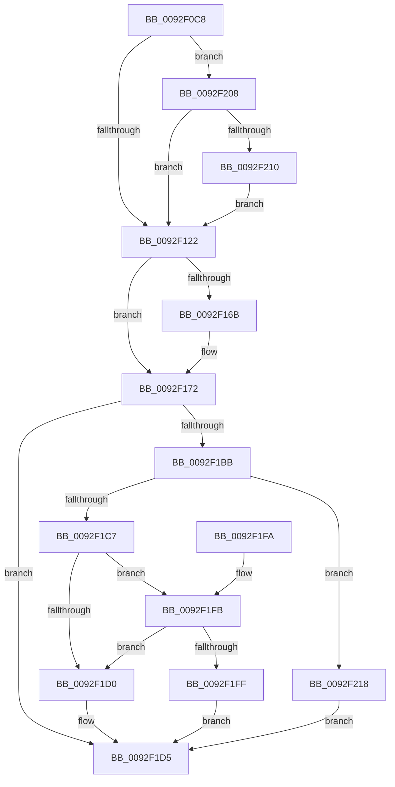

# DrvDbGetObjectSubKeyList

- RVA: `0x0092F0C8`–`0x0092F21D` (길이 `341` bytes)
- VA: `0x000000014092F0C8`
- 실행 섹션: `PAGE`
- PDB 이름 있음: `예`; PDB Function 태그: `아니요`
- unwind 정보 RVA: `0x0008EA3C`
- 디코드: `91`개 명령, `341/341` bytes 표시
- 미해석 바이트: `0` (있으면 어셈블리에 `.byte`로 보존)

> 이 문서는 커널 이미지의 기계어와 PDB 기호를 분석해 생성했습니다. 4번과 5번은 함수 원형과 자료형을 바이너리 사용 방식에서 추정한 C 해석이며 원본 소스 복구 결과는 아닙니다.

## 1. Dependencies

- 직접 호출 지점: **3**; 고유 호출 대상: **3**
- 직접 호출자로 확인된 함수: **1**
- RIP 상대 이미지 참조: **3**

### Outgoing calls
- `0x0092F12F` → [memset](../../text/6C/memset_function_006C6C40.md) (function, `0x006C6C40`)
- `0x0092F1B0` → [_RegRtlEnumKeyWithCallback](../99/_RegRtlEnumKeyWithCallback_function_009929EC.md) (function, `0x009929EC`)
- `0x0092F1E1` → [_security_check_cookie](../../text/6A/_security_check_cookie_function_006AC640.md) (function, `0x006AC640`)

### Direct callers
- [DrvDbGetObjectList](DrvDbGetObjectList_function_0092F224.md) at `0x0092F340`
- [DrvDbGetObjectList](DrvDbGetObjectList_function_0092F224.md) at `0x0092F3CC`

### Static image references
- `0x0092F0E4` → RVA `0x00E0A740` (`.data`; read)
- `0x0092F177` → RVA `0x00A11300` (`DrvDbGetObjectSubKeyCallback`; read)
- `0x0092F183` → RVA `0x004719E0` (`PnpCtxInternalEnumKeyCallback`; read)

## 2. Other-region calls and transfers

- 다른 실행 섹션으로 향하는 call: **2**
  - `0x0092F12F` → [memset](../../text/6C/memset_function_006C6C40.md) (`PAGE` → `.text`)
  - `0x0092F1E1` → [_security_check_cookie](../../text/6A/_security_check_cookie_function_006AC640.md) (`PAGE` → `.text`)
- 별도 외부 분기/꼬리 이동을 확인하지 못했습니다.

## 3. Assembly (complete function range)

```asm
0092F0C8  40 55                           push rbp
0092F0CA  53                              push rbx
0092F0CB  56                              push rsi
0092F0CC  57                              push rdi
0092F0CD  41 54                           push r12
0092F0CF  41 55                           push r13
0092F0D1  41 56                           push r14
0092F0D3  41 57                           push r15
0092F0D5  48 8D AC 24 68 FE FF FF         lea rbp, [rsp - 0x198]
0092F0DD  48 81 EC 98 02 00 00            sub rsp, 0x298
0092F0E4  48 8B 05 55 B6 4D 00            mov rax, qword ptr [rip + 0x4db655]
0092F0EB  48 33 C4                        xor rax, rsp
0092F0EE  48 89 85 80 01 00 00            mov qword ptr [rbp + 0x180], rax
0092F0F5  48 8B B5 10 02 00 00            mov rsi, qword ptr [rbp + 0x210]
0092F0FC  33 C0                           xor eax, eax
0092F0FE  48 8B 9D 00 02 00 00            mov rbx, qword ptr [rbp + 0x200]
0092F105  4D 8B E1                        mov r12, r9
0092F108  8B BD 08 02 00 00               mov edi, dword ptr [rbp + 0x208]
0092F10E  4D 8B F8                        mov r15, r8
0092F111  4C 8B EA                        mov r13, rdx
0092F114  4C 8B F1                        mov r14, rcx
0092F117  89 06                           mov dword ptr [rsi], eax
0092F119  48 85 DB                        test rbx, rbx
0092F11C  0F 85 E6 00 00 00               jne 0x14092f208
0092F122  33 D2                           xor edx, edx
0092F124  48 8D 4C 24 54                  lea rcx, [rsp + 0x54]
0092F129  41 B8 04 02 00 00               mov r8d, 0x204
0092F12F  E8 0C 7B D9 FF                  call 0x1406c6c40
0092F134  8B 85 18 02 00 00               mov eax, dword ptr [rbp + 0x218]
0092F13A  4C 89 BD 58 01 00 00            mov qword ptr [rbp + 0x158], r15
0092F141  45 33 FF                        xor r15d, r15d
0092F144  89 44 24 50                     mov dword ptr [rsp + 0x50], eax
0092F148  41 8B C7                        mov eax, r15d
0092F14B  4C 89 A5 60 01 00 00            mov qword ptr [rbp + 0x160], r12
0092F152  48 89 9D 68 01 00 00            mov qword ptr [rbp + 0x168], rbx
0092F159  89 BD 70 01 00 00               mov dword ptr [rbp + 0x170], edi
0092F15F  44 89 BD 74 01 00 00            mov dword ptr [rbp + 0x174], r15d
0092F166  4D 85 F6                        test r14, r14
0092F169  74 07                           je 0x14092f172
0092F16B  49 8B 86 E0 00 00 00            mov rax, qword ptr [r14 + 0xe0]
0092F172  48 89 44 24 38                  mov qword ptr [rsp + 0x38], rax
0092F177  48 8D 0D 82 21 0E 00            lea rcx, [rip + 0xe2182]
0092F17E  48 89 4C 24 28                  mov qword ptr [rsp + 0x28], rcx
0092F183  48 8D 05 56 28 B4 FF            lea rax, [rip - 0x4bd7aa]
0092F18A  48 8D 4C 24 50                  lea rcx, [rsp + 0x50]
0092F18F  48 89 44 24 40                  mov qword ptr [rsp + 0x40], rax
0092F194  48 89 4C 24 30                  mov qword ptr [rsp + 0x30], rcx
0092F199  48 8D 44 24 20                  lea rax, [rsp + 0x20]
0092F19E  49 8B CD                        mov rcx, r13
0092F1A1  4C 89 74 24 20                  mov qword ptr [rsp + 0x20], r14
0092F1A6  4C 8D 44 24 38                  lea r8, [rsp + 0x38]
0092F1AB  48 89 44 24 48                  mov qword ptr [rsp + 0x48], rax
0092F1B0  E8 37 38 06 00                  call 0x1409929ec
0092F1B5  8B D0                           mov edx, eax
0092F1B7  85 C0                           test eax, eax
0092F1B9  78 1A                           js 0x14092f1d5
0092F1BB  8B 85 74 01 00 00               mov eax, dword ptr [rbp + 0x174]
0092F1C1  89 06                           mov dword ptr [rsi], eax
0092F1C3  85 C0                           test eax, eax
0092F1C5  74 51                           je 0x14092f218
0092F1C7  FF C0                           inc eax
0092F1C9  89 06                           mov dword ptr [rsi], eax
0092F1CB  48 85 DB                        test rbx, rbx
0092F1CE  75 2B                           jne 0x14092f1fb
0092F1D0  BA 23 00 00 C0                  mov edx, 0xc0000023
0092F1D5  8B C2                           mov eax, edx
0092F1D7  48 8B 8D 80 01 00 00            mov rcx, qword ptr [rbp + 0x180]
0092F1DE  48 33 CC                        xor rcx, rsp
0092F1E1  E8 5A D4 D7 FF                  call 0x1406ac640
0092F1E6  48 81 C4 98 02 00 00            add rsp, 0x298
0092F1ED  41 5F                           pop r15
0092F1EF  41 5E                           pop r14
0092F1F1  41 5D                           pop r13
0092F1F3  41 5C                           pop r12
0092F1F5  5F                              pop rdi
0092F1F6  5E                              pop rsi
0092F1F7  5B                              pop rbx
0092F1F8  5D                              pop rbp
0092F1F9  C3                              ret
0092F1FA  CC                              int3
0092F1FB  3B C7                           cmp eax, edi
0092F1FD  77 D1                           ja 0x14092f1d0
0092F1FF  FF C8                           dec eax
0092F201  66 44 89 3C 43                  mov word ptr [rbx + rax*2], r15w
0092F206  EB CD                           jmp 0x14092f1d5
0092F208  85 FF                           test edi, edi
0092F20A  0F 84 12 FF FF FF               je 0x14092f122
0092F210  66 89 03                        mov word ptr [rbx], ax
0092F213  E9 0A FF FF FF                  jmp 0x14092f122
0092F218  41 8B D7                        mov edx, r15d
0092F21B  EB B8                           jmp 0x14092f1d5
```

## 4. C-style interpretation (structured pseudocode)

```c
__int64 __fastcall DrvDbGetObjectSubKeyList(__int64 a1, __int64 a2, __int64 a3, __int64 a4, __int64 a5, unsigned int a6, __int64 a7, unsigned int a8)
{
    __int64 result;
    __int64 v_r15;
    __int64 v_rsp;
    unsigned __int64 v_stack_m1D8;
    unsigned __int64 v_stack_m284;
    unsigned int v_stack_m288;
    unsigned __int64 v_stack_m290;
    unsigned __int64 v_stack_m298;
    unsigned __int64 v_stack_m2A0;
    unsigned __int64 v_stack_m2A8;
    unsigned __int64 v_stack_m2B0;
    unsigned __int64 v_stack_m2B8;
    unsigned __int64 v_stack_m58;
    unsigned int v_stack_m64;
    unsigned int v_stack_m68;
    unsigned __int64 v_stack_m70;
    unsigned __int64 v_stack_m78;
    unsigned __int64 v_stack_m80;

    v_rsp = (v_rsp) - (664);
    result = (*(unsigned __int64 *)(v_rip + 5092949)) ^ (v_rsp);
    v_stack_m58 = result;
    result = 0;
    *(unsigned int *)(a7) = 0;
    if (a5 != 0) goto loc_0092F208;
loc_0092F122:
    a2 = 0;
    result = memset(v_stack_m284, a2, 516, a4);
    v_stack_m80 = a3;
    v_r15 = 0;
    v_stack_m288 = (unsigned int)((unsigned int)(a8));
    v_stack_m78 = a4;
    v_stack_m70 = a5;
    v_stack_m68 = (unsigned int)((unsigned int)(a6));
    v_stack_m64 = 0;
    result = 0;
    if (a1 != 0) {
        result = *(unsigned __int64 *)(a1 + 224);
    }
    v_stack_m2A0 = result;
    v_stack_m2B0 = v_rip + 926082;
    v_stack_m298 = v_rip - 4970410;
    v_stack_m2A8 = v_stack_m288;
    v_stack_m2B8 = a1;
    v_stack_m290 = v_stack_m2B8;
    result = _RegRtlEnumKeyWithCallback(0, a2, v_stack_m2A0, a4);
    if (sign_flag) goto loc_0092F1D5;
    *(unsigned int *)(a7) = (unsigned int)((unsigned int)(v_stack_m64));
    if ((unsigned int)((unsigned int)(v_stack_m64)) == 0) goto loc_0092F218;
    result = (unsigned int)(((unsigned int)(v_stack_m64)) + 1);
    *(unsigned int *)(a7) = (unsigned int)(result);
    if (a5 != 0) goto loc_0092F1FB;
loc_0092F1D0:
loc_0092F1D5:
    a1 = (v_stack_m58) ^ (v_rsp);
    result = _security_check_cookie(a1, (unsigned int)(0xC0000023ULL), v_stack_m2A0, a4);
    v_rsp = (v_rsp) + (664);
    return result;
loc_0092F1FB:
    if (((unsigned int)(result)) > ((unsigned int)((unsigned int)(a6)))) goto loc_0092F1D0;
    result = (unsigned int)((result) - 1);
    *(unsigned __int16 *)(a5 + result * 2) = 0;
    goto loc_0092F1D5;
loc_0092F208:
    if ((unsigned int)((unsigned int)(a6)) == 0) goto loc_0092F122;
    *(unsigned __int16 *)(a5) = (unsigned __int16)(result);
    goto loc_0092F122;
loc_0092F218:
    goto loc_0092F1D5;
}
```

## 5. (Beta) C Style

```c
int64_t DrvDbGetObjectSubKeyList(int64_t Arg1, int64_t Arg2, int64_t Arg3, int64_t Arg4, int64_t Arg5, uint32_t Arg6, void *Arg7, uint32_t Arg8)
{
    uint8_t *arg7 = (uint8_t *)Arg7;

    int64_t result;
    int64_t local_r15;
    int64_t local_rsp;
    uint64_t v_stack_m1D8;
    uint64_t v_stack_m284;
    uint32_t v_stack_m288;
    uint64_t v_stack_m290;
    uint64_t v_stack_m298;
    uint64_t v_stack_m2A0;
    uint64_t v_stack_m2A8;
    uint64_t v_stack_m2B0;
    uint64_t v_stack_m2B8;
    uint64_t v_stack_m58;
    uint32_t v_stack_m64;
    uint32_t v_stack_m68;
    uint64_t v_stack_m70;
    uint64_t v_stack_m78;
    uint64_t v_stack_m80;

    local_rsp = (local_rsp) - (664);
    result = (*(uint64_t *)(v_rip + 0x4DB655)) ^ (local_rsp);
    v_stack_m58 = result;
    result = 0;
    *(uint32_t *)(arg7) = 0;
    if (Arg5 != 0) goto loc_0092F208;
loc_0092F122:
    Arg2 = 0;
    result = memset(v_stack_m284, Arg2, 516, Arg4);
    v_stack_m80 = Arg3;
    local_r15 = 0;
    v_stack_m288 = (uint32_t)((uint32_t)(Arg8));
    v_stack_m78 = Arg4;
    v_stack_m70 = Arg5;
    v_stack_m68 = (uint32_t)((uint32_t)(Arg6));
    v_stack_m64 = 0;
    result = 0;
    if (Arg1 != 0) {
        result = *(uint64_t *)(Arg1 + 0xE0);
    }
    v_stack_m2A0 = result;
    v_stack_m2B0 = v_rip + 926082;
    v_stack_m298 = v_rip - 4970410;
    v_stack_m2A8 = v_stack_m288;
    v_stack_m2B8 = Arg1;
    v_stack_m290 = v_stack_m2B8;
    result = _RegRtlEnumKeyWithCallback(0, Arg2, v_stack_m2A0, Arg4);
    if (sign_flag) goto loc_0092F1D5;
    *(uint32_t *)(arg7) = (uint32_t)((uint32_t)(v_stack_m64));
    if ((uint32_t)((uint32_t)(v_stack_m64)) == 0) goto loc_0092F218;
    result = (uint32_t)(((uint32_t)(v_stack_m64)) + 1);
    *(uint32_t *)(arg7) = (uint32_t)(result);
    if (Arg5 != 0) goto loc_0092F1FB;
loc_0092F1D0:
loc_0092F1D5:
    Arg1 = (v_stack_m58) ^ (local_rsp);
    result = _security_check_cookie(Arg1, (uint32_t)(0xC0000023ULL), v_stack_m2A0, Arg4);
    local_rsp = (local_rsp) + (664);
    return result;
loc_0092F1FB:
    if (((uint32_t)(result)) > ((uint32_t)((uint32_t)(Arg6)))) goto loc_0092F1D0;
    result = (uint32_t)((result) - 1);
    *(uint16_t *)(Arg5 + result * 2) = 0;
    goto loc_0092F1D5;
loc_0092F208:
    if ((uint32_t)((uint32_t)(Arg6)) == 0) goto loc_0092F122;
    *(uint16_t *)(Arg5) = (uint16_t)(result);
    goto loc_0092F122;
loc_0092F218:
    goto loc_0092F1D5;
}
```

### 관측된 메모리 오프셋

구조체 형식이 확인되지 않은 접근은 인자 기준의 오프셋으로만 기록했습니다.

| 기준 인자 | 오프셋 표현 | 폭 (bit) | 접근 |
|---|---:|---:|---|
| `Arg7` | `+ 0x0` | `32` | `W` |

## 6. Execution-region graph

[열기: 2D/3D 그래프와 함수 탐색 컨트롤 패널](../../../control-panel.html?section=page&rva=0x0092F0C8&view=graph)

- 2D 그래프는 위에서 아래로 흐르고, 3D 그래프는 빈 공간을 드래그해 회전합니다. Shift+드래그는 이동, 휠은 확대·축소, 함수 노드 선택은 대상 보고서 이동입니다.

### Static fallback


