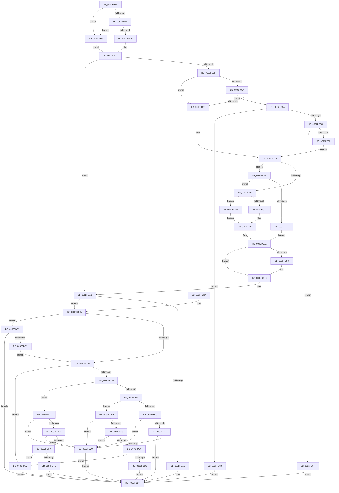

# DrvDbGetRegValueMappedProperty

- RVA: `0x0092FB80`–`0x0092FE07` (길이 `647` bytes)
- VA: `0x000000014092FB80`
- 실행 섹션: `PAGE`
- PDB 이름 있음: `예`; PDB Function 태그: `아니요`
- unwind 정보 RVA: `0x0008EAE0`
- 디코드: `161`개 명령, `647/647` bytes 표시
- 미해석 바이트: `0` (있으면 어셈블리에 `.byte`로 보존)

> 이 문서는 커널 이미지의 기계어와 PDB 기호를 분석해 생성했습니다. 4번과 5번은 함수 원형과 자료형을 바이너리 사용 방식에서 추정한 C 해석이며 원본 소스 복구 결과는 아닙니다.

## 1. Dependencies

- 직접 호출 지점: **6**; 고유 호출 대상: **6**
- 직접 호출자로 확인된 함수: **6**
- RIP 상대 이미지 참조: **1**

### Outgoing calls
- `0x0092FC0A` → [RtlInitUnicodeStringEx](../../text/46/RtlInitUnicodeStringEx_function_00463960.md) (function, `0x00463960`)
- `0x0092FC5B` → [ZwQueryValueKey](../../text/6A/ZwQueryValueKey_function_006AD3B0.md) (function, `0x006AD3B0`)
- `0x0092FC81` → [memcpy](../../text/6C/memcpy_function_006C6840.md) (function, `0x006C6840`)
- `0x0092FC98` → [ExFreePoolWithTag](../../poolcode/B8/ExFreePoolWithTag_function_00B82870.md) (function, `0x00B82870`)
- `0x0092FCBD` → [_security_check_cookie](../../text/6A/_security_check_cookie_function_006AC640.md) (function, `0x006AC640`)
- `0x0092FD4B` → [ExAllocatePool2](../../poolcode/B8/ExAllocatePool2_function_00B820F0.md) (function, `0x00B820F0`)

### Direct callers
- [DrvDbGetDriverFileMappedProperty](../83/DrvDbGetDriverFileMappedProperty_function_00833778.md) at `0x008338C1`
- [DrvDbGetDriverPackageSignerName](../83/DrvDbGetDriverPackageSignerName_function_00833E24.md) at `0x00833EB6`
- [DrvDbGetDriverDatabaseMappedProperty](DrvDbGetDriverDatabaseMappedProperty_function_0092EE28.md) at `0x0092EF5C`
- [DrvDbGetDriverInfFileMappedProperty](../93/DrvDbGetDriverInfFileMappedProperty_function_00930080.md) at `0x00930179`
- [DrvDbGetDriverPackageMappedProperty](../93/DrvDbGetDriverPackageMappedProperty_function_009305BC.md) at `0x00930785`
- [sub_00B237BE](../B2/Unknown_function_00B237BE.md) at `0x00B237DC`

### Static image references
- `0x0092FB92` → RVA `0x00E0A740` (`.data`; read)

## 2. Other-region calls and transfers

- 다른 실행 섹션으로 향하는 call: **6**
  - `0x0092FC0A` → [RtlInitUnicodeStringEx](../../text/46/RtlInitUnicodeStringEx_function_00463960.md) (`PAGE` → `.text`)
  - `0x0092FC5B` → [ZwQueryValueKey](../../text/6A/ZwQueryValueKey_function_006AD3B0.md) (`PAGE` → `.text`)
  - `0x0092FC81` → [memcpy](../../text/6C/memcpy_function_006C6840.md) (`PAGE` → `.text`)
  - `0x0092FC98` → [ExFreePoolWithTag](../../poolcode/B8/ExFreePoolWithTag_function_00B82870.md) (`PAGE` → `POOLCODE`)
  - `0x0092FCBD` → [_security_check_cookie](../../text/6A/_security_check_cookie_function_006AC640.md) (`PAGE` → `.text`)
  - `0x0092FD4B` → [ExAllocatePool2](../../poolcode/B8/ExAllocatePool2_function_00B820F0.md) (`PAGE` → `POOLCODE`)
- 별도 외부 분기/꼬리 이동을 확인하지 못했습니다.

## 3. Assembly (complete function range)

```asm
0092FB80  40 53                           push rbx
0092FB82  55                              push rbp
0092FB83  56                              push rsi
0092FB84  57                              push rdi
0092FB85  41 54                           push r12
0092FB87  41 55                           push r13
0092FB89  41 56                           push r14
0092FB8B  48 81 EC 10 01 00 00            sub rsp, 0x110
0092FB92  48 8B 05 A7 AB 4D 00            mov rax, qword ptr [rip + 0x4daba7]
0092FB99  48 33 C4                        xor rax, rsp
0092FB9C  48 89 84 24 00 01 00 00         mov qword ptr [rsp + 0x100], rax
0092FBA4  48 8B 84 24 80 01 00 00         mov rax, qword ptr [rsp + 0x180]
0092FBAC  45 33 F6                        xor r14d, r14d
0092FBAF  48 8B B4 24 70 01 00 00         mov rsi, qword ptr [rsp + 0x170]
0092FBB7  33 ED                           xor ebp, ebp
0092FBB9  48 89 44 24 40                  mov qword ptr [rsp + 0x40], rax
0092FBBE  41 8B 40 08                     mov eax, dword ptr [r8 + 8]
0092FBC2  4C 89 4C 24 58                  mov qword ptr [rsp + 0x58], r9
0092FBC7  4C 89 44 24 50                  mov qword ptr [rsp + 0x50], r8
0092FBCC  48 89 54 24 48                  mov qword ptr [rsp + 0x48], rdx
0092FBD1  44 89 74 24 34                  mov dword ptr [rsp + 0x34], r14d
0092FBD6  83 F8 05                        cmp eax, 5
0092FBD9  0F 84 46 01 00 00               je 0x14092fd25
0092FBDF  83 F8 11                        cmp eax, 0x11
0092FBE2  0F 84 3D 01 00 00               je 0x14092fd25
0092FBE8  8B BC 24 78 01 00 00            mov edi, dword ptr [rsp + 0x178]
0092FBEF  4C 8B EE                        mov r13, rsi
0092FBF2  49 8B 50 10                     mov rdx, qword ptr [r8 + 0x10]
0092FBF6  48 8D 4C 24 60                  lea rcx, [rsp + 0x60]
0092FBFB  21 6C 24 38                     and dword ptr [rsp + 0x38], ebp
0092FBFF  0F 57 C0                        xorps xmm0, xmm0
0092FC02  0F 11 44 24 60                  movups xmmword ptr [rsp + 0x60], xmm0
0092FC07  45 33 E4                        xor r12d, r12d
0092FC0A  E8 51 3D B3 FF                  call 0x140463960
0092FC0F  8B D8                           mov ebx, eax
0092FC11  41 B9 23 00 00 C0               mov r9d, 0xc0000023
0092FC17  85 C0                           test eax, eax
0092FC19  0F 88 84 00 00 00               js 0x14092fca3
0092FC1F  4D 85 ED                        test r13, r13
0092FC22  74 0C                           je 0x14092fc30
0092FC24  81 FF 80 00 00 00               cmp edi, 0x80
0092FC2A  0F 87 04 01 00 00               ja 0x14092fd34
0092FC30  48 8D 6C 24 70                  lea rbp, [rsp + 0x70]
0092FC35  BB 8C 00 00 00                  mov ebx, 0x8c
0092FC3A  48 8B 4C 24 48                  mov rcx, qword ptr [rsp + 0x48]
0092FC3F  48 8D 44 24 38                  lea rax, [rsp + 0x38]
0092FC44  48 89 44 24 28                  mov qword ptr [rsp + 0x28], rax
0092FC49  48 8D 54 24 60                  lea rdx, [rsp + 0x60]
0092FC4E  4C 8B CD                        mov r9, rbp
0092FC51  89 5C 24 20                     mov dword ptr [rsp + 0x20], ebx
0092FC55  41 B8 02 00 00 00               mov r8d, 2
0092FC5B  E8 50 D7 D7 FF                  call 0x1406ad3b0
0092FC60  8B D8                           mov ebx, eax
0092FC62  85 C0                           test eax, eax
0092FC64  0F 85 00 01 00 00               jne 0x14092fd6a
0092FC6A  8B C7                           mov eax, edi
0092FC6C  8B 7D 08                        mov edi, dword ptr [rbp + 8]
0092FC6F  3B C7                           cmp eax, edi
0092FC71  0F 82 06 01 00 00               jb 0x14092fd7d
0092FC77  44 8B C7                        mov r8d, edi
0092FC7A  48 8D 55 0C                     lea rdx, [rbp + 0xc]
0092FC7E  49 8B CD                        mov rcx, r13
0092FC81  E8 BA 6B D9 FF                  call 0x1406c6840
0092FC86  44 8B 74 24 34                  mov r14d, dword ptr [rsp + 0x34]
0092FC8B  8B 6D 04                        mov ebp, dword ptr [rbp + 4]
0092FC8E  4D 85 E4                        test r12, r12
0092FC91  74 0A                           je 0x14092fc9d
0092FC93  33 D2                           xor edx, edx
0092FC95  49 8B CC                        mov rcx, r12
0092FC98  E8 D3 2B 25 00                  call 0x140b82870
0092FC9D  41 B9 23 00 00 C0               mov r9d, 0xc0000023
0092FCA3  81 FB 34 00 00 C0               cmp ebx, 0xc0000034
0092FCA9  75 2A                           jne 0x14092fcd5
0092FCAB  BB 25 02 00 C0                  mov ebx, 0xc0000225
0092FCB0  8B C3                           mov eax, ebx
0092FCB2  48 8B 8C 24 00 01 00 00         mov rcx, qword ptr [rsp + 0x100]
0092FCBA  48 33 CC                        xor rcx, rsp
0092FCBD  E8 7E C9 D7 FF                  call 0x1406ac640
0092FCC2  48 81 C4 10 01 00 00            add rsp, 0x110
0092FCC9  41 5E                           pop r14
0092FCCB  41 5D                           pop r13
0092FCCD  41 5C                           pop r12
0092FCCF  5F                              pop rdi
0092FCD0  5E                              pop rsi
0092FCD1  5D                              pop rbp
0092FCD2  5B                              pop rbx
0092FCD3  C3                              ret
0092FCD4  CC                              int3
0092FCD5  85 DB                           test ebx, ebx
0092FCD7  0F 85 B4 00 00 00               jne 0x14092fd91
0092FCDD  48 8B 54 24 50                  mov rdx, qword ptr [rsp + 0x50]
0092FCE2  3B 6A 18                        cmp ebp, dword ptr [rdx + 0x18]
0092FCE5  0F 85 9C 00 00 00               jne 0x14092fd87
0092FCEB  8B 42 08                        mov eax, dword ptr [rdx + 8]
0092FCEE  4C 8B 44 24 58                  mov r8, qword ptr [rsp + 0x58]
0092FCF3  41 89 00                        mov dword ptr [r8], eax
0092FCF6  8B 42 08                        mov eax, dword ptr [rdx + 8]
0092FCF9  83 F8 05                        cmp eax, 5
0092FCFC  0F 84 D5 00 00 00               je 0x14092fdd7
0092FD02  83 F8 11                        cmp eax, 0x11
0092FD05  48 8B 44 24 40                  mov rax, qword ptr [rsp + 0x40]
0092FD0A  0F 84 99 00 00 00               je 0x14092fda9
0092FD10  89 38                           mov dword ptr [rax], edi
0092FD12  48 85 F6                        test rsi, rsi
0092FD15  74 09                           je 0x14092fd20
0092FD17  39 BC 24 78 01 00 00            cmp dword ptr [rsp + 0x178], edi
0092FD1E  73 90                           jae 0x14092fcb0
0092FD20  41 8B D9                        mov ebx, r9d
0092FD23  EB 8B                           jmp 0x14092fcb0
0092FD25  4C 8D 6C 24 34                  lea r13, [rsp + 0x34]
0092FD2A  BF 04 00 00 00                  mov edi, 4
0092FD2F  E9 BE FE FF FF                  jmp 0x14092fbf2
0092FD34  8D 47 0C                        lea eax, [rdi + 0xc]
0092FD37  83 F8 0C                        cmp eax, 0xc
0092FD3A  72 24                           jb 0x14092fd60
0092FD3C  8B D0                           mov edx, eax
0092FD3E  B9 00 01 00 00                  mov ecx, 0x100
0092FD43  41 B8 52 45 47 4C               mov r8d, 0x4c474552
0092FD49  8B D8                           mov ebx, eax
0092FD4B  E8 A0 23 25 00                  call 0x140b820f0
0092FD50  4C 8B E0                        mov r12, rax
0092FD53  48 85 C0                        test rax, rax
0092FD56  74 47                           je 0x14092fd9f
0092FD58  48 8B E8                        mov rbp, rax
0092FD5B  E9 DA FE FF FF                  jmp 0x14092fc3a
0092FD60  BB 95 00 00 C0                  mov ebx, 0xc0000095
0092FD65  E9 46 FF FF FF                  jmp 0x14092fcb0
0092FD6A  3D 05 00 00 80                  cmp eax, 0x80000005
0092FD6F  0F 84 F5 FE FF FF               je 0x14092fc6a
0092FD75  41 8B EE                        mov ebp, r14d
0092FD78  E9 11 FF FF FF                  jmp 0x14092fc8e
0092FD7D  BB 23 00 00 C0                  mov ebx, 0xc0000023
0092FD82  E9 04 FF FF FF                  jmp 0x14092fc8b
0092FD87  BB E5 00 00 C0                  mov ebx, 0xc00000e5
0092FD8C  E9 1F FF FF FF                  jmp 0x14092fcb0
0092FD91  41 3B D9                        cmp ebx, r9d
0092FD94  0F 85 16 FF FF FF               jne 0x14092fcb0
0092FD9A  E9 3E FF FF FF                  jmp 0x14092fcdd
0092FD9F  BB 17 00 00 C0                  mov ebx, 0xc0000017
0092FDA4  E9 07 FF FF FF                  jmp 0x14092fcb0
0092FDA9  C7 00 01 00 00 00               mov dword ptr [rax], 1
0092FDAF  48 85 F6                        test rsi, rsi
0092FDB2  0F 84 68 FF FF FF               je 0x14092fd20
0092FDB8  83 BC 24 78 01 00 00 01         cmp dword ptr [rsp + 0x178], 1
0092FDC0  0F 82 5A FF FF FF               jb 0x14092fd20
0092FDC6  41 3B D9                        cmp ebx, r9d
0092FDC9  74 BC                           je 0x14092fd87
0092FDCB  41 F7 DE                        neg r14d
0092FDCE  1A C0                           sbb al, al
0092FDD0  88 06                           mov byte ptr [rsi], al
0092FDD2  E9 D9 FE FF FF                  jmp 0x14092fcb0
0092FDD7  48 8B 44 24 40                  mov rax, qword ptr [rsp + 0x40]
0092FDDC  C7 00 02 00 00 00               mov dword ptr [rax], 2
0092FDE2  48 85 F6                        test rsi, rsi
0092FDE5  0F 84 35 FF FF FF               je 0x14092fd20
0092FDEB  83 BC 24 78 01 00 00 02         cmp dword ptr [rsp + 0x178], 2
0092FDF3  0F 82 27 FF FF FF               jb 0x14092fd20
0092FDF9  41 3B D9                        cmp ebx, r9d
0092FDFC  74 89                           je 0x14092fd87
0092FDFE  66 44 89 36                     mov word ptr [rsi], r14w
0092FE02  E9 A9 FE FF FF                  jmp 0x14092fcb0
```

## 4. C-style interpretation (structured pseudocode)

```c
__int64 __fastcall DrvDbGetRegValueMappedProperty(__int64 a1, __int64 a2, __int64 a3, __int64 a4, __int64 a5, unsigned int a6, __int64 a7)
{
    __int64 result;
    __int64 v_r12;
    __int64 v_r14;
    __int64 v_rbp;
    __int64 v_rsp;
    unsigned __int64 v_stack_m100;
    unsigned __int64 v_stack_m108;
    unsigned int v_stack_m110;
    unsigned int v_stack_m114;
    unsigned __int64 v_stack_m120;
    unsigned int v_stack_m128;
    unsigned __int64 v_stack_m48;
    unsigned __int64 v_stack_mCC;
    unsigned int v_stack_mD0;
    unsigned int v_stack_mD4;
    unsigned __int64 v_stack_mD8;
    unsigned __int64 v_stack_mE8;
    unsigned __int64 v_stack_mF0;
    unsigned __int64 v_stack_mF8;
    unsigned __int64 v_stack_p34;
    unsigned __int64 v_stack_p40;
    unsigned __int64 v_stack_p50;
    unsigned __int64 v_stack_p58;

    v_rsp = (v_rsp) - (272);
    result = (*(unsigned __int64 *)(v_rip + 5090215)) ^ (v_rsp);
    v_stack_m48 = result;
    v_r14 = 0;
    v_rbp = 0;
    v_stack_m108 = a7;
    v_stack_mF0 = a4;
    v_stack_mF8 = a3;
    v_stack_m100 = a2;
    v_stack_m114 = 0;
    if (((unsigned int)((unsigned int)(*(unsigned int *)(a3 + 8)))) == 5) goto loc_0092FD25;
    if (((unsigned int)((unsigned int)(*(unsigned int *)(a3 + 8)))) == 17) goto loc_0092FD25;
loc_0092FBF2:
    v_stack_mE8 = v_xmm0;
    v_r12 = 0;
    result = RtlInitUnicodeStringEx(v_stack_mE8, *(unsigned __int64 *)(a3 + 16), a3, a4);
    if (sign_flag) goto loc_0092FCA3;
    if (a5 == 0) goto loc_0092FC30;
    if (((unsigned int)((unsigned int)(a6))) > 128) goto loc_0092FD34;
loc_0092FC30:
loc_0092FC3A:
    v_stack_m120 = v_stack_m110;
    v_stack_m128 = 140;
    result = ZwQueryValueKey(v_stack_m100, v_stack_mE8, 2, v_stack_mD8);
    if ((unsigned int)(result) != 0) goto loc_0092FD6A;
loc_0092FC6A:
    if (((unsigned int)((unsigned int)((unsigned int)((unsigned int)(a6))))) < ((unsigned int)((unsigned int)(v_stack_mD0)))) goto loc_0092FD7D;
    result = memcpy(a5, v_stack_mCC, (unsigned int)((unsigned int)((unsigned int)(v_stack_mD0))), v_stack_mD8);
loc_0092FC8B:
loc_0092FC8E:
    if (0 != 0) {
        a2 = 0;
        a1 = 0;
        result = ExFreePoolWithTag(a1, a2, (unsigned int)((unsigned int)((unsigned int)(v_stack_mD0))), v_stack_mD8);
    }
loc_0092FCA3:
    if (((unsigned int)((unsigned int)((unsigned int)(result)))) != 0xC0000034ULL) goto loc_0092FCD5;
loc_0092FCB0:
    a1 = (v_stack_m48) ^ (v_rsp);
    result = _security_check_cookie(a1, a2, (unsigned int)((unsigned int)((unsigned int)(v_stack_mD0))), (unsigned int)(0xC0000023ULL));
    v_rsp = (v_rsp) + (272);
    return result;
loc_0092FCD5:
    if ((unsigned int)((unsigned int)(0xC0000225ULL)) != 0) goto loc_0092FD91;
loc_0092FCDD:
    if (((unsigned int)((unsigned int)(v_stack_mD4))) != (*(unsigned int *)(v_stack_p50 + 24))) goto loc_0092FD87;
    *(unsigned int *)(v_stack_p58) = (unsigned int)((unsigned int)(*(unsigned int *)(v_stack_p50 + 8)));
    if (((unsigned int)((unsigned int)(*(unsigned int *)(v_stack_p50 + 8)))) == 5) goto loc_0092FDD7;
    if (((unsigned int)((unsigned int)(*(unsigned int *)(v_stack_p50 + 8)))) == 17) goto loc_0092FDA9;
    *(unsigned int *)(v_stack_p40) = (unsigned int)((unsigned int)(v_stack_mD0));
    if (a5 == 0) goto loc_0092FD20;
    if (a6 >= ((unsigned int)((unsigned int)(v_stack_mD0)))) goto loc_0092FCB0;
loc_0092FD20:
    goto loc_0092FCB0;
loc_0092FD25:
    goto loc_0092FBF2;
loc_0092FD34:
    if (((unsigned int)(4 + 12)) < 12) goto loc_0092FD60;
    result = ExAllocatePool2(256, (unsigned int)((unsigned int)(4 + 12)), (unsigned int)(0x4C474552ULL), (unsigned int)(0xC0000023ULL));
    if (result == 0) goto loc_0092FD9F;
    goto loc_0092FC3A;
loc_0092FD60:
    goto loc_0092FCB0;
loc_0092FD6A:
    if (((unsigned int)(result)) == 0x80000005ULL) goto loc_0092FC6A;
    goto loc_0092FC8E;
loc_0092FD7D:
    goto loc_0092FC8B;
loc_0092FD87:
    goto loc_0092FCB0;
loc_0092FD91:
    if (((unsigned int)((unsigned int)(0xC00000E5ULL))) != ((unsigned int)((unsigned int)(0xC0000023ULL)))) goto loc_0092FCB0;
    goto loc_0092FCDD;
loc_0092FD9F:
    goto loc_0092FCB0;
loc_0092FDA9:
    *(unsigned int *)(result) = 1;
    if (a5 == 0) goto loc_0092FD20;
    if (a6 < 1) goto loc_0092FD20;
    if (((unsigned int)((unsigned int)(0xC0000017ULL))) == ((unsigned int)((unsigned int)(0xC0000023ULL)))) goto loc_0092FD87;
    v_r14 = (unsigned int)(-((unsigned int)(v_stack_m114)));
    *(unsigned __int8 *)(a5) = (unsigned __int8)(result);
    goto loc_0092FCB0;
loc_0092FDD7:
    *(unsigned int *)(v_stack_p40) = 2;
    if (a5 == 0) goto loc_0092FD20;
    if (a6 < 2) goto loc_0092FD20;
    if (((unsigned int)((unsigned int)(0xC0000017ULL))) == ((unsigned int)((unsigned int)(0xC0000023ULL)))) goto loc_0092FD87;
    *(unsigned __int16 *)(a5) = (unsigned __int16)(v_r14);
    goto loc_0092FCB0;
}
```

## 5. (Beta) C Style

```c
int64_t DrvDbGetRegValueMappedProperty(int64_t Arg1, int64_t Arg2, void *Arg3, int64_t Arg4, int64_t Arg5, uint32_t Arg6, int64_t Arg7)
{
    uint8_t *arg3 = (uint8_t *)Arg3;

    int64_t result;
    int64_t local_r12;
    int64_t local_r14;
    int64_t local_rbp;
    int64_t local_rsp;
    uint64_t v_stack_m100;
    uint64_t v_stack_m108;
    uint32_t v_stack_m110;
    uint32_t v_stack_m114;
    uint64_t v_stack_m120;
    uint32_t v_stack_m128;
    uint64_t v_stack_m48;
    uint64_t v_stack_mCC;
    uint32_t v_stack_mD0;
    uint32_t v_stack_mD4;
    uint64_t v_stack_mD8;
    uint64_t v_stack_mE8;
    uint64_t v_stack_mF0;
    uint64_t v_stack_mF8;
    uint64_t v_stack_p34;
    uint64_t v_stack_p40;
    uint64_t v_stack_p50;
    uint64_t v_stack_p58;

    local_rsp = (local_rsp) - (272);
    result = (*(uint64_t *)(v_rip + 0x4DABA7)) ^ (local_rsp);
    v_stack_m48 = result;
    local_r14 = 0;
    local_rbp = 0;
    v_stack_m108 = Arg7;
    v_stack_mF0 = Arg4;
    v_stack_mF8 = Arg3;
    v_stack_m100 = Arg2;
    v_stack_m114 = 0;
    if (((uint32_t)((uint32_t)(*(uint32_t *)(arg3 + 0x8)))) == 5) goto loc_0092FD25;
    if (((uint32_t)((uint32_t)(*(uint32_t *)(arg3 + 0x8)))) == 17) goto loc_0092FD25;
loc_0092FBF2:
    v_stack_mE8 = v_xmm0;
    local_r12 = 0;
    result = RtlInitUnicodeStringEx(v_stack_mE8, *(uint64_t *)(arg3 + 0x10), Arg3, Arg4);
    if (sign_flag) goto loc_0092FCA3;
    if (Arg5 == 0) goto loc_0092FC30;
    if (((uint32_t)((uint32_t)(Arg6))) > 128) goto loc_0092FD34;
loc_0092FC30:
loc_0092FC3A:
    v_stack_m120 = v_stack_m110;
    v_stack_m128 = 140;
    result = ZwQueryValueKey(v_stack_m100, v_stack_mE8, 2, v_stack_mD8);
    if ((uint32_t)(result) != 0) goto loc_0092FD6A;
loc_0092FC6A:
    if (((uint32_t)((uint32_t)((uint32_t)((uint32_t)(Arg6))))) < ((uint32_t)((uint32_t)(v_stack_mD0)))) goto loc_0092FD7D;
    result = memcpy(Arg5, v_stack_mCC, (uint32_t)((uint32_t)((uint32_t)(v_stack_mD0))), v_stack_mD8);
loc_0092FC8B:
loc_0092FC8E:
    if (0 != 0) {
        Arg2 = 0;
        Arg1 = 0;
        result = ExFreePoolWithTag(Arg1, Arg2, (uint32_t)((uint32_t)((uint32_t)(v_stack_mD0))), v_stack_mD8);
    }
loc_0092FCA3:
    if (((uint32_t)((uint32_t)((uint32_t)(result)))) != 0xC0000034ULL) goto loc_0092FCD5;
loc_0092FCB0:
    Arg1 = (v_stack_m48) ^ (local_rsp);
    result = _security_check_cookie(Arg1, Arg2, (uint32_t)((uint32_t)((uint32_t)(v_stack_mD0))), (uint32_t)(0xC0000023ULL));
    local_rsp = (local_rsp) + (272);
    return result;
loc_0092FCD5:
    if ((uint32_t)((uint32_t)(0xC0000225ULL)) != 0) goto loc_0092FD91;
loc_0092FCDD:
    if (((uint32_t)((uint32_t)(v_stack_mD4))) != (*(uint32_t *)(v_stack_p50 + 0x18))) goto loc_0092FD87;
    *(uint32_t *)(v_stack_p58) = (uint32_t)((uint32_t)(*(uint32_t *)(v_stack_p50 + 0x8)));
    if (((uint32_t)((uint32_t)(*(uint32_t *)(v_stack_p50 + 0x8)))) == 5) goto loc_0092FDD7;
    if (((uint32_t)((uint32_t)(*(uint32_t *)(v_stack_p50 + 0x8)))) == 17) goto loc_0092FDA9;
    *(uint32_t *)(v_stack_p40) = (uint32_t)((uint32_t)(v_stack_mD0));
    if (Arg5 == 0) goto loc_0092FD20;
    if (Arg6 >= ((uint32_t)((uint32_t)(v_stack_mD0)))) goto loc_0092FCB0;
loc_0092FD20:
    goto loc_0092FCB0;
loc_0092FD25:
    goto loc_0092FBF2;
loc_0092FD34:
    if (((uint32_t)(4 + 12)) < 12) goto loc_0092FD60;
    result = ExAllocatePool2(256, (uint32_t)((uint32_t)(4 + 12)), (uint32_t)(0x4C474552ULL), (uint32_t)(0xC0000023ULL));
    if (result == 0) goto loc_0092FD9F;
    goto loc_0092FC3A;
loc_0092FD60:
    goto loc_0092FCB0;
loc_0092FD6A:
    if (((uint32_t)(result)) == 0x80000005ULL) goto loc_0092FC6A;
    goto loc_0092FC8E;
loc_0092FD7D:
    goto loc_0092FC8B;
loc_0092FD87:
    goto loc_0092FCB0;
loc_0092FD91:
    if (((uint32_t)((uint32_t)(0xC00000E5ULL))) != ((uint32_t)((uint32_t)(0xC0000023ULL)))) goto loc_0092FCB0;
    goto loc_0092FCDD;
loc_0092FD9F:
    goto loc_0092FCB0;
loc_0092FDA9:
    *(uint32_t *)(result) = 1;
    if (Arg5 == 0) goto loc_0092FD20;
    if (Arg6 < 1) goto loc_0092FD20;
    if (((uint32_t)((uint32_t)(0xC0000017ULL))) == ((uint32_t)((uint32_t)(0xC0000023ULL)))) goto loc_0092FD87;
    local_r14 = (uint32_t)(-((uint32_t)(v_stack_m114)));
    *(uint8_t *)(Arg5) = (uint8_t)(result);
    goto loc_0092FCB0;
loc_0092FDD7:
    *(uint32_t *)(v_stack_p40) = 2;
    if (Arg5 == 0) goto loc_0092FD20;
    if (Arg6 < 2) goto loc_0092FD20;
    if (((uint32_t)((uint32_t)(0xC0000017ULL))) == ((uint32_t)((uint32_t)(0xC0000023ULL)))) goto loc_0092FD87;
    *(uint16_t *)(Arg5) = (uint16_t)(local_r14);
    goto loc_0092FCB0;
}
```

### 관측된 메모리 오프셋

구조체 형식이 확인되지 않은 접근은 인자 기준의 오프셋으로만 기록했습니다.

| 기준 인자 | 오프셋 표현 | 폭 (bit) | 접근 |
|---|---:|---:|---|
| `Arg3` | `+ 0x8` | `32` | `R` |
| `Arg3` | `+ 0x10` | `64` | `R` |

## 6. Execution-region graph

[열기: 2D/3D 그래프와 함수 탐색 컨트롤 패널](../../../control-panel.html?section=page&rva=0x0092FB80&view=graph)

- 2D 그래프는 위에서 아래로 흐르고, 3D 그래프는 빈 공간을 드래그해 회전합니다. Shift+드래그는 이동, 휠은 확대·축소, 함수 노드 선택은 대상 보고서 이동입니다.

### Static fallback


