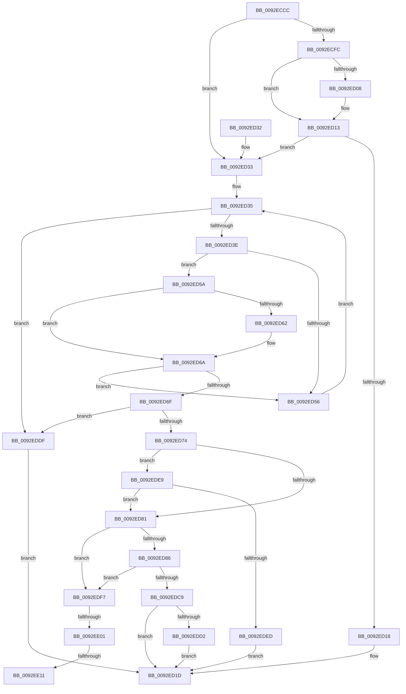

# DrvDbSetDeviceIdMappedProperty

- RVA: `0x0092ECCC`–`0x0092EE21` (길이 `341` bytes)
- VA: `0x000000014092ECCC`
- 실행 섹션: `PAGE`
- PDB 이름 있음: `예`; PDB Function 태그: `예`
- unwind 정보 RVA: `0x0008E9E8`
- 디코드: `92`개 명령, `341/341` bytes 표시
- 미해석 바이트: `0` (있으면 어셈블리에 `.byte`로 보존)

> 이 문서는 커널 이미지의 기계어와 PDB 기호를 분석해 생성했습니다. 4번과 5번은 함수 원형과 자료형을 바이너리 사용 방식에서 추정한 C 해석이며 원본 소스 복구 결과는 아닙니다.

## 1. Dependencies

- 직접 호출 지점: **2**; 고유 호출 대상: **2**
- 직접 호출자로 확인된 함수: **1**
- RIP 상대 이미지 참조: **5**

### Outgoing calls
- `0x0092EDB6` → [DrvDbOpenObjectRegKey](../93/DrvDbOpenObjectRegKey_function_00931060.md) (function, `0x00931060`)
- `0x0092EDD5` → [ZwClose](../../text/6A/ZwClose_function_006AD2B0.md) (function, `0x006AD2B0`)

### Direct callers
- [DrvDbDispatchDeviceId](DrvDbDispatchDeviceId_function_0092F490.md) at `0x0092F56F`

### Static image references
- `0x0092ECFF` → RVA `0x00011F28` (`.rdata`; read)
- `0x0092ED0C` → RVA `0x00011F30` (`.rdata`; read)
- `0x0092ED42` → RVA `0x000020E0` (`.rdata`; read)
- `0x0092EE04` → RVA `0x00011EF8` (`.rdata`; read)
- `0x0092EE15` → RVA `0x00011F00` (`.rdata`; read)

## 2. Other-region calls and transfers

- 다른 실행 섹션으로 향하는 call: **1**
  - `0x0092EDD5` → [ZwClose](../../text/6A/ZwClose_function_006AD2B0.md) (`PAGE` → `.text`)
- call이 아닌 외부 분기/꼬리 이동: **3**
  - `0x0092EDFB` → [sub_00B23350 + 0x59](../B2/Unknown_function_00B23350.md) (`tail-transfer`)
  - `0x0092EE0B` → [sub_00B23350](../B2/Unknown_function_00B23350.md) (`tail-transfer`)
  - `0x0092EE1C` → [sub_00B23350](../B2/Unknown_function_00B23350.md) (`tail-transfer`)

## 3. Assembly (complete function range)

```asm
0092ECCC  48 8B C4                        mov rax, rsp
0092ECCF  48 89 58 08                     mov qword ptr [rax + 8], rbx
0092ECD3  48 89 68 10                     mov qword ptr [rax + 0x10], rbp
0092ECD7  56                              push rsi
0092ECD8  57                              push rdi
0092ECD9  41 56                           push r14
0092ECDB  48 83 EC 50                     sub rsp, 0x50
0092ECDF  45 33 D2                        xor r10d, r10d
0092ECE2  49 8B F1                        mov rsi, r9
0092ECE5  45 8B 49 10                     mov r9d, dword ptr [r9 + 0x10]
0092ECE9  49 8B E8                        mov rbp, r8
0092ECEC  4C 89 50 20                     mov qword ptr [rax + 0x20], r10
0092ECF0  4C 8B DA                        mov r11, rdx
0092ECF3  48 8B D9                        mov rbx, rcx
0092ECF6  41 83 F9 02                     cmp r9d, 2
0092ECFA  75 37                           jne 0x14092ed33
0092ECFC  48 8B 06                        mov rax, qword ptr [rsi]
0092ECFF  48 2B 05 22 32 6E FF            sub rax, qword ptr [rip - 0x91cdde]
0092ED06  75 0B                           jne 0x14092ed13
0092ED08  48 8B 46 08                     mov rax, qword ptr [rsi + 8]
0092ED0C  48 2B 05 1D 32 6E FF            sub rax, qword ptr [rip - 0x91cde3]
0092ED13  48 85 C0                        test rax, rax
0092ED16  75 1B                           jne 0x14092ed33
0092ED18  BB 22 00 00 C0                  mov ebx, 0xc0000022
0092ED1D  48 8B 6C 24 78                  mov rbp, qword ptr [rsp + 0x78]
0092ED22  8B C3                           mov eax, ebx
0092ED24  48 8B 5C 24 70                  mov rbx, qword ptr [rsp + 0x70]
0092ED29  48 83 C4 50                     add rsp, 0x50
0092ED2D  41 5E                           pop r14
0092ED2F  5F                              pop rdi
0092ED30  5E                              pop rsi
0092ED31  C3                              ret
0092ED32  CC                              int3
0092ED33  33 D2                           xor edx, edx
0092ED35  83 FA 01                        cmp edx, 1
0092ED38  0F 83 A1 00 00 00               jae 0x14092eddf
0092ED3E  48 8D 0C 92                     lea rcx, [rdx + rdx*4]
0092ED42  48 8D 05 97 33 6D FF            lea rax, [rip - 0x92cc69]
0092ED49  4C 8D 34 C8                     lea r14, [rax + rcx*8]
0092ED4D  4D 8B 06                        mov r8, qword ptr [r14]
0092ED50  45 39 48 10                     cmp dword ptr [r8 + 0x10], r9d
0092ED54  74 04                           je 0x14092ed5a
0092ED56  FF C2                           inc edx
0092ED58  EB DB                           jmp 0x14092ed35
0092ED5A  49 8B 08                        mov rcx, qword ptr [r8]
0092ED5D  48 2B 0E                        sub rcx, qword ptr [rsi]
0092ED60  75 08                           jne 0x14092ed6a
0092ED62  49 8B 48 08                     mov rcx, qword ptr [r8 + 8]
0092ED66  48 2B 4E 08                     sub rcx, qword ptr [rsi + 8]
0092ED6A  48 85 C9                        test rcx, rcx
0092ED6D  75 E7                           jne 0x14092ed56
0092ED6F  4D 85 F6                        test r14, r14
0092ED72  74 6B                           je 0x14092eddf
0092ED74  8B BC 24 90 00 00 00            mov edi, dword ptr [rsp + 0x90]
0092ED7B  41 3B 7E 08                     cmp edi, dword ptr [r14 + 8]
0092ED7F  75 68                           jne 0x14092ede9
0092ED81  48 85 ED                        test rbp, rbp
0092ED84  75 71                           jne 0x14092edf7
0092ED86  4C 21 54 24 40                  and qword ptr [rsp + 0x40], r10
0092ED8B  48 8D 84 24 88 00 00 00         lea rax, [rsp + 0x88]
0092ED93  4C 21 54 24 38                  and qword ptr [rsp + 0x38], r10
0092ED98  44 8D 45 05                     lea r8d, [rbp + 5]
0092ED9C  48 89 44 24 30                  mov qword ptr [rsp + 0x30], rax
0092EDA1  4D 8B CB                        mov r9, r11
0092EDA4  44 88 54 24 28                  mov byte ptr [rsp + 0x28], r10b
0092EDA9  33 D2                           xor edx, edx
0092EDAB  48 8B CB                        mov rcx, rbx
0092EDAE  C7 44 24 20 03 00 00 00         mov dword ptr [rsp + 0x20], 3
0092EDB6  E8 A5 22 00 00                  call 0x140931060
0092EDBB  4C 8B 94 24 88 00 00 00         mov r10, qword ptr [rsp + 0x88]
0092EDC3  8B D8                           mov ebx, eax
0092EDC5  85 C0                           test eax, eax
0092EDC7  79 2E                           jns 0x14092edf7
0092EDC9  4D 85 D2                        test r10, r10
0092EDCC  0F 84 4B FF FF FF               je 0x14092ed1d
0092EDD2  49 8B CA                        mov rcx, r10
0092EDD5  E8 D6 E4 D7 FF                  call 0x1406ad2b0
0092EDDA  E9 3E FF FF FF                  jmp 0x14092ed1d
0092EDDF  BB 16 00 00 C0                  mov ebx, 0xc0000016
0092EDE4  E9 34 FF FF FF                  jmp 0x14092ed1d
0092EDE9  85 FF                           test edi, edi
0092EDEB  74 94                           je 0x14092ed81
0092EDED  BB 0D 00 00 C0                  mov ebx, 0xc000000d
0092EDF2  E9 26 FF FF FF                  jmp 0x14092ed1d
0092EDF7  83 7E 10 03                     cmp dword ptr [rsi + 0x10], 3
0092EDFB  0F 85 A8 45 1F 00               jne 0x140b233a9
0092EE01  48 8B 06                        mov rax, qword ptr [rsi]
0092EE04  48 2B 05 ED 30 6E FF            sub rax, qword ptr [rip - 0x91cf13]
0092EE0B  0F 85 3F 45 1F 00               jne 0x140b23350
0092EE11  48 8B 46 08                     mov rax, qword ptr [rsi + 8]
0092EE15  48 2B 05 E4 30 6E FF            sub rax, qword ptr [rip - 0x91cf1c]
0092EE1C  E9 2F 45 1F 00                  jmp 0x140b23350
```

## 4. C-style interpretation (structured pseudocode)

```c
__int64 __fastcall DrvDbSetDeviceIdMappedProperty(__int64 a1, __int64 a2, __int64 a3, __int64 a4, unsigned int a5)
{
    __int64 result;
    __int64 v_r10;
    __int64 v_rsp;
    unsigned __int64 v_stack_p10;
    unsigned int v_stack_p20;
    unsigned __int8 v_stack_p28;
    unsigned __int64 v_stack_p30;
    unsigned __int64 v_stack_p38;
    unsigned __int64 v_stack_p40;
    unsigned __int64 v_stack_p8;
    unsigned __int64 v_stack_p88;

    *(unsigned __int64 *)(v_rsp + 8) = v_rbx;
    *(unsigned __int64 *)(v_rsp + 16) = v_rbp;
    v_rsp = (v_rsp) - (80);
    v_r10 = 0;
    *(unsigned __int64 *)(v_rsp + 32) = 0;
    if (((unsigned int)((unsigned int)(*(unsigned int *)(a4 + 16)))) != 2) goto loc_0092ED33;
    result = (*(unsigned __int64 *)(a4)) - (*(unsigned __int64 *)(v_rip - 9555422));
    if (!(condition_is_not_equal)) {
        result = *(unsigned __int64 *)(a4 + 8);
        result = (result) - (*(unsigned __int64 *)(v_rip - 9555427));
    }
    if (result != 0) goto loc_0092ED33;
loc_0092ED1D:
    v_rsp = (v_rsp) + (80);
    return (unsigned int)((unsigned int)((unsigned int)(0xC0000022ULL)));
loc_0092ED33:
    a2 = 0;
loc_0092ED35:
    if (0 >= 1) goto loc_0092EDDF;
    if ((*(unsigned int *)(*(unsigned __int64 *)(v_rip - 9620585 + a2 + a2 * 4 * 8) + 16)) == ((unsigned int)((unsigned int)(*(unsigned int *)(a4 + 16))))) goto loc_0092ED5A;
loc_0092ED56:
    a2 = (unsigned int)((a2) + 1);
    goto loc_0092ED35;
loc_0092ED5A:
    a1 = (*(unsigned __int64 *)(*(unsigned __int64 *)(v_rip - 9620585 + a2 + a2 * 4 * 8))) - (*(unsigned __int64 *)(a4));
    if (!(condition_is_not_equal)) {
        a1 = *(unsigned __int64 *)(*(unsigned __int64 *)(v_rip - 9620585 + a2 + a2 * 4 * 8) + 8);
        a1 = (a1) - (*(unsigned __int64 *)(a4 + 8));
    }
    if (a1 != 0) goto loc_0092ED56;
    if (v_rip - 9620585 + a2 + a2 * 4 * 8 == 0) goto loc_0092EDDF;
    if (((unsigned int)((unsigned int)(a5))) != (*(unsigned int *)(v_rip - 9620585 + a2 + a2 * 4 * 8 + 8))) goto loc_0092EDE9;
loc_0092ED81:
    if (v_stack_p10 != 0) goto loc_0092EDF7;
    v_stack_p30 = v_stack_p88;
    v_stack_p28 = 0;
    a2 = 0;
    v_stack_p20 = 3;
    result = DrvDbOpenObjectRegKey(v_stack_p8, a2, v_stack_p10 + 5, a2);
    if (!sign_flag) goto loc_0092EDF7;
    if (v_stack_p88 == 0) goto loc_0092ED1D;
    result = ZwClose(v_stack_p88, a2, v_stack_p10 + 5, a2);
    goto loc_0092ED1D;
loc_0092EDDF:
    goto loc_0092ED1D;
loc_0092EDE9:
    if ((unsigned int)((unsigned int)(a5)) == 0) goto loc_0092ED81;
    goto loc_0092ED1D;
loc_0092EDF7:
    result = (*(unsigned __int64 *)(a4)) - (*(unsigned __int64 *)(v_rip - 9555731));
    result = (*(unsigned __int64 *)(a4 + 8)) - (*(unsigned __int64 *)(v_rip - 9555740));
}
```

## 5. (Beta) C Style

```c
int64_t DrvDbSetDeviceIdMappedProperty(int64_t Arg1, int64_t Arg2, int64_t Arg3, void *Arg4, uint32_t Arg5)
{
    uint8_t *arg4 = (uint8_t *)Arg4;

    int64_t result;
    int64_t local_r10;
    int64_t local_rsp;
    uint64_t v_stack_p10;
    uint32_t v_stack_p20;
    uint8_t v_stack_p28;
    uint64_t v_stack_p30;
    uint64_t v_stack_p38;
    uint64_t v_stack_p40;
    uint64_t v_stack_p8;
    uint64_t v_stack_p88;

    *(uint64_t *)(local_rsp + 0x8) = local_rbx;
    *(uint64_t *)(local_rsp + 0x10) = local_rbp;
    local_rsp = (local_rsp) - (80);
    local_r10 = 0;
    *(uint64_t *)(local_rsp + 0x20) = 0;
    if (((uint32_t)((uint32_t)(*(uint32_t *)(arg4 + 0x10)))) != 2) goto loc_0092ED33;
    result = (*(uint64_t *)(arg4)) - (*(uint64_t *)(v_rip - 0x91CDDE));
    if (!(condition_is_not_equal)) {
        result = *(uint64_t *)(arg4 + 0x8);
        result = (result) - (*(uint64_t *)(v_rip - 0x91CDE3));
    }
    if (result != 0) goto loc_0092ED33;
loc_0092ED1D:
    local_rsp = (local_rsp) + (80);
    return (uint32_t)((uint32_t)((uint32_t)(0xC0000022ULL)));
loc_0092ED33:
    Arg2 = 0;
loc_0092ED35:
    if (0 >= 1) goto loc_0092EDDF;
    if ((*(uint32_t *)(*(uint64_t *)(v_rip - 0x92CC69 + Arg2 + Arg2 * 4 * 8) + 0x10)) == ((uint32_t)((uint32_t)(*(uint32_t *)(arg4 + 0x10))))) goto loc_0092ED5A;
loc_0092ED56:
    Arg2 = (uint32_t)((Arg2) + 1);
    goto loc_0092ED35;
loc_0092ED5A:
    Arg1 = (*(uint64_t *)(*(uint64_t *)(v_rip - 0x92CC69 + Arg2 + Arg2 * 4 * 8))) - (*(uint64_t *)(arg4));
    if (!(condition_is_not_equal)) {
        Arg1 = *(uint64_t *)(*(uint64_t *)(v_rip - 0x92CC69 + Arg2 + Arg2 * 4 * 8) + 0x8);
        Arg1 = (Arg1) - (*(uint64_t *)(arg4 + 0x8));
    }
    if (Arg1 != 0) goto loc_0092ED56;
    if (v_rip - 9620585 + Arg2 + Arg2 * 4 * 8 == 0) goto loc_0092EDDF;
    if (((uint32_t)((uint32_t)(Arg5))) != (*(uint32_t *)(v_rip - 0x92CC69 + Arg2 + Arg2 * 4 * 8 + 0x8))) goto loc_0092EDE9;
loc_0092ED81:
    if (v_stack_p10 != 0) goto loc_0092EDF7;
    v_stack_p30 = v_stack_p88;
    v_stack_p28 = 0;
    Arg2 = 0;
    v_stack_p20 = 3;
    result = DrvDbOpenObjectRegKey(v_stack_p8, Arg2, v_stack_p10 + 5, Arg2);
    if (!sign_flag) goto loc_0092EDF7;
    if (v_stack_p88 == 0) goto loc_0092ED1D;
    result = ZwClose(v_stack_p88, Arg2, v_stack_p10 + 5, Arg2);
    goto loc_0092ED1D;
loc_0092EDDF:
    goto loc_0092ED1D;
loc_0092EDE9:
    if ((uint32_t)((uint32_t)(Arg5)) == 0) goto loc_0092ED81;
    goto loc_0092ED1D;
loc_0092EDF7:
    result = (*(uint64_t *)(arg4)) - (*(uint64_t *)(v_rip - 0x91CF13));
    result = (*(uint64_t *)(arg4 + 0x8)) - (*(uint64_t *)(v_rip - 0x91CF1C));
}
```

### 관측된 메모리 오프셋

구조체 형식이 확인되지 않은 접근은 인자 기준의 오프셋으로만 기록했습니다.

| 기준 인자 | 오프셋 표현 | 폭 (bit) | 접근 |
|---|---:|---:|---|
| `Arg4` | `+ 0x0` | `64` | `R` |
| `Arg4` | `+ 0x8` | `64` | `R` |
| `Arg4` | `+ 0x10` | `32` | `R` |

## 6. Execution-region graph

[열기: 2D/3D 그래프와 함수 탐색 컨트롤 패널](../../../control-panel.html?section=page&rva=0x0092ECCC&view=graph)

- 2D 그래프는 위에서 아래로 흐르고, 3D 그래프는 빈 공간을 드래그해 회전합니다. Shift+드래그는 이동, 휠은 확대·축소, 함수 노드 선택은 대상 보고서 이동입니다.

### Static fallback


