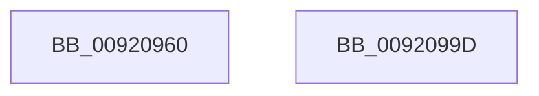

# EtwRegister

- RVA: `0x00920960`–`0x0092099E` (길이 `62` bytes)
- VA: `0x0000000140920960`
- 실행 섹션: `PAGE`
- PDB 이름 있음: `예`; PDB Function 태그: `아니요`
- unwind 정보 RVA: `0x00063458`
- 디코드: `15`개 명령, `62/62` bytes 표시
- 미해석 바이트: `0` (있으면 어셈블리에 `.byte`로 보존)

> 이 문서는 커널 이미지의 기계어와 PDB 기호를 분석해 생성했습니다. 4번과 5번은 함수 원형과 자료형을 바이너리 사용 방식에서 추정한 C 해석이며 원본 소스 복구 결과는 아닙니다.

## 1. Dependencies

- 직접 호출 지점: **2**; 고유 호출 대상: **2**
- 직접 호출자로 확인된 함수: **27**
- RIP 상대 이미지 참조: **0**

### Outgoing calls
- `0x00920967` → [PsGetCurrentServerSiloGlobals](../../text/2F/PsGetCurrentServerSiloGlobals_function_002FE1F0.md) (function, `0x002FE1F0`)
- `0x00920993` → [EtwpRegisterKMProvider](EtwpRegisterKMProvider_function_009209A4.md) (function, `0x009209A4`)

### Direct callers
- [KiIntSteerConnect](../../text/2D/KiIntSteerConnect_function_002D44F0.md) at `0x002D48A7`
- [BapdWriteEtwEvents](../../text/4A/BapdWriteEtwEvents_function_004AE884.md) at `0x004AE901`
- [BapdWriteEtwEvents](../../text/4A/BapdWriteEtwEvents_function_004AE884.md) at `0x004AEBE2`
- [BapdRegisterEtwProvider](../../text/4A/BapdRegisterEtwProvider_function_004AECF8.md) at `0x004AED10`
- [McGenEventRegister_EtwRegister](../../text/57/McGenEventRegister_EtwRegister_function_0057EF04.md) at `0x0057EF16`
- [HvlpEtwRegister](../../text/58/HvlpEtwRegister_function_0058C444.md) at `0x0058C45B`
- [IoInitializeLiveDump](../../text/59/IoInitializeLiveDump_function_00598B14.md) at `0x00598B55`
- [DifEtwRegisterWrapper](../../text/61/DifEtwRegisterWrapper_function_0061D1A0.md) at `0x0061D293`
- [sub_006F88AE](../../text/6F/Unknown_function_006F88AE.md) at `0x006F8A83`
- [HalpMiscInitializeTelemetry](../70/HalpMiscInitializeTelemetry_function_00707DFC.md) at `0x00707E13`
- [DbgkCaptureLiveDump](../71/DbgkCaptureLiveDump_function_0071113C.md) at `0x007111E2`
- [FsRtlpDedupChangeRegisterVolume](../71/FsRtlpDedupChangeRegisterVolume_function_00715F70.md) at `0x007160B0`
- [FsRtlpHeatRegisterVolume](../71/FsRtlpHeatRegisterVolume_function_0071696C.md) at `0x00716A96`
- [PopDiagSleepStudyInitialize](../76/PopDiagSleepStudyInitialize_function_00760314.md) at `0x00760339`
- [SSHSupportEtwRegister](../77/SSHSupportEtwRegister_function_007749C8.md) at `0x007749E4`
- [WdipSemEnableSemProvider](../7B/WdipSemEnableSemProvider_function_007B1B54.md) at `0x007B1BE9`
- [PfSnBeginBootPhase](../../pagelk/B6/PfSnBeginBootPhase_function_00B6BAC4.md) at `0x00B6BB84`
- [IoInitSystemPreDrivers](../../init/C2/IoInitSystemPreDrivers_function_00C2AC3C.md) at `0x00C2B60F`
- [IoInitSystemPreDrivers](../../init/C2/IoInitSystemPreDrivers_function_00C2AC3C.md) at `0x00C2B6B7`
- [IoInitSystemPreDrivers](../../init/C2/IoInitSystemPreDrivers_function_00C2AC3C.md) at `0x00C2B8E6`
- [IopInitializePlugPlayServices](../../init/C2/IopInitializePlugPlayServices_function_00C2F298.md) at `0x00C2FF2A`
- [KseInitialize](../../init/C3/KseInitialize_function_00C3B5AC.md) at `0x00C3B736`
- [PopDiagInitialize](../../init/C3/PopDiagInitialize_function_00C3F2C0.md) at `0x00C3F305`
- [PopDiagInitialize](../../init/C3/PopDiagInitialize_function_00C3F2C0.md) at `0x00C3F3B1`
- [PopBatteryInitPhaseTwo](../../init/C4/PopBatteryInitPhaseTwo_function_00C42148.md) at `0x00C421ED`
- [PpmEventInitialize](../../init/C4/PpmEventInitialize_function_00C437A0.md) at `0x00C437CC`
- [PpmEventInitializeEx](../../init/C4/PpmEventInitializeEx_function_00C445CC.md) at `0x00C44619`
- [PerfDiagInitialize](../../init/C4/PerfDiagInitialize_function_00C4D150.md) at `0x00C4D193`
- [PerfDiagInitialize](../../init/C4/PerfDiagInitialize_function_00C4D150.md) at `0x00C4D1B0`
- [PerfDiagInitialize](../../init/C4/PerfDiagInitialize_function_00C4D150.md) at `0x00C4D1CD`
- [PerfDiagInitialize](../../init/C4/PerfDiagInitialize_function_00C4D150.md) at `0x00C4D1EA`
- [PerfDiagInitialize](../../init/C4/PerfDiagInitialize_function_00C4D150.md) at `0x00C4D1FF`
- [EtwpInitialize](../../init/C4/EtwpInitialize_function_00C4DBCC.md) at `0x00C4DEC8`
- [EtwpInitialize](../../init/C4/EtwpInitialize_function_00C4DBCC.md) at `0x00C4DF30`
- [EtwpInitialize](../../init/C4/EtwpInitialize_function_00C4DBCC.md) at `0x00C4DF5C`
- [EtwpInitialize](../../init/C4/EtwpInitialize_function_00C4DBCC.md) at `0x00C4DFA3`
- [EtwpInitialize](../../init/C4/EtwpInitialize_function_00C4DBCC.md) at `0x00C4DFBF`
- [EtwpInitialize](../../init/C4/EtwpInitialize_function_00C4DBCC.md) at `0x00C4DFDB`
- [EtwpInitialize](../../init/C4/EtwpInitialize_function_00C4DBCC.md) at `0x00C4DFF8`
- [EtwpInitialize](../../init/C4/EtwpInitialize_function_00C4DBCC.md) at `0x00C4E014`
- [EtwpInitialize](../../init/C4/EtwpInitialize_function_00C4DBCC.md) at `0x00C4E02C`
- [EtwpInitialize](../../init/C4/EtwpInitialize_function_00C4DBCC.md) at `0x00C4E044`
- [EtwpInitialize](../../init/C4/EtwpInitialize_function_00C4DBCC.md) at `0x00C4E05C`
- [EtwpInitialize](../../init/C4/EtwpInitialize_function_00C4DBCC.md) at `0x00C4E074`
- [EtwpInitialize](../../init/C4/EtwpInitialize_function_00C4DBCC.md) at `0x00C4E08C`
- [EtwpInitialize](../../init/C4/EtwpInitialize_function_00C4DBCC.md) at `0x00C4E0A4`
- [EtwpInitialize](../../init/C4/EtwpInitialize_function_00C4DBCC.md) at `0x00C4E0C1`
- [EtwpInitialize](../../init/C4/EtwpInitialize_function_00C4DBCC.md) at `0x00C4E0D9`
- [EtwpInitialize](../../init/C4/EtwpInitialize_function_00C4DBCC.md) at `0x00C4E0F6`
- [WheapInitializeEventing](../../init/C5/WheapInitializeEventing_function_00C55610.md) at `0x00C556D4`
- [SmInitSystem](../../init/C7/SmInitSystem_function_00C7673C.md) at `0x00C7684D`

### Static image references
- 디코드된 RIP-relative 메모리 참조가 없습니다.

## 2. Other-region calls and transfers

- 다른 실행 섹션으로 향하는 call: **1**
  - `0x00920967` → [PsGetCurrentServerSiloGlobals](../../text/2F/PsGetCurrentServerSiloGlobals_function_002FE1F0.md) (`PAGE` → `.text`)
- 별도 외부 분기/꼬리 이동을 확인하지 못했습니다.

## 3. Assembly (complete function range)

```asm
00920960  48 83 EC 48                     sub rsp, 0x48
00920964  4C 8B D1                        mov r10, rcx
00920967  E8 84 D8 9D FF                  call 0x1402fe1f0
0092096C  4C 89 4C 24 30                  mov qword ptr [rsp + 0x30], r9
00920971  4C 8B CA                        mov r9, rdx
00920974  49 8B D2                        mov rdx, r10
00920977  48 8B 88 40 03 00 00            mov rcx, qword ptr [rax + 0x340]
0092097E  48 8B 44 24 48                  mov rax, qword ptr [rsp + 0x48]
00920983  48 89 44 24 28                  mov qword ptr [rsp + 0x28], rax
00920988  4C 89 44 24 20                  mov qword ptr [rsp + 0x20], r8
0092098D  41 B8 03 00 00 00               mov r8d, 3
00920993  E8 0C 00 00 00                  call 0x1409209a4
00920998  48 83 C4 48                     add rsp, 0x48
0092099C  C3                              ret
0092099D  CC                              int3
```

## 4. C-style interpretation (structured pseudocode)

```c
__int64 __fastcall EtwRegister(__int64 a1, __int64 a2, __int64 a3, __int64 a4)
{
    __int64 result;
    __int64 v_rsp;
    unsigned __int64 v_stack_m18;
    unsigned __int64 v_stack_m20;
    unsigned __int64 v_stack_m28;
    unsigned __int64 v_stack_p0;

    v_rsp = (v_rsp) - (72);
    result = PsGetCurrentServerSiloGlobals(a1, a2, a3, a4);
    v_stack_m18 = a4;
    v_stack_m20 = v_stack_p0;
    v_stack_m28 = a3;
    result = EtwpRegisterKMProvider(*(unsigned __int64 *)(result + 832), a1, 3, a2);
    v_rsp = (v_rsp) + (72);
    return result;
}
```

## 5. (Beta) C Style

```c
int64_t EtwRegister(int64_t Arg1, int64_t Arg2, int64_t Arg3, int64_t Arg4)
{
    int64_t result;
    int64_t local_rsp;
    uint64_t v_stack_m18;
    uint64_t v_stack_m20;
    uint64_t v_stack_m28;
    uint64_t v_stack_p0;

    local_rsp = (local_rsp) - (72);
    result = PsGetCurrentServerSiloGlobals(Arg1, Arg2, Arg3, Arg4);
    v_stack_m18 = Arg4;
    v_stack_m20 = v_stack_p0;
    v_stack_m28 = Arg3;
    result = EtwpRegisterKMProvider(*(uint64_t *)(result + 0x340), Arg1, 3, Arg2);
    local_rsp = (local_rsp) + (72);
    return result;
}
```

## 6. Execution-region graph

[열기: 2D/3D 그래프와 함수 탐색 컨트롤 패널](../../../control-panel.html?section=page&rva=0x00920960&view=graph)

- 2D 그래프는 위에서 아래로 흐르고, 3D 그래프는 빈 공간을 드래그해 회전합니다. Shift+드래그는 이동, 휠은 확대·축소, 함수 노드 선택은 대상 보고서 이동입니다.

### Static fallback


