# EtwpRegisterKMProvider

- RVA: `0x009209A4`–`0x00920DB1` (길이 `1,037` bytes)
- VA: `0x00000001409209A4`
- 실행 섹션: `PAGE`
- PDB 이름 있음: `예`; PDB Function 태그: `예`
- unwind 정보 RVA: `0x0008CF34`
- 디코드: `251`개 명령, `1,037/1,037` bytes 표시
- 미해석 바이트: `0` (있으면 어셈블리에 `.byte`로 보존)

> 이 문서는 커널 이미지의 기계어와 PDB 기호를 분석해 생성했습니다. 4번과 5번은 함수 원형과 자료형을 바이너리 사용 방식에서 추정한 C 해석이며 원본 소스 복구 결과는 아닙니다.

## 1. Dependencies

- 직접 호출 지점: **18**; 고유 호출 대상: **15**
- 직접 호출자로 확인된 함수: **4**
- RIP 상대 이미지 참조: **5**

### Outgoing calls
- `0x00920A48` → [EtwpFindOrCreateGuidEntry](../8C/EtwpFindOrCreateGuidEntry_function_008C1B70.md) (function, `0x008C1B70`)
- `0x00920A7A` → [EtwEventEnabled](../../text/39/EtwEventEnabled_function_00392450.md) (function, `0x00392450`)
- `0x00920AB7` → [EtwWrite](../../text/41/EtwWrite_function_0041C720.md) (function, `0x0041C720`)
- `0x00920AFA` → [KeAbPostRelease](../../text/2E/KeAbPostRelease_function_002E1600.md) (function, `0x002E1600`)
- `0x00920AFF` → [KeLeaveCriticalRegion](../../text/25/KeLeaveCriticalRegion_function_0025D8B0.md) (function, `0x0025D8B0`)
- `0x00920B1E` → [EtwpUnreferenceGuidEntry](../8C/EtwpUnreferenceGuidEntry_function_008C3320.md) (function, `0x008C3320`)
- `0x00920B2C` → [_security_check_cookie](../../text/6A/_security_check_cookie_function_006AC640.md) (function, `0x006AC640`)
- `0x00920B85` → [KeAbPreAcquire](../../text/21/KeAbPreAcquire_function_00210230.md) (function, `0x00210230`)
- `0x00920B9E` → [ExfAcquirePushLockExclusiveEx](../../text/20/ExfAcquirePushLockExclusiveEx_function_0020FC90.md) (function, `0x0020FC90`)
- `0x00920BE1` → [EtwpAddKmRegEntry](EtwpAddKmRegEntry_function_00920DB8.md) (function, `0x00920DB8`)
- `0x00920C24` → [EtwpComputeRegEntryEnableInfo](../8C/EtwpComputeRegEntryEnableInfo_function_008C0FE0.md) (function, `0x008C0FE0`)
- `0x00920C2C` → [EtwpTrackProviderRegistration](../8C/EtwpTrackProviderRegistration_function_008C368C.md) (function, `0x008C368C`)
- `0x00920C56` → [ExfReleasePushLock](../../text/26/ExfReleasePushLock_function_002638D0.md) (function, `0x002638D0`)
- `0x00920C7B` → [EtwpUpdateEnableMask](../8C/EtwpUpdateEnableMask_function_008C0948.md) (function, `0x008C0948`)
- `0x00920CCF` → [KeAbPreAcquire](../../text/21/KeAbPreAcquire_function_00210230.md) (function, `0x00210230`)
- `0x00920CEC` → [ExfAcquirePushLockExclusiveEx](../../text/20/ExfAcquirePushLockExclusiveEx_function_0020FC90.md) (function, `0x0020FC90`)
- `0x00920D18` → [EtwpUpdateEnableMask](../8C/EtwpUpdateEnableMask_function_008C0948.md) (function, `0x008C0948`)
- `0x00920D5A` → [guard_dispatch_icall](../../text/6B/guard_dispatch_icall_function_006BAAD0.md) (function, `0x006BAAD0`)

### Direct callers
- [TraceLoggingRegisterEx_EtwRegister_EtwSetInformation](TraceLoggingRegisterEx_EtwRegister_EtwSetInformation_function_009208A0.md) at `0x0092091A`
- [EtwRegister](EtwRegister_function_00920960.md) at `0x00920993`
- [DbgkpStartSystemErrorHandler](DbgkpStartSystemErrorHandler_function_00920F78.md) at `0x00921026`
- [EtwRegisterClassicProvider](../AA/EtwRegisterClassicProvider_function_00AA5B40.md) at `0x00AA5B80`

### Static image references
- `0x009209C0` → RVA `0x00E0A740` (`.data`; read)
- `0x009209F4` → RVA `0x00011370` (`.rdata`; read)
- `0x00920A12` → RVA `0x00011378` (`.rdata`; read)
- `0x00920A6C` → RVA `0x00EFF840` (`.data`; read)
- `0x00920A73` → RVA `0x00011390` (`.rdata`; read)

## 2. Other-region calls and transfers

- 다른 실행 섹션으로 향하는 call: **11**
  - `0x00920A7A` → [EtwEventEnabled](../../text/39/EtwEventEnabled_function_00392450.md) (`PAGE` → `.text`)
  - `0x00920AB7` → [EtwWrite](../../text/41/EtwWrite_function_0041C720.md) (`PAGE` → `.text`)
  - `0x00920AFA` → [KeAbPostRelease](../../text/2E/KeAbPostRelease_function_002E1600.md) (`PAGE` → `.text`)
  - `0x00920AFF` → [KeLeaveCriticalRegion](../../text/25/KeLeaveCriticalRegion_function_0025D8B0.md) (`PAGE` → `.text`)
  - `0x00920B2C` → [_security_check_cookie](../../text/6A/_security_check_cookie_function_006AC640.md) (`PAGE` → `.text`)
  - `0x00920B85` → [KeAbPreAcquire](../../text/21/KeAbPreAcquire_function_00210230.md) (`PAGE` → `.text`)
  - `0x00920B9E` → [ExfAcquirePushLockExclusiveEx](../../text/20/ExfAcquirePushLockExclusiveEx_function_0020FC90.md) (`PAGE` → `.text`)
  - `0x00920C56` → [ExfReleasePushLock](../../text/26/ExfReleasePushLock_function_002638D0.md) (`PAGE` → `.text`)
  - `0x00920CCF` → [KeAbPreAcquire](../../text/21/KeAbPreAcquire_function_00210230.md) (`PAGE` → `.text`)
  - `0x00920CEC` → [ExfAcquirePushLockExclusiveEx](../../text/20/ExfAcquirePushLockExclusiveEx_function_0020FC90.md) (`PAGE` → `.text`)
  - `0x00920D5A` → [guard_dispatch_icall](../../text/6B/guard_dispatch_icall_function_006BAAD0.md) (`PAGE` → `.text`)
- call이 아닌 외부 분기/꼬리 이동: **9**
  - `0x00920C44` → [sub_00B225A4 + 0x2F](../B2/Unknown_function_00B225A4.md) (`tail-transfer`)
  - `0x00920C85` → [sub_00B225A4](../B2/Unknown_function_00B225A4.md) (`tail-transfer`)
  - `0x00920C94` → [sub_00B225A4](../B2/Unknown_function_00B225A4.md) (`tail-transfer`)
  - `0x00920CA3` → [sub_00B225A4](../B2/Unknown_function_00B225A4.md) (`tail-transfer`)
  - `0x00920CDD` → [sub_00B225A4 + 0xA](../B2/Unknown_function_00B225A4.md) (`tail-transfer`)
  - `0x00920CF2` → [sub_00B225A4 + 0xA](../B2/Unknown_function_00B225A4.md) (`tail-transfer`)
  - `0x00920D9B` → [sub_00B225A4 + 0xE1](../B2/Unknown_function_00B225A4.md) (`tail-transfer`)
  - `0x00920DA6` → [sub_00B225A4 + 0xE1](../B2/Unknown_function_00B225A4.md) (`tail-transfer`)
  - `0x00920DAC` → [sub_00B225A4 + 0xE9](../B2/Unknown_function_00B225A4.md) (`tail-transfer`)

## 3. Assembly (complete function range)

```asm
009209A4  48 89 5C 24 18                  mov qword ptr [rsp + 0x18], rbx
009209A9  55                              push rbp
009209AA  56                              push rsi
009209AB  57                              push rdi
009209AC  41 54                           push r12
009209AE  41 55                           push r13
009209B0  41 56                           push r14
009209B2  41 57                           push r15
009209B4  48 8D 6C 24 F1                  lea rbp, [rsp - 0xf]
009209B9  48 81 EC E0 00 00 00            sub rsp, 0xe0
009209C0  48 8B 05 79 9D 4E 00            mov rax, qword ptr [rip + 0x4e9d79]
009209C7  48 33 C4                        xor rax, rsp
009209CA  48 89 45 07                     mov qword ptr [rbp + 7], rax
009209CE  4C 8B 6D 7F                     mov r13, qword ptr [rbp + 0x7f]
009209D2  33 F6                           xor esi, esi
009209D4  4C 8B FA                        mov r15, rdx
009209D7  48 89 55 B7                     mov qword ptr [rbp - 0x49], rdx
009209DB  48 8B 55 6F                     mov rdx, qword ptr [rbp + 0x6f]
009209DF  0F 57 C0                        xorps xmm0, xmm0
009209E2  4D 8B E1                        mov r12, r9
009209E5  48 89 54 24 50                  mov qword ptr [rsp + 0x50], rdx
009209EA  49 89 75 00                     mov qword ptr [r13], rsi
009209EE  45 8B F0                        mov r14d, r8d
009209F1  49 8B 07                        mov rax, qword ptr [r15]
009209F4  48 2B 05 75 09 6F FF            sub rax, qword ptr [rip - 0x90f68b]
009209FB  48 89 74 24 40                  mov qword ptr [rsp + 0x40], rsi
00920A00  48 89 75 87                     mov qword ptr [rbp - 0x79], rsi
00920A04  0F 11 45 97                     movups xmmword ptr [rbp - 0x69], xmm0
00920A08  0F 11 45 A7                     movups xmmword ptr [rbp - 0x59], xmm0
00920A0C  75 0B                           jne 0x140920a19
00920A0E  49 8B 47 08                     mov rax, qword ptr [r15 + 8]
00920A12  48 2B 05 5F 09 6F FF            sub rax, qword ptr [rip - 0x90f6a1]
00920A19  48 85 C0                        test rax, rax
00920A1C  0F 84 27 02 00 00               je 0x140920c49
00920A22  4D 85 E4                        test r12, r12
00920A25  0F 84 57 02 00 00               je 0x140920c82
00920A2B  41 83 FE 03                     cmp r14d, 3
00920A2F  0F 85 5B 02 00 00               jne 0x140920c90
00920A35  48 8D 44 24 40                  lea rax, [rsp + 0x40]
00920A3A  45 33 C9                        xor r9d, r9d
00920A3D  45 33 C0                        xor r8d, r8d
00920A40  48 89 44 24 20                  mov qword ptr [rsp + 0x20], rax
00920A45  49 8B D7                        mov rdx, r15
00920A48  E8 23 11 FA FF                  call 0x1408c1b70
00920A4D  8B D8                           mov ebx, eax
00920A4F  85 C0                           test eax, eax
00920A51  0F 84 F6 00 00 00               je 0x140920b4d
00920A57  48 8B 4C 24 40                  mov rcx, qword ptr [rsp + 0x40]
00920A5C  E9 B8 00 00 00                  jmp 0x140920b19
00920A61  41 F6 46 5B 01                  test byte ptr [r14 + 0x5b], 1
00920A66  0F 85 B6 02 00 00               jne 0x140920d22
00920A6C  48 8B 0D CD ED 5D 00            mov rcx, qword ptr [rip + 0x5dedcd]
00920A73  48 8D 15 16 09 6F FF            lea rdx, [rip - 0x90f6ea]
00920A7A  E8 D1 19 A7 FF                  call 0x140392450
00920A7F  84 C0                           test al, al
00920A81  74 39                           je 0x140920abc
00920A83  48 8B 0D B6 ED 5D 00            mov rcx, qword ptr [rip + 0x5dedb6]
00920A8A  44 8B CE                        mov r9d, esi
00920A8D  4D 85 FF                        test r15, r15
00920A90  74 12                           je 0x140920aa4
00920A92  4C 89 7D D7                     mov qword ptr [rbp - 0x29], r15
00920A96  41 B9 01 00 00 00               mov r9d, 1
00920A9C  48 C7 45 DF 10 00 00 00         mov qword ptr [rbp - 0x21], 0x10
00920AA4  48 8D 45 D7                     lea rax, [rbp - 0x29]
00920AA8  45 33 C0                        xor r8d, r8d
00920AAB  48 8D 15 DE 08 6F FF            lea rdx, [rip - 0x90f722]
00920AB2  48 89 44 24 20                  mov qword ptr [rsp + 0x20], rax
00920AB7  E8 64 BC AF FF                  call 0x14041c720
00920ABC  8B 5C 24 48                     mov ebx, dword ptr [rsp + 0x48]
00920AC0  48 8B 45 8F                     mov rax, qword ptr [rbp - 0x71]
00920AC4  48 89 B0 A0 02 00 00            mov qword ptr [rax + 0x2a0], rsi
00920ACB  0F 0D 0F                        prefetchw byte ptr [rdi]
00920ACE  48 8B 07                        mov rax, qword ptr [rdi]
00920AD1  48 8B C8                        mov rcx, rax
00920AD4  48 83 E1 F0                     and rcx, 0xfffffffffffffff0
00920AD8  48 83 F9 10                     cmp rcx, 0x10
00920ADC  48 8D 50 F0                     lea rdx, [rax - 0x10]
00920AE0  48 0F 46 D6                     cmovbe rdx, rsi
00920AE4  A8 02                           test al, 2
00920AE6  0F 85 67 01 00 00               jne 0x140920c53
00920AEC  F0 48 0F B1 17                  lock cmpxchg qword ptr [rdi], rdx
00920AF1  0F 85 5C 01 00 00               jne 0x140920c53
00920AF7  48 8B CF                        mov rcx, rdi
00920AFA  E8 01 0B 9C FF                  call 0x1402e1600
00920AFF  E8 AC CD 93 FF                  call 0x14025d8b0
00920B04  48 8B 4C 24 40                  mov rcx, qword ptr [rsp + 0x40]
00920B09  48 8B 81 90 02 00 00            mov rax, qword ptr [rcx + 0x290]
00920B10  48 85 C0                        test rax, rax
00920B13  0F 85 52 02 00 00               jne 0x140920d6b
00920B19  48 85 C9                        test rcx, rcx
00920B1C  74 05                           je 0x140920b23
00920B1E  E8 FD 27 FA FF                  call 0x1408c3320
00920B23  8B C3                           mov eax, ebx
00920B25  48 8B 4D 07                     mov rcx, qword ptr [rbp + 7]
00920B29  48 33 CC                        xor rcx, rsp
00920B2C  E8 0F BB D8 FF                  call 0x1406ac640
00920B31  48 8B 9C 24 30 01 00 00         mov rbx, qword ptr [rsp + 0x130]
00920B39  48 81 C4 E0 00 00 00            add rsp, 0xe0
00920B40  41 5F                           pop r15
00920B42  41 5E                           pop r14
00920B44  41 5D                           pop r13
00920B46  41 5C                           pop r12
00920B48  5F                              pop rdi
00920B49  5E                              pop rsi
00920B4A  5D                              pop rbp
00920B4B  C3                              ret
00920B4C  CC                              int3
00920B4D  48 8B 74 24 40                  mov rsi, qword ptr [rsp + 0x40]
00920B52  48 83 BE 90 02 00 00 00         cmp qword ptr [rsi + 0x290], 0
00920B5A  0F 85 48 01 00 00               jne 0x140920ca8
00920B60  65 48 8B 04 25 88 01 00 00      mov rax, qword ptr gs:[0x188]
00920B69  45 33 C0                        xor r8d, r8d
00920B6C  48 8B 7C 24 40                  mov rdi, qword ptr [rsp + 0x40]
00920B71  33 D2                           xor edx, edx
00920B73  48 81 C7 98 02 00 00            add rdi, 0x298
00920B7A  48 8B CF                        mov rcx, rdi
00920B7D  66 FF 88 E4 01 00 00            dec word ptr [rax + 0x1e4]
00920B84  90                              nop
00920B85  E8 A6 F6 8E FF                  call 0x140210230
00920B8A  F0 48 0F BA 2F 00               lock bts qword ptr [rdi], 0
00920B90  48 8B D8                        mov rbx, rax
00920B93  73 0E                           jae 0x140920ba3
00920B95  4C 8B C7                        mov r8, rdi
00920B98  48 8B D0                        mov rdx, rax
00920B9B  48 8B CF                        mov rcx, rdi
00920B9E  E8 ED F0 8E FF                  call 0x14020fc90
00920BA3  48 85 DB                        test rbx, rbx
00920BA6  74 04                           je 0x140920bac
00920BA8  C6 43 0A 01                     mov byte ptr [rbx + 0xa], 1
00920BAC  65 48 8B 04 25 88 01 00 00      mov rax, qword ptr gs:[0x188]
00920BB5  41 8B D6                        mov edx, r14d
00920BB8  48 8B 4C 24 40                  mov rcx, qword ptr [rsp + 0x40]
00920BBD  4D 8B C4                        mov r8, r12
00920BC0  4C 8B 74 24 40                  mov r14, qword ptr [rsp + 0x40]
00920BC5  4C 8B 4C 24 50                  mov r9, qword ptr [rsp + 0x50]
00920BCA  48 89 4D 8F                     mov qword ptr [rbp - 0x71], rcx
00920BCE  48 89 81 A0 02 00 00            mov qword ptr [rcx + 0x2a0], rax
00920BD5  48 8D 45 87                     lea rax, [rbp - 0x79]
00920BD9  49 8B CE                        mov rcx, r14
00920BDC  48 89 44 24 20                  mov qword ptr [rsp + 0x20], rax
00920BE1  E8 D2 01 00 00                  call 0x140920db8
00920BE6  89 44 24 48                     mov dword ptr [rsp + 0x48], eax
00920BEA  8B D8                           mov ebx, eax
00920BEC  85 C0                           test eax, eax
00920BEE  0F 88 70 01 00 00               js 0x140920d64
00920BF4  48 8B 5D 87                     mov rbx, qword ptr [rbp - 0x79]
00920BF8  48 8B 45 77                     mov rax, qword ptr [rbp + 0x77]
00920BFC  48 89 43 30                     mov qword ptr [rbx + 0x30], rax
00920C00  49 89 5D 00                     mov qword ptr [r13], rbx
00920C04  41 83 7E 60 00                  cmp dword ptr [r14 + 0x60], 0
00920C09  75 55                           jne 0x140920c60
00920C0B  48 8B 8E 90 02 00 00            mov rcx, qword ptr [rsi + 0x290]
00920C12  33 F6                           xor esi, esi
00920C14  48 85 C9                        test rcx, rcx
00920C17  0F 85 DA 00 00 00               jne 0x140920cf7
00920C1D  48 8D 55 97                     lea rdx, [rbp - 0x69]
00920C21  48 8B CB                        mov rcx, rbx
00920C24  E8 B7 03 FA FF                  call 0x1408c0fe0
00920C29  48 8B CB                        mov rcx, rbx
00920C2C  E8 5B 2A FA FF                  call 0x1408c368c
00920C31  4D 85 E4                        test r12, r12
00920C34  0F 84 32 FE FF FF               je 0x140920a6c
00920C3A  F6 43 62 08                     test byte ptr [rbx + 0x62], 8
00920C3E  0F 85 1D FE FF FF               jne 0x140920a61
00920C44  E9 8A 19 20 00                  jmp 0x140b225d3
00920C49  B8 22 00 00 C0                  mov eax, 0xc0000022
00920C4E  E9 D2 FE FF FF                  jmp 0x140920b25
00920C53  48 8B CF                        mov rcx, rdi
00920C56  E8 75 2C 94 FF                  call 0x1402638d0
00920C5B  E9 97 FE FF FF                  jmp 0x140920af7
00920C60  8A 53 62                        mov dl, byte ptr [rbx + 0x62]
00920C63  48 8D 43 64                     lea rax, [rbx + 0x64]
00920C67  C0 EA 03                        shr dl, 3
00920C6A  45 33 C9                        xor r9d, r9d
00920C6D  80 E2 01                        and dl, 1
00920C70  48 89 44 24 20                  mov qword ptr [rsp + 0x20], rax
00920C75  45 33 C0                        xor r8d, r8d
00920C78  49 8B CE                        mov rcx, r14
00920C7B  E8 C8 FC F9 FF                  call 0x1408c0948
00920C80  EB 89                           jmp 0x140920c0b
00920C82  48 85 D2                        test rdx, rdx
00920C85  0F 85 19 19 20 00               jne 0x140b225a4
00920C8B  E9 9B FD FF FF                  jmp 0x140920a2b
00920C90  41 83 FE 02                     cmp r14d, 2
00920C94  0F 85 0A 19 20 00               jne 0x140b225a4
00920C9A  4D 85 E4                        test r12, r12
00920C9D  0F 85 92 FD FF FF               jne 0x140920a35
00920CA3  E9 FC 18 20 00                  jmp 0x140b225a4
00920CA8  65 48 8B 04 25 88 01 00 00      mov rax, qword ptr gs:[0x188]
00920CB1  45 33 C0                        xor r8d, r8d
00920CB4  33 D2                           xor edx, edx
00920CB6  66 FF 88 E4 01 00 00            dec word ptr [rax + 0x1e4]
00920CBD  90                              nop
00920CBE  48 8B 9E 90 02 00 00            mov rbx, qword ptr [rsi + 0x290]
00920CC5  48 81 C3 98 02 00 00            add rbx, 0x298
00920CCC  48 8B CB                        mov rcx, rbx
00920CCF  E8 5C F5 8E FF                  call 0x140210230
00920CD4  F0 48 0F BA 2B 00               lock bts qword ptr [rbx], 0
00920CDA  48 8B F8                        mov rdi, rax
00920CDD  0F 83 CB 18 20 00               jae 0x140b225ae
00920CE3  4C 8B C3                        mov r8, rbx
00920CE6  48 8B D0                        mov rdx, rax
00920CE9  48 8B CB                        mov rcx, rbx
00920CEC  E8 9F EF 8E FF                  call 0x14020fc90
00920CF1  90                              nop
00920CF2  E9 B7 18 20 00                  jmp 0x140b225ae
00920CF7  39 71 60                        cmp dword ptr [rcx + 0x60], esi
00920CFA  0F 84 1D FF FF FF               je 0x140920c1d
00920D00  8A 53 62                        mov dl, byte ptr [rbx + 0x62]
00920D03  48 8D 43 68                     lea rax, [rbx + 0x68]
00920D07  C0 EA 03                        shr dl, 3
00920D0A  45 33 C9                        xor r9d, r9d
00920D0D  80 E2 01                        and dl, 1
00920D10  48 89 44 24 20                  mov qword ptr [rsp + 0x20], rax
00920D15  41 B0 01                        mov r8b, 1
00920D18  E8 2B FC F9 FF                  call 0x1408c0948
00920D1D  E9 FB FE FF FF                  jmp 0x140920c1d
00920D22  41 8A 4E 5A                     mov cl, byte ptr [r14 + 0x5a]
00920D26  41 0F B7 46 58                  movzx eax, word ptr [r14 + 0x58]
00920D2B  41 8B 56 50                     mov edx, dword ptr [r14 + 0x50]
00920D2F  45 8B 46 54                     mov r8d, dword ptr [r14 + 0x54]
00920D33  4C 8B 4C 24 50                  mov r9, qword ptr [rsp + 0x50]
00920D38  66 89 45 B7                     mov word ptr [rbp - 0x49], ax
00920D3C  49 8B C4                        mov rax, r12
00920D3F  88 4D B9                        mov byte ptr [rbp - 0x47], cl
00920D42  49 8D 4E 28                     lea rcx, [r14 + 0x28]
00920D46  89 55 BB                        mov dword ptr [rbp - 0x45], edx
00920D49  B2 01                           mov dl, 1
00920D4B  44 89 45 BF                     mov dword ptr [rbp - 0x41], r8d
00920D4F  4C 8D 45 B7                     lea r8, [rbp - 0x49]
00920D53  40 88 75 BA                     mov byte ptr [rbp - 0x46], sil
00920D57  89 75 C3                        mov dword ptr [rbp - 0x3d], esi
00920D5A  E8 71 9D D9 FF                  call 0x1406baad0
00920D5F  E9 08 FD FF FF                  jmp 0x140920a6c
00920D64  33 F6                           xor esi, esi
00920D66  E9 55 FD FF FF                  jmp 0x140920ac0
00920D6B  48 89 B0 A0 02 00 00            mov qword ptr [rax + 0x2a0], rsi
00920D72  48 8B 99 90 02 00 00            mov rbx, qword ptr [rcx + 0x290]
00920D79  48 81 C3 98 02 00 00            add rbx, 0x298
00920D80  0F 0D 0B                        prefetchw byte ptr [rbx]
00920D83  48 8B 03                        mov rax, qword ptr [rbx]
00920D86  48 8B C8                        mov rcx, rax
00920D89  48 83 E1 F0                     and rcx, 0xfffffffffffffff0
00920D8D  48 83 F9 10                     cmp rcx, 0x10
00920D91  48 8D 50 F0                     lea rdx, [rax - 0x10]
00920D95  48 0F 46 D6                     cmovbe rdx, rsi
00920D99  A8 02                           test al, 2
00920D9B  0F 85 E4 18 20 00               jne 0x140b22685
00920DA1  F0 48 0F B1 13                  lock cmpxchg qword ptr [rbx], rdx
00920DA6  0F 85 D9 18 20 00               jne 0x140b22685
00920DAC  E9 DC 18 20 00                  jmp 0x140b2268d
```

## 4. C-style interpretation (structured pseudocode)

```c
__int64 __fastcall EtwpRegisterKMProvider(__int64 a1, __int64 a2, int a3, __int64 a4, __int64 a5, __int64 a6, __int64 a7)
{
    __int64 result;
    __int64 v_rbx;
    __int64 v_rdi;
    __int64 v_rsi;
    __int64 v_rsp;
    unsigned __int64 v_stack_m40;
    unsigned __int64 v_stack_m47;
    unsigned __int64 v_stack_m68;
    unsigned __int64 v_stack_m70;
    unsigned int v_stack_m84;
    unsigned int v_stack_m88;
    unsigned int v_stack_m8C;
    unsigned __int8 v_stack_m8D;
    unsigned __int8 v_stack_m8E;
    unsigned __int64 v_stack_m90;
    unsigned __int64 v_stack_mA0;
    unsigned __int64 v_stack_mB0;
    unsigned __int64 v_stack_mB8;
    unsigned __int64 v_stack_mC0;
    unsigned __int64 v_stack_mC8;
    unsigned int v_stack_mD0;
    unsigned __int64 v_stack_mD8;
    unsigned __int64 v_stack_mF8;
    unsigned __int64 v_stack_p18;
    unsigned __int64 v_stack_p20;
    unsigned __int64 v_stack_p40;
    unsigned int v_stack_p48;
    unsigned __int64 v_stack_p50;

    v_stack_p18 = v_rbx;
    v_rsp = (v_rsp) - (224);
    result = (*(unsigned __int64 *)(v_rip + 5152121)) ^ (v_rsp);
    v_stack_m40 = result;
    v_rsi = 0;
    v_stack_m90 = a2;
    v_stack_mC8 = a5;
    *(unsigned __int64 *)(a7) = 0;
    result = (*(unsigned __int64 *)(a2)) - (*(unsigned __int64 *)(v_rip - 9500299));
    v_stack_mD8 = 0;
    v_stack_mC0 = 0;
    v_stack_mB0 = v_xmm0;
    v_stack_mA0 = v_xmm0;
    if (!(condition_is_not_equal)) {
        result = *(unsigned __int64 *)(a2 + 8);
        result = (result) - (*(unsigned __int64 *)(v_rip - 9500321));
    }
    if (result == 0) goto loc_00920C49;
    if (a4 == 0) goto loc_00920C82;
loc_00920A2B:
    if (((unsigned int)((unsigned int)(a3))) != 3) goto loc_00920C90;
loc_00920A35:
    a4 = 0;
    a3 = 0;
    v_stack_mF8 = v_stack_mD8;
    result = EtwpFindOrCreateGuidEntry(a1, a2, a3, a4);
    if ((unsigned int)(result) == 0) goto loc_00920B4D;
    goto loc_00920B19;
loc_00920A61:
    if (((*(unsigned __int8 *)((unsigned int)(a3) + 91)) & (1)) != 0) goto loc_00920D22;
loc_00920A6C:
    result = EtwEventEnabled(*(unsigned __int64 *)(v_rip + 6155725), v_rip - 9500394, a3, a4);
    if ((unsigned __int8)(result) == 0) goto loc_00920ABC;
    if (a2 != 0) {
        v_stack_m70 = a2;
        a4 = 1;
        v_stack_m68 = 16;
    }
    a3 = 0;
    v_stack_mF8 = v_stack_m70;
    result = EtwWrite(*(unsigned __int64 *)(v_rip + 6155702), v_rip - 9500450, a3, a4);
loc_00920ABC:
loc_00920AC0:
    *(unsigned __int64 *)(v_stack_mB8 + 672) = 0;
    a1 = (*(unsigned __int64 *)(v_rdi)) & (-16);
    a2 = *(unsigned __int64 *)(v_rdi) - 16;
    if (a1 <= 16) { a2 = 0; }
    if ((((unsigned __int8)(*(unsigned __int64 *)(v_rdi))) & (2)) != 0) goto loc_00920C53;
    if ((((unsigned __int8)(*(unsigned __int64 *)(v_rdi))) & (2)) != 0) goto loc_00920C53;
loc_00920AF7:
    result = KeAbPostRelease(v_rdi, a2, a3, a4);
    result = KeLeaveCriticalRegion(v_rdi, a2, a3, a4);
    if (*(unsigned __int64 *)(v_stack_mD8 + 656) != 0) goto loc_00920D6B;
loc_00920B19:
    result = *(unsigned __int64 *)(v_stack_mD8 + 656);
    if (v_stack_mD8 != 0) {
        result = EtwpUnreferenceGuidEntry(v_stack_mD8, a2, a3, a4);
    }
loc_00920B25:
    a1 = (v_stack_m40) ^ (v_rsp);
    result = _security_check_cookie(a1, a2, a3, a4);
    v_rsp = (v_rsp) + (224);
    return result;
loc_00920B4D:
    if ((*(unsigned __int64 *)(v_stack_p40 + 656)) != 0) goto loc_00920CA8;
    a3 = 0;
    a2 = 0;
    v_rdi = (v_stack_p40) + (664);
    result = KeAbPreAcquire(v_rdi, a2, a3, a4);
    if (!(condition_is_above_or_equal)) {
        a3 = v_rdi;
        a2 = result;
        a1 = v_rdi;
        result = ExfAcquirePushLockExclusiveEx(a1, a2, a3, a4);
    }
    if (result != 0) {
        *(unsigned __int8 *)(result + 10) = 1;
    }
    v_stack_mB8 = v_stack_p40;
    *(unsigned __int64 *)(v_stack_p40 + 672) = *(unsigned __int64 *)(gs_base + (0 + 392));
    v_stack_p20 = v_stack_mC0;
    result = EtwpAddKmRegEntry(v_stack_p40, (unsigned int)((unsigned int)((unsigned int)(a3))), a4, v_stack_p50);
    v_stack_p48 = (unsigned int)(result);
    if (sign_flag) goto loc_00920D64;
    *(unsigned __int64 *)(v_stack_mC0 + 48) = a6;
    *(unsigned __int64 *)(a7) = v_stack_mC0;
    if ((*(unsigned int *)(v_stack_p40 + 96)) != 0) goto loc_00920C60;
loc_00920C0B:
    v_rsi = 0;
    if (*(unsigned __int64 *)(v_stack_p40 + 656) != 0) goto loc_00920CF7;
loc_00920C1D:
    result = EtwpComputeRegEntryEnableInfo(v_stack_mC0, v_stack_mB0, a4, v_stack_p50);
    result = EtwpTrackProviderRegistration(v_stack_mC0, v_stack_mB0, a4, v_stack_p50);
    if (a4 == 0) goto loc_00920A6C;
    if (((*(unsigned __int8 *)(v_stack_mC0 + 98)) & (8)) != 0) goto loc_00920A61;
loc_00920C49:
    goto loc_00920B25;
loc_00920C53:
    result = ExfReleasePushLock(v_rdi, v_stack_mB0, a4, v_stack_p50);
    goto loc_00920AF7;
loc_00920C60:
    a2 = (unsigned __int8)((*(unsigned __int8 *)(v_stack_mC0 + 98)) >> (3));
    a4 = 0;
    a2 = (unsigned __int8)((a2) & (1));
    v_stack_p20 = v_stack_mC0 + 100;
    a3 = 0;
    result = EtwpUpdateEnableMask(v_stack_p40, a2, a3, a4);
    goto loc_00920C0B;
loc_00920C82:
    goto loc_00920A2B;
loc_00920C90:
    if (0 != 0) goto loc_00920A35;
loc_00920CA8:
    a3 = 0;
    a2 = 0;
    v_rbx = (*(unsigned __int64 *)(v_rsi + 656)) + (664);
    result = KeAbPreAcquire(v_rbx, a2, a3, a4);
    result = ExfAcquirePushLockExclusiveEx(v_rbx, result, v_rbx, a4);
loc_00920CF7:
    if ((*(unsigned int *)(v_rbx + 96)) == 0) goto loc_00920C1D;
    a2 = (unsigned __int8)((*(unsigned __int8 *)(v_rbx + 98)) >> (3));
    a4 = 0;
    a2 = (unsigned __int8)((a2) & (1));
    v_stack_p20 = v_rbx + 104;
    result = EtwpUpdateEnableMask(v_rbx, a2, 1, a4);
    goto loc_00920C1D;
loc_00920D22:
    v_stack_m90 = (unsigned __int16)(*(unsigned __int16 *)(v_stack_p40 + 88));
    v_stack_m8E = (unsigned __int8)(*(unsigned __int8 *)(v_stack_p40 + 90));
    v_stack_m8C = (unsigned int)((unsigned int)(*(unsigned int *)(v_stack_p40 + 80)));
    v_stack_m88 = (unsigned int)((unsigned int)(*(unsigned int *)(v_stack_p40 + 84)));
    v_stack_m8D = 0;
    v_stack_m84 = 0;
    result = guard_dispatch_icall(v_stack_p40 + 40, 1, v_stack_m90, v_stack_p50);
    goto loc_00920A6C;
loc_00920D64:
    v_rsi = 0;
    goto loc_00920AC0;
loc_00920D6B:
    *(unsigned __int64 *)(result + 672) = 0;
    v_rbx = (*(unsigned __int64 *)(v_stack_p40 + 40 + 656)) + (664);
    a1 = (*(unsigned __int64 *)(v_rbx)) & (-16);
    a2 = *(unsigned __int64 *)(v_rbx) - 16;
    if (a1 <= 16) { a2 = 0; }
}
```

## 5. (Beta) C Style

```c
int64_t EtwpRegisterKMProvider(int64_t Arg1, void *Arg2, int32_t Arg3, int64_t Arg4, int64_t Arg5, int64_t Arg6, void *Arg7)
{
    uint8_t *arg2 = (uint8_t *)Arg2;
    uint8_t *arg7 = (uint8_t *)Arg7;

    int64_t result;
    int64_t local_rbx;
    int64_t local_rdi;
    int64_t local_rsi;
    int64_t local_rsp;
    uint64_t v_stack_m40;
    uint64_t v_stack_m47;
    uint64_t v_stack_m68;
    uint64_t v_stack_m70;
    uint32_t v_stack_m84;
    uint32_t v_stack_m88;
    uint32_t v_stack_m8C;
    uint8_t v_stack_m8D;
    uint8_t v_stack_m8E;
    uint64_t v_stack_m90;
    uint64_t v_stack_mA0;
    uint64_t v_stack_mB0;
    uint64_t v_stack_mB8;
    uint64_t v_stack_mC0;
    uint64_t v_stack_mC8;
    uint32_t v_stack_mD0;
    uint64_t v_stack_mD8;
    uint64_t v_stack_mF8;
    uint64_t v_stack_p18;
    uint64_t v_stack_p20;
    uint64_t v_stack_p40;
    uint32_t v_stack_p48;
    uint64_t v_stack_p50;

    v_stack_p18 = local_rbx;
    local_rsp = (local_rsp) - (224);
    result = (*(uint64_t *)(v_rip + 0x4E9D79)) ^ (local_rsp);
    v_stack_m40 = result;
    local_rsi = 0;
    v_stack_m90 = Arg2;
    v_stack_mC8 = Arg5;
    *(uint64_t *)(arg7) = 0;
    result = (*(uint64_t *)(arg2)) - (*(uint64_t *)(v_rip - 0x90F68B));
    v_stack_mD8 = 0;
    v_stack_mC0 = 0;
    v_stack_mB0 = v_xmm0;
    v_stack_mA0 = v_xmm0;
    if (!(condition_is_not_equal)) {
        result = *(uint64_t *)(arg2 + 0x8);
        result = (result) - (*(uint64_t *)(v_rip - 0x90F6A1));
    }
    if (result == 0) goto loc_00920C49;
    if (Arg4 == 0) goto loc_00920C82;
loc_00920A2B:
    if (((uint32_t)((uint32_t)(Arg3))) != 3) goto loc_00920C90;
loc_00920A35:
    Arg4 = 0;
    Arg3 = 0;
    v_stack_mF8 = v_stack_mD8;
    result = EtwpFindOrCreateGuidEntry(Arg1, Arg2, Arg3, Arg4);
    if ((uint32_t)(result) == 0) goto loc_00920B4D;
    goto loc_00920B19;
loc_00920A61:
    if (((*(uint8_t *)((uint32_t)(Arg3) + 0x5B)) & (1)) != 0) goto loc_00920D22;
loc_00920A6C:
    result = EtwEventEnabled(*(uint64_t *)(v_rip + 0x5DEDCD), v_rip - 9500394, Arg3, Arg4);
    if ((uint8_t)(result) == 0) goto loc_00920ABC;
    if (Arg2 != NULL) {
        v_stack_m70 = Arg2;
        Arg4 = 1;
        v_stack_m68 = 16;
    }
    Arg3 = 0;
    v_stack_mF8 = v_stack_m70;
    result = EtwWrite(*(uint64_t *)(v_rip + 0x5DEDB6), v_rip - 9500450, Arg3, Arg4);
loc_00920ABC:
loc_00920AC0:
    *(uint64_t *)(v_stack_mB8 + 0x2A0) = 0;
    Arg1 = (*(uint64_t *)(local_rdi)) & (-16);
    Arg2 = *(uint64_t *)(local_rdi) - 16;
    if (Arg1 <= 16) { Arg2 = 0; }
    if ((((uint8_t)(*(uint64_t *)(local_rdi))) & (2)) != 0) goto loc_00920C53;
    if ((((uint8_t)(*(uint64_t *)(local_rdi))) & (2)) != 0) goto loc_00920C53;
loc_00920AF7:
    result = KeAbPostRelease(local_rdi, Arg2, Arg3, Arg4);
    result = KeLeaveCriticalRegion(local_rdi, Arg2, Arg3, Arg4);
    if (*(uint64_t *)(v_stack_mD8 + 0x290) != 0) goto loc_00920D6B;
loc_00920B19:
    result = *(uint64_t *)(v_stack_mD8 + 0x290);
    if (v_stack_mD8 != 0) {
        result = EtwpUnreferenceGuidEntry(v_stack_mD8, Arg2, Arg3, Arg4);
    }
loc_00920B25:
    Arg1 = (v_stack_m40) ^ (local_rsp);
    result = _security_check_cookie(Arg1, Arg2, Arg3, Arg4);
    local_rsp = (local_rsp) + (224);
    return result;
loc_00920B4D:
    if ((*(uint64_t *)(v_stack_p40 + 0x290)) != 0) goto loc_00920CA8;
    Arg3 = 0;
    Arg2 = 0;
    local_rdi = (v_stack_p40) + (664);
    result = KeAbPreAcquire(local_rdi, Arg2, Arg3, Arg4);
    if (!(condition_is_above_or_equal)) {
        Arg3 = local_rdi;
        Arg2 = result;
        Arg1 = local_rdi;
        result = ExfAcquirePushLockExclusiveEx(Arg1, Arg2, Arg3, Arg4);
    }
    if (result != 0) {
        *(uint8_t *)(result + 0xA) = 1;
    }
    v_stack_mB8 = v_stack_p40;
    *(uint64_t *)(v_stack_p40 + 0x2A0) = *(uint64_t *)(gs_base + (0 + 0x188));
    v_stack_p20 = v_stack_mC0;
    result = EtwpAddKmRegEntry(v_stack_p40, (uint32_t)((uint32_t)((uint32_t)(Arg3))), Arg4, v_stack_p50);
    v_stack_p48 = (uint32_t)(result);
    if (sign_flag) goto loc_00920D64;
    *(uint64_t *)(v_stack_mC0 + 0x30) = Arg6;
    *(uint64_t *)(arg7) = v_stack_mC0;
    if ((*(uint32_t *)(v_stack_p40 + 0x60)) != 0) goto loc_00920C60;
loc_00920C0B:
    local_rsi = 0;
    if (*(uint64_t *)(v_stack_p40 + 0x290) != 0) goto loc_00920CF7;
loc_00920C1D:
    result = EtwpComputeRegEntryEnableInfo(v_stack_mC0, v_stack_mB0, Arg4, v_stack_p50);
    result = EtwpTrackProviderRegistration(v_stack_mC0, v_stack_mB0, Arg4, v_stack_p50);
    if (Arg4 == 0) goto loc_00920A6C;
    if (((*(uint8_t *)(v_stack_mC0 + 0x62)) & (8)) != 0) goto loc_00920A61;
loc_00920C49:
    goto loc_00920B25;
loc_00920C53:
    result = ExfReleasePushLock(local_rdi, v_stack_mB0, Arg4, v_stack_p50);
    goto loc_00920AF7;
loc_00920C60:
    Arg2 = (uint8_t)((*(uint8_t *)(v_stack_mC0 + 0x62)) >> (3));
    Arg4 = 0;
    Arg2 = (uint8_t)((Arg2) & (1));
    v_stack_p20 = v_stack_mC0 + 100;
    Arg3 = 0;
    result = EtwpUpdateEnableMask(v_stack_p40, Arg2, Arg3, Arg4);
    goto loc_00920C0B;
loc_00920C82:
    goto loc_00920A2B;
loc_00920C90:
    if (0 != 0) goto loc_00920A35;
loc_00920CA8:
    Arg3 = 0;
    Arg2 = 0;
    local_rbx = (*(uint64_t *)(local_rsi + 0x290)) + (664);
    result = KeAbPreAcquire(local_rbx, Arg2, Arg3, Arg4);
    result = ExfAcquirePushLockExclusiveEx(local_rbx, result, local_rbx, Arg4);
loc_00920CF7:
    if ((*(uint32_t *)(local_rbx + 0x60)) == 0) goto loc_00920C1D;
    Arg2 = (uint8_t)((*(uint8_t *)(local_rbx + 0x62)) >> (3));
    Arg4 = 0;
    Arg2 = (uint8_t)((Arg2) & (1));
    v_stack_p20 = local_rbx + 104;
    result = EtwpUpdateEnableMask(local_rbx, Arg2, 1, Arg4);
    goto loc_00920C1D;
loc_00920D22:
    v_stack_m90 = (uint16_t)(*(uint16_t *)(v_stack_p40 + 0x58));
    v_stack_m8E = (uint8_t)(*(uint8_t *)(v_stack_p40 + 0x5A));
    v_stack_m8C = (uint32_t)((uint32_t)(*(uint32_t *)(v_stack_p40 + 0x50)));
    v_stack_m88 = (uint32_t)((uint32_t)(*(uint32_t *)(v_stack_p40 + 0x54)));
    v_stack_m8D = 0;
    v_stack_m84 = 0;
    result = guard_dispatch_icall(v_stack_p40 + 40, 1, v_stack_m90, v_stack_p50);
    goto loc_00920A6C;
loc_00920D64:
    local_rsi = 0;
    goto loc_00920AC0;
loc_00920D6B:
    *(uint64_t *)(result + 0x2A0) = 0;
    local_rbx = (*(uint64_t *)(v_stack_p40 + 0x28 + 0x290)) + (664);
    Arg1 = (*(uint64_t *)(local_rbx)) & (-16);
    Arg2 = *(uint64_t *)(local_rbx) - 16;
    if (Arg1 <= 16) { Arg2 = 0; }
}
```

### 관측된 메모리 오프셋

구조체 형식이 확인되지 않은 접근은 인자 기준의 오프셋으로만 기록했습니다.

| 기준 인자 | 오프셋 표현 | 폭 (bit) | 접근 |
|---|---:|---:|---|
| `Arg2` | `+ 0x0` | `64` | `R` |
| `Arg2` | `+ 0x8` | `64` | `R` |
| `Arg7` | `+ 0x0` | `64` | `W` |

## 6. Execution-region graph

[열기: 2D/3D 그래프와 함수 탐색 컨트롤 패널](../../../control-panel.html?section=page&rva=0x009209A4&view=graph)

- 2D 그래프는 위에서 아래로 흐르고, 3D 그래프는 빈 공간을 드래그해 회전합니다. Shift+드래그는 이동, 휠은 확대·축소, 함수 노드 선택은 대상 보고서 이동입니다.

### Static fallback

```mermaid
flowchart TD
  bb_009209A4[BB_009209A4]
  bb_00920A0E[BB_00920A0E]
  bb_00920A19[BB_00920A19]
  bb_00920A22[BB_00920A22]
  bb_00920A2B[BB_00920A2B]
  bb_00920A35[BB_00920A35]
  bb_00920A57[BB_00920A57]
  bb_00920A61[BB_00920A61]
  bb_00920A6C[BB_00920A6C]
  bb_00920A83[BB_00920A83]
  bb_00920A92[BB_00920A92]
  bb_00920AA4[BB_00920AA4]
  bb_00920ABC[BB_00920ABC]
  bb_00920AC0[BB_00920AC0]
  bb_00920AEC[BB_00920AEC]
  bb_00920AF7[BB_00920AF7]
  bb_00920B19[BB_00920B19]
  bb_00920B1E[BB_00920B1E]
  bb_00920B23[BB_00920B23]
  bb_00920B25[BB_00920B25]
  bb_00920B4C[BB_00920B4C]
  bb_00920B4D[BB_00920B4D]
  bb_00920B60[BB_00920B60]
  bb_00920B95[BB_00920B95]
  bb_00920BA3[BB_00920BA3]
  bb_00920BA8[BB_00920BA8]
  bb_00920BAC[BB_00920BAC]
  bb_00920BF4[BB_00920BF4]
  bb_00920C0B[BB_00920C0B]
  bb_00920C1D[BB_00920C1D]
  bb_00920C3A[BB_00920C3A]
  bb_00920C44[BB_00920C44]
  bb_00920C49[BB_00920C49]
  bb_00920C53[BB_00920C53]
  bb_00920C60[BB_00920C60]
  bb_00920C82[BB_00920C82]
  bb_00920C8B[BB_00920C8B]
  bb_00920C90[BB_00920C90]
  bb_00920C9A[BB_00920C9A]
  bb_00920CA3[BB_00920CA3]
  bb_00920CA8[BB_00920CA8]
  bb_00920CE3[BB_00920CE3]
  bb_00920CF7[BB_00920CF7]
  bb_00920D00[BB_00920D00]
  bb_00920D22[BB_00920D22]
  bb_00920D64[BB_00920D64]
  bb_00920D6B[BB_00920D6B]
  bb_00920DA1[BB_00920DA1]
  bb_00920DAC[BB_00920DAC]
  bb_009209A4 -->|branch| bb_00920A19
  bb_009209A4 -->|fallthrough| bb_00920A0E
  bb_00920A0E -->|flow| bb_00920A19
  bb_00920A19 -->|branch| bb_00920C49
  bb_00920A19 -->|fallthrough| bb_00920A22
  bb_00920A22 -->|branch| bb_00920C82
  bb_00920A22 -->|fallthrough| bb_00920A2B
  bb_00920A2B -->|branch| bb_00920C90
  bb_00920A2B -->|fallthrough| bb_00920A35
  bb_00920A35 -->|branch| bb_00920B4D
  bb_00920A35 -->|fallthrough| bb_00920A57
  bb_00920A57 -->|branch| bb_00920B19
  bb_00920A61 -->|branch| bb_00920D22
  bb_00920A61 -->|fallthrough| bb_00920A6C
  bb_00920A6C -->|branch| bb_00920ABC
  bb_00920A6C -->|fallthrough| bb_00920A83
  bb_00920A83 -->|branch| bb_00920AA4
  bb_00920A83 -->|fallthrough| bb_00920A92
  bb_00920A92 -->|flow| bb_00920AA4
  bb_00920AA4 -->|flow| bb_00920ABC
  bb_00920ABC -->|flow| bb_00920AC0
  bb_00920AC0 -->|branch| bb_00920C53
  bb_00920AC0 -->|fallthrough| bb_00920AEC
  bb_00920AEC -->|branch| bb_00920C53
  bb_00920AEC -->|fallthrough| bb_00920AF7
  bb_00920AF7 -->|branch| bb_00920D6B
  bb_00920AF7 -->|fallthrough| bb_00920B19
  bb_00920B19 -->|branch| bb_00920B23
  bb_00920B19 -->|fallthrough| bb_00920B1E
  bb_00920B1E -->|flow| bb_00920B23
  bb_00920B23 -->|flow| bb_00920B25
  bb_00920B4C -->|flow| bb_00920B4D
  bb_00920B4D -->|branch| bb_00920CA8
  bb_00920B4D -->|fallthrough| bb_00920B60
  bb_00920B60 -->|branch| bb_00920BA3
  bb_00920B60 -->|fallthrough| bb_00920B95
  bb_00920B95 -->|flow| bb_00920BA3
  bb_00920BA3 -->|branch| bb_00920BAC
  bb_00920BA3 -->|fallthrough| bb_00920BA8
  bb_00920BA8 -->|flow| bb_00920BAC
  bb_00920BAC -->|branch| bb_00920D64
  bb_00920BAC -->|fallthrough| bb_00920BF4
  bb_00920BF4 -->|branch| bb_00920C60
  bb_00920BF4 -->|fallthrough| bb_00920C0B
  bb_00920C0B -->|branch| bb_00920CF7
  bb_00920C0B -->|fallthrough| bb_00920C1D
  bb_00920C1D -->|branch| bb_00920A6C
  bb_00920C1D -->|fallthrough| bb_00920C3A
  bb_00920C3A -->|branch| bb_00920A61
  bb_00920C3A -->|fallthrough| bb_00920C44
  bb_00920C49 -->|branch| bb_00920B25
  bb_00920C53 -->|branch| bb_00920AF7
  bb_00920C60 -->|branch| bb_00920C0B
  bb_00920C82 -->|fallthrough| bb_00920C8B
  bb_00920C8B -->|branch| bb_00920A2B
  bb_00920C90 -->|fallthrough| bb_00920C9A
  bb_00920C9A -->|branch| bb_00920A35
  bb_00920C9A -->|fallthrough| bb_00920CA3
  bb_00920CA8 -->|fallthrough| bb_00920CE3
  bb_00920CF7 -->|branch| bb_00920C1D
  bb_00920CF7 -->|fallthrough| bb_00920D00
  bb_00920D00 -->|branch| bb_00920C1D
  bb_00920D22 -->|branch| bb_00920A6C
  bb_00920D64 -->|branch| bb_00920AC0
  bb_00920D6B -->|fallthrough| bb_00920DA1
  bb_00920DA1 -->|fallthrough| bb_00920DAC
```


