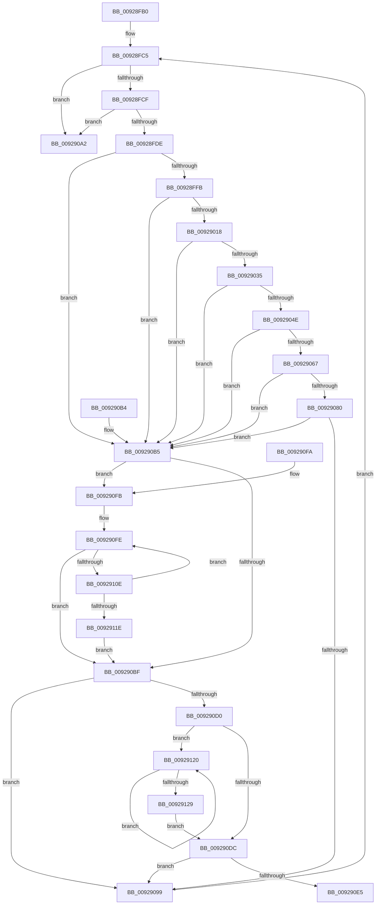

# FContainCallBackAce

- RVA: `0x00928FB0`–`0x0092912B` (길이 `379` bytes)
- VA: `0x0000000140928FB0`
- 실행 섹션: `PAGE`
- PDB 이름 있음: `예`; PDB Function 태그: `아니요`
- unwind 정보 RVA: `0x0008D7A8`
- 디코드: `101`개 명령, `379/379` bytes 표시
- 미해석 바이트: `0` (있으면 어셈블리에 `.byte`로 보존)

> 이 문서는 커널 이미지의 기계어와 PDB 기호를 분석해 생성했습니다. 4번과 5번은 함수 원형과 자료형을 바이너리 사용 방식에서 추정한 C 해석이며 원본 소스 복구 결과는 아닙니다.

## 1. Dependencies

- 직접 호출 지점: **7**; 고유 호출 대상: **1**
- 직접 호출자로 확인된 함수: **2**
- RIP 상대 이미지 참조: **7**

### Outgoing calls
- `0x00928FEE` → [wcsnicmp](../../text/50/wcsnicmp_function_005001C0.md) (function, `0x005001C0`)
- `0x0092900B` → [wcsnicmp](../../text/50/wcsnicmp_function_005001C0.md) (function, `0x005001C0`)
- `0x00929028` → [wcsnicmp](../../text/50/wcsnicmp_function_005001C0.md) (function, `0x005001C0`)
- `0x00929045` → [wcsnicmp](../../text/50/wcsnicmp_function_005001C0.md) (function, `0x005001C0`)
- `0x0092905E` → [wcsnicmp](../../text/50/wcsnicmp_function_005001C0.md) (function, `0x005001C0`)
- `0x00929077` → [wcsnicmp](../../text/50/wcsnicmp_function_005001C0.md) (function, `0x005001C0`)
- `0x00929090` → [wcsnicmp](../../text/50/wcsnicmp_function_005001C0.md) (function, `0x005001C0`)

### Direct callers
- [LocalGetAclForString](LocalGetAclForString_function_00927F30.md) at `0x00927FF5`
- [LocalGetAceCount](LocalGetAceCount_function_00929140.md) at `0x0092916B`

### Static image references
- `0x00928FE4` → RVA `0x00011CAC` (`.rdata`; read)
- `0x00929001` → RVA `0x00011CB4` (`.rdata`; read)
- `0x0092901E` → RVA `0x00011CBC` (`.rdata`; read)
- `0x0092903B` → RVA `0x00011CCC` (`.rdata`; read)
- `0x00929054` → RVA `0x00011CDC` (`.rdata`; read)
- `0x0092906D` → RVA `0x00011CD4` (`.rdata`; read)
- `0x00929086` → RVA `0x00011CC4` (`.rdata`; read)

## 2. Other-region calls and transfers

- 다른 실행 섹션으로 향하는 call: **7**
  - `0x00928FEE` → [wcsnicmp](../../text/50/wcsnicmp_function_005001C0.md) (`PAGE` → `.text`)
  - `0x0092900B` → [wcsnicmp](../../text/50/wcsnicmp_function_005001C0.md) (`PAGE` → `.text`)
  - `0x00929028` → [wcsnicmp](../../text/50/wcsnicmp_function_005001C0.md) (`PAGE` → `.text`)
  - `0x00929045` → [wcsnicmp](../../text/50/wcsnicmp_function_005001C0.md) (`PAGE` → `.text`)
  - `0x0092905E` → [wcsnicmp](../../text/50/wcsnicmp_function_005001C0.md) (`PAGE` → `.text`)
  - `0x00929077` → [wcsnicmp](../../text/50/wcsnicmp_function_005001C0.md) (`PAGE` → `.text`)
  - `0x00929090` → [wcsnicmp](../../text/50/wcsnicmp_function_005001C0.md) (`PAGE` → `.text`)
- 별도 외부 분기/꼬리 이동을 확인하지 못했습니다.

## 3. Assembly (complete function range)

```asm
00928FB0  48 89 5C 24 10                  mov qword ptr [rsp + 0x10], rbx
00928FB5  56                              push rsi
00928FB6  48 83 EC 20                     sub rsp, 0x20
00928FBA  48 8B F1                        mov rsi, rcx
00928FBD  48 89 7C 24 30                  mov qword ptr [rsp + 0x30], rdi
00928FC2  48 8B D9                        mov rbx, rcx
00928FC5  66 83 3B 00                     cmp word ptr [rbx], 0
00928FC9  0F 84 D3 00 00 00               je 0x1409290a2
00928FCF  66 83 7B 02 00                  cmp word ptr [rbx + 2], 0
00928FD4  48 8D 7B FE                     lea rdi, [rbx - 2]
00928FD8  0F 84 C4 00 00 00               je 0x1409290a2
00928FDE  41 B8 02 00 00 00               mov r8d, 2
00928FE4  48 8D 15 C1 8C 6E FF            lea rdx, [rip - 0x91733f]
00928FEB  48 8B CB                        mov rcx, rbx
00928FEE  E8 CD 71 BD FF                  call 0x1405001c0
00928FF3  85 C0                           test eax, eax
00928FF5  0F 84 BA 00 00 00               je 0x1409290b5
00928FFB  41 B8 02 00 00 00               mov r8d, 2
00929001  48 8D 15 AC 8C 6E FF            lea rdx, [rip - 0x917354]
00929008  48 8B CB                        mov rcx, rbx
0092900B  E8 B0 71 BD FF                  call 0x1405001c0
00929010  85 C0                           test eax, eax
00929012  0F 84 9D 00 00 00               je 0x1409290b5
00929018  41 B8 02 00 00 00               mov r8d, 2
0092901E  48 8D 15 97 8C 6E FF            lea rdx, [rip - 0x917369]
00929025  48 8B CB                        mov rcx, rbx
00929028  E8 93 71 BD FF                  call 0x1405001c0
0092902D  85 C0                           test eax, eax
0092902F  0F 84 80 00 00 00               je 0x1409290b5
00929035  41 B8 02 00 00 00               mov r8d, 2
0092903B  48 8D 15 8A 8C 6E FF            lea rdx, [rip - 0x917376]
00929042  48 8B CB                        mov rcx, rbx
00929045  E8 76 71 BD FF                  call 0x1405001c0
0092904A  85 C0                           test eax, eax
0092904C  74 67                           je 0x1409290b5
0092904E  41 B8 02 00 00 00               mov r8d, 2
00929054  48 8D 15 81 8C 6E FF            lea rdx, [rip - 0x91737f]
0092905B  48 8B CB                        mov rcx, rbx
0092905E  E8 5D 71 BD FF                  call 0x1405001c0
00929063  85 C0                           test eax, eax
00929065  74 4E                           je 0x1409290b5
00929067  41 B8 02 00 00 00               mov r8d, 2
0092906D  48 8D 15 60 8C 6E FF            lea rdx, [rip - 0x9173a0]
00929074  48 8B CB                        mov rcx, rbx
00929077  E8 44 71 BD FF                  call 0x1405001c0
0092907C  85 C0                           test eax, eax
0092907E  74 35                           je 0x1409290b5
00929080  41 B8 02 00 00 00               mov r8d, 2
00929086  48 8D 15 37 8C 6E FF            lea rdx, [rip - 0x9173c9]
0092908D  48 8B CB                        mov rcx, rbx
00929090  E8 2B 71 BD FF                  call 0x1405001c0
00929095  85 C0                           test eax, eax
00929097  74 1C                           je 0x1409290b5
00929099  48 83 C3 02                     add rbx, 2
0092909D  E9 23 FF FF FF                  jmp 0x140928fc5
009290A2  33 C0                           xor eax, eax
009290A4  48 8B 7C 24 30                  mov rdi, qword ptr [rsp + 0x30]
009290A9  48 8B 5C 24 38                  mov rbx, qword ptr [rsp + 0x38]
009290AE  48 83 C4 20                     add rsp, 0x20
009290B2  5E                              pop rsi
009290B3  C3                              ret
009290B4  CC                              int3
009290B5  BA 01 00 00 00                  mov edx, 1
009290BA  48 3B FE                        cmp rdi, rsi
009290BD  73 3C                           jae 0x1409290fb
009290BF  8B CA                           mov ecx, edx
009290C1  48 8B C3                        mov rax, rbx
009290C4  48 03 C9                        add rcx, rcx
009290C7  48 2B C1                        sub rax, rcx
009290CA  66 83 38 28                     cmp word ptr [rax], 0x28
009290CE  75 C9                           jne 0x140929099
009290D0  66 83 7F 06 20                  cmp word ptr [rdi + 6], 0x20
009290D5  B9 02 00 00 00                  mov ecx, 2
009290DA  74 44                           je 0x140929120
009290DC  8B C1                           mov eax, ecx
009290DE  66 83 3C 43 3B                  cmp word ptr [rbx + rax*2], 0x3b
009290E3  75 B4                           jne 0x140929099
009290E5  48 8B 7C 24 30                  mov rdi, qword ptr [rsp + 0x30]
009290EA  B8 01 00 00 00                  mov eax, 1
009290EF  48 8B 5C 24 38                  mov rbx, qword ptr [rsp + 0x38]
009290F4  48 83 C4 20                     add rsp, 0x20
009290F8  5E                              pop rsi
009290F9  C3                              ret
009290FA  CC                              int3
009290FB  48 8B CA                        mov rcx, rdx
009290FE  48 8D 04 09                     lea rax, [rcx + rcx]
00929102  48 8B CB                        mov rcx, rbx
00929105  48 2B C8                        sub rcx, rax
00929108  66 83 39 20                     cmp word ptr [rcx], 0x20
0092910C  75 B1                           jne 0x1409290bf
0092910E  FF C2                           inc edx
00929110  8B CA                           mov ecx, edx
00929112  48 6B C1 FE                     imul rax, rcx, -2
00929116  48 03 C3                        add rax, rbx
00929119  48 3B C6                        cmp rax, rsi
0092911C  73 E0                           jae 0x1409290fe
0092911E  EB 9F                           jmp 0x1409290bf
00929120  FF C1                           inc ecx
00929122  66 83 3C 4B 20                  cmp word ptr [rbx + rcx*2], 0x20
00929127  74 F7                           je 0x140929120
00929129  EB B1                           jmp 0x1409290dc
```

## 4. C-style interpretation (structured pseudocode)

```c
__int64 __fastcall FContainCallBackAce(__int64 a1)
{
    __int64 result;
    __int64 v_rbx;
    __int64 v_rsp;
    unsigned __int64 v_stack_p10;
    unsigned __int64 v_stack_p30;
    unsigned __int64 v_stack_p38;
    unsigned __int64 v_stack_p8;

    v_stack_p10 = v_rbx;
    v_rsp = (v_rsp) - (32);
    v_stack_p8 = v_rdi;
loc_00928FC5:
    if ((*(unsigned __int16 *)(a1)) == 0) goto loc_009290A2;
    if ((*(unsigned __int16 *)(a1 + 2)) == 0) goto loc_009290A2;
    result = wcsnicmp(a1, v_rip - 9532223, 2, a4);
    if ((unsigned int)(result) == 0) goto loc_009290B5;
    result = wcsnicmp(a1, v_rip - 9532244, 2, a4);
    if ((unsigned int)(result) == 0) goto loc_009290B5;
    result = wcsnicmp(a1, v_rip - 9532265, 2, a4);
    if ((unsigned int)(result) == 0) goto loc_009290B5;
    result = wcsnicmp(a1, v_rip - 9532278, 2, a4);
    if ((unsigned int)(result) == 0) goto loc_009290B5;
    result = wcsnicmp(a1, v_rip - 9532287, 2, a4);
    if ((unsigned int)(result) == 0) goto loc_009290B5;
    result = wcsnicmp(a1, v_rip - 9532320, 2, a4);
    if ((unsigned int)(result) == 0) goto loc_009290B5;
    result = wcsnicmp(a1, v_rip - 9532361, 2, a4);
    if ((unsigned int)(result) == 0) goto loc_009290B5;
loc_00929099:
    v_rbx = (a1) + (2);
    goto loc_00928FC5;
loc_009290A2:
    result = 0;
    v_rsp = (v_rsp) + (32);
    return result;
loc_009290B5:
    if (v_stack_p8 >= a1) goto loc_009290FB;
loc_009290BF:
    a1 = (1) + (1);
    result = (v_stack_p10) - (a1);
    if ((*(unsigned __int16 *)(result)) != 40) goto loc_00929099;
    if ((*(unsigned __int16 *)(v_stack_p8 + 6)) == 32) goto loc_00929120;
loc_009290DC:
    if ((*(unsigned __int16 *)(v_stack_p10 + 2 * 2)) != 59) goto loc_00929099;
    v_rsp = (v_rsp) + (32);
    return 1;
loc_009290FB:
loc_009290FE:
    a1 = (v_stack_p38) - (1 + 1 * 1);
    if ((*(unsigned __int16 *)(a1)) != 32) goto loc_009290BF;
    a2 = (unsigned int)((1) + 1);
    result = (1 + 1 * 1) * ((unsigned int)((unsigned int)(a2)));
    result = (result) + (v_stack_p38);
    if (result >= a1) goto loc_009290FE;
    goto loc_009290BF;
loc_00929120:
    a1 = (unsigned int)(((unsigned int)((unsigned int)(a2))) + 1);
    if ((*(unsigned __int16 *)(v_stack_p38 + a1 * 2)) == 32) goto loc_00929120;
    goto loc_009290DC;
}
```

## 5. (Beta) C Style

```c
int64_t FContainCallBackAce(void *Arg1)
{
    uint8_t *arg1 = (uint8_t *)Arg1;

    int64_t result;
    int64_t local_rbx;
    int64_t local_rsp;
    uint64_t v_stack_p10;
    uint64_t v_stack_p30;
    uint64_t v_stack_p38;
    uint64_t v_stack_p8;

    v_stack_p10 = local_rbx;
    local_rsp = (local_rsp) - (32);
    v_stack_p8 = local_rdi;
loc_00928FC5:
    if ((*(uint16_t *)(arg1)) == 0) goto loc_009290A2;
    if ((*(uint16_t *)(arg1 + 0x2)) == 0) goto loc_009290A2;
    result = wcsnicmp(Arg1, v_rip - 9532223, 2, a4);
    if ((uint32_t)(result) == 0) goto loc_009290B5;
    result = wcsnicmp(Arg1, v_rip - 9532244, 2, a4);
    if ((uint32_t)(result) == 0) goto loc_009290B5;
    result = wcsnicmp(Arg1, v_rip - 9532265, 2, a4);
    if ((uint32_t)(result) == 0) goto loc_009290B5;
    result = wcsnicmp(Arg1, v_rip - 9532278, 2, a4);
    if ((uint32_t)(result) == 0) goto loc_009290B5;
    result = wcsnicmp(Arg1, v_rip - 9532287, 2, a4);
    if ((uint32_t)(result) == 0) goto loc_009290B5;
    result = wcsnicmp(Arg1, v_rip - 9532320, 2, a4);
    if ((uint32_t)(result) == 0) goto loc_009290B5;
    result = wcsnicmp(Arg1, v_rip - 9532361, 2, a4);
    if ((uint32_t)(result) == 0) goto loc_009290B5;
loc_00929099:
    local_rbx = (Arg1) + (2);
    goto loc_00928FC5;
loc_009290A2:
    result = 0;
    local_rsp = (local_rsp) + (32);
    return result;
loc_009290B5:
    if (v_stack_p8 >= Arg1) goto loc_009290FB;
loc_009290BF:
    Arg1 = (1) + (1);
    result = (v_stack_p10) - (Arg1);
    if ((*(uint16_t *)(result)) != 40) goto loc_00929099;
    if ((*(uint16_t *)(v_stack_p8 + 0x6)) == 32) goto loc_00929120;
loc_009290DC:
    if ((*(uint16_t *)(v_stack_p10 + 0x2 * 2)) != 59) goto loc_00929099;
    local_rsp = (local_rsp) + (32);
    return 1;
loc_009290FB:
loc_009290FE:
    Arg1 = (v_stack_p38) - (1 + 1 * 1);
    if ((*(uint16_t *)(arg1)) != 32) goto loc_009290BF;
    a2 = (uint32_t)((1) + 1);
    result = (1 + 1 * 1) * ((uint32_t)((uint32_t)(a2)));
    result = (result) + (v_stack_p38);
    if (result >= Arg1) goto loc_009290FE;
    goto loc_009290BF;
loc_00929120:
    Arg1 = (uint32_t)(((uint32_t)((uint32_t)(a2))) + 1);
    if ((*(uint16_t *)(v_stack_p38 + arg1 * 2)) == 32) goto loc_00929120;
    goto loc_009290DC;
}
```

### 관측된 메모리 오프셋

구조체 형식이 확인되지 않은 접근은 인자 기준의 오프셋으로만 기록했습니다.

| 기준 인자 | 오프셋 표현 | 폭 (bit) | 접근 |
|---|---:|---:|---|
| `Arg1` | `- 0x2` | `64` | `R` |
| `Arg1` | `+ 0x0` | `16` | `R` |
| `Arg1` | `+ 0x0 + rax*2` | `16` | `R` |
| `Arg1` | `+ 0x0 + rcx*2` | `16` | `R` |
| `Arg1` | `+ 0x2` | `16` | `R` |

## 6. Execution-region graph

[열기: 2D/3D 그래프와 함수 탐색 컨트롤 패널](../../../control-panel.html?section=page&rva=0x00928FB0&view=graph)

- 2D 그래프는 위에서 아래로 흐르고, 3D 그래프는 빈 공간을 드래그해 회전합니다. Shift+드래그는 이동, 휠은 확대·축소, 함수 노드 선택은 대상 보고서 이동입니다.

### Static fallback


