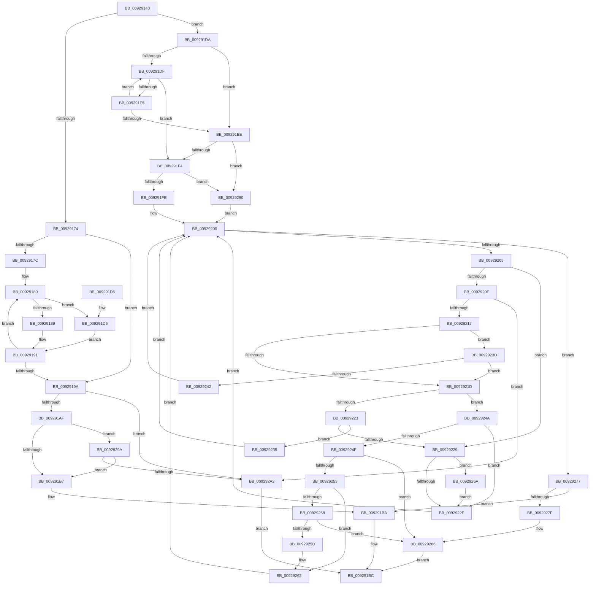

# LocalGetAceCount

- RVA: `0x00929140`–`0x009292AD` (길이 `365` bytes)
- VA: `0x0000000140929140`
- 실행 섹션: `PAGE`
- PDB 이름 있음: `예`; PDB Function 태그: `아니요`
- unwind 정보 RVA: `0x0008D7C0`
- 디코드: `116`개 명령, `365/365` bytes 표시
- 미해석 바이트: `0` (있으면 어셈블리에 `.byte`로 보존)

> 이 문서는 커널 이미지의 기계어와 PDB 기호를 분석해 생성했습니다. 4번과 5번은 함수 원형과 자료형을 바이너리 사용 방식에서 추정한 C 해석이며 원본 소스 복구 결과는 아닙니다.

## 1. Dependencies

- 직접 호출 지점: **1**; 고유 호출 대상: **1**
- 직접 호출자로 확인된 함수: **1**
- RIP 상대 이미지 참조: **0**

### Outgoing calls
- `0x0092916B` → [FContainCallBackAce](FContainCallBackAce_function_00928FB0.md) (function, `0x00928FB0`)

### Direct callers
- [LocalGetAclForString](LocalGetAclForString_function_00927F30.md) at `0x0092806D`

### Static image references
- 디코드된 RIP-relative 메모리 참조가 없습니다.

## 2. Other-region calls and transfers

- 다른 실행 섹션으로 향하는 call: **0**
- 별도 외부 분기/꼬리 이동을 확인하지 못했습니다.

## 3. Assembly (complete function range)

```asm
00929140  48 89 5C 24 08                  mov qword ptr [rsp + 8], rbx
00929145  48 89 6C 24 10                  mov qword ptr [rsp + 0x10], rbp
0092914A  48 89 74 24 18                  mov qword ptr [rsp + 0x18], rsi
0092914F  57                              push rdi
00929150  41 56                           push r14
00929152  41 57                           push r15
00929154  48 83 EC 20                     sub rsp, 0x20
00929158  33 F6                           xor esi, esi
0092915A  4D 8B F8                        mov r15, r8
0092915D  41 89 30                        mov dword ptr [r8], esi
00929160  48 8B FA                        mov rdi, rdx
00929163  48 8B D9                        mov rbx, rcx
00929166  33 ED                           xor ebp, ebp
00929168  45 33 F6                        xor r14d, r14d
0092916B  E8 40 FE FF FF                  call 0x140928fb0
00929170  85 C0                           test eax, eax
00929172  75 66                           jne 0x1409291da
00929174  45 33 C0                        xor r8d, r8d
00929177  48 3B DF                        cmp rbx, rdi
0092917A  73 1E                           jae 0x14092919a
0092917C  8D 4D 01                        lea ecx, [rbp + 1]
0092917F  90                              nop
00929180  0F B7 03                        movzx eax, word ptr [rbx]
00929183  66 83 F8 3B                     cmp ax, 0x3b
00929187  74 4D                           je 0x1409291d6
00929189  66 83 F8 28                     cmp ax, 0x28
0092918D  44 0F 45 C1                     cmovne r8d, ecx
00929191  48 83 C3 02                     add rbx, 2
00929195  48 3B DF                        cmp rbx, rdi
00929198  72 E6                           jb 0x140929180
0092919A  B8 CD CC CC CC                  mov eax, 0xcccccccd
0092919F  F7 E6                           mul esi
009291A1  C1 EA 02                        shr edx, 2
009291A4  8D 0C 92                        lea ecx, [rdx + rdx*4]
009291A7  3B F1                           cmp esi, ecx
009291A9  0F 85 F4 00 00 00               jne 0x1409292a3
009291AF  85 F6                           test esi, esi
009291B1  0F 84 E3 00 00 00               je 0x14092929a
009291B7  41 89 17                        mov dword ptr [r15], edx
009291BA  33 C0                           xor eax, eax
009291BC  48 8B 5C 24 40                  mov rbx, qword ptr [rsp + 0x40]
009291C1  48 8B 6C 24 48                  mov rbp, qword ptr [rsp + 0x48]
009291C6  48 8B 74 24 50                  mov rsi, qword ptr [rsp + 0x50]
009291CB  48 83 C4 20                     add rsp, 0x20
009291CF  41 5F                           pop r15
009291D1  41 5E                           pop r14
009291D3  5F                              pop rdi
009291D4  C3                              ret
009291D5  CC                              int3
009291D6  FF C6                           inc esi
009291D8  EB B7                           jmp 0x140929191
009291DA  48 3B DF                        cmp rbx, rdi
009291DD  73 0F                           jae 0x1409291ee
009291DF  66 83 3B 20                     cmp word ptr [rbx], 0x20
009291E3  75 0F                           jne 0x1409291f4
009291E5  48 83 C3 02                     add rbx, 2
009291E9  48 3B DF                        cmp rbx, rdi
009291EC  72 F1                           jb 0x1409291df
009291EE  0F 84 9C 00 00 00               je 0x140929290
009291F4  66 83 3B 28                     cmp word ptr [rbx], 0x28
009291F8  0F 85 92 00 00 00               jne 0x140929290
009291FE  33 C9                           xor ecx, ecx
00929200  48 3B DF                        cmp rbx, rdi
00929203  73 72                           jae 0x140929277
00929205  0F B7 03                        movzx eax, word ptr [rbx]
00929208  66 83 F8 20                     cmp ax, 0x20
0092920C  74 1B                           je 0x140929229
0092920E  48 85 C9                        test rcx, rcx
00929211  0F 85 8C 00 00 00               jne 0x1409292a3
00929217  66 83 F8 28                     cmp ax, 0x28
0092921B  74 20                           je 0x14092923d
0092921D  66 83 F8 29                     cmp ax, 0x29
00929221  74 27                           je 0x14092924a
00929223  66 83 F8 3B                     cmp ax, 0x3b
00929227  74 0C                           je 0x140929235
00929229  66 83 F8 22                     cmp ax, 0x22
0092922D  74 3B                           je 0x14092926a
0092922F  48 83 C3 02                     add rbx, 2
00929233  EB CB                           jmp 0x140929200
00929235  FF C6                           inc esi
00929237  48 83 C3 02                     add rbx, 2
0092923B  EB C3                           jmp 0x140929200
0092923D  45 85 F6                        test r14d, r14d
00929240  75 DB                           jne 0x14092921d
00929242  FF C5                           inc ebp
00929244  48 83 C3 02                     add rbx, 2
00929248  EB B6                           jmp 0x140929200
0092924A  45 85 F6                        test r14d, r14d
0092924D  75 E0                           jne 0x14092922f
0092924F  85 ED                           test ebp, ebp
00929251  74 33                           je 0x140929286
00929253  83 FD 01                        cmp ebp, 1
00929256  75 0A                           jne 0x140929262
00929258  83 FE 05                        cmp esi, 5
0092925B  72 29                           jb 0x140929286
0092925D  33 F6                           xor esi, esi
0092925F  41 FF 07                        inc dword ptr [r15]
00929262  FF CD                           dec ebp
00929264  48 83 C3 02                     add rbx, 2
00929268  EB 96                           jmp 0x140929200
0092926A  33 C0                           xor eax, eax
0092926C  45 85 F6                        test r14d, r14d
0092926F  0F 94 C0                        sete al
00929272  44 8B F0                        mov r14d, eax
00929275  EB B8                           jmp 0x14092922f
00929277  85 ED                           test ebp, ebp
00929279  0F 84 3B FF FF FF               je 0x1409291ba
0092927F  41 C7 07 00 00 00 00            mov dword ptr [r15], 0
00929286  B8 38 05 00 00                  mov eax, 0x538
0092928B  E9 2C FF FF FF                  jmp 0x1409291bc
00929290  B9 01 00 00 00                  mov ecx, 1
00929295  E9 66 FF FF FF                  jmp 0x140929200
0092929A  45 85 C0                        test r8d, r8d
0092929D  0F 84 14 FF FF FF               je 0x1409291b7
009292A3  B8 57 00 00 00                  mov eax, 0x57
009292A8  E9 0F FF FF FF                  jmp 0x1409291bc
```

## 4. C-style interpretation (structured pseudocode)

```c
__int64 __fastcall LocalGetAceCount(__int64 a1, __int64 a2, __int64 a3)
{
    __int64 result;
    __int64 v_r14;
    __int64 v_rbp;
    __int64 v_rbx;
    __int64 v_rsi;
    __int64 v_rsp;
    unsigned __int64 v_stack_p10;
    unsigned __int64 v_stack_p18;
    unsigned __int64 v_stack_p8;

    v_stack_p8 = v_rbx;
    v_stack_p10 = v_rbp;
    v_stack_p18 = v_rsi;
    v_rsp = (v_rsp) - (32);
    v_rsi = 0;
    *(unsigned int *)(a3) = 0;
    v_rbp = 0;
    v_r14 = 0;
    result = FContainCallBackAce(a1, a2, a3, a4);
    if ((unsigned int)(result) != 0) goto loc_009291DA;
    a3 = 0;
    if (a1 >= a2) goto loc_0092919A;
loc_00929180:
    if (((unsigned __int16)(*(unsigned __int16 *)(a1))) == 59) goto loc_009291D6;
    if (((unsigned __int16)(*(unsigned __int16 *)(a1))) != 40) { a3 = (unsigned int)(v_rbp + 1); }
loc_00929191:
    v_rbx = (a1) + (2);
    if (v_rbx < a2) goto loc_00929180;
loc_0092919A:
    a2 = (unsigned int)((a2) >> (2));
    if (0 != ((unsigned int)(a2 + a2 * 4))) goto loc_009292A3;
    if (0 == 0) goto loc_0092929A;
loc_009291B7:
    *(unsigned int *)(a3) = (unsigned int)(a2);
loc_009291BA:
    result = 0;
loc_009291BC:
    v_rsp = (v_rsp) + (32);
    return result;
loc_009291D6:
    v_rsi = (unsigned int)((v_stack_p18) + 1);
    goto loc_00929191;
loc_009291DA:
    if (v_stack_p8 >= a2) goto loc_009291EE;
loc_009291DF:
    if ((*(unsigned __int16 *)(v_stack_p8)) != 32) goto loc_009291F4;
    v_rbx = (v_stack_p8) + (2);
    if (v_rbx < a2) goto loc_009291DF;
loc_009291EE:
    if (v_rbx == a2) goto loc_00929290;
loc_009291F4:
    if ((*(unsigned __int16 *)(v_rbx)) != 40) goto loc_00929290;
    a1 = 0;
loc_00929200:
    if (v_rbx >= a2) goto loc_00929277;
    if (((unsigned __int16)(*(unsigned __int16 *)(v_rbx))) == 32) goto loc_00929229;
    if (0 != 0) goto loc_009292A3;
    if (((unsigned __int16)(*(unsigned __int16 *)(v_rbx))) == 40) goto loc_0092923D;
loc_0092921D:
    if (((unsigned __int16)(*(unsigned __int16 *)(v_rbx))) == 41) goto loc_0092924A;
    if (((unsigned __int16)(*(unsigned __int16 *)(v_rbx))) == 59) goto loc_00929235;
loc_00929229:
    if (((unsigned __int16)(*(unsigned __int16 *)(v_rbx))) == 34) goto loc_0092926A;
loc_0092922F:
    v_rbx = (v_rbx) + (2);
    goto loc_00929200;
loc_00929235:
    v_rsi = (unsigned int)((v_rsi) + 1);
    v_rbx = (v_rbx) + (2);
    goto loc_00929200;
loc_0092923D:
    if (0 != 0) goto loc_0092921D;
    v_rbp = (unsigned int)((v_stack_p10) + 1);
    v_rbx = (v_rbx) + (2);
    goto loc_00929200;
loc_0092924A:
    if (0 != 0) goto loc_0092922F;
    if ((unsigned int)(v_rbp) == 0) goto loc_00929286;
    if (((unsigned int)(v_rbp)) != 1) goto loc_00929262;
    if (((unsigned int)(v_rsi)) < 5) goto loc_00929286;
    v_rsi = 0;
loc_00929262:
    v_rbp = (unsigned int)((v_rbp) - 1);
    v_rbx = (v_rbx) + (2);
    goto loc_00929200;
loc_0092926A:
    result = 0;
    result = (0 == 0) ? 1 : 0;
    goto loc_0092922F;
loc_00929277:
    if ((unsigned int)(v_rbp) == 0) goto loc_009291BA;
    *(unsigned int *)(a3) = 0;
loc_00929286:
    goto loc_009291BC;
loc_00929290:
    goto loc_00929200;
loc_0092929A:
    if ((unsigned int)(a3) == 0) goto loc_009291B7;
loc_009292A3:
    goto loc_009291BC;
}
```

## 5. (Beta) C Style

```c
int64_t LocalGetAceCount(int64_t Arg1, int64_t Arg2, void *Arg3)
{
    uint8_t *arg3 = (uint8_t *)Arg3;

    int64_t result;
    int64_t local_r14;
    int64_t local_rbp;
    int64_t local_rbx;
    int64_t local_rsi;
    int64_t local_rsp;
    uint64_t v_stack_p10;
    uint64_t v_stack_p18;
    uint64_t v_stack_p8;

    v_stack_p8 = local_rbx;
    v_stack_p10 = local_rbp;
    v_stack_p18 = local_rsi;
    local_rsp = (local_rsp) - (32);
    local_rsi = 0;
    *(uint32_t *)(arg3) = 0;
    local_rbp = 0;
    local_r14 = 0;
    result = FContainCallBackAce(Arg1, Arg2, Arg3, a4);
    if ((uint32_t)(result) != 0) goto loc_009291DA;
    Arg3 = 0;
    if (Arg1 >= Arg2) goto loc_0092919A;
loc_00929180:
    if (((uint16_t)(*(uint16_t *)(Arg1))) == 59) goto loc_009291D6;
    if (((uint16_t)(*(uint16_t *)(Arg1))) != 40) { Arg3 = (uint32_t)(local_rbp + 1); }
loc_00929191:
    local_rbx = (Arg1) + (2);
    if (local_rbx < Arg2) goto loc_00929180;
loc_0092919A:
    Arg2 = (uint32_t)((Arg2) >> (2));
    if (0 != ((uint32_t)(Arg2 + Arg2 * 4))) goto loc_009292A3;
    if (0 == 0) goto loc_0092929A;
loc_009291B7:
    *(uint32_t *)(arg3) = (uint32_t)(Arg2);
loc_009291BA:
    result = 0;
loc_009291BC:
    local_rsp = (local_rsp) + (32);
    return result;
loc_009291D6:
    local_rsi = (uint32_t)((v_stack_p18) + 1);
    goto loc_00929191;
loc_009291DA:
    if (v_stack_p8 >= Arg2) goto loc_009291EE;
loc_009291DF:
    if ((*(uint16_t *)(v_stack_p8)) != 32) goto loc_009291F4;
    local_rbx = (v_stack_p8) + (2);
    if (local_rbx < Arg2) goto loc_009291DF;
loc_009291EE:
    if (local_rbx == Arg2) goto loc_00929290;
loc_009291F4:
    if ((*(uint16_t *)(local_rbx)) != 40) goto loc_00929290;
    Arg1 = 0;
loc_00929200:
    if (local_rbx >= Arg2) goto loc_00929277;
    if (((uint16_t)(*(uint16_t *)(local_rbx))) == 32) goto loc_00929229;
    if (0 != 0) goto loc_009292A3;
    if (((uint16_t)(*(uint16_t *)(local_rbx))) == 40) goto loc_0092923D;
loc_0092921D:
    if (((uint16_t)(*(uint16_t *)(local_rbx))) == 41) goto loc_0092924A;
    if (((uint16_t)(*(uint16_t *)(local_rbx))) == 59) goto loc_00929235;
loc_00929229:
    if (((uint16_t)(*(uint16_t *)(local_rbx))) == 34) goto loc_0092926A;
loc_0092922F:
    local_rbx = (local_rbx) + (2);
    goto loc_00929200;
loc_00929235:
    local_rsi = (uint32_t)((local_rsi) + 1);
    local_rbx = (local_rbx) + (2);
    goto loc_00929200;
loc_0092923D:
    if (0 != 0) goto loc_0092921D;
    local_rbp = (uint32_t)((v_stack_p10) + 1);
    local_rbx = (local_rbx) + (2);
    goto loc_00929200;
loc_0092924A:
    if (0 != 0) goto loc_0092922F;
    if ((uint32_t)(local_rbp) == 0) goto loc_00929286;
    if (((uint32_t)(local_rbp)) != 1) goto loc_00929262;
    if (((uint32_t)(local_rsi)) < 5) goto loc_00929286;
    local_rsi = 0;
loc_00929262:
    local_rbp = (uint32_t)((local_rbp) - 1);
    local_rbx = (local_rbx) + (2);
    goto loc_00929200;
loc_0092926A:
    result = 0;
    result = (0 == 0) ? 1 : 0;
    goto loc_0092922F;
loc_00929277:
    if ((uint32_t)(local_rbp) == 0) goto loc_009291BA;
    *(uint32_t *)(arg3) = 0;
loc_00929286:
    goto loc_009291BC;
loc_00929290:
    goto loc_00929200;
loc_0092929A:
    if ((uint32_t)(Arg3) == 0) goto loc_009291B7;
loc_009292A3:
    goto loc_009291BC;
}
```

### 관측된 메모리 오프셋

구조체 형식이 확인되지 않은 접근은 인자 기준의 오프셋으로만 기록했습니다.

| 기준 인자 | 오프셋 표현 | 폭 (bit) | 접근 |
|---|---:|---:|---|
| `Arg3` | `+ 0x0` | `32` | `R/W` |
| `Arg3` | `+ 0x0` | `32` | `W` |

## 6. Execution-region graph

[열기: 2D/3D 그래프와 함수 탐색 컨트롤 패널](../../../control-panel.html?section=page&rva=0x00929140&view=graph)

- 2D 그래프는 위에서 아래로 흐르고, 3D 그래프는 빈 공간을 드래그해 회전합니다. Shift+드래그는 이동, 휠은 확대·축소, 함수 노드 선택은 대상 보고서 이동입니다.

### Static fallback


