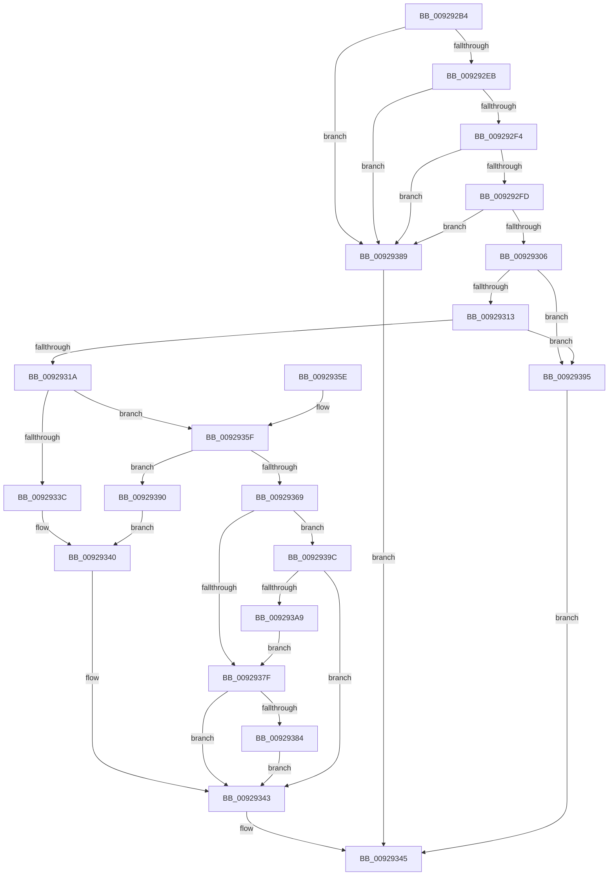

# LocalGetSidForString

- RVA: `0x009292B4`–`0x009293AB` (길이 `247` bytes)
- VA: `0x00000001409292B4`
- 실행 섹션: `PAGE`
- PDB 이름 있음: `예`; PDB Function 태그: `아니요`
- unwind 정보 RVA: `0x0008D7DC`
- 디코드: `76`개 명령, `247/247` bytes 표시
- 미해석 바이트: `0` (있으면 어셈블리에 `.byte`로 보존)

> 이 문서는 커널 이미지의 기계어와 PDB 기호를 분석해 생성했습니다. 4번과 5번은 함수 원형과 자료형을 바이너리 사용 방식에서 추정한 C 해석이며 원본 소스 복구 결과는 아닙니다.

## 1. Dependencies

- 직접 호출 지점: **3**; 고유 호출 대상: **3**
- 직접 호출자로 확인된 함수: **2**
- RIP 상대 이미지 참조: **0**

### Outgoing calls
- `0x00929332` → [LookupSidInTable](LookupSidInTable_function_009293C0.md) (function, `0x009293C0`)
- `0x00929376` → [LocalpConvertStringSidToSid](../A1/LocalpConvertStringSidToSid_function_00A17490.md) (function, `0x00A17490`)
- `0x0092939E` → [RtlNtStatusToDosError](RtlNtStatusToDosError_function_00926C40.md) (function, `0x00926C40`)

### Direct callers
- [LocalGetRelativeAttributeForString](../AC/LocalGetRelativeAttributeForString_function_00AC74E4.md) at `0x00AC7889`
- [LocalGetRelativeAttributeForString](../AC/LocalGetRelativeAttributeForString_function_00AC74E4.md) at `0x00AC7D57`
- [sub_00B32FE4](../B3/Unknown_function_00B32FE4.md) at `0x00B33224`

### Static image references
- 디코드된 RIP-relative 메모리 참조가 없습니다.

## 2. Other-region calls and transfers

- 다른 실행 섹션으로 향하는 call: **0**
- 별도 외부 분기/꼬리 이동을 확인하지 못했습니다.

## 3. Assembly (complete function range)

```asm
009292B4  4C 8B DC                        mov r11, rsp
009292B7  49 89 5B 10                     mov qword ptr [r11 + 0x10], rbx
009292BB  49 89 6B 18                     mov qword ptr [r11 + 0x18], rbp
009292BF  49 89 73 20                     mov qword ptr [r11 + 0x20], rsi
009292C3  57                              push rdi
009292C4  41 56                           push r14
009292C6  41 57                           push r15
009292C8  48 83 EC 40                     sub rsp, 0x40
009292CC  45 33 FF                        xor r15d, r15d
009292CF  49 8B F9                        mov rdi, r9
009292D2  4D 89 7B 08                     mov qword ptr [r11 + 8], r15
009292D6  4D 8B F0                        mov r14, r8
009292D9  48 8B DA                        mov rbx, rdx
009292DC  48 8B F1                        mov rsi, rcx
009292DF  41 8B EF                        mov ebp, r15d
009292E2  48 85 C9                        test rcx, rcx
009292E5  0F 84 9E 00 00 00               je 0x140929389
009292EB  48 85 D2                        test rdx, rdx
009292EE  0F 84 95 00 00 00               je 0x140929389
009292F4  4D 85 C0                        test r8, r8
009292F7  0F 84 8C 00 00 00               je 0x140929389
009292FD  4D 85 C9                        test r9, r9
00929300  0F 84 83 00 00 00               je 0x140929389
00929306  45 88 39                        mov byte ptr [r9], r15b
00929309  66 44 39 39                     cmp word ptr [rcx], r15w
0092930D  0F 84 82 00 00 00               je 0x140929395
00929313  66 44 39 79 02                  cmp word ptr [rcx + 2], r15w
00929318  74 7B                           je 0x140929395
0092931A  48 8D 41 04                     lea rax, [rcx + 4]
0092931E  33 D2                           xor edx, edx
00929320  49 89 00                        mov qword ptr [r8], rax
00929323  49 8D 43 08                     lea rax, [r11 + 8]
00929327  49 89 43 D8                     mov qword ptr [r11 - 0x28], rax
0092932B  45 33 C0                        xor r8d, r8d
0092932E  45 88 7B D0                     mov byte ptr [r11 - 0x30], r15b
00929332  E8 89 00 00 00                  call 0x1409293c0
00929337  48 85 C0                        test rax, rax
0092933A  74 23                           je 0x14092935f
0092933C  48 8B 40 10                     mov rax, qword ptr [rax + 0x10]
00929340  48 89 03                        mov qword ptr [rbx], rax
00929343  8B C5                           mov eax, ebp
00929345  48 8B 5C 24 68                  mov rbx, qword ptr [rsp + 0x68]
0092934A  48 8B 6C 24 70                  mov rbp, qword ptr [rsp + 0x70]
0092934F  48 8B 74 24 78                  mov rsi, qword ptr [rsp + 0x78]
00929354  48 83 C4 40                     add rsp, 0x40
00929358  41 5F                           pop r15
0092935A  41 5E                           pop r14
0092935C  5F                              pop rdi
0092935D  C3                              ret
0092935E  CC                              int3
0092935F  48 8B 44 24 60                  mov rax, qword ptr [rsp + 0x60]
00929364  48 85 C0                        test rax, rax
00929367  75 27                           jne 0x140929390
00929369  49 83 06 FC                     add qword ptr [r14], -4
0092936D  4D 8B C6                        mov r8, r14
00929370  48 8B D3                        mov rdx, rbx
00929373  48 8B CE                        mov rcx, rsi
00929376  E8 15 E1 0E 00                  call 0x140a17490
0092937B  85 C0                           test eax, eax
0092937D  78 1D                           js 0x14092939c
0092937F  4C 39 3B                        cmp qword ptr [rbx], r15
00929382  74 BF                           je 0x140929343
00929384  C6 07 01                        mov byte ptr [rdi], 1
00929387  EB BA                           jmp 0x140929343
00929389  B8 57 00 00 00                  mov eax, 0x57
0092938E  EB B5                           jmp 0x140929345
00929390  C6 07 01                        mov byte ptr [rdi], 1
00929393  EB AB                           jmp 0x140929340
00929395  B8 34 05 00 00                  mov eax, 0x534
0092939A  EB A9                           jmp 0x140929345
0092939C  8B C8                           mov ecx, eax
0092939E  E8 9D D8 FF FF                  call 0x140926c40
009293A3  8B E8                           mov ebp, eax
009293A5  85 C0                           test eax, eax
009293A7  75 9A                           jne 0x140929343
009293A9  EB D4                           jmp 0x14092937f
```

## 4. C-style interpretation (structured pseudocode)

```c
__int64 __fastcall LocalGetSidForString(__int64 a1, __int64 a2, __int64 a3, __int64 a4)
{
    __int64 result;
    __int64 v_r15;
    __int64 v_rsp;
    unsigned __int64 v_stack_p10;
    unsigned __int64 v_stack_p18;
    unsigned __int64 v_stack_p20;
    unsigned __int64 v_stack_p60;

    *(unsigned __int64 *)(v_rsp + 16) = v_rbx;
    *(unsigned __int64 *)(v_rsp + 24) = v_rbp;
    *(unsigned __int64 *)(v_rsp + 32) = v_rsi;
    v_rsp = (v_rsp) - (64);
    v_r15 = 0;
    *(unsigned __int64 *)(v_rsp + 8) = 0;
    if (a1 == 0) goto loc_00929389;
    if (a2 == 0) goto loc_00929389;
    if (a3 == 0) goto loc_00929389;
    if (a4 == 0) goto loc_00929389;
    *(unsigned __int8 *)(a4) = 0;
    if ((*(unsigned __int16 *)(a1)) == 0) goto loc_00929395;
    if ((*(unsigned __int16 *)(a1 + 2)) == 0) goto loc_00929395;
    a2 = 0;
    *(unsigned __int64 *)(a3) = a1 + 4;
    *(unsigned __int64 *)(v_rsp - 40) = v_rsp + 8;
    a3 = 0;
    *(unsigned __int8 *)(v_rsp - 48) = 0;
    result = LookupSidInTable(a1, a2, a3, a4);
    if (result == 0) goto loc_0092935F;
loc_00929340:
    *(unsigned __int64 *)(a2) = *(unsigned __int64 *)(result + 16);
loc_00929343:
loc_00929345:
    v_rsp = (v_rsp) + (64);
    return 0;
loc_0092935F:
    if (v_stack_p60 != 0) goto loc_00929390;
    result = LocalpConvertStringSidToSid(v_stack_p20, v_stack_p10, 0, a4);
    if (sign_flag) goto loc_0092939C;
loc_0092937F:
    if ((*(unsigned __int64 *)(v_stack_p10)) == 0) goto loc_00929343;
    *(unsigned __int8 *)(a4) = 1;
    goto loc_00929343;
loc_00929389:
    goto loc_00929345;
loc_00929390:
    *(unsigned __int8 *)(a4) = 1;
    goto loc_00929340;
loc_00929395:
    goto loc_00929345;
loc_0092939C:
    result = RtlNtStatusToDosError((unsigned int)((unsigned int)((unsigned int)(0x534ULL))), v_stack_p10, 0, a4);
    if ((unsigned int)(result) != 0) goto loc_00929343;
    goto loc_0092937F;
}
```

## 5. (Beta) C Style

```c
int64_t LocalGetSidForString(int64_t Arg1, void *Arg2, void *Arg3, void *Arg4)
{
    uint8_t *arg2 = (uint8_t *)Arg2;
    uint8_t *arg3 = (uint8_t *)Arg3;
    uint8_t *arg4 = (uint8_t *)Arg4;

    int64_t result;
    int64_t local_r15;
    int64_t local_rsp;
    uint64_t v_stack_p10;
    uint64_t v_stack_p18;
    uint64_t v_stack_p20;
    uint64_t v_stack_p60;

    *(uint64_t *)(local_rsp + 0x10) = local_rbx;
    *(uint64_t *)(local_rsp + 0x18) = local_rbp;
    *(uint64_t *)(local_rsp + 0x20) = local_rsi;
    local_rsp = (local_rsp) - (64);
    local_r15 = 0;
    *(uint64_t *)(local_rsp + 0x8) = 0;
    if (Arg1 == 0) goto loc_00929389;
    if (Arg2 == NULL) goto loc_00929389;
    if (Arg3 == NULL) goto loc_00929389;
    if (Arg4 == NULL) goto loc_00929389;
    *(uint8_t *)(arg4) = 0;
    if ((*(uint16_t *)(Arg1)) == 0) goto loc_00929395;
    if ((*(uint16_t *)(Arg1 + 0x2)) == 0) goto loc_00929395;
    Arg2 = 0;
    *(uint64_t *)(arg3) = Arg1 + 4;
    *(uint64_t *)(local_rsp - 0x28) = local_rsp + 8;
    Arg3 = 0;
    *(uint8_t *)(local_rsp - 0x30) = 0;
    result = LookupSidInTable(Arg1, Arg2, Arg3, Arg4);
    if (result == 0) goto loc_0092935F;
loc_00929340:
    *(uint64_t *)(arg2) = *(uint64_t *)(result + 0x10);
loc_00929343:
loc_00929345:
    local_rsp = (local_rsp) + (64);
    return 0;
loc_0092935F:
    if (v_stack_p60 != 0) goto loc_00929390;
    result = LocalpConvertStringSidToSid(v_stack_p20, v_stack_p10, 0, Arg4);
    if (sign_flag) goto loc_0092939C;
loc_0092937F:
    if ((*(uint64_t *)(v_stack_p10)) == 0) goto loc_00929343;
    *(uint8_t *)(arg4) = 1;
    goto loc_00929343;
loc_00929389:
    goto loc_00929345;
loc_00929390:
    *(uint8_t *)(arg4) = 1;
    goto loc_00929340;
loc_00929395:
    goto loc_00929345;
loc_0092939C:
    result = RtlNtStatusToDosError((uint32_t)((uint32_t)((uint32_t)(0x534ULL))), v_stack_p10, 0, Arg4);
    if ((uint32_t)(result) != 0) goto loc_00929343;
    goto loc_0092937F;
}
```

### 관측된 메모리 오프셋

구조체 형식이 확인되지 않은 접근은 인자 기준의 오프셋으로만 기록했습니다.

| 기준 인자 | 오프셋 표현 | 폭 (bit) | 접근 |
|---|---:|---:|---|
| `Arg2` | `+ 0x0` | `64` | `R` |
| `Arg2` | `+ 0x0` | `64` | `W` |
| `Arg3` | `+ 0x0` | `64` | `R/W` |
| `Arg4` | `+ 0x0` | `8` | `W` |

## 6. Execution-region graph

[열기: 2D/3D 그래프와 함수 탐색 컨트롤 패널](../../../control-panel.html?section=page&rva=0x009292B4&view=graph)

- 2D 그래프는 위에서 아래로 흐르고, 3D 그래프는 빈 공간을 드래그해 회전합니다. Shift+드래그는 이동, 휠은 확대·축소, 함수 노드 선택은 대상 보고서 이동입니다.

### Static fallback


