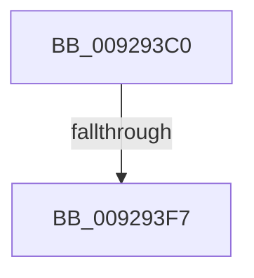

# LookupSidInTable

- RVA: `0x009293C0`–`0x009293FF` (길이 `63` bytes)
- VA: `0x00000001409293C0`
- 실행 섹션: `PAGE`
- PDB 이름 있음: `예`; PDB Function 태그: `아니요`
- unwind 정보 RVA: `0x0008D7F8`
- 디코드: `16`개 명령, `63/63` bytes 표시
- 미해석 바이트: `0` (있으면 어셈블리에 `.byte`로 보존)

> 이 문서는 커널 이미지의 기계어와 PDB 기호를 분석해 생성했습니다. 4번과 5번은 함수 원형과 자료형을 바이너리 사용 방식에서 추정한 C 해석이며 원본 소스 복구 결과는 아닙니다.

## 1. Dependencies

- 직접 호출 지점: **0**; 고유 호출 대상: **0**
- 직접 호출자로 확인된 함수: **6**
- RIP 상대 이미지 참조: **0**

### Outgoing calls
- 직접 디코드된 call 명령이 없습니다.

### Direct callers
- [SeConvertStringSidToSid](../../text/4C/SeConvertStringSidToSid_function_004C6710.md) at `0x004C67A7`
- [LocalConvertStringSDToSD_Rev1](LocalConvertStringSDToSD_Rev1_function_0092656C.md) at `0x00926894`
- [LocalConvertStringSDToSD_Rev1](LocalConvertStringSDToSD_Rev1_function_0092656C.md) at `0x0092691E`
- [LocalGetAclForString](LocalGetAclForString_function_00927F30.md) at `0x009283AC`
- [LocalGetSidForString](LocalGetSidForString_function_009292B4.md) at `0x00929332`
- [LocalGetStringForSid](../A0/LocalGetStringForSid_function_00A00328.md) at `0x00A0036C`
- [LocalConvertAclToString](../A0/LocalConvertAclToString_function_00A00408.md) at `0x00A00E6E`

### Static image references
- 디코드된 RIP-relative 메모리 참조가 없습니다.

## 2. Other-region calls and transfers

- 다른 실행 섹션으로 향하는 call: **0**
- call이 아닌 외부 분기/꼬리 이동: **1**
  - `0x009293F1` → [sub_009296CB](Unknown_function_009296CB.md) (`tail-transfer`)

## 3. Assembly (complete function range)

```asm
009293C0  4C 89 4C 24 20                  mov qword ptr [rsp + 0x20], r9
009293C5  4C 89 44 24 18                  mov qword ptr [rsp + 0x18], r8
009293CA  48 89 54 24 10                  mov qword ptr [rsp + 0x10], rdx
009293CF  56                              push rsi
009293D0  41 54                           push r12
009293D2  41 55                           push r13
009293D4  41 57                           push r15
009293D6  48 83 EC 48                     sub rsp, 0x48
009293DA  45 33 ED                        xor r13d, r13d
009293DD  45 32 FF                        xor r15b, r15b
009293E0  44 89 AC 24 88 00 00 00         mov dword ptr [rsp + 0x88], r13d
009293E8  48 8B F2                        mov rsi, rdx
009293EB  4C 8B E1                        mov r12, rcx
009293EE  48 85 C9                        test rcx, rcx
009293F1  0F 84 D4 02 00 00               je 0x1409296cb
009293F7  48 8B 84 24 A0 00 00 00         mov rax, qword ptr [rsp + 0xa0]
```

## 4. C-style interpretation (structured pseudocode)

```c
__int64 __fastcall LookupSidInTable(__int64 a1, __int64 a2, __int64 a3, __int64 a4, __int64 a5, __int64 a6, __int64 a7)
{
    __int64 v_r13;
    __int64 v_r15;
    __int64 v_rsp;
    unsigned __int64 v_stack_p10;
    unsigned __int64 v_stack_p18;
    unsigned __int64 v_stack_p20;

    v_stack_p20 = a4;
    v_stack_p18 = a3;
    v_stack_p10 = a2;
    v_rsp = (v_rsp) - (72);
    v_r13 = 0;
    v_r15 = 0;
    v_stack_p20 = 0;
    return a7;
}
```

## 5. (Beta) C Style

```c
int64_t LookupSidInTable(int64_t Arg1, int64_t Arg2, int64_t Arg3, int64_t Arg4, uint64_t Arg5, uint64_t Arg6, int64_t Arg7)
{
    int64_t local_r13;
    int64_t local_r15;
    int64_t local_rsp;
    uint64_t v_stack_p10;
    uint64_t v_stack_p18;
    uint64_t v_stack_p20;

    v_stack_p20 = Arg4;
    v_stack_p18 = Arg3;
    v_stack_p10 = Arg2;
    local_rsp = (local_rsp) - (72);
    local_r13 = 0;
    local_r15 = 0;
    v_stack_p20 = 0;
    return Arg7;
}
```

## 6. Execution-region graph

[열기: 2D/3D 그래프와 함수 탐색 컨트롤 패널](../../../control-panel.html?section=page&rva=0x009293C0&view=graph)

- 2D 그래프는 위에서 아래로 흐르고, 3D 그래프는 빈 공간을 드래그해 회전합니다. Shift+드래그는 이동, 휠은 확대·축소, 함수 노드 선택은 대상 보고서 이동입니다.

### Static fallback


