# MmGetSectionInformation

- RVA: `0x00921910`–`0x00921C30` (길이 `800` bytes)
- VA: `0x0000000140921910`
- 실행 섹션: `PAGE`
- PDB 이름 있음: `예`; PDB Function 태그: `아니요`
- unwind 정보 RVA: `0x0008D048`
- 디코드: `207`개 명령, `800/800` bytes 표시
- 미해석 바이트: `0` (있으면 어셈블리에 `.byte`로 보존)

> 이 문서는 커널 이미지의 기계어와 PDB 기호를 분석해 생성했습니다. 4번과 5번은 함수 원형과 자료형을 바이너리 사용 방식에서 추정한 C 해석이며 원본 소스 복구 결과는 아닙니다.

## 1. Dependencies

- 직접 호출 지점: **5**; 고유 호출 대상: **5**
- 직접 호출자로 확인된 함수: **6**
- RIP 상대 이미지 참조: **1**

### Outgoing calls
- `0x0092193E` → [memset](../../text/6C/memset_function_006C6C40.md) (function, `0x006C6C40`)
- `0x00921950` → [MiSectionControlArea](../../text/29/MiSectionControlArea_function_00294CB0.md) (function, `0x00294CB0`)
- `0x0092195B` → [MiAweControlArea](../../text/44/MiAweControlArea_function_00447720.md) (function, `0x00447720`)
- `0x009219DA` → [MiGetControlAreaLoadConfig](../../text/46/MiGetControlAreaLoadConfig_function_0046E9D4.md) (function, `0x0046E9D4`)
- `0x00921A8E` → [MiRelocateAmount](../A9/MiRelocateAmount_function_00A96F4C.md) (function, `0x00A96F4C`)

### Direct callers
- [PspLocateSystemDll](../77/PspLocateSystemDll_function_0077F0D0.md) at `0x0077F24E`
- [PspLocateSystemDll](../77/PspLocateSystemDll_function_0077F0D0.md) at `0x0077F29D`
- [DbgkpSendErrorMessage](DbgkpSendErrorMessage_function_009210A8.md) at `0x00921165`
- [AlpcpMapLegacyPortView](AlpcpMapLegacyPortView_function_00921588.md) at `0x00921615`
- [NtQuerySection](NtQuerySection_function_00921770.md) at `0x0092188C`
- [NtQueryInformationProcess](../9A/NtQueryInformationProcess_function_009AA250.md) at `0x009AB648`
- [PspAllocateProcess](../A1/PspAllocateProcess_function_00A13B3C.md) at `0x00A144D3`
- [PspAllocateProcess](../A1/PspAllocateProcess_function_00A13B3C.md) at `0x00A14A53`

### Static image references
- `0x00921AA8` → RVA `0x00E2DB40` (`.data`; read)

## 2. Other-region calls and transfers

- 다른 실행 섹션으로 향하는 call: **4**
  - `0x0092193E` → [memset](../../text/6C/memset_function_006C6C40.md) (`PAGE` → `.text`)
  - `0x00921950` → [MiSectionControlArea](../../text/29/MiSectionControlArea_function_00294CB0.md) (`PAGE` → `.text`)
  - `0x0092195B` → [MiAweControlArea](../../text/44/MiAweControlArea_function_00447720.md) (`PAGE` → `.text`)
  - `0x009219DA` → [MiGetControlAreaLoadConfig](../../text/46/MiGetControlAreaLoadConfig_function_0046E9D4.md) (`PAGE` → `.text`)
- 별도 외부 분기/꼬리 이동을 확인하지 못했습니다.

## 3. Assembly (complete function range)

```asm
00921910  48 8B C4                        mov rax, rsp
00921913  48 89 58 08                     mov qword ptr [rax + 8], rbx
00921917  48 89 70 10                     mov qword ptr [rax + 0x10], rsi
0092191B  48 89 78 18                     mov qword ptr [rax + 0x18], rdi
0092191F  4C 89 70 20                     mov qword ptr [rax + 0x20], r14
00921923  41 57                           push r15
00921925  48 81 EC 80 00 00 00            sub rsp, 0x80
0092192C  49 8B D8                        mov rbx, r8
0092192F  8B FA                           mov edi, edx
00921931  48 8B F1                        mov rsi, rcx
00921934  33 D2                           xor edx, edx
00921936  44 8D 42 48                     lea r8d, [rdx + 0x48]
0092193A  48 8D 48 A8                     lea rcx, [rax - 0x58]
0092193E  E8 FD 52 DA FF                  call 0x1406c6c40
00921943  44 8B 76 38                     mov r14d, dword ptr [rsi + 0x38]
00921947  45 33 C9                        xor r9d, r9d
0092194A  45 8B D9                        mov r11d, r9d
0092194D  48 8B CE                        mov rcx, rsi
00921950  E8 5B 33 97 FF                  call 0x140294cb0
00921955  4C 8B D0                        mov r10, rax
00921958  48 8B C8                        mov rcx, rax
0092195B  E8 C0 5D B2 FF                  call 0x140447720
00921960  85 C0                           test eax, eax
00921962  0F 85 BE 02 00 00               jne 0x140921c26
00921968  85 FF                           test edi, edi
0092196A  0F 84 1D 02 00 00               je 0x140921b8d
00921970  85 FF                           test edi, edi
00921972  0F 84 46 01 00 00               je 0x140921abe
00921978  41 BB 01 00 00 00               mov r11d, 1
0092197E  41 3B FB                        cmp edi, r11d
00921981  0F 85 F5 00 00 00               jne 0x140921a7c
00921987  41 F6 C6 20                     test r14b, 0x20
0092198B  0F 84 58 01 00 00               je 0x140921ae9
00921991  49 8B 02                        mov rax, qword ptr [r10]
00921994  4C 8B 40 38                     mov r8, qword ptr [rax + 0x38]
00921998  41 0F 10 00                     movups xmm0, xmmword ptr [r8]
0092199C  0F 29 44 24 30                  movaps xmmword ptr [rsp + 0x30], xmm0
009219A1  41 0F 10 48 10                  movups xmm1, xmmword ptr [r8 + 0x10]
009219A6  41 0F 10 50 20                  movups xmm2, xmmword ptr [r8 + 0x20]
009219AB  41 0F 10 58 30                  movups xmm3, xmmword ptr [r8 + 0x30]
009219B0  41 F7 42 38 00 00 00 20         test dword ptr [r10 + 0x38], 0x20000000
009219B8  0F 85 38 01 00 00               jne 0x140921af6
009219BE  83 FF 04                        cmp edi, 4
009219C1  74 14                           je 0x1409219d7
009219C3  0F 11 03                        movups xmmword ptr [rbx], xmm0
009219C6  0F 11 4B 10                     movups xmmword ptr [rbx + 0x10], xmm1
009219CA  0F 11 53 20                     movups xmmword ptr [rbx + 0x20], xmm2
009219CE  0F 11 5B 30                     movups xmmword ptr [rbx + 0x30], xmm3
009219D2  E9 8B 01 00 00                  jmp 0x140921b62
009219D7  49 8B CA                        mov rcx, r10
009219DA  E8 F5 CF B4 FF                  call 0x14046e9d4
009219DF  48 8B D0                        mov rdx, rax
009219E2  41 8B C1                        mov eax, r9d
009219E5  89 44 24 70                     mov dword ptr [rsp + 0x70], eax
009219E9  41 8B C9                        mov ecx, r9d
009219EC  48 85 D2                        test rdx, rdx
009219EF  74 2D                           je 0x140921a1e
009219F1  8B 12                           mov edx, dword ptr [rdx]
009219F3  F6 C2 10                        test dl, 0x10
009219F6  0F 85 1A 01 00 00               jne 0x140921b16
009219FC  F6 C2 08                        test dl, 8
009219FF  74 0C                           je 0x140921a0d
00921A01  8B C1                           mov eax, ecx
00921A03  0F BA E8 08                     bts eax, 8
00921A07  89 44 24 70                     mov dword ptr [rsp + 0x70], eax
00921A0B  8B C8                           mov ecx, eax
00921A0D  41 84 D3                        test r11b, dl
00921A10  74 0C                           je 0x140921a1e
00921A12  8B C1                           mov eax, ecx
00921A14  0F BA E8 09                     bts eax, 9
00921A18  89 44 24 70                     mov dword ptr [rsp + 0x70], eax
00921A1C  8B C8                           mov ecx, eax
00921A1E  41 8B 50 4C                     mov edx, dword ptr [r8 + 0x4c]
00921A22  41 84 D3                        test r11b, dl
00921A25  74 09                           je 0x140921a30
00921A27  8B C1                           mov eax, ecx
00921A29  83 C8 02                        or eax, 2
00921A2C  89 44 24 70                     mov dword ptr [rsp + 0x70], eax
00921A30  F6 C2 02                        test dl, 2
00921A33  0F 85 EC 00 00 00               jne 0x140921b25
00921A39  F6 C2 04                        test dl, 4
00921A3C  0F 85 EF 00 00 00               jne 0x140921b31
00921A42  F6 C2 08                        test dl, 8
00921A45  0F 85 F2 00 00 00               jne 0x140921b3d
00921A4B  F6 C2 10                        test dl, 0x10
00921A4E  0F 85 F5 00 00 00               jne 0x140921b49
00921A54  F6 C2 20                        test dl, 0x20
00921A57  0F 85 F8 00 00 00               jne 0x140921b55
00921A5D  0F 11 03                        movups xmmword ptr [rbx], xmm0
00921A60  0F 11 4B 10                     movups xmmword ptr [rbx + 0x10], xmm1
00921A64  0F 11 53 20                     movups xmmword ptr [rbx + 0x20], xmm2
00921A68  0F 11 5B 30                     movups xmmword ptr [rbx + 0x30], xmm3
00921A6C  F2 0F 10 44 24 70               movsd xmm0, qword ptr [rsp + 0x70]
00921A72  F2 0F 11 43 40                  movsd qword ptr [rbx + 0x40], xmm0
00921A77  E9 E6 00 00 00                  jmp 0x140921b62
00921A7C  83 FF 04                        cmp edi, 4
00921A7F  0F 84 02 FF FF FF               je 0x140921987
00921A85  41 F6 C6 20                     test r14b, 0x20
00921A89  74 5E                           je 0x140921ae9
00921A8B  49 8B CA                        mov rcx, r10
00921A8E  E8 B9 54 17 00                  call 0x140a96f4c
00921A93  48 8B D0                        mov rdx, rax
00921A96  83 FF 02                        cmp edi, 2
00921A99  75 3F                           jne 0x140921ada
00921A9B  41 F7 42 38 00 00 00 20         test dword ptr [r10 + 0x38], 0x20000000
00921AA3  74 11                           je 0x140921ab6
00921AA5  49 8B 02                        mov rax, qword ptr [r10]
00921AA8  48 8B 0D 91 C0 50 00            mov rcx, qword ptr [rip + 0x50c091]
00921AAF  48 2B 48 20                     sub rcx, qword ptr [rax + 0x20]
00921AB3  48 03 D1                        add rdx, rcx
00921AB6  48 89 13                        mov qword ptr [rbx], rdx
00921AB9  E9 A4 00 00 00                  jmp 0x140921b62
00921ABE  48 8B 46 18                     mov rax, qword ptr [rsi + 0x18]
00921AC2  48 C1 E0 0C                     shl rax, 0xc
00921AC6  48 89 03                        mov qword ptr [rbx], rax
00921AC9  48 8B 46 30                     mov rax, qword ptr [rsi + 0x30]
00921ACD  48 89 43 10                     mov qword ptr [rbx + 0x10], rax
00921AD1  44 89 5B 08                     mov dword ptr [rbx + 8], r11d
00921AD5  E9 88 00 00 00                  jmp 0x140921b62
00921ADA  49 8B 02                        mov rax, qword ptr [r10]
00921ADD  48 8B 48 20                     mov rcx, qword ptr [rax + 0x20]
00921AE1  48 2B CA                        sub rcx, rdx
00921AE4  48 89 0B                        mov qword ptr [rbx], rcx
00921AE7  EB 79                           jmp 0x140921b62
00921AE9  41 B9 49 00 00 C0               mov r9d, 0xc0000049
00921AEF  44 89 4C 24 20                  mov dword ptr [rsp + 0x20], r9d
00921AF4  EB 6C                           jmp 0x140921b62
00921AF6  0F B7 4C 24 30                  movzx ecx, word ptr [rsp + 0x30]
00921AFB  48 89 4C 24 30                  mov qword ptr [rsp + 0x30], rcx
00921B00  48 0B 0D 39 C0 50 00            or rcx, qword ptr [rip + 0x50c039]
00921B07  48 89 4C 24 30                  mov qword ptr [rsp + 0x30], rcx
00921B0C  0F 28 44 24 30                  movaps xmm0, xmmword ptr [rsp + 0x30]
00921B11  E9 A8 FE FF FF                  jmp 0x1409219be
00921B16  41 8B C3                        mov eax, r11d
00921B19  89 44 24 70                     mov dword ptr [rsp + 0x70], eax
00921B1D  41 8B CB                        mov ecx, r11d
00921B20  E9 D7 FE FF FF                  jmp 0x1409219fc
00921B25  83 C8 08                        or eax, 8
00921B28  89 44 24 70                     mov dword ptr [rsp + 0x70], eax
00921B2C  E9 08 FF FF FF                  jmp 0x140921a39
00921B31  83 C8 10                        or eax, 0x10
00921B34  89 44 24 70                     mov dword ptr [rsp + 0x70], eax
00921B38  E9 05 FF FF FF                  jmp 0x140921a42
00921B3D  83 C8 20                        or eax, 0x20
00921B40  89 44 24 70                     mov dword ptr [rsp + 0x70], eax
00921B44  E9 02 FF FF FF                  jmp 0x140921a4b
00921B49  83 C8 40                        or eax, 0x40
00921B4C  89 44 24 70                     mov dword ptr [rsp + 0x70], eax
00921B50  E9 FF FE FF FF                  jmp 0x140921a54
00921B55  0F BA E8 07                     bts eax, 7
00921B59  89 44 24 70                     mov dword ptr [rsp + 0x70], eax
00921B5D  E9 FB FE FF FF                  jmp 0x140921a5d
00921B62  EB 07                           jmp 0x140921b6b
00921B64  44 8B C8                        mov r9d, eax
00921B67  89 44 24 20                     mov dword ptr [rsp + 0x20], eax
00921B6B  41 8B C1                        mov eax, r9d
00921B6E  4C 8D 9C 24 80 00 00 00         lea r11, [rsp + 0x80]
00921B76  49 8B 5B 10                     mov rbx, qword ptr [r11 + 0x10]
00921B7A  49 8B 73 18                     mov rsi, qword ptr [r11 + 0x18]
00921B7E  49 8B 7B 20                     mov rdi, qword ptr [r11 + 0x20]
00921B82  4D 8B 73 28                     mov r14, qword ptr [r11 + 0x28]
00921B86  49 8B E3                        mov rsp, r11
00921B89  41 5F                           pop r15
00921B8B  C3                              ret
00921B8C  CC                              int3
00921B8D  41 8B CE                        mov ecx, r14d
00921B90  41 BF 00 10 00 00               mov r15d, 0x1000
00921B96  41 23 CF                        and ecx, r15d
00921B99  C1 E1 0E                        shl ecx, 0xe
00921B9C  44 8B C1                        mov r8d, ecx
00921B9F  41 0F BA E8 1B                  bts r8d, 0x1b
00921BA4  41 0F BA E6 0D                  bt r14d, 0xd
00921BA9  44 0F 43 C1                     cmovae r8d, ecx
00921BAD  41 F6 C6 20                     test r14b, 0x20
00921BB1  B8 00 00 00 01                  mov eax, 0x1000000
00921BB6  44 0F 45 C0                     cmovne r8d, eax
00921BBA  41 8B D0                        mov edx, r8d
00921BBD  0F BA EA 15                     bts edx, 0x15
00921BC1  41 F6 C6 40                     test r14b, 0x40
00921BC5  41 0F 44 D0                     cmove edx, r8d
00921BC9  8B CA                           mov ecx, edx
00921BCB  0F BA E9 17                     bts ecx, 0x17
00921BCF  41 F6 C6 80                     test r14b, 0x80
00921BD3  0F 44 CA                        cmove ecx, edx
00921BD6  8B D1                           mov edx, ecx
00921BD8  0F BA EA 13                     bts edx, 0x13
00921BDC  45 85 F6                        test r14d, r14d
00921BDF  0F 49 D1                        cmovns edx, ecx
00921BE2  49 8B 02                        mov rax, qword ptr [r10]
00921BE5  44 0F B7 40 0C                  movzx r8d, word ptr [rax + 0xc]
00921BEA  8B CA                           mov ecx, edx
00921BEC  0F BA E9 1C                     bts ecx, 0x1c
00921BF0  66 41 0F BA E0 0D               bt r8w, 0xd
00921BF6  0F 43 CA                        cmovae ecx, edx
00921BF9  44 8B D9                        mov r11d, ecx
00921BFC  41 0F BA EB 1E                  bts r11d, 0x1e
00921C01  66 45 85 C7                     test r15w, r8w
00921C05  44 0F 44 D9                     cmove r11d, ecx
00921C09  41 8B 42 38                     mov eax, dword ptr [r10 + 0x38]
00921C0D  B9 20 00 02 00                  mov ecx, 0x20020
00921C12  23 C1                           and eax, ecx
00921C14  3B C1                           cmp eax, ecx
00921C16  0F 85 54 FD FF FF               jne 0x140921970
00921C1C  41 0F BA EB 1D                  bts r11d, 0x1d
00921C21  E9 4A FD FF FF                  jmp 0x140921970
00921C26  B8 0D 00 00 C0                  mov eax, 0xc000000d
00921C2B  E9 3E FF FF FF                  jmp 0x140921b6e
```

## 4. C-style interpretation (structured pseudocode)

```c
__int64 __fastcall MmGetSectionInformation(__int64 a1, int a2, __int64 a3, int a4)
{
    __int64 result;
    __int64 v_r11;
    __int64 v_rsp;
    unsigned int v_stack_m18;
    unsigned __int64 v_stack_m58;
    unsigned int v_stack_m68;
    unsigned __int64 v_stack_m8;

    *(unsigned __int64 *)(v_rsp + 8) = v_rbx;
    *(unsigned __int64 *)(v_rsp + 16) = v_rsi;
    *(unsigned __int64 *)(v_rsp + 24) = v_rdi;
    *(unsigned __int64 *)(v_rsp + 32) = v_r14;
    v_rsp = (v_rsp) - (128);
    a2 = 0;
    result = memset(v_rsp - 88, a2, a2 + 72, a4);
    a4 = 0;
    result = MiSectionControlArea(a1, a2, a2 + 72, a4);
    result = MiAweControlArea(result, a2, a2 + 72, a4);
    if ((unsigned int)(result) != 0) goto loc_00921C26;
    if ((unsigned int)((unsigned int)(a2)) == 0) goto loc_00921B8D;
loc_00921970:
    if ((unsigned int)((unsigned int)(a2)) == 0) goto loc_00921ABE;
    if (((unsigned int)((unsigned int)(a2))) != 1) goto loc_00921A7C;
loc_00921987:
    if ((((unsigned __int8)((unsigned int)(*(unsigned int *)(a1 + 56)))) & (32)) == 0) goto loc_00921AE9;
    v_stack_m58 = v_xmm0;
    if (((*(unsigned int *)(result + 56)) & (0x20000000ULL)) != 0) goto loc_00921AF6;
loc_009219BE:
    if (((unsigned int)((unsigned int)(a2))) == 4) goto loc_009219D7;
    *(unsigned __int64 *)(a3) = v_xmm0;
    *(unsigned __int64 *)(a3 + 16) = v_xmm1;
    *(unsigned __int64 *)(a3 + 32) = v_xmm2;
    *(unsigned __int64 *)(a3 + 48) = v_xmm3;
    goto loc_00921B62;
loc_009219D7:
    result = MiGetControlAreaLoadConfig(result, a2, *(unsigned __int64 *)(*(unsigned __int64 *)(result) + 56), a4);
    v_stack_m18 = 0;
    if (result == 0) goto loc_00921A1E;
    if ((((unsigned __int8)((unsigned int)(*(unsigned int *)(result)))) & (16)) != 0) goto loc_00921B16;
loc_009219FC:
    result = 0;
    if ((((unsigned __int8)((unsigned int)(*(unsigned int *)(result)))) & (8)) != 0) {
        result = 0;
        v_stack_m18 = (unsigned int)(result);
        a1 = (unsigned int)(result);
    }
    if (((1) & ((unsigned __int8)((unsigned int)(*(unsigned int *)(result))))) != 0) {
        result = (unsigned int)(a1);
        v_stack_m18 = (unsigned int)(result);
        a1 = (unsigned int)(result);
    }
    if (((1) & ((unsigned __int8)((unsigned int)(*(unsigned int *)(*(unsigned __int64 *)(*(unsigned __int64 *)(result) + 56) + 76))))) != 0) {
        result = (unsigned int)(a1);
        result = (unsigned int)((result) | (2));
        v_stack_m18 = (unsigned int)(result);
    }
    if ((((unsigned __int8)((unsigned int)(*(unsigned int *)(*(unsigned __int64 *)(*(unsigned __int64 *)(result) + 56) + 76)))) & (2)) != 0) goto loc_00921B25;
loc_00921A39:
    if ((((unsigned __int8)((unsigned int)(*(unsigned int *)(*(unsigned __int64 *)(*(unsigned __int64 *)(result) + 56) + 76)))) & (4)) != 0) goto loc_00921B31;
loc_00921A42:
    if ((((unsigned __int8)((unsigned int)(*(unsigned int *)(*(unsigned __int64 *)(*(unsigned __int64 *)(result) + 56) + 76)))) & (8)) != 0) goto loc_00921B3D;
loc_00921A4B:
    if ((((unsigned __int8)((unsigned int)(*(unsigned int *)(*(unsigned __int64 *)(*(unsigned __int64 *)(result) + 56) + 76)))) & (16)) != 0) goto loc_00921B49;
loc_00921A54:
    if ((((unsigned __int8)((unsigned int)(*(unsigned int *)(*(unsigned __int64 *)(*(unsigned __int64 *)(result) + 56) + 76)))) & (32)) != 0) goto loc_00921B55;
loc_00921A5D:
    *(unsigned __int64 *)(a3) = v_xmm0;
    *(unsigned __int64 *)(a3 + 16) = v_xmm1;
    *(unsigned __int64 *)(a3 + 32) = v_xmm2;
    *(unsigned __int64 *)(a3 + 48) = v_xmm3;
    *(unsigned __int64 *)(a3 + 64) = v_xmm0;
    goto loc_00921B62;
loc_00921A7C:
    if (((unsigned int)((unsigned int)(a2))) == 4) goto loc_00921987;
    if ((((unsigned __int8)((unsigned int)(*(unsigned int *)(a1 + 56)))) & (32)) == 0) goto loc_00921AE9;
    result = MiRelocateAmount(result, (unsigned int)(*(unsigned int *)(*(unsigned __int64 *)(*(unsigned __int64 *)(result) + 56) + 76)), *(unsigned __int64 *)(*(unsigned __int64 *)(result) + 56), a4);
    if (((unsigned int)((unsigned int)(a2))) != 2) goto loc_00921ADA;
    if (((*(unsigned int *)(result + 56)) & (0x20000000ULL)) != 0) {
        result = *(unsigned __int64 *)(result);
        a1 = *(unsigned __int64 *)(v_rip + 5292177);
        a1 = (a1) - (*(unsigned __int64 *)(result + 32));
        a2 = (result) + (a1);
    }
    *(unsigned __int64 *)(a3) = a2;
    goto loc_00921B62;
loc_00921ABE:
    result = (*(unsigned __int64 *)(a1 + 24)) << (12);
    *(unsigned __int64 *)(a3) = result;
    *(unsigned __int64 *)(a3 + 16) = *(unsigned __int64 *)(a1 + 48);
    *(unsigned int *)(a3 + 8) = 1;
    goto loc_00921B62;
loc_00921ADA:
    a1 = (*(unsigned __int64 *)(*(unsigned __int64 *)(result) + 32)) - (a2);
    *(unsigned __int64 *)(a3) = a1;
    goto loc_00921B62;
loc_00921AE9:
    v_stack_m68 = (unsigned int)((unsigned int)(0xC0000049ULL));
    goto loc_00921B62;
loc_00921AF6:
    v_stack_m58 = v_stack_m58;
    a1 = (v_stack_m58) | (*(unsigned __int64 *)(v_rip + 5292089));
    v_stack_m58 = a1;
    goto loc_009219BE;
loc_00921B16:
    v_stack_m18 = 1;
    goto loc_009219FC;
loc_00921B25:
    result = (unsigned int)((1) | (8));
    v_stack_m18 = (unsigned int)(result);
    goto loc_00921A39;
loc_00921B31:
    result = (unsigned int)((result) | (16));
    v_stack_m18 = (unsigned int)(result);
    goto loc_00921A42;
loc_00921B3D:
    result = (unsigned int)((result) | (32));
    v_stack_m18 = (unsigned int)(result);
    goto loc_00921A4B;
loc_00921B49:
    result = (unsigned int)((result) | (64));
    v_stack_m18 = (unsigned int)(result);
    goto loc_00921A54;
loc_00921B55:
    v_stack_m18 = (unsigned int)(result);
    goto loc_00921A5D;
loc_00921B62:
    goto loc_00921B6B;
loc_00921B6B:
loc_00921B6E:
    return (unsigned int)((unsigned int)((unsigned int)(0xC0000049ULL)));
loc_00921B8D:
    a1 = (unsigned int)(((unsigned int)((unsigned int)(*(unsigned __int64 *)(v_stack_m8 + 40)))) & ((unsigned int)((unsigned int)(0x1000ULL))));
    a1 = (unsigned int)((a1) << (14));
    a3 = (unsigned int)((unsigned int)(a1));
    if (condition_is_above_or_equal) { a3 = (unsigned int)(a1); }
    if ((((unsigned __int8)(*(unsigned __int64 *)(v_stack_m8 + 40))) & (32)) != 0) { a3 = (unsigned int)((unsigned int)(0x1000000ULL)); }
    a2 = (unsigned int)((unsigned int)(a3));
    if ((((unsigned __int8)(*(unsigned __int64 *)(v_stack_m8 + 40))) & (64)) == 0) { a2 = (unsigned int)(a3); }
    a1 = (unsigned int)(a2);
    if ((((unsigned __int8)(*(unsigned __int64 *)(v_stack_m8 + 40))) & (128)) == 0) { a1 = a2; }
    a2 = (unsigned int)((unsigned int)(a1));
    if (!sign_flag) { a2 = (unsigned int)(a1); }
    a1 = (unsigned int)(a2);
    if (condition_is_above_or_equal) { a1 = a2; }
    v_r11 = (unsigned int)((unsigned int)(a1));
    if ((((unsigned __int16)((unsigned int)(0x1000ULL))) & ((unsigned __int16)(*(unsigned __int16 *)(*(unsigned __int64 *)(result) + 12)))) == 0) { v_r11 = (unsigned int)(a1); }
    result = (unsigned int)(((unsigned int)(*(unsigned int *)(result + 56))) & ((unsigned int)((unsigned int)(0x20020ULL))));
    if (((unsigned int)(result)) != ((unsigned int)((unsigned int)(0x20020ULL)))) goto loc_00921970;
    goto loc_00921970;
loc_00921C26:
    goto loc_00921B6E;
}
```

## 5. (Beta) C Style

```c
int64_t MmGetSectionInformation(void *Arg1, int32_t Arg2, void *Arg3, int32_t Arg4)
{
    uint8_t *arg1 = (uint8_t *)Arg1;
    uint8_t *arg3 = (uint8_t *)Arg3;

    int64_t result;
    int64_t local_r11;
    int64_t local_rsp;
    uint32_t v_stack_m18;
    uint64_t v_stack_m58;
    uint32_t v_stack_m68;
    uint64_t v_stack_m8;

    *(uint64_t *)(local_rsp + 0x8) = local_rbx;
    *(uint64_t *)(local_rsp + 0x10) = local_rsi;
    *(uint64_t *)(local_rsp + 0x18) = local_rdi;
    *(uint64_t *)(local_rsp + 0x20) = local_r14;
    local_rsp = (local_rsp) - (128);
    Arg2 = 0;
    result = memset(local_rsp - 88, Arg2, Arg2 + 72, Arg4);
    Arg4 = 0;
    result = MiSectionControlArea(Arg1, Arg2, Arg2 + 72, Arg4);
    result = MiAweControlArea(result, Arg2, Arg2 + 72, Arg4);
    if ((uint32_t)(result) != 0) goto loc_00921C26;
    if ((uint32_t)((uint32_t)(Arg2)) == 0) goto loc_00921B8D;
loc_00921970:
    if ((uint32_t)((uint32_t)(Arg2)) == 0) goto loc_00921ABE;
    if (((uint32_t)((uint32_t)(Arg2))) != 1) goto loc_00921A7C;
loc_00921987:
    if ((((uint8_t)((uint32_t)(*(uint32_t *)(arg1 + 0x38)))) & (32)) == 0) goto loc_00921AE9;
    v_stack_m58 = v_xmm0;
    if (((*(uint32_t *)(result + 0x38)) & (0x20000000ULL)) != 0) goto loc_00921AF6;
loc_009219BE:
    if (((uint32_t)((uint32_t)(Arg2))) == 4) goto loc_009219D7;
    *(uint64_t *)(arg3) = v_xmm0;
    *(uint64_t *)(arg3 + 0x10) = v_xmm1;
    *(uint64_t *)(arg3 + 0x20) = v_xmm2;
    *(uint64_t *)(arg3 + 0x30) = v_xmm3;
    goto loc_00921B62;
loc_009219D7:
    result = MiGetControlAreaLoadConfig(result, Arg2, *(uint64_t *)(*(uint64_t *)(result) + 0x38), Arg4);
    v_stack_m18 = 0;
    if (result == 0) goto loc_00921A1E;
    if ((((uint8_t)((uint32_t)(*(uint32_t *)(result)))) & (16)) != 0) goto loc_00921B16;
loc_009219FC:
    result = 0;
    if ((((uint8_t)((uint32_t)(*(uint32_t *)(result)))) & (8)) != 0) {
        result = 0;
        v_stack_m18 = (uint32_t)(result);
        Arg1 = (uint32_t)(result);
    }
    if (((1) & ((uint8_t)((uint32_t)(*(uint32_t *)(result))))) != 0) {
        result = (uint32_t)(Arg1);
        v_stack_m18 = (uint32_t)(result);
        Arg1 = (uint32_t)(result);
    }
    if (((1) & ((uint8_t)((uint32_t)(*(uint32_t *)(*(uint64_t *)(*(uint64_t *)(result) + 0x38) + 0x4C))))) != 0) {
        result = (uint32_t)(Arg1);
        result = (uint32_t)((result) | (2));
        v_stack_m18 = (uint32_t)(result);
    }
    if ((((uint8_t)((uint32_t)(*(uint32_t *)(*(uint64_t *)(*(uint64_t *)(result) + 0x38) + 0x4C)))) & (2)) != 0) goto loc_00921B25;
loc_00921A39:
    if ((((uint8_t)((uint32_t)(*(uint32_t *)(*(uint64_t *)(*(uint64_t *)(result) + 0x38) + 0x4C)))) & (4)) != 0) goto loc_00921B31;
loc_00921A42:
    if ((((uint8_t)((uint32_t)(*(uint32_t *)(*(uint64_t *)(*(uint64_t *)(result) + 0x38) + 0x4C)))) & (8)) != 0) goto loc_00921B3D;
loc_00921A4B:
    if ((((uint8_t)((uint32_t)(*(uint32_t *)(*(uint64_t *)(*(uint64_t *)(result) + 0x38) + 0x4C)))) & (16)) != 0) goto loc_00921B49;
loc_00921A54:
    if ((((uint8_t)((uint32_t)(*(uint32_t *)(*(uint64_t *)(*(uint64_t *)(result) + 0x38) + 0x4C)))) & (32)) != 0) goto loc_00921B55;
loc_00921A5D:
    *(uint64_t *)(arg3) = v_xmm0;
    *(uint64_t *)(arg3 + 0x10) = v_xmm1;
    *(uint64_t *)(arg3 + 0x20) = v_xmm2;
    *(uint64_t *)(arg3 + 0x30) = v_xmm3;
    *(uint64_t *)(arg3 + 0x40) = v_xmm0;
    goto loc_00921B62;
loc_00921A7C:
    if (((uint32_t)((uint32_t)(Arg2))) == 4) goto loc_00921987;
    if ((((uint8_t)((uint32_t)(*(uint32_t *)(arg1 + 0x38)))) & (32)) == 0) goto loc_00921AE9;
    result = MiRelocateAmount(result, (uint32_t)(*(uint32_t *)(*(uint64_t *)(*(uint64_t *)(result) + 0x38) + 0x4C)), *(uint64_t *)(*(uint64_t *)(result) + 0x38), Arg4);
    if (((uint32_t)((uint32_t)(Arg2))) != 2) goto loc_00921ADA;
    if (((*(uint32_t *)(result + 0x38)) & (0x20000000ULL)) != 0) {
        result = *(uint64_t *)(result);
        Arg1 = *(uint64_t *)(v_rip + 0x50C091);
        Arg1 = (Arg1) - (*(uint64_t *)(result + 0x20));
        Arg2 = (result) + (Arg1);
    }
    *(uint64_t *)(arg3) = Arg2;
    goto loc_00921B62;
loc_00921ABE:
    result = (*(uint64_t *)(arg1 + 0x18)) << (12);
    *(uint64_t *)(arg3) = result;
    *(uint64_t *)(arg3 + 0x10) = *(uint64_t *)(arg1 + 0x30);
    *(uint32_t *)(arg3 + 0x8) = 1;
    goto loc_00921B62;
loc_00921ADA:
    Arg1 = (*(uint64_t *)(*(uint64_t *)(result) + 0x20)) - (Arg2);
    *(void **)(arg3) = Arg1;
    goto loc_00921B62;
loc_00921AE9:
    v_stack_m68 = (uint32_t)((uint32_t)(0xC0000049ULL));
    goto loc_00921B62;
loc_00921AF6:
    v_stack_m58 = v_stack_m58;
    Arg1 = (v_stack_m58) | (*(uint64_t *)(v_rip + 0x50C039));
    v_stack_m58 = Arg1;
    goto loc_009219BE;
loc_00921B16:
    v_stack_m18 = 1;
    goto loc_009219FC;
loc_00921B25:
    result = (uint32_t)((1) | (8));
    v_stack_m18 = (uint32_t)(result);
    goto loc_00921A39;
loc_00921B31:
    result = (uint32_t)((result) | (16));
    v_stack_m18 = (uint32_t)(result);
    goto loc_00921A42;
loc_00921B3D:
    result = (uint32_t)((result) | (32));
    v_stack_m18 = (uint32_t)(result);
    goto loc_00921A4B;
loc_00921B49:
    result = (uint32_t)((result) | (64));
    v_stack_m18 = (uint32_t)(result);
    goto loc_00921A54;
loc_00921B55:
    v_stack_m18 = (uint32_t)(result);
    goto loc_00921A5D;
loc_00921B62:
    goto loc_00921B6B;
loc_00921B6B:
loc_00921B6E:
    return (uint32_t)((uint32_t)((uint32_t)(0xC0000049ULL)));
loc_00921B8D:
    Arg1 = (uint32_t)(((uint32_t)((uint32_t)(*(uint64_t *)(v_stack_m8 + 0x28)))) & ((uint32_t)((uint32_t)(0x1000ULL))));
    Arg1 = (uint32_t)((Arg1) << (14));
    Arg3 = (uint32_t)((uint32_t)(Arg1));
    if (condition_is_above_or_equal) { Arg3 = (uint32_t)(Arg1); }
    if ((((uint8_t)(*(uint64_t *)(v_stack_m8 + 0x28))) & (32)) != 0) { Arg3 = (uint32_t)((uint32_t)(0x1000000ULL)); }
    Arg2 = (uint32_t)((uint32_t)(Arg3));
    if ((((uint8_t)(*(uint64_t *)(v_stack_m8 + 0x28))) & (64)) == 0) { Arg2 = (uint32_t)(Arg3); }
    Arg1 = (uint32_t)(Arg2);
    if ((((uint8_t)(*(uint64_t *)(v_stack_m8 + 0x28))) & (128)) == 0) { Arg1 = Arg2; }
    Arg2 = (uint32_t)((uint32_t)(Arg1));
    if (!sign_flag) { Arg2 = (uint32_t)(Arg1); }
    Arg1 = (uint32_t)(Arg2);
    if (condition_is_above_or_equal) { Arg1 = Arg2; }
    local_r11 = (uint32_t)((uint32_t)(Arg1));
    if ((((uint16_t)((uint32_t)(0x1000ULL))) & ((uint16_t)(*(uint16_t *)(*(uint64_t *)(result) + 0xC)))) == 0) { local_r11 = (uint32_t)(Arg1); }
    result = (uint32_t)(((uint32_t)(*(uint32_t *)(result + 0x38))) & ((uint32_t)((uint32_t)(0x20020ULL))));
    if (((uint32_t)(result)) != ((uint32_t)((uint32_t)(0x20020ULL)))) goto loc_00921970;
    goto loc_00921970;
loc_00921C26:
    goto loc_00921B6E;
}
```

### 관측된 메모리 오프셋

구조체 형식이 확인되지 않은 접근은 인자 기준의 오프셋으로만 기록했습니다.

| 기준 인자 | 오프셋 표현 | 폭 (bit) | 접근 |
|---|---:|---:|---|
| `Arg1` | `+ 0x18` | `64` | `R` |
| `Arg1` | `+ 0x30` | `64` | `R` |
| `Arg1` | `+ 0x38` | `32` | `R` |
| `Arg3` | `+ 0x0` | `64` | `W` |
| `Arg3` | `+ 0x0` | `128` | `R` |
| `Arg3` | `+ 0x8` | `32` | `W` |
| `Arg3` | `+ 0x10` | `64` | `W` |
| `Arg3` | `+ 0x10` | `128` | `R` |
| `Arg3` | `+ 0x20` | `128` | `R` |
| `Arg3` | `+ 0x30` | `128` | `R` |
| `Arg3` | `+ 0x40` | `64` | `W` |

## 6. Execution-region graph

[열기: 2D/3D 그래프와 함수 탐색 컨트롤 패널](../../../control-panel.html?section=page&rva=0x00921910&view=graph)

- 2D 그래프는 위에서 아래로 흐르고, 3D 그래프는 빈 공간을 드래그해 회전합니다. Shift+드래그는 이동, 휠은 확대·축소, 함수 노드 선택은 대상 보고서 이동입니다.

### Static fallback

```mermaid
flowchart TD
  bb_00921910[BB_00921910]
  bb_00921968[BB_00921968]
  bb_00921970[BB_00921970]
  bb_00921978[BB_00921978]
  bb_00921987[BB_00921987]
  bb_00921991[BB_00921991]
  bb_009219BE[BB_009219BE]
  bb_009219C3[BB_009219C3]
  bb_009219D7[BB_009219D7]
  bb_009219F1[BB_009219F1]
  bb_009219FC[BB_009219FC]
  bb_00921A01[BB_00921A01]
  bb_00921A0D[BB_00921A0D]
  bb_00921A12[BB_00921A12]
  bb_00921A1E[BB_00921A1E]
  bb_00921A27[BB_00921A27]
  bb_00921A30[BB_00921A30]
  bb_00921A39[BB_00921A39]
  bb_00921A42[BB_00921A42]
  bb_00921A4B[BB_00921A4B]
  bb_00921A54[BB_00921A54]
  bb_00921A5D[BB_00921A5D]
  bb_00921A7C[BB_00921A7C]
  bb_00921A85[BB_00921A85]
  bb_00921A8B[BB_00921A8B]
  bb_00921A9B[BB_00921A9B]
  bb_00921AA5[BB_00921AA5]
  bb_00921AB6[BB_00921AB6]
  bb_00921ABE[BB_00921ABE]
  bb_00921ADA[BB_00921ADA]
  bb_00921AE9[BB_00921AE9]
  bb_00921AF6[BB_00921AF6]
  bb_00921B16[BB_00921B16]
  bb_00921B25[BB_00921B25]
  bb_00921B31[BB_00921B31]
  bb_00921B3D[BB_00921B3D]
  bb_00921B49[BB_00921B49]
  bb_00921B55[BB_00921B55]
  bb_00921B62[BB_00921B62]
  bb_00921B64[BB_00921B64]
  bb_00921B6B[BB_00921B6B]
  bb_00921B6E[BB_00921B6E]
  bb_00921B8C[BB_00921B8C]
  bb_00921B8D[BB_00921B8D]
  bb_00921C1C[BB_00921C1C]
  bb_00921C26[BB_00921C26]
  bb_00921910 -->|branch| bb_00921C26
  bb_00921910 -->|fallthrough| bb_00921968
  bb_00921968 -->|branch| bb_00921B8D
  bb_00921968 -->|fallthrough| bb_00921970
  bb_00921970 -->|branch| bb_00921ABE
  bb_00921970 -->|fallthrough| bb_00921978
  bb_00921978 -->|branch| bb_00921A7C
  bb_00921978 -->|fallthrough| bb_00921987
  bb_00921987 -->|branch| bb_00921AE9
  bb_00921987 -->|fallthrough| bb_00921991
  bb_00921991 -->|branch| bb_00921AF6
  bb_00921991 -->|fallthrough| bb_009219BE
  bb_009219BE -->|branch| bb_009219D7
  bb_009219BE -->|fallthrough| bb_009219C3
  bb_009219C3 -->|branch| bb_00921B62
  bb_009219D7 -->|branch| bb_00921A1E
  bb_009219D7 -->|fallthrough| bb_009219F1
  bb_009219F1 -->|branch| bb_00921B16
  bb_009219F1 -->|fallthrough| bb_009219FC
  bb_009219FC -->|branch| bb_00921A0D
  bb_009219FC -->|fallthrough| bb_00921A01
  bb_00921A01 -->|flow| bb_00921A0D
  bb_00921A0D -->|branch| bb_00921A1E
  bb_00921A0D -->|fallthrough| bb_00921A12
  bb_00921A12 -->|flow| bb_00921A1E
  bb_00921A1E -->|branch| bb_00921A30
  bb_00921A1E -->|fallthrough| bb_00921A27
  bb_00921A27 -->|flow| bb_00921A30
  bb_00921A30 -->|branch| bb_00921B25
  bb_00921A30 -->|fallthrough| bb_00921A39
  bb_00921A39 -->|branch| bb_00921B31
  bb_00921A39 -->|fallthrough| bb_00921A42
  bb_00921A42 -->|branch| bb_00921B3D
  bb_00921A42 -->|fallthrough| bb_00921A4B
  bb_00921A4B -->|branch| bb_00921B49
  bb_00921A4B -->|fallthrough| bb_00921A54
  bb_00921A54 -->|branch| bb_00921B55
  bb_00921A54 -->|fallthrough| bb_00921A5D
  bb_00921A5D -->|branch| bb_00921B62
  bb_00921A7C -->|branch| bb_00921987
  bb_00921A7C -->|fallthrough| bb_00921A85
  bb_00921A85 -->|branch| bb_00921AE9
  bb_00921A85 -->|fallthrough| bb_00921A8B
  bb_00921A8B -->|branch| bb_00921ADA
  bb_00921A8B -->|fallthrough| bb_00921A9B
  bb_00921A9B -->|branch| bb_00921AB6
  bb_00921A9B -->|fallthrough| bb_00921AA5
  bb_00921AA5 -->|flow| bb_00921AB6
  bb_00921AB6 -->|branch| bb_00921B62
  bb_00921ABE -->|branch| bb_00921B62
  bb_00921ADA -->|branch| bb_00921B62
  bb_00921AE9 -->|branch| bb_00921B62
  bb_00921AF6 -->|branch| bb_009219BE
  bb_00921B16 -->|branch| bb_009219FC
  bb_00921B25 -->|branch| bb_00921A39
  bb_00921B31 -->|branch| bb_00921A42
  bb_00921B3D -->|branch| bb_00921A4B
  bb_00921B49 -->|branch| bb_00921A54
  bb_00921B55 -->|branch| bb_00921A5D
  bb_00921B62 -->|branch| bb_00921B6B
  bb_00921B64 -->|flow| bb_00921B6B
  bb_00921B6B -->|flow| bb_00921B6E
  bb_00921B8C -->|flow| bb_00921B8D
  bb_00921B8D -->|branch| bb_00921970
  bb_00921B8D -->|fallthrough| bb_00921C1C
  bb_00921C1C -->|branch| bb_00921970
  bb_00921C26 -->|branch| bb_00921B6E
```


