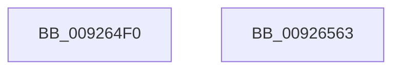

# NtAlpcConnectPort

- RVA: `0x009264F0`–`0x00926564` (길이 `116` bytes)
- VA: `0x00000001409264F0`
- 실행 섹션: `PAGE`
- PDB 이름 있음: `예`; PDB Function 태그: `아니요`
- unwind 정보 RVA: `0x0006C9B8`
- 디코드: `24`개 명령, `116/116` bytes 표시
- 미해석 바이트: `0` (있으면 어셈블리에 `.byte`로 보존)

> 이 문서는 커널 이미지의 기계어와 PDB 기호를 분석해 생성했습니다. 4번과 5번은 함수 원형과 자료형을 바이너리 사용 방식에서 추정한 C 해석이며 원본 소스 복구 결과는 아닙니다.

## 1. Dependencies

- 직접 호출 지점: **1**; 고유 호출 대상: **1**
- 직접 호출자로 확인된 함수: **0**
- RIP 상대 이미지 참조: **0**

### Outgoing calls
- `0x00926559` → [AlpcpConnectPort](AlpcpConnectPort_function_00926C8C.md) (function, `0x00926C8C`)

### Direct callers
- 이 함수 시작 RVA로 연결되는 직접 call은 확인되지 않았습니다. 간접 호출은 완전히 역산할 수 없습니다.

### Static image references
- 디코드된 RIP-relative 메모리 참조가 없습니다.

## 2. Other-region calls and transfers

- 다른 실행 섹션으로 향하는 call: **0**
- 별도 외부 분기/꼬리 이동을 확인하지 못했습니다.

## 3. Assembly (complete function range)

```asm
009264F0  4C 8B DC                        mov r11, rsp
009264F3  48 83 EC 78                     sub rsp, 0x78
009264F7  48 8B 84 24 D0 00 00 00         mov rax, qword ptr [rsp + 0xd0]
009264FF  49 89 43 E8                     mov qword ptr [r11 - 0x18], rax
00926503  48 8B 84 24 C8 00 00 00         mov rax, qword ptr [rsp + 0xc8]
0092650B  49 89 43 E0                     mov qword ptr [r11 - 0x20], rax
0092650F  48 8B 84 24 C0 00 00 00         mov rax, qword ptr [rsp + 0xc0]
00926517  49 89 43 D8                     mov qword ptr [r11 - 0x28], rax
0092651B  48 8B 84 24 B8 00 00 00         mov rax, qword ptr [rsp + 0xb8]
00926523  49 89 43 D0                     mov qword ptr [r11 - 0x30], rax
00926527  48 8B 84 24 B0 00 00 00         mov rax, qword ptr [rsp + 0xb0]
0092652F  49 89 43 C8                     mov qword ptr [r11 - 0x38], rax
00926533  48 8B 84 24 A8 00 00 00         mov rax, qword ptr [rsp + 0xa8]
0092653B  49 89 43 C0                     mov qword ptr [r11 - 0x40], rax
0092653F  49 83 63 B8 00                  and qword ptr [r11 - 0x48], 0
00926544  8B 84 24 A0 00 00 00            mov eax, dword ptr [rsp + 0xa0]
0092654B  89 44 24 28                     mov dword ptr [rsp + 0x28], eax
0092654F  4D 89 4B A8                     mov qword ptr [r11 - 0x58], r9
00926553  4D 8B C8                        mov r9, r8
00926556  45 33 C0                        xor r8d, r8d
00926559  E8 2E 07 00 00                  call 0x140926c8c
0092655E  48 83 C4 78                     add rsp, 0x78
00926562  C3                              ret
00926563  CC                              int3
```

## 4. C-style interpretation (structured pseudocode)

```c
__int64 __fastcall NtAlpcConnectPort(__int64 a1, __int64 a2, __int64 a3, __int64 a4, unsigned int a5, __int64 a6, __int64 a7, __int64 a8, __int64 a9, __int64 a10, __int64 a11)
{
    __int64 result;
    __int64 v_rsp;
    unsigned int v_stack_m50;

    v_rsp = (v_rsp) - (120);
    *(unsigned __int64 *)(v_rsp - 24) = a11;
    *(unsigned __int64 *)(v_rsp - 32) = a10;
    *(unsigned __int64 *)(v_rsp - 40) = a9;
    *(unsigned __int64 *)(v_rsp - 48) = a8;
    *(unsigned __int64 *)(v_rsp - 56) = a7;
    *(unsigned __int64 *)(v_rsp - 64) = a6;
    v_stack_m50 = (unsigned int)((unsigned int)(a5));
    *(unsigned __int64 *)(v_rsp - 88) = a4;
    a3 = 0;
    result = AlpcpConnectPort(a1, a2, a3, a3);
    v_rsp = (v_rsp) + (120);
    return result;
}
```

## 5. (Beta) C Style

```c
int64_t NtAlpcConnectPort(int64_t Arg1, int64_t Arg2, int64_t Arg3, int64_t Arg4, uint32_t Arg5, int64_t Arg6, int64_t Arg7, int64_t Arg8, int64_t Arg9, int64_t Arg10, int64_t Arg11)
{
    int64_t result;
    int64_t local_rsp;
    uint32_t v_stack_m50;

    local_rsp = (local_rsp) - (120);
    *(uint64_t *)(local_rsp - 0x18) = Arg11;
    *(uint64_t *)(local_rsp - 0x20) = Arg10;
    *(uint64_t *)(local_rsp - 0x28) = Arg9;
    *(uint64_t *)(local_rsp - 0x30) = Arg8;
    *(uint64_t *)(local_rsp - 0x38) = Arg7;
    *(uint64_t *)(local_rsp - 0x40) = Arg6;
    v_stack_m50 = (uint32_t)((uint32_t)(Arg5));
    *(uint64_t *)(local_rsp - 0x58) = Arg4;
    Arg3 = 0;
    result = AlpcpConnectPort(Arg1, Arg2, Arg3, Arg3);
    local_rsp = (local_rsp) + (120);
    return result;
}
```

## 6. Execution-region graph

[열기: 2D/3D 그래프와 함수 탐색 컨트롤 패널](../../../control-panel.html?section=page&rva=0x009264F0&view=graph)

- 2D 그래프는 위에서 아래로 흐르고, 3D 그래프는 빈 공간을 드래그해 회전합니다. Shift+드래그는 이동, 휠은 확대·축소, 함수 노드 선택은 대상 보고서 이동입니다.

### Static fallback


